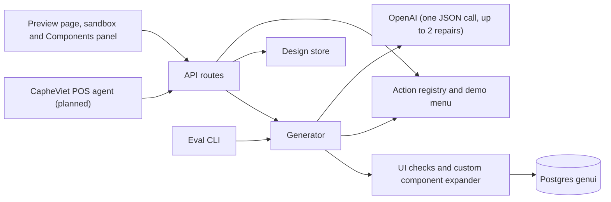

# Update the docs to describe the generator

## Sources

- [Simplify genui plan — R15 and Architecture after](../plans/simplify-to-generator-tool.md#r15-docs-describe-the-generator)

## Context

After `remove-agent-loop`, genui is a one-call generator: `POST /api/generate` runs `generateComponent` (one JSON-mode OpenAI call plus at most two repairs, with every design checked by `checkDesign`), a bounded in-memory design store (500 newest) backs `POST /api/actions/run` (`{ designId, action, values, confirmed? }`), a preview page (prompt box, Generate button, sandbox, Components panel) replaces the chat, custom components are read-only building blocks in Postgres, the eval harness (`npm run eval`) calls the generator directly, and Redis and the `genui_traces` database are gone. Rate limits count in process memory per instance. Config kept: `OPENAI_API_KEY`, `AGENT_MODEL`, `AGENT_MAX_OUTPUT_TOKENS`, `DATABASE_URL`, `AGENT_RATE_LIMIT_PER_MINUTE`, `TRUST_PROXY`, `API_PORT`, `API_HOST`, `LOG_LEVEL`, `API_PROXY_TARGET`. Check commands: `npm run typecheck`, `npm test`, `npm run build`, `npm run build:api`.

Target architecture diagram (use in `docs/ARCHITECTURE.md`):

## Scope

Rewrite `README.md` and `docs/ARCHITECTURE.md` to describe what remains: the generator, its endpoint and `GENERATE_UI_TOOL` (exported from `shared/generate.ts`), the preview page, the design store, the action route, custom components as read-only building blocks, the eval harness, config, and check commands. Read the code first and match what is actually there.

## Acceptance

- Neither file mentions the chat pane, conversations, SSE, the agent loop's caps, `genui_traces` or Redis, except in a history section saying they were removed.
- `README.md` shows a `curl` example for `POST /api/generate` and says how a host agent registers `GENERATE_UI_TOOL`.
- It states that rate limits are per instance and in memory, and that there is no authentication yet.
- The architecture diagrams in `docs/ARCHITECTURE.md` match the diagram above.

## Validation

- `git grep -i -e redis -e genui_traces -e "agent loop" -e SSE -- README.md docs/ARCHITECTURE.md` shows only history-section mentions.
- `npm run typecheck` and `npm test` still pass (no code changes expected).
