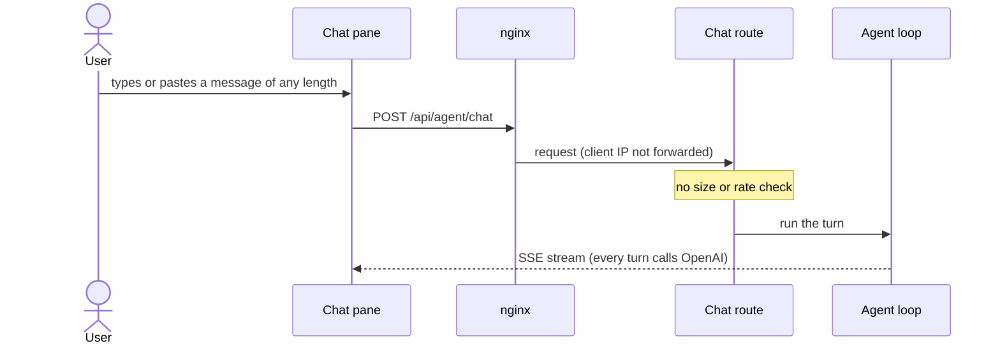
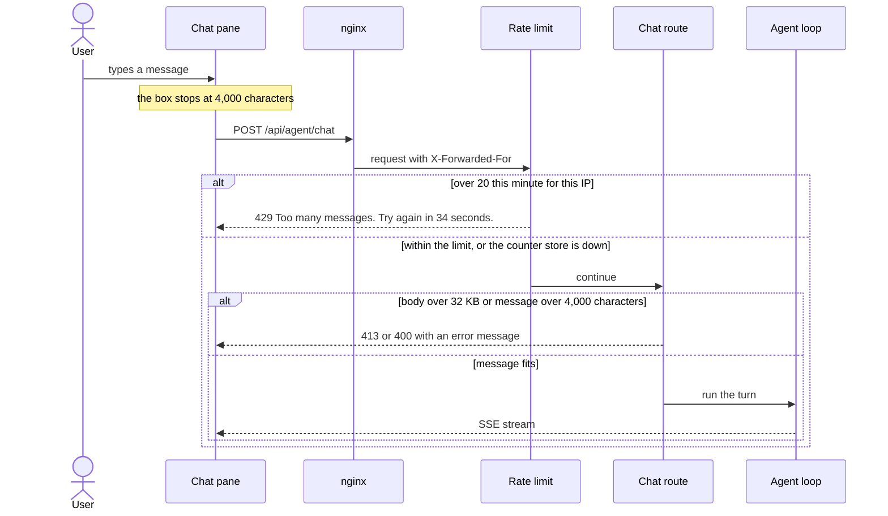
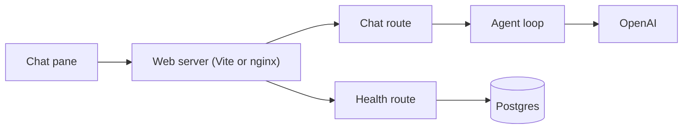
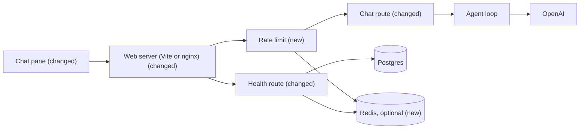

# Cap message size and how often each client can chat

**Branch:** request-limits · **Written:** 2026-10-14 · **Supersedes:** `docs/request-limits.md` (deleted when this shipped) · **Shipped:** merged into main in #25 (`feaba79`)

## Summary

Anyone who can reach the API can send as many chat messages as they like, of any size, and every message costs an OpenAI call. A huge message also stays in the conversation's history, so every later turn pays for it again. This plan caps each message at 4,000 characters and limits each IP address to 20 chat messages a minute. The counts live in memory by default, or in Redis when `REDIS_URL` is set, so they survive restarts and are shared between API instances. It worked when oversized or too-frequent messages get a clear error in the chat before any model call, and the real app keeps working normally under the limits, including while Redis is down.

- **In scope:** a 4,000-character message cap in the chat box and on the server, a 32 KB body limit on the chat route, a per-IP limit of 20 chat messages a minute, forwarding the client IP through nginx, an optional Redis store for the counts, Redis in health, Compose and CI, and the docs.
- **Out of scope:** limits on replies in progress at once, limits on history size, per-user quotas, a daily spend cap, and banning clients.
- **Open decisions:** 3 (see [Open decisions](#open-decisions)), none of which block work.

### Behavior before



### Behavior after



### Architecture before



### Architecture after



### What changes

- The chat pane's textarea stops at 4,000 characters.
- nginx forwards the client IP, and the API trusts one proxy hop in production, so each client gets its own limit.
- A new rate limiter in front of the chat route allows 20 messages a minute per IP and answers 429 past that.
- The chat route rejects messages over 4,000 characters (400) and bodies over 32 KB (413).
- The limiter keeps its counts in Redis when `REDIS_URL` is set, and in memory otherwise.
- Health reports whether Redis answers.

---

## Current state

- **Chat route:** `server/routes/agent.ts` registers `POST /chat` under the `/api/agent` prefix. It requires a non-empty `conversationId` and a `message` that isn't blank, answering 400 `{ error: { message: "conversationId and message are required" } }` otherwise. It trims the message and passes it to `runAgent`. There is no length check and no route `bodyLimit`.
- **Wire contract:** `shared/api.ts` holds `AgentChatRequest` and `AgentEvent`. Today it exports only types.
- **App setup:** `server/index.ts` builds the Fastify instance with only `logger`. It adds a custom `application/json` parser (`parseAs: "string"`, so empty bodies are allowed) and an error handler. It also wires the adapters, registers `healthRouter` at `/api/health` and `agentRouter` at `/api/agent`, runs migrations and the seed in production, listens, and closes on SIGINT and SIGTERM. Because it calls `listen` at the top level, tests can't import it.
- **Error handler** (`server/index.ts:52`): it sends `{ error: { code: "repository", message } }` with `err.statusCode` (500 when missing), and replaces the message with "Internal server error" at 500 and above.
- **Body limit:** Fastify 5.12.6 uses the route's `bodyLimit` ahead of a custom parser's limit (`node_modules/fastify/lib/route.js:381`, `node_modules/fastify/lib/content-type-parser.js:247`). It answers a body that is too large with `FST_ERR_CTP_BODY_TOO_LARGE` (413).
- **Config:** `server/config.ts` is the only file that reads the environment. Its `port()` helper parses positive integers with a fallback.
- **Health:** `server/routes/health.ts` returns `{ ok: true, db, agent }`. `db` comes from an optional `pingDb`, the pattern being `DbHandle.ping()` in `server/adapters/db/client.ts`, which never rejects. There is no health test.
- **Route tests:** `server/routes/agent.test.ts` builds a bare `Fastify()` with only `agentRouter`. It has no error handler, no custom parser, no rate limit and no trust-proxy setting, so it can't check the final error bodies the browser gets.
- **Browser:** `src/main.ts` renders the composer textarea in its `app.innerHTML` template, with no `maxlength`. `src/agentClient.ts` (`errorMessage`) shows `error.message` from any non-OK JSON response as an error line, so new 400, 413 and 429 responses need no client work.
- **Edge:** `nginx.conf` proxies `/api/` to `api:3001` without setting `X-Forwarded-For`. The Vite dev proxy (`vite.config.ts`) adds no forwarding headers. In `docker-compose.yml`, the production `api` service isn't published, only `web` (8080) and `db` (5432) are, and `api-dev` publishes 3001.
- **Per-turn limits:** `server/agent/guardrails.ts` caps steps, tool calls and tokens per turn, but nothing limits how many turns a client sends.
- **Checks:** `.github/workflows/ci.yml` starts a Postgres service and runs `npm ci`, `npm run typecheck`, `npm test`, `npm run build` and `npm run build:api`. Database tests skip without `DATABASE_URL`, and `npm test` runs files one at a time (`--test-concurrency=1`).
- **Libraries:** `@fastify/rate-limit` 11.2.1 is current, and versions 10 and later support Fastify 5. Its default key is `request.ip` with IPv6 grouped by `/64` (`ipv6Subnet: 64`). It sets `retry-after` to `ceil(ttl / 1000)`, then throws whatever `errorResponseBuilder` returns, with `context.ttl` in milliseconds. With `skipOnError: true` it swallows store errors without logging anything (`index.js:300`). It is tested against `ioredis` ^6, and `ioredis` 6.0.0 still has `connectTimeout`, `maxRetriesPerRequest`, `enableOfflineQueue` and `lazyConnect`.

## Requirements

### R1: Chat box length cap

The chat textarea MUST stop at `MAX_MESSAGE_CHARS` (4,000) characters, using the shared constant. This stops the user before the server has to refuse them.

**Acceptance:**

- The textarea in `src/main.ts` has `maxlength` set from `MAX_MESSAGE_CHARS`, which `shared/api.ts` exports.
- In the running app, typing or pasting past 4,000 characters stops at 4,000.

### R2: Server message length check

The chat route MUST answer 400 with `error.message` "Message is too long (max 4000 characters)." when the trimmed message is longer than `MAX_MESSAGE_CHARS`, before the agent runs. The browser limit can be bypassed by calling the API directly.

**Acceptance:**

- A trimmed message of exactly 4,000 characters is accepted and streams.
- A trimmed message of 4,001 characters gets the 400 with that message, and the fake LLM is never called.
- Surrounding whitespace that brings the length over 4,000 doesn't count against the message.
- Length is `string.length` (UTF-16 code units), matching `maxlength`, so an emoji counts as 2.

### R3: Chat body limit

The chat route MUST reject request bodies over 32 KB with a 413 before parsing them. This keeps a giant body out of memory.

**Acceptance:**

- A body of 32 KB or less is parsed as usual, including a 4,000-character message made of 4-byte UTF-8 characters.
- A body over 32 KB gets a 413 with a JSON `error.message`.
- Other routes keep Fastify's default limit.

### R4: Per-IP chat rate limit

`POST /api/agent/chat` MUST allow at most `AGENT_RATE_LIMIT_PER_MINUTE` (default 20) requests per client IP in each one-minute window. Past that, it MUST answer 429 with a `Retry-After` header and `error.message` "Too many messages. Try again in N seconds." (N matches `Retry-After`, and it says "1 second" when N is 1). No other route is limited. Each message costs an OpenAI call, and nothing else limits how many a client sends.

**Acceptance:**

- From one IP, requests 1 to 20 in a window pass and request 21 gets the 429 with `Retry-After` and that message.
- A second IP is still allowed while the first is limited.
- `GET /api/health` is never limited, even after the chat limit is hit.
- `AGENT_RATE_LIMIT_PER_MINUTE` changes the limit, and a missing or invalid value falls back to 20.
- Requests the route later rejects (400, 413) still count, because the limit runs before the body is read.

### R5: Real client IP behind the proxy

The API MUST take the client IP from `X-Forwarded-For` only when `TRUST_PROXY` (a number of proxy hops) is set, and nginx MUST forward the client IP. Without this, every user in production would share one limit of 20.

**Acceptance:**

- With `TRUST_PROXY` unset, a request's IP is the socket address, and an `X-Forwarded-For` header is ignored.
- With `TRUST_PROXY=1`, the limit uses the last `X-Forwarded-For` address, so two different forwarded addresses get separate counts.
- `nginx.conf` sets `X-Forwarded-For` to `$proxy_add_x_forwarded_for` for `/api/`, and the production `api` service in `docker-compose.yml` sets `TRUST_PROXY: "1"`.
- An invalid `TRUST_PROXY` value turns trust off.

### R6: Testable app with the real error shape

The API's Fastify setup (custom JSON parser, error handler, trust proxy, rate limit, routes) MUST be built by a factory that tests can call. The 400, 413 and 429 responses MUST all reach the browser as `{ error: { message } }`. That's the only shape `src/agentClient.ts` shows, and the rate-limit error goes through a path that is easy to get wrong.

**Acceptance:**

- `server/index.ts` calls the factory and keeps only adapter wiring, the production migrate and seed, `listen`, and the signal handling.
- Tests built with the factory check the final JSON bodies of the 400, 413 and 429 responses, each with a string `error.message`.
- Running the API is unchanged otherwise: same routes, same health body before R9, and the same production startup.

### R7: Redis store when configured

When `REDIS_URL` is set, the rate limiter MUST keep its counts in Redis under the `genui-rate-limit:` namespace. Otherwise it keeps them in memory. In-memory counts reset on restart and aren't shared between instances.

**Acceptance:**

- With `REDIS_URL` set, the R4 tests pass against Redis.
- A count survives closing one app and building a new one on the same Redis.
- Keys start with the namespace and expire after their window.
- Without `REDIS_URL`, behavior is exactly R4, and nothing tries to connect to Redis.

### R8: Fail open when Redis is down

When Redis is unreachable, chat requests MUST be let through quickly (`skipOnError`), and the API MUST log a warning. The limiter protects cost, not security, and blocking all chat during an outage would be worse than briefly losing the limit.

**Acceptance:**

- With `REDIS_URL` pointing at a closed port, a chat request still streams. Its limiter step finishes within 1 second (client options `connectTimeout: 500`, `maxRetriesPerRequest: 1`, `enableOfflineQueue: false`).
- A `warn` log names Redis as unavailable, at most once per outage (logged again only after a reconnect), and contains no credentials from the URL.
- The API starts while Redis is down, and recovers without a restart when Redis comes up.

### R9: Redis in health

`GET /api/health` MUST include `redis`: `true` when Redis answers `PING`, `false` when it doesn't, and `null` when `REDIS_URL` isn't set. That's how an operator sees whether limiting is shared.

**Acceptance:**

- The health tests cover all three values, using fake pings.
- The health check never rejects or hangs when Redis is down.

### R10: Redis lifecycle

The API MUST close its Redis client on shutdown, through the existing `onClose` path. That keeps shutdown clean.

**Acceptance:**

- `app.close()` ends the Redis connection, and no open handle keeps the test process alive.

### R11: Compose and CI run Redis

Compose MUST offer a `redis` service, the production `api` MUST use it, and CI MUST run the Redis tests. That way production gets shared counts and the Redis path stays tested.

**Acceptance:**

- `docker-compose.yml` has `redis` (`redis:8-alpine`, `--save "" --appendonly no`, a `redis-cli ping` healthcheck, published `6379`).
- `api` has `REDIS_URL: redis://redis:6379` and waits for `redis` to be healthy.
- `.github/workflows/ci.yml` adds a `redis` service and `REDIS_URL`, so the Redis tests run there and skip locally without `REDIS_URL`.

### R12: Docs

The docs MUST describe the shipped limits and settings, so the next reader doesn't rediscover them from code.

**Acceptance:**

- `docs/ARCHITECTURE.md` covers the message cap, body limit, rate limit, trust proxy and Redis. That includes the overview and production diagrams, §3 health, §7 configuration and §10 limits.
- `.env.example` lists `AGENT_RATE_LIMIT_PER_MINUTE`, `TRUST_PROXY` and `REDIS_URL`, commented, with defaults.
- `README.md` says Redis is optional and how to start it (`docker compose up -d redis`).
- `docs/request-limits.md` is removed, since this plan and the architecture doc replace it.

## Design

### Components

- **`server/app.ts` (new):** `buildApp(deps)` creates Fastify with `logger` and `trustProxy`, and adds the JSON parser and error handler moved unchanged from `server/index.ts`. It registers the rate limiter, then `healthRouter` and `agentRouter`. It does no listening, migrating or signal handling.
- **`server/rateLimit.ts` (new):** registers `@fastify/rate-limit` with `global: false`. It owns the namespace constant, the message builder and the option values, so the route only names its limit.
- **`server/adapters/redis/client.ts` (new):** `createRedis(url, log)` builds the `ioredis` client with fail-fast options, logs outages once, and exposes `ping` and `close`, mirroring `DbHandle` in `server/adapters/db/client.ts`.
- **`server/routes/agent.ts` (changed):** adds `bodyLimit` and `config.rateLimit` to the chat route, and the length check after the existing required-fields check.
- **`server/routes/health.ts` (changed):** adds an optional `pingRedis`.
- **`src/main.ts` (changed):** sets `maxlength` on the textarea from `MAX_MESSAGE_CHARS`.

### Interfaces

- **`shared/api.ts`** (additive): `export const MAX_MESSAGE_CHARS = 4000;`
- **`server/app.ts`:**

```ts
export interface AppDeps {
  logLevel: string;
  /** Proxy hops to trust for the client IP; false trusts none. */
  trustProxy: number | false;
  llm?: AgentLlm;
  tools: ToolRegistry;
  pingDb?: () => Promise<boolean>;
  rateLimit: ChatRateLimitOptions;
  /** Absent when REDIS_URL isn't set. */
  redis?: RedisHandle;
}
export async function buildApp(deps: AppDeps): Promise<FastifyInstance>;
```

  `buildApp` registers `onClose` to call `deps.redis?.close()`. `server/index.ts` keeps its own `onClose` for the database pool.
- **`server/rateLimit.ts`:**

```ts
export const RATE_LIMIT_NAMESPACE = "genui-rate-limit:";
export interface ChatRateLimitOptions {
  max: number;                 // per IP per window
  timeWindowMs?: number;       // default 60_000
  redis?: Redis;               // ioredis client; absent → memory
  nameSpace?: string;          // default RATE_LIMIT_NAMESPACE; tests pass a unique one
}
export async function registerRateLimit(app: FastifyInstance, opts: ChatRateLimitOptions): Promise<void>;
export function tooManyMessages(ttlMs: number): string; // "Too many messages. Try again in N seconds."
```

  The plugin options are `global: false`, `max`, `timeWindow`, `skipOnError: true` (only matters with Redis), `redis`, `nameSpace`, and `errorResponseBuilder: (_req, ctx) => ({ statusCode: 429, message: tooManyMessages(ctx.ttl) })`. `tooManyMessages` uses `Math.ceil(ttlMs / 1000)` with a floor of 1, so it agrees with the plugin's `retry-after`. The chat route sets `config: { rateLimit: {} }` to opt in with the global settings.
- **`server/adapters/redis/client.ts`:**

```ts
export interface RedisHandle {
  client: Redis;
  /** Resolves whether Redis answered PING; never rejects. */
  ping(): Promise<boolean>;
  close(): Promise<void>;
}
export function createRedis(url: string, log: { warn(msg: string): void; info(msg: string): void }): RedisHandle;
```

  The client uses `connectTimeout: 500`, `maxRetriesPerRequest: 1` and `enableOfflineQueue: false`, with the default reconnect strategy. On `error` it calls `warn` once until the next `ready`, with the host only (as in `dbHost` in `server/index.ts`). `close()` calls `quit()`, falling back to `disconnect()`.
- **`server/routes/health.ts`:** `HealthOptions` adds an optional `pingRedis`, typed like `pingDb` (an async check resolving to a boolean). The body becomes `{ ok: true, db, agent, redis }`, where `redis` is `null` without `pingRedis`, the ping result otherwise, and `false` if the ping throws.
- **Chat route:** `POST /api/agent/chat` gets the options `{ bodyLimit: 32 * 1024, config: { rateLimit: {} } }`. The responses:

  | Status | When | Body |
  |---|---|---|
  | 200 | Within the limits | SSE stream, unchanged |
  | 400 | Missing fields (unchanged) | `{ error: { message: "conversationId and message are required" } }` |
  | 400 | Trimmed message longer than 4,000 characters | `{ error: { message: "Message is too long (max 4000 characters)." } }` |
  | 413 | Body over 32 KB | `{ error: { code, message } }` from the error handler |
  | 429 | Over the limit, with `Retry-After` | `{ error: { code, message: "Too many messages. Try again in N seconds." } }` |
- **Config** (`server/config.ts`): `rateLimitPerMinute: port(env.AGENT_RATE_LIMIT_PER_MINUTE, 20)`. `trustProxy`: the positive integer in `env.TRUST_PROXY`, otherwise `false`. `redisUrl: env.REDIS_URL || undefined`. Environment names are `AGENT_RATE_LIMIT_PER_MINUTE`, `TRUST_PROXY` and `REDIS_URL`.
- **nginx** (`/api/` block): `proxy_set_header X-Forwarded-For $proxy_add_x_forwarded_for;`
- **New dependencies:** `@fastify/rate-limit` (^11) and `ioredis` (^6) in `dependencies`, both pinned by `package-lock.json`.

### Data and migrations

No Postgres changes. Redis holds only counter keys, named `genui-rate-limit:` followed by the client IP (or its IPv6 /64 prefix), with a TTL of one window. It has no persistence, and nothing needs migrating or rolling back.

### Errors and edge cases

- **Order:** the limiter runs in `onRequest`, before the body is read. A client over the limit gets a 429 even for a body that would also have gotten a 413 or 400.
- **Fixed window:** a client can send 20 at the end of one minute and 20 at the start of the next. That's acceptable for cost control.
- **Development:** without `TRUST_PROXY`, everything through Vite counts as `127.0.0.1`, so one developer shares one limit with themselves.
- **Shared networks:** IPv6 clients are grouped by `/64`, and people behind one NAT share a limit (D3).
- **Redis outage:** requests pass, `redis` health is `false`, and one warning is logged per outage. In-flight `INCR` commands fail fast instead of queueing.
- **A count expires mid-request:** the plugin handles this, and `tooManyMessages` never says "0 seconds".

### Compatibility and rollout

- Every change is additive for the browser: it already shows `error.message` for any status.
- The health body gains a field, and nothing reads it strictly.
- **Rollout order:** (1) the app factory, with no behavior change; (2) the message cap and the in-memory limit, with nginx and `TRUST_PROXY` shipping in the same change as the limit, so production never runs a limit shared by all users; (3) Redis.
- **Rollback:** unset `REDIS_URL` to drop back to memory, or raise `AGENT_RATE_LIMIT_PER_MINUTE` to loosen the limit without a deploy.

## Security

| Concern | Mitigation | Enforced by |
|---|---|---|
| Unlimited paid OpenAI calls from one client | 20 chat messages per minute per IP, before the body is read | R4 |
| Large messages inflating every later turn's cost | 4,000-character cap on the server, and the textarea cap as a convenience | R1, R2 |
| Memory exhaustion from giant bodies | 32 KB route `bodyLimit`, rejected before parsing | R3 |
| Spoofing `X-Forwarded-For` to dodge the limit | Trust is off by default. In production only nginx reaches the API (its port isn't published), and nginx appends the real peer, so trusting one hop reads the address nginx saw | R5 |
| Turning on `TRUST_PROXY` where clients reach the API directly | Documented as unsafe in `.env.example` and the architecture doc; off unless set | R5, R12 |
| Redis outage becoming a chat outage | Fail open with fast timeouts, and warn so it's noticed; the per-turn limits still apply | R8, R9 |
| Credentials in `REDIS_URL` reaching logs or health | Log the host only; health reports a boolean | R8, R9 |
| Redis key collisions with other users of the same Redis | Fixed namespace; keys expire after one window | R7 |
| New dependencies | `@fastify/rate-limit` is the official Fastify plugin, maintained with Fastify 5 (11.2.1). `ioredis` 6 is the client it's tested against. Both are pinned by the lockfile | R4, R7 |
| Error bodies leaking internals | The existing handler hides messages at 500 and above; the new 4xx messages are fixed strings | R6 |

## Validation

**Workers can run** (no credentials or live services):

- `npm run typecheck`: the app, Vite config and server compile with the factory, plugin and client types.
- `npm test`: the route, app, rate-limit and health tests use fake LLMs and `app.inject` with a `remoteAddress`. The Redis tests skip without `REDIS_URL`, and the fail-open test needs no Redis, since it points at a closed port.
- `npm run build`: the web bundle builds with the shared constant.
- `npm run build:api`: the API bundles with the new dependencies kept external.

**New tests:**

- R1: none automated (`src/main.ts` has no DOM test setup); checked after merge.
- R2: `server/routes/agent.test.ts`. 4,000 characters streams. 4,001 gets the 400 and its message, and the fake LLM isn't called. Padding whitespace doesn't count. A 2,000-emoji (4,000-unit) message passes.
- R3: `server/app.test.ts`. A body just over 32 KB gets a 413 with a string `error.message`. A 4,000 × 4-byte-character message passes.
- R4: `server/rateLimit.test.ts`.
  - The 21st request from `remoteAddress` A gets a 429, with `Retry-After` and "Try again in N seconds".
  - Address B still passes.
  - `/api/health` is never limited.
  - `max` from the options is honored.
  - `tooManyMessages` gives "1 second" and "34 seconds", and never 0.
- R5: `server/rateLimit.test.ts`. With `trustProxy: 1`, two `X-Forwarded-For` values get separate counts. With `false`, the header is ignored. Config parsing of `TRUST_PROXY` is covered where `server/config.ts` is tested, or through a small exported parser.
- R6: `server/app.test.ts`. The 400, 413 and 429 bodies have the `{ error: { message } }` shape, through `buildApp`.
- R7: `server/rateLimit.redis.test.ts` (skips without `REDIS_URL`). It runs the R4 cases with a unique `nameSpace` per run, checks that a count survives a second `buildApp` on the same Redis, and checks the key prefix and TTL.
- R8: `server/adapters/redis/client.test.ts`.
  - With `REDIS_URL` at a closed port, a chat request streams and its limiter step finishes within 1 s.
  - `ping()` resolves `false`.
  - `warn` is called once for repeated errors.
  - The log has no password from the URL.
- R9: `server/routes/health.test.ts`. `redis` is `null` without `pingRedis`, `true` or `false` from a fake ping, and `false` when the ping throws.
- R10: `server/adapters/redis/client.test.ts`. `close()` resolves while disconnected, and the test process exits.

**After merge** (needs credentials, live services, or a person):

- In the dev app, the chat box stops at 4,000 characters, and the 21st message in a minute shows "Too many messages. Try again in N seconds." in the chat.
- `docker compose up web --build`: the API logs show the real client IP, not nginx's, and health shows `"redis":true`.
- `docker compose stop redis`: chat still works, one warning is logged, health shows `"redis":false`, and limiting resumes after `docker compose start redis` without restarting the API.
- CI on the first PR that adds the Redis service runs the Redis tests rather than skipping them.

## Work breakdown

| Slice | Covers | Touches | After | Size |
|---|---|---|---|---|
| app-factory | R6 | server/app.ts, server/app.test.ts, server/index.ts | - | small |
| message-length | R1, R2, R3 | shared/api.ts, src/main.ts, server/routes/agent.ts, server/routes/agent.test.ts, server/app.test.ts | app-factory | small |
| ip-rate-limit | R4, R5 | package.json, package-lock.json, server/rateLimit.ts, server/rateLimit.test.ts, server/app.ts, server/index.ts, server/config.ts, server/routes/agent.ts, nginx.conf, docker-compose.yml | app-factory | medium |
| redis-store | R7, R8, R9, R10, R11 | package.json, package-lock.json, server/adapters/redis/client.ts, server/adapters/redis/client.test.ts, server/rateLimit.ts, server/rateLimit.redis.test.ts, server/app.ts, server/index.ts, server/config.ts, server/routes/health.ts, server/routes/health.test.ts, docker-compose.yml, .github/workflows/ci.yml | ip-rate-limit | medium |
| request-limits-docs | R12 | docs/ARCHITECTURE.md, README.md, .env.example, docs/request-limits.md | message-length, redis-store | small |

`app-factory` goes first: it moves existing setup without changing behavior, and both later slices test through it. Then `message-length` and `ip-rate-limit` run in parallel. Both touch `server/routes/agent.ts`, but in different parts: `message-length` adds the handler's length check and the `bodyLimit` option, and `ip-rate-limit` adds `config.rateLimit` to the same options object. Whichever merges second rebases a one-line overlap. `redis-store` builds on `ChatRateLimitOptions` and `registerRateLimit` from `ip-rate-limit`, and adds the `redis` field to `AppDeps`. The docs go last, so they describe what shipped.

## Non-goals

- Limits on concurrent replies per client or per conversation.
- Limits on conversation history size.
- Per-user quotas, login, or API keys.
- A daily spend cap across all users.
- Banning or blocking clients (the plugin's `ban` option stays off).
- Limiting the containerized dev API (`api-dev`), which keeps the in-memory store.

## Assumptions

- **App factory:** the setup moves into `buildApp` in `server/app.ts`. The route tests build a bare Fastify without the error handler, so the 429 and 413 bodies the browser actually gets can't be tested otherwise.
- **The unused `components` decoration:** `server/index.ts` decorates `app.components`, but nothing reads it. It stays in `server/index.ts` (after `buildApp`) to keep `app-factory` a pure move, and it's listed under Risks.
- **Fail-open warning:** the plugin logs nothing with `skipOnError`, so the warning comes from the Redis client's `error` event. It's logged once per outage instead of once per request, so a long outage doesn't flood the logs.
- **Config parsing:** `AGENT_RATE_LIMIT_PER_MINUTE` reuses the existing `port()` positive-integer parser, and `TRUST_PROXY` accepts only a positive integer (hop count). The doc's "number of proxy hops" rules out `true` and IP lists.
- **`api-dev` gets no Redis:** the request doc gives `REDIS_URL` only to the production `api` service, and "development needs nothing new".
- **`.env.example`:** it's edited only in the docs slice, so the parallel slices don't conflict on it.
- **`docs/request-limits.md` is deleted:** once this ships it would be stale, and the architecture doc becomes the record.
- **The error body keeps its `code` field:** the 413 and 429 go through the existing handler, so they carry `code: "repository"` like every other handler-made error. The browser ignores `code`.

## Risks

- **Wrong shape for the rate-limit body:** the plugin throws a plain object, not an `Error`. Mitigation: the R6 test asserts the final 429 body through `buildApp`, and if Fastify mishandles a plain object, the builder returns an `Error` with `statusCode` set.
- **`TRUST_PROXY` set where the API is directly reachable** (for example `api-dev` publishes 3001): clients could fake their IP. Mitigation: `api-dev` doesn't set it, and the docs warn against it.
- **Users behind one NAT share a limit:** mitigation is the configurable limit; revisit with login (D3).
- **The error handler labels every error `code: "repository"`:** it's misleading for 400, 413 and 429. It's a follow-up outside this plan: set `code` from the status, or drop it.
- **The `app.components` decoration is unused:** a follow-up removes it.
- **Merge overlap in `server/routes/agent.ts`** between `message-length` and `ip-rate-limit`: kept to the route options object, resolved on rebase.
- **ioredis 6 is new (2026-07-31):** mitigation is pinning through the lockfile. The plugin's own tests run against it.

## Open decisions

### D1: Are 20 messages a minute and 4,000 characters the right values?

- **Options:** keep the defaults; tighten them; loosen them.
- **Recommendation:** ship the defaults (both are configurable or a one-line constant). Tune from the per-turn usage log once people use the app.
- **Blocks:** nothing

### D2: Redis or Valkey?

- **Options:** `redis:8-alpine` (AGPLv3 or source-available); `valkey/valkey:8-alpine` (BSD, a drop-in that works with `ioredis` unchanged).
- **Recommendation:** Redis 8, as the request doc proposes. Switching later is a one-line image change in `docker-compose.yml` and `.github/workflows/ci.yml`.
- **Blocks:** nothing

### D3: What about people sharing one IP?

- **Options:** accept a shared limit; raise the limit; add login and per-user quotas later.
- **Recommendation:** accept it for now. A prototype with no login has no better identity than the IP.
- **Blocks:** nothing

## References

- Request: "create a new feature branch for called request-limits then run /d-generate-plans - @docs/request-limits.md"
- `docs/request-limits.md` (deleted when this shipped): the request plan this formalizes.
- [docs/ARCHITECTURE.md](../../docs/ARCHITECTURE.md): §3 API, §4 chat turn, §7 configuration, §9 CI, §10 limits.
- Code: `server/index.ts`, `server/config.ts`, `server/routes/agent.ts`, `server/routes/agent.test.ts`, `server/routes/health.ts`, `server/adapters/db/client.ts`, `server/agent/guardrails.ts`, `shared/api.ts`, `src/main.ts`, `src/agentClient.ts`, `nginx.conf`, `vite.config.ts`, `docker-compose.yml`, `.github/workflows/ci.yml`.
- `node_modules/fastify/lib/route.js` and `node_modules/fastify/lib/content-type-parser.js` (Fastify 5.12.6): a route `bodyLimit` overrides the parser limit.
- `@fastify/rate-limit` 11.2.1 README and `index.js` (npm package, local only): Fastify 5 compatibility, the `ipv6Subnet` default, `retry-after`, `errorResponseBuilder` context, and `skipOnError` behavior.
- `ioredis` 6.0.0 `built/redis/RedisOptions.d.ts` (npm package, local only): the client option names.
