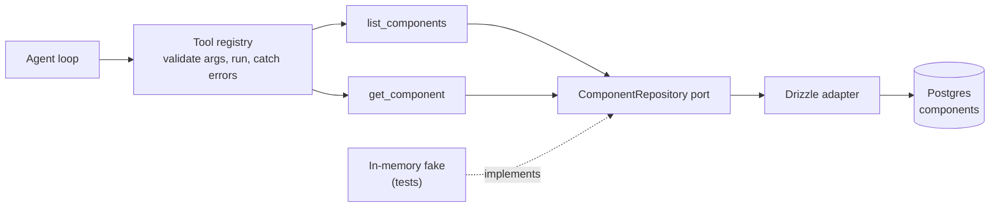

# Plan: Tool registry and component tools

Give the agent its first tools. A tool registry defines which tools exist, checks the model's arguments against each tool's schema, and runs the tool. The first two tools read the component catalog through the existing `ComponentRepository` port, so the agent can check which components exist and what props they take before it describes or composes a UI.

**Status:** shipped, merged into main in #13 (`09c9cf0`) · **Builds on:** [Predefined component catalog and seed](./component-catalog.md)

Related: [Architecture](../../docs/ARCHITECTURE.md) · [Milestones](./README.md)

## Index

1. [Goals and non-goals](#1-goals-and-non-goals)
2. [Target shape](#2-target-shape)
3. [Step 1 — Tool definitions and the registry](#3-step-1--tool-definitions-and-the-registry)
4. [Step 2 — Component tools](#4-step-2--component-tools)
5. [Step 3 — Wiring and the system prompt](#5-step-3--wiring-and-the-system-prompt)
6. [Step 4 — Tests, docs, and checks](#6-step-4--tests-docs-and-checks)
7. [Decisions and open questions](#7-decisions-and-open-questions)

## 1. Goals and non-goals

**Goals**

- One place that defines every tool the agent may call: name, description, input schema, and handler.
- A registry that validates arguments before a handler runs, turns every failure into a result the model can read, and never lets a tool crash the turn.
- Two read-only tools over the component catalog: `list_components` and `get_component`.
- Tools reach the database only through the `ComponentRepository` port, so they can be tested with an in-memory fake and the database stays behind its adapter.

**Non-goals (this plan)**

- Tools that change anything: rendering into the sandbox (`render_ui`), validating a UI tree, or writing components. The catalog is read-only, and rendering needs the UI tree format from the renderer plan.
- A new database adapter. `DrizzleComponentRepository` already implements the port; the catalog plan gives it `list()`, `get(id)`, and `getByName(name)`.
- Confirmation before a tool runs. Read-only tools don't need it; the first tool that changes state will.
- Browser changes. The chat already shows `tool_call` and `tool_result` events as compact lines.

## 2. Target shape



```
server/agent/
├── tools.ts                 # ToolSpec, ToolRegistry (existing), plus ToolDefinition and ToolContext
├── registry.ts              # createToolRegistry(definitions)
├── registry.test.ts
└── tools/
    ├── index.ts             # createAgentTools({ components }): the list of tools the agent gets
    ├── components.ts        # list_components, get_component
    └── components.test.ts
server/ports/
└── fakes/InMemoryComponentRepository.ts   # test fake, built from the seed catalog
```

## 3. Step 1 — Tool definitions and the registry

**A tool definition** (`server/agent/tools.ts`) keeps the existing `ToolSpec` fields and adds the handler:

```ts
export interface ToolContext {
  signal: AbortSignal;          // aborted when the user presses Stop
  log: FastifyBaseLogger;       // the request's logger
}

export interface ToolDefinition {
  name: string;                               // snake_case, unique
  description: string;                        // what it does and when to use it
  input_schema: Record<string, unknown>;      // JSON Schema, closed
  run(args: Record<string, unknown>, ctx: ToolContext): Promise<ToolResult>;
}
```

`ToolRegistry.run(name, args)` gains a third argument, `ctx`, and `handleToolCall` in `server/agent/run.ts` passes the turn's signal and logger. `AgentRun` gains `log`, set by the chat route from `req.log`.

**`createToolRegistry(definitions)`** (`server/agent/registry.ts`) returns a `ToolRegistry`:

- **At startup:** throws if two tools share a name, a name isn't `^[a-z][a-z0-9_]*$`, or an `input_schema` isn't valid JSON Schema with `type: "object"` and `additionalProperties: false`. A broken tool stops the API from starting instead of failing mid-chat.
- **`specs`:** the definitions' `name`, `description`, and `input_schema`, in order. The OpenAI adapter already converts these and omits `tools` when the list is empty.
- **`run(name, args, ctx)`**, in order:
  1. Unknown name → `{ ok: false, summary: "Unknown tool: <name>" }`.
  2. Validate `args` with Ajv (compiled once per tool at startup). Invalid → `{ ok: false, summary: "Invalid arguments for <name>", data: { errors } }`, with each error as a short path and message the model can act on.
  3. Run the handler. If it throws, log the error with the tool name and return `{ ok: false, summary: "<name> failed" }`. Error details stay in the log, not in what the model or the browser sees.
  4. Log the tool name, duration, and `ok` at debug level.
- **Result size:** if `JSON.stringify(data)` is over 16 KB, replace `data` with a note saying it was too large. This keeps one tool from flooding the model's context. The catalog tools stay far below it.

`emptyToolRegistry` becomes `createToolRegistry([])`.

**Done when** the registry tests pass (Step 4) and `npm run typecheck` passes.

## 4. Step 2 — Component tools

Both tools take the repository through `createAgentTools({ components })` and use only the port's read methods.

**`list_components`**

| | |
|---|---|
| Description for the model | "List the predefined UI components you can use, with what each is for. Call this before choosing components." |
| Input | `{ category?: "layout" \| "text" \| "input" \| "display" }` |
| Data | `{ components: [{ name, category, description, children }] }`, from `components.list()`, filtered by category when given |
| Summary | `Listed 12 components` or `Listed 3 layout components` |

The list leaves out `propsSchema` and `exampleProps` so it stays short; the model asks for those with `get_component`.

**`get_component`**

| | |
|---|---|
| Description for the model | "Get one component's props schema and an example. Call this before using a component, so its props are valid." |
| Input | `{ name: string }` (required) |
| Data | `{ name, category, description, children, propsSchema, exampleProps }`, from `components.getByName(name)` |
| Summary | `Read Button` |
| Not found | `{ ok: false, summary: "No component named <name>", data: { available: [<names>] } }`. If a name matches ignoring case, the error says which one, so the model can retry with the right spelling |

**Database errors** (Postgres down, for example) surface as the registry's generic failure (Step 1, rule 3). The model is told the tool failed and can say so; the details go to the log.

**Done when** the component tool tests pass against the in-memory fake, and against Postgres when `DATABASE_URL` is set.

## 5. Step 3 — Wiring and the system prompt

- **`server/index.ts`:** build the registry once with `createToolRegistry(createAgentTools({ components }))`, using the `DrizzleComponentRepository` it already creates, and pass it to `agentRouter` in place of `emptyToolRegistry`.
- **Without Postgres** (dev, API started before the database), the API still starts. The tools exist, and a call returns the generic failure until the database is up.
- **System prompt** (`server/agent/loop.ts`): add two guidelines.
  - Use only the predefined components. Call `list_components` to see them, and `get_component` before relying on a component's props.
  - If no component fits the request, say so instead of inventing one.

**Done when** asking the agent "what components can I use?" in the running app shows a `list_components` call in the thread and a reply that names the seeded components.

## 6. Step 4 — Tests, docs, and checks

**Tests**

- `server/agent/registry.test.ts`: duplicate names, a bad name, and an open or invalid schema are refused at startup; an unknown tool, invalid arguments, and a throwing handler each return `ok: false` with the expected summary; a handler receives the context's signal; oversized `data` is replaced.
- `server/agent/tools/components.test.ts`, using `InMemoryComponentRepository` seeded from the real catalog: listing all and by category; reading one; an unknown name returns the available names; a wrong-case name suggests the right one.
- `server/agent/loop.test.ts`: a scripted model calls `list_components`, then `get_component`, then replies. The history holds both tool results, and the events include `tool_call` and `tool_result` for each.
- The repository tests from the catalog plan already cover the Drizzle side of `list()` and `getByName()`.

**Docs**

- `docs/ARCHITECTURE.md`: the tool registry is no longer empty; list the two tools, and update the overview diagram and "Current limits".
- `daniel-super-secret-workflow/plans/README.md`: list this plan under **Active**.

**Final checks:** `npm run typecheck`, `npm test`, `npm run build`, and `npm run build:api` pass.

## 7. Decisions and open questions

**Decided**

- **Tools use the port, never Drizzle directly.** The existing adapter is enough; tests use an in-memory fake.
- **The registry validates arguments**, with the Ajv instance the catalog plan adds, and every failure becomes a readable `ok: false` result.
- **Read-only tools first.** No confirmation step until a tool changes state.
- **The list is short and the detail is on demand**: `list_components` for choosing, `get_component` for props.

**Open**

1. **Next tools.** `render_ui` and `validate_ui` follow once the renderer plan defines the UI tree format. They need a new SSE event to reach the sandbox.
2. **OpenAI strict mode.** Function calling can enforce the schema on the model's side (`strict: true`), but it requires every property to be listed in `required` (optional ones as nullable). Our own validation covers this for now; strict mode is worth trying once there are more tools.
3. **Search.** With twelve components, listing all of them is cheapest. A `search_components` tool is worth adding if the catalog grows past a few dozen.
