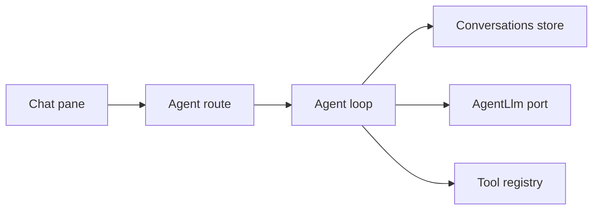
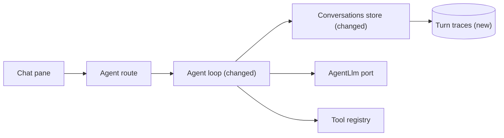

# Record each agent turn as a retrievable trace

**Branch:** eval-harness · **Written:** 2026-10-21 · **Supersedes:** -

## Summary

When something goes wrong in a chat turn, we can see the SSE events in the browser and one usage log line on the server, but we cannot look up what the model did step by step after the turn ends. Tests rebuild that picture by capturing `emit` in a local array; nothing in the product keeps it. This plan records a structured turn trace while the agent loop runs and stores the last five traces on the in-memory conversation, next to history and designs. A later eval harness can assert against that object; this plan does not build evals. It worked when a test can read the completions, tool results, skip reasons and any UI tree from a finished turn, including a turn the user stopped.

- **In scope:** a server-side turn trace type; recording it in the agent loop; storing and retrieving the last five traces per conversation; skip reasons and UI on tool calls; keeping the existing counts-only usage log; architecture doc updates.
- **Out of scope:** an eval harness; recording live OpenAI traffic to disk; a chat UI or HTTP route for traces; OpenTelemetry; changing SSE events or guardrail limits.
- **Open decisions:** none (see [Open decisions](#open-decisions))

### Behavior before

```mermaid
sequenceDiagram
  actor User
  participant Browser
  participant Loop as Agent loop
  participant Store as Conversations store
  User->>Browser: sends a chat message
  Browser->>Loop: POST /api/agent/chat
  Loop->>Store: append history and designs
  Loop-->>Browser: SSE text, tool, and ui events
  Loop->>Loop: info log of counts and endedBy
```

### Behavior after

```mermaid
sequenceDiagram
  actor User
  participant Browser
  participant Loop as Agent loop
  participant Store as Conversations store
  User->>Browser: sends a chat message
  Browser->>Loop: POST /api/agent/chat
  Loop->>Store: append history and designs
  Loop-->>Browser: SSE text, tool, and ui events
  alt the turn finishes or the user stops it
    Loop->>Store: append this turn's trace
  else the conversation already has five traces
    Store->>Store: drop the oldest trace
    Loop->>Store: append this turn's trace
  end
  Loop->>Loop: info log of counts and endedBy
```

### Architecture before



### Architecture after



### What changes

- The conversations store keeps the last five turn traces beside history and designs.
- The agent loop writes one trace per `runAgent` turn while it runs, including a turn that stops with no model calls.
- Trace types live in a new server module; nothing new is sent to the browser.

---

## Current state

- **Loop.** [server/agent/loop.ts](../../server/agent/loop.ts) (`runAgent`, `runTurn`) appends the user message, calls `llm.complete` up to `MAX_STEPS` (10), runs tools through [server/agent/run.ts](../../server/agent/run.ts) (`handleToolCall`), and stops on a reply with no tool calls. Caps and duplicate detection are in [server/agent/guardrails.ts](../../server/agent/guardrails.ts): 20 tool calls per turn, 150,000 tokens, `callKey` for repeats. `EndedBy` is a private type: `reply`, `max_steps`, `tool_budget`, `token_budget`, `stopped`. In a `finally` block the loop logs `{ conversationId, steps, toolCalls, promptTokens, completionTokens, endedBy }` at `info` with message `agent turn finished`.
- **Events.** [shared/api.ts](../../shared/api.ts) defines `AgentEvent` (`text`, `tool_call`, `tool_result`, `ui`, `notice`, `done`, `error`), `ToolCall`, and `ToolResult`. [server/routes/agent.ts](../../server/routes/agent.ts) streams those events as SSE and emits `done` after `runAgent` returns. [src/agentClient.ts](../../src/agentClient.ts) (`streamChat`) forwards events to the chat pane and does not keep a structured trace.
- **History and designs.** [server/agent/conversations.ts](../../server/agent/conversations.ts) holds an in-memory `Map` of conversations (`history`, `designs`). `MAX_CONVERSATIONS` is 500 (LRU). `MAX_DESIGNS_PER_CONVERSATION` is 5. `getHistory` creates the conversation; `getDesign` does not. `rememberDesign` evicts the oldest design. `resetConversation` deletes the entry. Lost on process restart. History is not exposed over HTTP.
- **Model port.** [server/ports/AgentLlm.ts](../../server/ports/AgentLlm.ts) `LlmTurn` has `content`, `toolCalls` (raw `arguments` string), optional `usage` (`promptTokens`, `completionTokens`), and `truncated`. The loop parses arguments with [server/agent/openaiTools.ts](../../server/agent/openaiTools.ts) (`parseToolArguments`) before `handleToolCall`.
- **Tool path.** `handleToolCall` emits `tool_call`, runs the registry, and emits `tool_result`. `showUi` assigns a UUID, calls `rememberDesign`, and emits `ui`. If the run is already aborted it does not run the tool and emits `{ ok: false, summary: "Stopped before this ran." }`. The loop's `skipCall` emits the same pair with `"Tool budget used up"` or `"Already called with these arguments"` without running the tool.
- **Tests.** [server/agent/loop.test.ts](../../server/agent/loop.test.ts) uses a local `scriptedLlm` and captures events via `run.emit`. [server/agent/run.test.ts](../../server/agent/run.test.ts) covers `handleToolCall` and `ui` ids. [server/agent/conversations.test.ts](../../server/agent/conversations.test.ts) covers `oneTurnAtATime`, design eviction, and conversation LRU. Tests call `resetConversation` so state does not leak.
- **Docs and checks.** [docs/ARCHITECTURE.md](../../docs/ARCHITECTURE.md) §4 describes the turn and the usage log; §5 lists history and designs but not traces. CI ([.github/workflows/ci.yml](../../.github/workflows/ci.yml)) runs `npm run typecheck`, `npm test`, `npm run build`, and `npm run build:api`. `npm test` uses a fake model and needs no OpenAI key.

## Requirements

### R1: Trace type

The server MUST define a turn trace whose totals match the usage log fields (`steps`, `toolCalls`, `promptTokens`, `completionTokens`, `endedBy`) and whose `completions` list each model call in order. Tests and a later eval harness need one object, not a reconstruction from history.

**Acceptance:**

- `AgentTrace` includes `conversationId`, `userText`, `endedBy`, `steps`, `toolCalls`, `promptTokens`, `completionTokens`, and `completions`.
- Each completion includes `allowTools`, `content`, `truncated`, optional `usage`, and `toolCalls`.
- Types live in `server/agent/trace.ts`, not on the browser wire in [shared/api.ts](../../shared/api.ts).
- `EndedBy` is exported from that module (`reply`, `max_steps`, `tool_budget`, `token_budget`, `stopped`) so the loop no longer keeps a private copy.

### R2: Store last five traces

The conversations store MUST keep the last five traces per conversation with the same lifetime as history. A sixth turn MUST drop the oldest. Callers MUST be able to read traces without creating a conversation.

**Acceptance:**

- `MAX_TRACES_PER_CONVERSATION` is 5, exported next to `MAX_DESIGNS_PER_CONVERSATION`.
- `rememberTrace(conversationId, trace)` appends; a sixth insert removes the oldest (insertion order, same as designs).
- `getTraces(conversationId)` returns the traces oldest first, or `[]` if the conversation is unknown, and does not create an entry.
- `resetConversation` clears traces with the rest of the conversation.
- Dropping a conversation under `MAX_CONVERSATIONS` drops its traces.
- No HTTP route lists or returns traces.

### R3: Loop records every turn

`runTurn` MUST write one trace in its `finally` block, including turns that stop before any model call. Recording MUST happen while the loop runs, not by parsing history afterwards.

**Acceptance:**

- After `runAgent` returns, `getTraces(conversationId)` has one new trace for that user text.
- A turn aborted before the first `complete` still stores a trace with `endedBy: "stopped"`, `steps: 0`, and `completions: []`.
- A text-only reply stores one completion with `allowTools: true`, the reply `content`, and empty `toolCalls`.
- The forgotten-conversation `notice` emitted before `runTurn` is not a field on the trace.
- If the loop emits an `error` event, the trace has `error` set to that message; otherwise `error` is omitted.

### R4: Tool outcomes on the completion

Each tool the model asked for MUST appear on that completion with the parsed `ToolCall`, the `ToolResult` that was emitted, a skip reason when the tool did not run, and the last `ui` event that tool emitted if any.

**Acceptance:**

- A successful `render_ui` has `skipped` omitted and `ui: { id, tree }` matching the SSE `ui` event.
- A failed `render_ui` (no `ui` event) omits `ui`.
- Skip reasons: `stopped` when the summary is "Stopped before this ran."; `duplicate` when it is "Already called with these arguments"; `budget` when it is "Tool budget used up" (the existing `skipCall` path, including tools-off because of `max_steps` or the token cap).
- `toolCalls` on the trace counts every requested call, including skipped ones, matching the usage log's `toolCalls`.
- Parsed `args` match the SSE `tool_call` event (via `parseToolArguments`), not the raw JSON string kept in history.

### R5: Counts-only usage log

The existing `info` log MUST keep the same fields and MUST NOT include user text, tool arguments, tool results, or UI trees.

**Acceptance:**

- The `finally` log is still `{ conversationId, steps, toolCalls, promptTokens, completionTokens, endedBy }` with message `agent turn finished`.
- Tests that assert that object in [server/agent/loop.test.ts](../../server/agent/loop.test.ts) still pass without adding payload fields.

### R6: Architecture docs

[docs/ARCHITECTURE.md](../../docs/ARCHITECTURE.md) MUST describe the turn trace in the chat-turn section and in the data table.

**Acceptance:**

- §4 says the loop stores a turn trace (completions, skip reasons, optional UI) on the conversation, and that the usage log remains counts-only.
- §5 adds a row for turn traces: in-memory, last five per conversation, lost with the conversation (restart or LRU).
- §8's agent line mentions traces next to conversations and designs.

## Design

### Components

- **`server/agent/trace.ts` (new).** Types and `EndedBy`. No I/O.
- **[server/agent/conversations.ts](../../server/agent/conversations.ts) (changed).** `Conversation` gains `traces: AgentTrace[]` (oldest first). `rememberTrace` and `getTraces` mirror `rememberDesign` / `getDesign`. Creating a conversation initializes `traces` to `[]`.
- **[server/agent/loop.ts](../../server/agent/loop.ts) (changed).** Import `EndedBy` from `trace.ts`. Build a trace during `runTurn` (wrap `emit` for `ui`/`error`; push a completion after each `complete`; push a tool outcome after each `handleToolCall` or `skipCall`). Call `rememberTrace` in the existing `finally`, before or after the info log. Do not change [server/agent/run.ts](../../server/agent/run.ts) or the SSE contract.
- **[docs/ARCHITECTURE.md](../../docs/ARCHITECTURE.md) (changed).** §4, §5, §8 as in R6.

### Interfaces

```ts
import type { ToolCall, ToolResult } from "shared/api";
import type { UiNode } from "shared/ui";
import type { LlmUsage } from "../ports/AgentLlm";

export type EndedBy = "reply" | "max_steps" | "tool_budget" | "token_budget" | "stopped";

export type ToolSkipReason = "budget" | "duplicate" | "stopped";

export interface AgentTraceToolCall {
  call: ToolCall;
  result: ToolResult;
  skipped?: ToolSkipReason;
  ui?: { id: string; tree: UiNode };
}

export interface AgentTraceCompletion {
  allowTools: boolean;
  content: string | null;
  truncated: boolean;
  usage?: LlmUsage;
  toolCalls: AgentTraceToolCall[];
}

export interface AgentTrace {
  conversationId: string;
  userText: string;
  endedBy: EndedBy;
  steps: number;
  toolCalls: number;
  promptTokens: number;
  completionTokens: number;
  completions: AgentTraceCompletion[];
  error?: string;
}

export const MAX_TRACES_PER_CONVERSATION = 5;

export function rememberTrace(conversationId: string, trace: AgentTrace): void;
export function getTraces(conversationId: string): AgentTrace[];
```

`rememberTrace` and `getTraces` are exported from [server/agent/conversations.ts](../../server/agent/conversations.ts). `MAX_TRACES_PER_CONVERSATION` may live there next to `MAX_DESIGNS_PER_CONVERSATION`, with the types in `trace.ts`.

### Data and migrations

No Postgres, no migration, no seed. Traces are another array on the in-memory `Conversation` already described in [docs/ARCHITECTURE.md](../../docs/ARCHITECTURE.md) §5. Rollback is a restart, which already drops history and designs.

### Errors and edge cases

- **Stop before the first completion.** `endedBy` stays `stopped`; still `rememberTrace` from `finally`; `completions` is empty. History still has the user message (today's `runTurn` pushes it before the loop).
- **Stop during a tool.** `handleToolCall` already emits the stopped result; the trace marks that call `skipped: "stopped"`. Later calls in the same step follow the same path.
- **Duplicate and budget skips.** Use the emitted `result.summary` to set `skipped`, so the trace cannot drift from SSE.
- **Unknown conversation.** `getTraces` returns `[]` and does not call `useConversation`.
- **Forgotten resume notice.** Emitted in `runAgent` before `runTurn`; omitted from the trace (R3).
- **Truncation.** `truncated: true` on that completion; the SSE `notice` is unchanged and not copied onto the trace beyond that flag.

### Compatibility and rollout

Additive. Existing SSE events, history shape, design memory, and the usage log fields stay the same. No env vars. No client change. Ship behind the usual PR checks; nothing to turn on.

## Security

| Concern | Mitigation | Enforced by |
|---|---|---|
| Traces hold user text, tool arguments, results, and UI trees | Same in-memory lifetime as conversation history; no new HTTP route; process restart drops them | R2 |
| Full payloads in logs | Usage log stays the five count fields plus `endedBy`; no `userText`, args, or trees at `info` | R5 |
| Unauthenticated API | Do not add a traces endpoint; history is not exposed over HTTP today either | R2 |
| Memory growth | Five traces per conversation, 500 conversations LRU, same as designs | R2 |

## Validation

**Workers can run** (no credentials or live services):

- `npm test`: store eviction and loop recording, including skipped tools and stopped turns
- `npm run typecheck`: trace types compile with the loop and tests
- `npm run build` and `npm run build:api`: existing production builds, no new entry point

**New tests:**

- R1: `server/agent/trace.ts` is imported by store and loop tests; `EndedBy` and the trace fields are asserted by value, not by `as` casts that hide missing keys
- R2: [server/agent/conversations.test.ts](../../server/agent/conversations.test.ts): `getTraces` on an unknown id is `[]` and does not create a conversation (`hasConversation` stays false); six `rememberTrace` calls leave the last five; `resetConversation` then `getTraces` is `[]`
- R3: [server/agent/loop.test.ts](../../server/agent/loop.test.ts): text-only turn; aborted-before-complete turn (`steps: 0`, `endedBy: "stopped"`); `error` set when the model ignores tools-off
- R4: same file: successful `render_ui` includes `ui`; invalid tree omits `ui`; duplicate skip; budget skip; stopped tool
- R5: existing usage-log assertions in that file stay field-for-field equal
- R6: no automated test; the architecture-docs slice edits the file

**After merge** (needs credentials, live services, or a person):

- None. A later eval plan may run live-model checks against this object.

## Work breakdown

| Slice | Covers | Touches | After | Size |
|---|---|---|---|---|
| trace-store | R1, R2 | server/agent/trace.ts, server/agent/conversations.ts, server/agent/conversations.test.ts | - | small |
| loop-record | R3, R4, R5 | server/agent/loop.ts, server/agent/loop.test.ts | trace-store | medium |
| architecture-docs | R6 | docs/ARCHITECTURE.md | loop-record | small |

`trace-store` lands the types and store first so `loop-record` can call `rememberTrace` / `getTraces`. `architecture-docs` waits until the names in code are real. One worker can run them in that order; nothing here is parallel.

## Non-goals

- An eval harness, golden fixtures, or live OpenAI recording.
- Showing traces in the chat UI or on an HTTP route.
- OpenTelemetry or a tracing vendor.
- Changing SSE event types, guardrail constants, or the usage log's field set.
- Persisting traces to Postgres or disk.

## Assumptions

- Five traces per conversation is enough (same cap as remembered designs). Full trees stay on the object; we cap by count, not by stripping fields.
- Types stay on the server (`server/agent/trace.ts`) because traces are not on the wire.
- Skip reasons follow today's `result.summary` strings rather than splitting `tools_off` from the tool-call cap.
- The forgotten-conversation notice stays off the trace because it is emitted before `runTurn`.
- Evals are a separate later plan that reads `getTraces`.

## Risks

- Memory: five traces with UI trees per conversation, times 500 conversations. Mitigation: same bound as designs, which already keep five trees; LRU drops the whole conversation.
- Skip-reason mapping depends on summary strings. Mitigation: R4 tests those exact strings already asserted in [server/agent/loop.test.ts](../../server/agent/loop.test.ts); changing a summary without updating the mapper fails those tests.
- Tests that forget `resetConversation` could see leftover traces. Mitigation: existing tests already reset; new tests do the same.

## Open decisions

None.

## References

- Request: "build an eval harness to test agent functionality" then "work on agent trace for now, skip evals"
- [docs/ARCHITECTURE.md](../../docs/ARCHITECTURE.md) §4 (chat turn, usage log) and §5 (history and designs)
- [server/agent/loop.ts](../../server/agent/loop.ts), [server/agent/run.ts](../../server/agent/run.ts), [server/agent/conversations.ts](../../server/agent/conversations.ts)
- [server/ports/AgentLlm.ts](../../server/ports/AgentLlm.ts), [shared/api.ts](../../shared/api.ts)
- [server/agent/loop.test.ts](../../server/agent/loop.test.ts), [server/agent/conversations.test.ts](../../server/agent/conversations.test.ts)
- Local only: `/d-generate-plans` skill template and `check-plan.sh`
