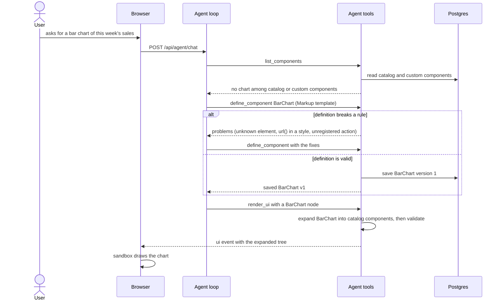
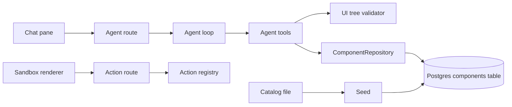
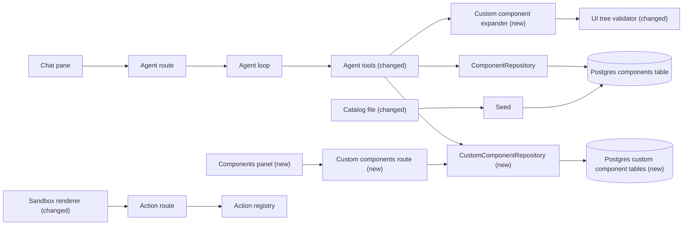

# Let the agent build and reuse its own UI components

**Branch:** custom-components · **Written:** 2026-10-21 · **Supersedes:** -

## Summary

Today the agent can only build designs from the 12 fixed catalog components. When a request needs something else, such as a bar chart, a star rating or a reusable menu card, it says so and offers the closest catalog component. This plan lets the agent define its own components while chatting and save them for every later conversation. It defines them as a template of existing components, or, when nothing existing can draw it, as a block of plain HTML and SVG elements with no scripts. The server turns every custom component back into ordinary components before anything reaches the browser. Buttons inside a custom component can only run actions that are already registered, and the server checks this the same way it checks today's Buttons. An update saves a new version rather than overwriting, and a delete only hides the component, so a new Components panel can preview, delete, restore or roll back any saved component. It worked when the agent can draw a requested bar chart, save a card as `MenuItemCard` and reuse it in a new chat, and a bad edit can be rolled back from the panel.

- **In scope:** custom component definitions (props, template, optional children slot) stored globally in Postgres with versions and soft delete; nesting of custom components; a `Markup` building block for elements no catalog component draws (HTML and SVG, no JavaScript); server-side expansion before validation; `define_component` and `delete_component` tools; custom components in `list_components`, `get_component` and `render_ui`; action and input checks inside custom components; a Components panel with preview, delete, restore and revert; system prompt and architecture doc updates.
- **Out of scope:** JavaScript inside components; generating new actions; authentication and per-user ownership (a separate, later plan); editing definitions by hand in the panel; sharing components between deployments.
- **Open decisions:** none (see [Open decisions](#open-decisions))

### Behavior before

```mermaid
sequenceDiagram
  actor User
  participant B as Browser
  participant A as Agent loop
  participant T as Agent tools
  participant DB as Postgres
  User->>B: asks for a bar chart of this week's sales
  B->>A: POST /api/agent/chat
  A->>T: list_components
  T->>DB: read components table
  DB-->>T: 12 catalog components
  T-->>A: no chart component
  A-->>B: "There is no chart component; here is a list of Text rows instead"
```

### Behavior after



### Architecture before



### Architecture after



### What changes

- New Postgres tables hold custom component definitions and every version of them; the seed never touches them.
- A new `CustomComponentRepository` port, with Drizzle and in-memory adapters, reads and writes them.
- A new expander turns custom component nodes into catalog components before the UI tree validator runs, so the browser only ever receives catalog components.
- The catalog gains one building block, `Markup`, that draws allowlisted HTML and SVG elements; the validator checks it and the sandbox renderer draws it.
- The agent tools gain `define_component` and `delete_component`, and `list_components`, `get_component` and `render_ui` see custom components.
- A new Components panel and route list, preview, delete, restore and revert custom components.

---

## Current state

- **Catalog.** [server/catalog/components.ts](../../server/catalog/components.ts) exports the 12 components; [server/catalog/validate.ts](../../server/catalog/validate.ts) (`validateCatalog`) requires names matching `^[A-Z][A-Za-z0-9]*$`, a non-empty description, a closed object `propsSchema` with a `description` on every property, and valid `default`s and `exampleProps`. Types are in [shared/components.ts](../../shared/components.ts) (`CatalogComponent`, `Component`, `PropsSchema`, categories `layout`, `text`, `input`, `display`; children `none` or `any`).
- **Storage.** [server/adapters/db/schema.ts](../../server/adapters/db/schema.ts) defines only the `components` table. [server/adapters/db/seed.ts](../../server/adapters/db/seed.ts) (`seedComponents`) locks that table, then inserts, updates and deletes rows to match the catalog. Migrations are generated with `npm run db:generate` into [server/adapters/db/migrations](../../server/adapters/db/migrations) and applied at production startup. The read-only port is [server/ports/ComponentRepository.ts](../../server/ports/ComponentRepository.ts) (`list`, `get`, `getByName`), with [server/adapters/db/DrizzleComponentRepository.ts](../../server/adapters/db/DrizzleComponentRepository.ts) and the test fake [server/ports/fakes/InMemoryComponentRepository.ts](../../server/ports/fakes/InMemoryComponentRepository.ts).
- **Tools.** [server/agent/tools/components.ts](../../server/agent/tools/components.ts) has `list_components` (name, category, description, children; optional category) and `get_component` (props schema and example; `didYouMean` on a case mismatch). [server/agent/tools/ui.ts](../../server/agent/tools/ui.ts) (`renderUiTool`) loads the catalog and dropdown values, calls `validateUiTree`, and on success calls `ctx.showUi(tree)`. [server/agent/tools/index.ts](../../server/agent/tools/index.ts) (`createAgentTools`) builds the tool list; [server/index.ts](../../server/index.ts) wires it. [server/agent/registry.ts](../../server/agent/registry.ts) validates tool arguments and cuts any result whose `data` exceeds `MAX_RESULT_DATA_CHARS` (16,384).
- **Validation.** [server/ui/validateTree.ts](../../server/ui/validateTree.ts) checks node shape, catalog names, props against each `propsSchema` (validators cached per name and `updatedAt`), children rules, `MAX_DEPTH` 8 and `MAX_NODES` 100, and bindings: duplicate input names, unregistered Button actions, missing required action inputs, input kinds, password fields, dropdown sources and edit forms. [server/ui/bindings.ts](../../server/ui/bindings.ts) (`collectBindings`) finds named `TextInput`, `Checkbox` and `Select` nodes and Buttons with an `action`. JSON Schema work goes through the shared strict Ajv instance in [server/validation/jsonSchema.ts](../../server/validation/jsonSchema.ts) (`schemaProblem`, `compileSchema`, `formatSchemaErrors`).
- **Designs and clicks.** [server/agent/run.ts](../../server/agent/run.ts) (`handleToolCall`) builds `ToolContext.showUi`, which remembers the tree in [server/agent/conversations.ts](../../server/agent/conversations.ts) (`rememberDesign`) and emits the `ui` event. [server/routes/actions.ts](../../server/routes/actions.ts) runs a click only when [server/ui/checkAction.ts](../../server/ui/checkAction.ts) (`checkActionRequest`) finds an enabled Button for the action in the remembered design and every value fits a named input (`MAX_FIELD_CHARS` 1000 in [shared/api.ts](../../shared/api.ts)); actions with a `confirm` question need `confirmed: true`.
- **Browser.** [src/sandbox/render.ts](../../src/sandbox/render.ts) draws a tree with one function per component from [src/sandbox/components.ts](../../src/sandbox/components.ts), using only `textContent` and named attributes; an unknown name draws a dashed placeholder. A Button gets `data-action` only when enabled with a snake_case action. [src/main.ts](../../src/main.ts) handles clicks on `button[data-action]` inside the sandbox and sends the values of every named `input` and `select` there ([src/sandbox/actionValues.ts](../../src/sandbox/actionValues.ts)). [src/sandbox/componentNames.test.ts](../../src/sandbox/componentNames.test.ts) fails if the catalog and the renderer's names differ. The chat header holds a placeholder session menu.
- **Agent instructions.** [server/agent/systemPrompt.ts](../../server/agent/systemPrompt.ts) says to use only catalog components and, when nothing fits, to say so and offer the closest one; [server/agent/systemPrompt.test.ts](../../server/agent/systemPrompt.test.ts) requires every tool name to appear in the prompt, and only those snake_case names. Each turn allows 20 tool calls, and each completion `AGENT_MAX_OUTPUT_TOKENS` tokens (default 2048, [server/agent/guardrails.ts](../../server/agent/guardrails.ts), [server/config.ts](../../server/config.ts)).
- **Routes.** [server/app.ts](../../server/app.ts) registers routers under `/api/*` with the shared per-IP rate limit (`config: { rateLimit: {} }`).
- **Checks.** CI ([.github/workflows/ci.yml](../../.github/workflows/ci.yml)) runs `npm run typecheck`, `npm test`, `npm run build` and `npm run build:api`, with Postgres and Redis services; repository tests skip without `DATABASE_URL`.

## Requirements

### R1: Global, versioned storage with soft delete

Custom component definitions MUST be stored in Postgres, shared by every conversation, with every saved version kept and deletion only hiding a component. A bad edit or an accidental delete must always be recoverable.

**Acceptance:**

- Saving a new name creates version 1; saving an existing name adds the next version and makes it current; earlier versions stay readable by number.
- Names are unique ignoring case (`MenuCard` and `menucard` cannot both exist).
- Deleting sets a deleted time and keeps every version; restoring clears it. Both report "not found" for an unknown name.
- Saving to a deleted name is refused with a message to restore it first or pick another name.
- Saving is refused past 200 components that aren't deleted, past 500 components in all, or past 20 versions of one component, with a message naming the limit.
- Two saves of one name at the same moment never produce two rows with the same version; the loser gets a "changed while saving, try again" refusal.
- The seed never reads, writes or deletes the custom component tables.

### R2: Definition rules

A definition MUST have a name, description, category, children setting, props schema, example props and template that follow the catalog's rules. Bad definitions must be refused before they are saved, with every problem listed.

**Acceptance:**

- The name matches `^[A-Z][A-Za-z0-9]*$` and is not a catalog name ignoring case (refused: `button`, `Markup`).
- The description is plain text of 1 to 300 characters; category is one of the catalog's four; children is `none` or `any`.
- The props schema passes the same checks `validateCatalog` applies to a catalog entry's `propsSchema` (shared strict Ajv instance, closed object, a description on every property, valid defaults), and `exampleProps` is valid against it.
- The whole definition serializes to at most 8,000 characters.
- All problems are reported together (at most 20), each with a path such as `template.children.1.props.text`.

### R3: Templates, props and the children slot

A template MUST be a tree of catalog components and custom components, where props flow in through placeholders and an optional slot marks where an instance's children go. This lets one definition render differently for each use without any string building.

**Acceptance:**

- A prop value written exactly as `{"$prop": "<name>"}` is replaced by that instance prop's value; `<name>` must be declared in the props schema. A missing optional prop with no default leaves that prop out.
- A node written exactly as `{"$children": true}` is replaced by the instance's children; it may appear only in a `children` array, at most once, and only when the definition's children is `any`. A definition with children `none` that contains a slot is refused.
- At definition time the template is expanded with `exampleProps` and checked as a UI tree (R8 checks, apart from the design-level checks for missing required action inputs and edit forms with nothing to change, which depend on the rest of the design).
- A template has at most 40 nodes and 6 levels, not counting what nested custom components expand to.

### R4: Nesting without cycles

A template MAY use other custom components, up to 3 levels of custom inside custom, and MUST never loop. This lets the agent build on earlier components without making the expansion unbounded.

**Acceptance:**

- A definition using a custom component that does not exist, or is deleted, is refused with its name.
- A definition that would reach itself through the current versions of the components it uses is refused, naming the loop (`A → B → A`).
- Expansion stops with a problem, not a crash or hang, if a loop or a fourth level appears later through another component's update.

### R5: Markup building block

The catalog MUST gain a `Markup` component whose `root` prop is a JSON tree of allowlisted HTML and SVG elements, with no JavaScript, so the agent can draw things no other component can. Markup is used only inside custom component templates.

**Acceptance:**

- An element is `{ "tag", "attrs"?, "style"?, "text"?, "action"?, "children"? }`. Tags, attributes per tag, CSS properties and input types come from one allowlist shared by the server and the browser (Design).
- Refused: any tag or attribute outside the allowlist (including `script`, `style`, `iframe`, `foreignObject`, `use`, `animate`, any `on*` attribute, `href`, `id`, `class`), CSS values containing `url(`, `expression`, `@`, `\`, `<`, or a `position` or `z-index` property, image `src` that isn't `http:` or `https:`, `input type="password"`, and more than 200 elements or 12 levels in one `root`.
- `text`, attribute values and style values may be `{"$prop": "<name>"}`; after substitution they must still pass the same checks, and text is only ever set as text.
- `action` is allowed only on `button`, and names the action the button runs.
- `render_ui` refuses a `Markup` node the agent puts directly in a design, telling it to define a custom component.

### R6: Drawing Markup in the sandbox

The browser MUST draw `Markup` element by element from the shared allowlist, and named controls and action buttons inside it MUST behave like catalog inputs and Buttons.

**Acceptance:**

- Elements are created with `createElement` or `createElementNS` and attributes set one by one; `innerHTML` is never used. Anything outside the allowlist is skipped, even if the server let it through.
- The Markup root is drawn inside a wrapper with `contain: content` and `overflow: hidden`, so nothing in it can cover the chat or the page.
- A `button` with an enabled, snake_case `action` gets `data-action`, so clicks send values exactly as a Button does, including the confirm question.
- Named `input` and `select` elements are sent with the click like catalog inputs; checkboxes send booleans.
- `src/sandbox/componentNames.test.ts` passes with `Markup` in both the catalog and the renderer.

### R7: Only registered actions

Buttons inside custom components MUST be able to run only actions in the registry, checked when a design is rendered and again when a click arrives. The user asked that custom components never gain new powers.

**Acceptance:**

- `collectBindings` also finds named `input`, `select` and action `button` elements inside `Markup` (mapped to `TextInput` with its type, `Select` with its options, `Checkbox`, and Button), so every existing binding check applies to them.
- A design whose expanded tree names an unregistered action, from a catalog Button or a Markup button, is refused by `render_ui`.
- A click is accepted only when `checkActionRequest` finds an enabled button for that action in the remembered expanded design, with values fitting its named inputs, Markup ones included.
- No tool, template or route can register, create or change an action.

### R8: Expansion in render_ui

`render_ui` MUST expand custom components before validating, send only the expanded tree to the browser, and report problems in terms the agent can fix.

**Acceptance:**

- Each custom node's props are checked against its definition's props schema, and its children against its children setting, before expansion; problems use the agent's own path (`tree.children.0.props.price is required`).
- Expansion uses the current version of each custom component; the `ui` event and the remembered design hold the expanded tree, so a design already drawn never changes when a definition is updated or deleted.
- A problem inside the expanded output names the agent's node, the definition and version, and the template path: `tree.children.0 (MenuItemCard v3) template.children.1.props.text must be string`.
- The agent's own tree keeps the 8-level and 100-node limits; the expanded tree may have up to 24 levels and 400 nodes, with Markup elements counted under R5's limits instead.
- A deleted custom component in the agent's tree is refused with a message to restore it in the Components panel or use another component; templates already using it still expand.
- A design using no custom components validates and renders exactly as before.

### R9: define_component tool

The agent MUST be able to create a custom component or save a new version of one with a `define_component` tool.

**Acceptance:**

- Arguments: `name`, `description`, `category`, `children`, `props_schema`, `example_props` and `template`, all required; the result names the saved version.
- A refused definition returns every problem (R2 to R5) and saves nothing.
- Storage limits and deleted names return R1's refusals.

### R10: delete_component tool

The agent MUST be able to hide a custom component with a `delete_component` tool when the person asks.

**Acceptance:**

- `delete_component { name }` soft-deletes it and says it can be restored from the Components panel; an unknown or catalog name is refused.

### R11: Custom components in list_components and get_component

The agent MUST find custom components the same way it finds catalog ones, without results growing past the size cap.

**Acceptance:**

- `list_components` returns the catalog as today plus up to 40 custom components that aren't deleted, each with `custom: true` and its version, ordered by name, with descriptions cut to 200 characters; when more exist it says how many and that `search` narrows them.
- A new optional `search` argument filters custom components by a case-insensitive substring of name or description.
- `get_component` on a custom name returns its props schema, example props, children, version and template; `didYouMean` covers custom names.
- A custom component whose name later matches a catalog name ignoring case is hidden, and the catalog component wins everywhere.

### R12: Agent instructions

The system prompt MUST tell the agent to prefer existing components and to build new ones only when needed, using only registered actions.

**Acceptance:**

- Order of preference: catalog components, then existing custom components, then a new custom component composed from them, then a new component using `Markup` only for what nothing existing can draw.
- The agent defines a component when the person asks to save or reuse a piece of a design, or when a request needs something no existing component draws; it never defines one for a single use that existing components already cover.
- It says in its reply when it created or updated a custom component.
- Buttons in templates use only actions `list_actions` returned; the prompt still forbids inventing action names.
- The old instruction to say nothing fits a chart, table or date picker is replaced; `systemPrompt.test.ts` covers the new sentences and both new tool names.

### R13: Custom components HTTP route

The API MUST expose custom components to the browser for the panel: list, read with preview, delete, restore and revert. It must not allow creating or editing them.

**Acceptance:**

- Endpoints, statuses and bodies as in Design; every endpoint uses the shared per-IP rate limit.
- A name parameter not matching the name pattern returns 400; an unknown name returns 404.
- Revert copies an earlier version into a new current version (R1 limits apply, 409 past them).
- No endpoint accepts a template or props schema.

### R14: Components panel

The browser MUST have a Components panel listing saved custom components, with preview, delete, restore and revert.

**Acceptance:**

- A "Components" button in the chat header opens the panel. It lists each component's name, description, version and last update, with deleted ones shown apart.
- Selecting one shows its example drawn by the sandbox renderer, plus its versions. The preview's buttons never send actions: it is drawn outside the sandbox and has no `data-action`.
- Delete, Restore and "Revert to version n" call the route and refresh the list; failures show the route's message.
- With no custom components, the panel says the agent creates them when asked.

### R15: Documentation

`docs/ARCHITECTURE.md` MUST describe custom components, Markup, the new tools, the route, the panel, the tables and the limits.

**Acceptance:**

- §3, §4, §5 and §10 are updated, the architecture diagram shows the new route and tables, and §10 no longer says the `components` table is the only component data.

### R16: Works without Postgres

The API MUST still start without a database, as today.

**Acceptance:**

- Without `DATABASE_URL`, custom component tools and routes fail on their own with a clear message, and the agent's other tools work as before.

## Design

### Components

- `shared/customComponents.ts` (new): definition and stored types, placeholder shapes, and the limits as exported constants.
- `shared/markup.ts` (new): the Markup element type and the allowlist (tags, attributes per tag, CSS properties, input types, value checks), imported by both the server validator and the browser renderer.
- `server/ports/CustomComponentRepository.ts` (new), `server/ports/fakes/InMemoryCustomComponentRepository.ts` (new), `server/adapters/db/DrizzleCustomComponentRepository.ts` (new).
- `server/ui/markup.ts` (new): `validateMarkup`. `server/ui/validateTree.ts` (changed): calls it for `Markup` nodes. `server/ui/bindings.ts` (changed): walks Markup roots.
- `server/customComponents/definition.ts` (new): `validateDefinition`. `server/customComponents/expand.ts` (new): `expandTree`.
- `server/agent/tools/customComponents.ts` (new): `define_component`, `delete_component`. `components.ts` and `ui.ts` (changed).
- `server/routes/customComponents.ts` (new), registered in `server/app.ts` under `/api/custom-components`.
- `src/customComponentsClient.ts` and `src/customComponentsPanel.ts` (new); `src/main.ts` adds the header button and panel; `src/sandbox/components.ts` adds `Markup`, built by `src/sandbox/markup.ts` (new).

### Interfaces

```ts
// shared/customComponents.ts
export type TemplateValue = unknown | { $prop: string };
export interface TemplateNode {
  component: string;                       // catalog or custom name
  props?: Record<string, TemplateValue>;
  children?: (TemplateNode | { $children: true })[];
}
export interface CustomComponentDefinition {
  name: string;
  description: string;
  category: ComponentCategory;
  children: ComponentChildren;
  propsSchema: PropsSchema;
  exampleProps: Record<string, unknown>;
  template: TemplateNode;
}
export interface StoredCustomComponent extends CustomComponentDefinition {
  version: number;
  versions: number;                        // how many exist
  createdAt: string;
  updatedAt: string;
  deletedAt: string | null;
}
export const MAX_CUSTOM_COMPONENTS = 200;          // not deleted
export const MAX_CUSTOM_COMPONENTS_TOTAL = 500;
export const MAX_CUSTOM_COMPONENT_VERSIONS = 20;
export const MAX_DEFINITION_CHARS = 8000;
export const MAX_DESCRIPTION_CHARS = 300;
export const MAX_TEMPLATE_NODES = 40;
export const MAX_TEMPLATE_DEPTH = 6;
export const MAX_CUSTOM_NESTING = 3;
export const MAX_EXPANDED_NODES = 400;
export const MAX_EXPANDED_DEPTH = 24;

// shared/markup.ts
export interface MarkupElement {
  tag: string;
  attrs?: Record<string, string | number | boolean | { $prop: string }>;
  style?: Record<string, string | { $prop: string }>;
  text?: string | { $prop: string };
  action?: string;                          // button only
  children?: MarkupElement[];
}
export const MAX_MARKUP_ELEMENTS = 200;
export const MAX_MARKUP_DEPTH = 12;
export const MARKUP_TAGS: Record<string, readonly string[]>;     // tag → allowed attributes
export const MARKUP_STYLE_PROPERTIES: readonly string[];
export const MARKUP_INPUT_TYPES: readonly string[];              // text, email, number, date, time, url, tel, checkbox, range
export function markupValueProblem(value: string): string | undefined;
```

Allowlist:
- HTML tags: `div`, `span`, `p`, `strong`, `em`, `small`, `br`, `hr`, `h1` to `h4`, `ul`, `ol`, `li`, `table`, `thead`, `tbody`, `tr`, `th`, `td`, `caption`, `label`, `input`, `select`, `option`, `button`, `img`, `figure`, `figcaption`, `progress`, `meter`.
- SVG tags: `svg`, `g`, `rect`, `circle`, `ellipse`, `line`, `polyline`, `polygon`, `path`, `text`, `tspan`, `title`.
- Attributes, per tag: `title`, `aria-label`, `colspan`, `rowspan`, `alt`, `src`, `width`, `height`, `name`, `type`, `placeholder`, `min`, `max`, `step`, `value`, `checked`, `selected`, `disabled`, `maxlength` (at most `MAX_FIELD_CHARS`), plus SVG geometry and paint attributes (`viewBox`, `x`, `y`, `x1`, `y1`, `x2`, `y2`, `cx`, `cy`, `r`, `rx`, `ry`, `points`, `d`, `fill`, `stroke`, `stroke-width`, `transform`, `text-anchor`, `font-size`, `opacity`).
- Style properties: colors, fonts, spacing, borders, sizes, `display` (`block`, `inline`, `inline-block`, `flex`, `grid`, `none`), flex and grid layout, `gap`, `opacity`, `fill`, `stroke`. No `position`, `z-index` or `transform`.

```ts
// server/ports/CustomComponentRepository.ts
export class CustomComponentError extends Error {
  constructor(readonly code: "limit" | "deleted" | "conflict" | "not_found", message: string);
}
export interface CustomComponentRepository {
  /** Current versions, ordered by name; deleted ones only with includeDeleted. */
  list(opts?: { includeDeleted?: boolean; search?: string; limit?: number }): Promise<{ components: StoredCustomComponent[]; total: number }>;
  /** Current version by exact name (deleted included, with deletedAt). */
  getByName(name: string): Promise<StoredCustomComponent | undefined>;
  getVersion(name: string, version: number): Promise<StoredCustomComponent | undefined>;
  listVersions(name: string): Promise<{ version: number; description: string; createdAt: string }[]>;
  /** Version 1 or the next version. Rejects CustomComponentError (limit, deleted, conflict). */
  save(definition: CustomComponentDefinition): Promise<StoredCustomComponent>;
  /** Resolve false for an unknown name. */
  softDelete(name: string): Promise<boolean>;
  restore(name: string): Promise<boolean>;
}

// server/customComponents/definition.ts
export function validateDefinition(
  definition: unknown,
  ctx: { catalog: Component[]; resolve: (name: string) => Promise<StoredCustomComponent | undefined>; actions: ActionSpec[] },
): Promise<{ ok: true; definition: CustomComponentDefinition } | { ok: false; errors: string[] }>;

// server/customComponents/expand.ts
export interface Expansion {
  tree: UiNode;                             // catalog components only
  errors: string[];                         // instance props, children, deleted, loops, limits
  /** Expanded-tree path prefix → "tree.children.0 (MenuItemCard v3) template" for rewriting validator errors. */
  origins: Map<string, string>;
}
export function expandTree(
  tree: unknown,
  ctx: { catalog: Component[]; resolve: (name: string) => Promise<StoredCustomComponent | undefined> },
): Promise<Expansion>;
```

`validateUiTree(tree, catalog, actions?, choiceValues?, options?: { designChecks?: boolean; maxNodes?: number; maxDepth?: number })`: an additive options argument. `designChecks: false` skips the missing-required-input and edit-form checks (used at definition time); the limits default to today's 100 and 8.

Tools:
- `createAgentTools({ components, actions, listChoices, customComponents? })`: new optional `customComponents: CustomComponentRepository`; without it, behavior is exactly today's.
- `renderUiTool(components, actions, listChoices?, customComponents?)`: checks the agent's tree for direct `Markup` and its own limits, calls `expandTree`, then `validateUiTree` on the expanded tree with the expanded limits, rewrites error paths through `origins`, and passes the expanded tree to `ctx.showUi`.
- `define_component` input schema: `{ name: string, description: string, category: enum, children: enum, props_schema: object, example_props: object, template: object }`, all required, closed. Result `{ ok, summary: "Saved MenuItemCard v2", data: { name, version } }` or `{ ok: false, summary: "Definition has N problems", data: { errors } }`.
- `delete_component` input schema: `{ name: string }`.
- `list_components` gains optional `search: string` (at most 100 characters).

HTTP route, prefix `/api/custom-components`, body limit 1 KB, shared rate limit:
- `GET /` → 200 `{ components: CustomComponentSummary[] }`: name, description, category, version, versions, updatedAt, deletedAt; deleted included; at most 500.
- `GET /:name` → 200 `{ component: StoredCustomComponent, versions: [...], preview: UiNode | null, previewErrors: string[] }`, where the preview is `exampleProps` expanded; 400 bad name; 404 unknown.
- `DELETE /:name` → 204; 404.
- `POST /:name/restore` → 204; 404.
- `POST /:name/revert` with body `{ version: integer }` → 200 `{ version }`; 400 bad body; 404 unknown name or version; 409 limit or deleted.

Errors are `{ error: { message } }` as elsewhere. Panel response types are added to `shared/api.ts` additively.

### Data and migrations

```ts
// server/adapters/db/schema.ts (additions)
custom_components: id uuid pk default random, name text not null, current_version integer not null,
  deleted_at timestamptz null, created_at, updated_at; unique index on lower(name).
custom_component_versions: id uuid pk, component_id uuid not null references custom_components(id),
  version integer not null, description text not null, category text not null (same check as components),
  children text not null (same check), props_schema jsonb not null, example_props jsonb not null,
  template jsonb not null, created_at timestamptz not null default now(); unique (component_id, version).
```

- `npm run db:generate` produces the next migration in `server/adapters/db/migrations`; production applies it at startup through `runMigrations`. Rollback: drop `custom_component_versions`, then `custom_components`; nothing else references them.
- `save` runs in one transaction: lock the component row (or insert it), check the counts, insert the version, update `current_version` and `updated_at`. A unique violation becomes `CustomComponentError("conflict")`.
- Props validators for custom components are compiled once per name and version, the same way `validateTree.ts` caches catalog validators per `updatedAt`.

### Errors and edge cases

- A catalog component added later with a custom component's name: lookups check the catalog first, `list_components` hides the shadowed custom one, and `define_component` refuses that name from then on.
- A custom node in the agent's tree whose name matches neither catalog nor custom components keeps today's "not in the catalog" message, with `didYouMean` over both.
- `$prop` used for a Button `action` or input `name` is allowed; those are checked after substitution, so an instance can only pass a registered action.
- Two instances of one component with fixed input names collide; the existing duplicate-name check reports both paths via `origins`.
- A Markup `select` with no options, or options from a dropdown source, goes through today's choice checks as a `Select`.
- A definition larger than one completion can write: `AGENT_MAX_OUTPUT_TOKENS` (default 2048) can cut tool arguments; the 8,000-character cap keeps a definition near that size, and the after-merge checks confirm it.

### Compatibility and rollout

- All shared type and function changes are additive (new optional parameters and fields), so the slices can merge in any order their dependencies allow.
- The `Markup` catalog entry reaches Postgres only through `npm run db:seed` in development, as with any catalog change; until then `render_ui` refuses Markup templates as "not in the catalog".
- Designs remembered before the change stay valid, because they contain only catalog components.

## Security

| Concern | Mitigation | Enforced by |
|---|---|---|
| A bad edit or delete losing a component | Every update is a new version; delete only hides; restore and revert in the panel | R1, R13, R14 |
| Script injection through agent-written markup | JSON element tree, never HTML strings; one allowlist of tags, attributes and CSS properties shared by server and browser; no `on*`, `href`, `script`, `style`, `foreignObject`, `use` or `animate`; no `url(` in styles; image `src` only `http:` or `https:`; text set only as text; checked at definition, after substitution, and again in the browser | R5, R6 |
| A component covering the chat or the page to trick the person | No `position`, `z-index` or `transform`; the Markup root is drawn inside a contained wrapper with hidden overflow | R5, R6 |
| Custom components running actions beyond the registry | Actions only through Button `action` or Markup button `action`; expanded tree checked against the registry before rendering; clicks checked against the remembered expanded design; confirm questions unchanged; nothing can register actions | R7, R8 |
| Passwords or personal data captured by components | No password inputs in Markup; definitions and values are never logged, only names and versions | R5, R7, R9 |
| Prompt injection through stored definitions | Descriptions are plain text of at most 300 characters; names follow a strict pattern; tool results stay data under the existing prompt rule; templates are returned only by `get_component` | R2, R11, R12 |
| Database growth and expensive renders | Caps on components, versions, definition size, template and markup size, nesting and expanded tree size; loops detected | R1, R2, R3, R4, R8 |
| Panel preview running actions | Preview is drawn outside the sandbox with no `data-action` | R14 |
| Route input | Name pattern, closed body schemas, 1 KB body limit, 400 or 404 on bad input | R13 |
| New dependencies | None: no HTML parser or sanitizer is needed because markup is never HTML text | R5 |

## Validation

**Workers can run** (no credentials or live services):

- `npm run typecheck`: shared types, ports and new parameters line up.
- `npm test`: unit tests below; Postgres repository tests skip without `DATABASE_URL` and run in CI.
- `npm run build` and `npm run build:api`: the browser and API still bundle.
- `npm run db:generate`: produces the migration from the schema without a database.

**New tests:**

- R1: `server/ports/fakes/InMemoryCustomComponentRepository.test.ts` (versions, case-insensitive names, soft delete, restore, limits, deleted-name refusal) and `server/adapters/db/DrizzleCustomComponentRepository.test.ts` (the same cases against Postgres, plus a concurrent save conflict).
- R2, R3, R4: `server/customComponents/definition.test.ts` (name, description, schema and size rules; placeholders; slot rules; template limits; unknown, deleted and looping references; nesting depth) and `server/customComponents/expand.test.ts` (substitution, missing optional props, slot, nesting, loops appearing after an update, origins).
- R5: `server/ui/markup.test.ts` (each refused tag, attribute, style value, input type and limit; substitution re-checked) and `server/ui/validateTree.test.ts` (Markup node checked; `designChecks: false`; custom limits).
- R6: `src/sandbox/markup.test.ts` (the browser's allowlist filter, run on plain objects without a DOM) and `src/sandbox/componentNames.test.ts`.
- R7: `server/ui/bindings.test.ts` and `server/ui/checkAction.test.ts` (Markup inputs and buttons found; unregistered action refused; clicks accepted only for an enabled Markup button).
- R8: `server/agent/tools/ui.test.ts` (expansion before validation, expanded tree sent and remembered, error paths, direct Markup refused, deleted component refused, unchanged behavior without custom components).
- R9, R10, R11: `server/agent/tools/customComponents.test.ts` and `server/agent/tools/components.test.ts` (save, refusals, versions, delete, list cap and search, shadowing, `didYouMean`).
- R12: `server/agent/systemPrompt.test.ts` (new sentences and tool names).
- R13: `server/routes/customComponents.test.ts` (every endpoint and status with the in-memory repository).
- R14: `src/customComponentsClient.test.ts` (request shapes and error messages).
- R16: `server/agent/tools/customComponents.test.ts` (a failing repository gives a clear tool error).

**After merge** (needs credentials, live services, or a person):

- `npm run db:migrate` and `npm run db:seed` on a real database; the seed reports `Markup` added and leaves custom tables alone.
- With `OPENAI_API_KEY`: "a bar chart of this week's sales: Mon 12, Tue 18, Wed 9" makes the agent define a Markup-based chart and render it.
- "Save this card as MenuItemCard", then in a new chat "show three menu item cards" reuses it.
- "Make a form to change a menu item's price as a custom component" builds one whose Save button runs `menu_set_size_price`, and clicking it changes the demo menu after the usual checks.
- Asking the agent to add a script, a link or a full-screen overlay to a component gets a refusal or a design without it.
- Panel: preview, delete, restore and revert a component; the preview's buttons do nothing.
- Check that a definition near 8,000 characters fits in one completion at the default `AGENT_MAX_OUTPUT_TOKENS`.

## Work breakdown

| Slice | Covers | Touches | After | Size |
|---|---|---|---|---|
| custom-component-store | R1 | shared/customComponents.ts, server/ports/CustomComponentRepository.ts, server/ports/fakes/InMemoryCustomComponentRepository.ts, server/ports/fakes/InMemoryCustomComponentRepository.test.ts, server/adapters/db/schema.ts, server/adapters/db/migrations, server/adapters/db/DrizzleCustomComponentRepository.ts, server/adapters/db/DrizzleCustomComponentRepository.test.ts | - | medium |
| markup-component | R5, R6, R7 | shared/markup.ts, server/catalog/components.ts, server/ui/markup.ts, server/ui/markup.test.ts, server/ui/validateTree.ts, server/ui/validateTree.test.ts, server/ui/bindings.ts, server/ui/bindings.test.ts, server/ui/checkAction.test.ts, src/sandbox/markup.ts, src/sandbox/markup.test.ts, src/sandbox/components.ts | - | large |
| custom-component-definitions | R2, R3, R4 | server/customComponents/definition.ts, server/customComponents/definition.test.ts, server/customComponents/expand.ts, server/customComponents/expand.test.ts | custom-component-store, markup-component | large |
| custom-component-render | R8 | server/agent/tools/ui.ts, server/agent/tools/ui.test.ts, server/agent/tools/index.ts | custom-component-definitions | medium |
| custom-component-agent-tools | R9, R10, R11, R12, R16 | server/agent/tools/customComponents.ts, server/agent/tools/customComponents.test.ts, server/agent/tools/components.ts, server/agent/tools/components.test.ts, server/agent/tools/index.ts, server/agent/systemPrompt.ts, server/agent/systemPrompt.test.ts, server/index.ts | custom-component-render | large |
| custom-components-panel | R13, R14 | server/routes/customComponents.ts, server/routes/customComponents.test.ts, server/app.ts, server/index.ts, shared/api.ts, src/customComponentsClient.ts, src/customComponentsClient.test.ts, src/customComponentsPanel.ts, src/main.ts | custom-component-definitions | large |
| custom-components-docs | R15 | docs/ARCHITECTURE.md | custom-component-agent-tools, custom-components-panel | small |

`custom-component-store` and `markup-component` start in parallel; they share nothing. `custom-component-definitions` needs both, the store's types and the Markup validator it calls for templates. After it, `custom-component-render` and `custom-components-panel` run in parallel. `custom-component-agent-tools` follows the render slice because both change `createAgentTools`. The panel and the agent tools slices each add one line to `server/index.ts`: the panel passes the repository to `buildApp`, the tools slice passes it to `createAgentTools`. The Drizzle repository is created once there, by whichever merges first. Docs go last.

## Non-goals

- JavaScript in components, or any script the browser runs from a definition.
- New, generated or changed actions.
- Authentication, per-user ownership or per-user visibility of custom components (see [Authentication](../plans/authentication.md)).
- Editing a definition's template or schema by hand in the panel; edits go through the agent.
- Pinning a design to an older version when it is rendered again; re-rendering uses the current version.
- Hard deletion, or pruning old versions.

## Assumptions

- Authentication arrives later in [its own plan](../plans/authentication.md); this plan doesn't design around its absence. Versions and soft delete are there to recover from bad edits, not as a substitute for logins.
- Names are unique ignoring case, and catalog names win ignoring case, so the agent can't confuse two components that differ only in case.
- A design already drawn keeps the version it was drawn with because the server stores the expanded tree; re-rendering a design uses current versions. This meets "a design keeps the version it was drawn with" without storing versions in trees.
- Templates already using a deleted component keep expanding, so deleting one component doesn't silently break others; only new uses are refused.
- Markup inputs exclude `textarea` and radio buttons, because the sandbox sends only `input` and `select` values and would send a radio group wrong; a `select` covers the radio case.
- Styles use a property allowlist instead of class names, because Tailwind builds only the classes it finds in the source.
- The limits (200, 500 and 20 rows; 8,000 characters; 40 and 6; 3 levels of nesting; 400 and 24; 200 and 12) are starting values chosen to keep `get_component` results under the 16,384-character cap and a definition within one completion.
- Agent-facing tool names `define_component` and `delete_component` follow the existing snake_case tool names.

## Risks

- Large definitions may be cut by the output token limit: the size cap and an after-merge check; raise `AGENT_MAX_OUTPUT_TOKENS` if needed.
- The model may build custom components too eagerly: the prompt's order of preference and its rule against single-use components; the after-merge checks watch for it.
- The allowlist may be too tight for some drawings: start strict and widen it in later changes with tests, never loosen the value checks.

## Open decisions

None.

## References

- Request: "Let the agent define custom components at runtime and reuse them in later designs. A definition is a name, description, props schema, and a template tree built only from catalog components (decide whether custom components may nest other custom components, and how deep), with prop placeholders. New agent tools create/update definitions; list_components, get_component and render_ui see custom components next to the built-in ones. The server expands a custom component into catalog components before validateUiTree and before the ui event, so the browser renderer and sandbox safety rules stay unchanged. Decide storage scope: per conversation (in memory, like designs) or global (a Postgres table beside components that the seed must not delete). Limits: definition size, template depth and node count, no collisions with catalog names, no self-reference, props validated with the shared Ajv instance in server/validation/jsonSchema.ts. Decide how Button action and input name bindings inside a template are checked after expansion. Update docs/ARCHITECTURE.md §3, §4, §5 and §10."
- Decisions from the user in this session: global Postgres storage; the agent through chat plus a browser panel; prefer existing components, build new ones when needed, including ones that draw beyond existing components; markup only, no JavaScript; props with a children slot; versioned updates with soft delete; custom components may only run registered actions.
- [docs/ARCHITECTURE.md](../../docs/ARCHITECTURE.md) §2 to §5 and §10.
- [Authentication](../plans/authentication.md).
