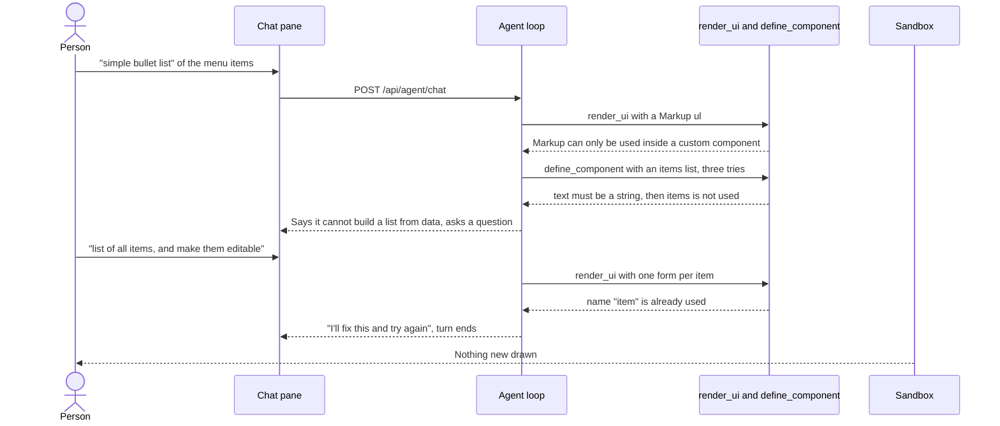
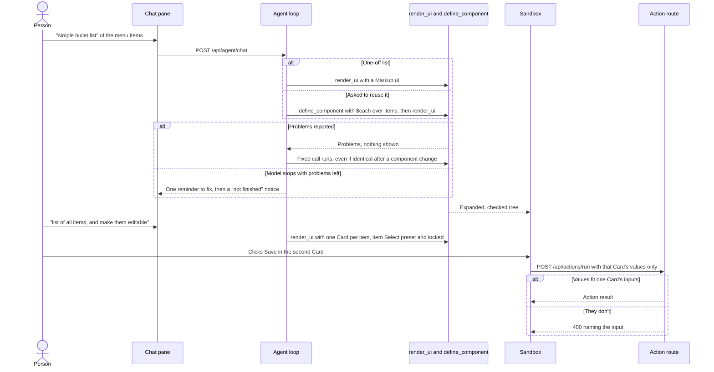
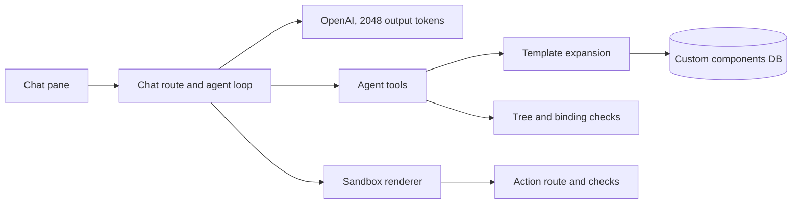
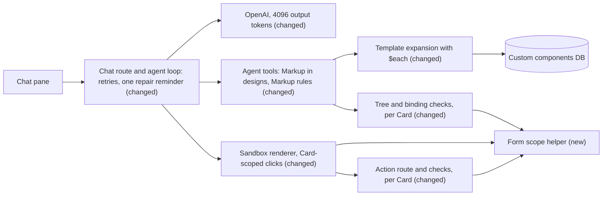

# Reliable component generation: lists, charts and per-item forms

**Branch:** guardrails · **Written:** 2026-10-23 · **Supersedes:** [Reliable custom component generation](../abandoned/custom-component-decision-flow.md)

## Summary

People asking the agent for ordinary things, such as "a simple bullet list" of menu items or "a list of all items, and make them editable", watch it try several times and then give up. The traces saved on 2026-10-23 show why:

- A custom component can't repeat anything over a list it's given, so a list, chart or table built from data can't be saved.
- Markup, the only way to draw something like a bullet, may appear only inside a saved component.
- A button sends every input in the whole design, so two edit forms can't sit side by side.
- A corrected call can be blocked as a "duplicate".
- Markup's rules can't be looked up before trying.
- A turn can end on "I'll fix this and try again" with nothing shown.

This plan fixes each of these and keeps forms on catalog components. We'll know it worked when live evals that never name a tool render lists, charts, ratings and per-item edit cards, reuse saved components, and leave ordinary designs free of Markup.

- **In scope:** `$each`/`$item` repetition in templates, clearer errors for list props, Markup in designs for visuals only, Markup rules from `get_component`, a node-limit hint, Card-scoped forms checked by one shared helper on the server and in the sandbox, Select `value` and `disabled`, retries after a fix, one repair reminder before a turn ends with problems unfixed, the output-token default, matching agent guidance, and need-based, negative and reuse evals.
- **Out of scope:** reply style ([the plain chat plan](../plans/plain-chat-and-new-chat.md)), arithmetic or expressions in templates, nested repetition, bulk actions that save many items in one click, prefilled text fields, a second agent, raising the step, tool or token budgets, and loosening the Markup allowlist.
- **Open decisions:** none (see [Open decisions](#open-decisions))

### Behavior before



### Behavior after



### Architecture before



### Architecture after



### What changes

- Templates can repeat a node or Markup element once per item of a list prop, so saved lists, charts and tables work with any data.
- A design can contain Markup for visuals; its inputs and buttons stay catalog components; `get_component("Markup")` lists exactly what Markup accepts.
- A Button sends only the inputs in its nearest Card, decided by one shared helper that the validator, the action route and the sandbox all call.
- A Select can start on an item and be locked, so a per-item form visibly carries its item.
- The loop re-runs a corrected call after a component changes, and gives one reminder before ending a turn whose design still has problems; that turn ends with a plain notice.
- The default output limit per model call doubles, so a full definition isn't cut off.
- The prompt, tool and catalog descriptions explain all of this; new evals check need-based generation, reuse, and that ordinary designs use no Markup.

---

## Current state

Evidence, from the `genui_traces` database (`agent_traces.payload`, local only), 2026-10-23:

- "simeple bullet list": `render_ui` with a Markup `ul` was refused ("Markup can only be used inside a custom component"). Three `define_component` calls for `ItemBulletList` then failed. The first used `text: {"$prop": "items"}` ("must be a string"). The second used a made-up `"{$each:items}"` string ("items is not used by the template"). The third used `children: {"$prop": "items"}` ("only allowed as a whole prop value…"). The agent replied that it couldn't iterate over arrays and asked a question.
- "create list of all items, and make them editable", then "try again": `render_ui` failed first on `name` patterns, then on "needs an input named \"item\"". Once every form named its fields `item`, `name` and `description`, it failed with 20 "is already used by" errors. One completion said "I'll add this for each item and try again" and the turn ended with no tool call.
- Eval log `eval-logs/2026-10-23T11-29-15.963Z/markup-prop-text.json` (local only): StatusDot needed three `define_component` attempts, failing on `display: inline-flex` and on `attrs.style`.

Code this plan builds on:

- **Template language.**
  - `shared/customComponents.ts` defines `TemplateNode` (its children may hold `{ $children: true }`) and the limits: `MAX_DEFINITION_CHARS` 8000, `MAX_TEMPLATE_NODES` 40, `MAX_EXPANDED_NODES` 400.
  - `server/customComponents/definition.ts` `checkTemplate` allows `{"$prop"}` only as a whole prop value or a Markup `text`, attribute or style value (`placeholder`, `misplaced`, `markup`, `node`), and requires every declared prop to be used. `validateDefinition` expands the template with `exampleProps` and validates the result.
  - `server/customComponents/expand.ts`: `fillTemplate`, `fillMarkup` and `fillValues` substitute placeholders (an undefined fill leaves the key out), and `expandTree` replaces custom nodes.
  - Running `validateDefinition` on a template with Markup `root: {"$prop": "root"}` and a `root: {type: "object"}` prop succeeds. So a saved component can already pass a whole Markup tree in from a design.
- **Markup.**
  - `shared/markup.ts` holds the allowlist constants (`MARKUP_HTML_TAGS`, `MARKUP_SVG_TAGS`, `MARKUP_STYLE_PROPERTIES`, `MARKUP_DISPLAY_VALUES`, `MARKUP_INPUT_TYPES`, `MARKUP_FUNCTIONS`, plus the module-private `UNSAFE_VALUE_PARTS`, `BOOLEAN_ATTRIBUTES` and `NO_TEXT_TAGS`) and `sanitizeMarkup`. The server's `validateMarkup` (`server/ui/markup.ts`) and the browser's `filterMarkup` (`src/sandbox/markup.ts`) both use `sanitizeMarkup`. Per root: 200 elements, 12 levels. Markup attributes can't set `data-*`.
  - `server/ui/validateTree.ts` `validateUiTree` validates every Markup root it meets.
  - `server/agent/tools/ui.ts` `ownTreeProblems` refuses any Markup node in the agent's own tree, and reports `sizeProblems` (100 nodes, 8 levels) for that tree. `server/agent/tools/ui.test.ts` pins the refusal ("refuses Markup in the agent's own tree, even when it is valid").
  - `server/agent/tools/components.ts` `get_component` returns `propsSchema` and `exampleProps` only. The Markup catalog entry (`server/catalog/components.ts`) says its rules are "allowlisted" without listing them, and calls Markup template-only, as does `server/catalog/components.test.ts`.
- **Bindings.**
  - `server/ui/bindings.ts` `collectBindings` returns `inputs` (TextInput, Checkbox, Select, Markup `input`/`select`) and `buttons` (a Button or Markup `button` with an `action`), with their tree paths.
  - `server/ui/validateTree.ts` `bindingProblems` refuses any two inputs with the same name. It checks each action's required properties, and that an edit form has something to change, once per action, against the whole design.
  - `server/ui/checkAction.ts` `checkActionRequest` is called from `server/routes/actions.ts` with the remembered expanded tree (`getDesign`, `server/agent/conversations.ts`). It accepts a value when it fits any input of that name anywhere in the design.
- **Sandbox clicks.**
  - `src/main.ts` `sendAction` reads every `input, select` in the sandbox. It refuses when a named one is hidden (`isHidden`), checks validity, and posts `ActionRunRequest` (`shared/api.ts`).
  - `src/sandbox/render.ts` `draw` walks the tree without paths. In `src/sandbox/components.ts`, `Card` draws a `section`, and `Select` draws an optional disabled placeholder option, with no initial value and no `disabled`.
- **Menu actions.** `server/actions/menu/index.ts`: `menu_update_item` requires `item` (a `menu_items` choice) and edits `name`, `description` and `category`.
- **Loop.**
  - `server/agent/loop.ts` `runTurn` adds every call's `callKey` to `seen` before running it, and skips any later identical call in the turn as "Already called with these arguments". That includes failed calls, and calls made after a component changed.
  - Any completion without tool calls ends the turn (`endedBy: "reply"`). Text streams out as `text` events as it arrives.
  - `server/agent/run.ts` `handleToolCall` returns `{ content, isError }`. `ToolResult` (`shared/api.ts`) is `{ ok, summary, data? }`.
  - `HistoryMessage` (`server/ports/AgentLlm.ts`) has `user`, `assistant` and `tool` roles. `EndedBy` (`server/agent/trace.ts`) is `reply | max_steps | tool_budget | token_budget | stopped`, and `server/eval/loadCases.ts` lists the same values in `ENDED_BY`.
  - The registry (`server/agent/registry.ts`) answers bad arguments with "Invalid arguments for {tool}" and caps result `data` at 16,384 characters (`MAX_RESULT_DATA_CHARS`).
- **Output cap.** `server/agent/guardrails.ts` sets `DEFAULT_MAX_OUTPUT_TOKENS = 2048`, the default for `AGENT_MAX_OUTPUT_TOKENS` (`server/config.ts`). It is asserted in `server/adapters/openai/OpenAILlm.test.ts` and documented in `.env.example` and `docs/ARCHITECTURE.md`.
- **Guidance.** `server/agent/systemPrompt.ts`:
  - Step 3 says "Only for what nothing existing can draw, define a custom component whose template uses Markup".
  - Step 5 says "Names must be unique in the design".
  - The Custom components section says "Markup may only be used inside a template" and "Never define one for a single use that existing components already cover".

  `server/agent/systemPrompt.test.ts` asserts some of these lines. Input `name` descriptions in the catalog say "Unique in the design."
- **Evals.**
  - `server/eval/types.ts` checks include `toolSucceeded`, `toolNotCalled`, `uiText`, `uiMarkupTag`, `uiComponent`, `uiButtonAction`, `uiNamedInput` and `agentComponent`.
  - `server/eval/loadCases.ts` validates case files. `server/eval/runner.ts` `createEvalTools` uses the catalog, an empty `InMemoryCustomComponentRepository`, and the demo and menu actions.
  - Every custom-component case names the component and the tool. `simple-heading`, `catalog-layout`, `closed-alert` and `echo-form` cover catalog-only designs.
- **Checks.** CI (`.github/workflows/ci.yml`) runs `npm run typecheck`, `npm test`, `npm run build` and `npm run build:api`. `npm test` runs `server/**/*.test.ts` and `src/**/*.test.ts` under Node with no DOM library. `npm run eval` (with `--repeat`) needs an OpenAI key.
- **Catalog rollout.** Production seeds the catalog on start (`server/index.ts`); development runs `npm run db:seed`.

## Requirements

### R1: Repetition in templates

A custom component template MUST be able to repeat one node, or one Markup element, for each item of an array prop. The syntax is an entry `{"$each": "<prop>", "as": <node or element>}` in a template node's `children` array or a Markup element's `children` array. Inside `as`, `{"$item": true}` MUST stand for the current item and `{"$item": "<field>"}` for one field of it, wherever `{"$prop"}` is allowed. This is the only way a saved component can draw a list, chart or table from data it is given.

**Acceptance:**

- A `BulletList` with `items: {type: "array", items: {type: "string"}}` and Markup `{"tag": "ul", "children": [{"$each": "items", "as": {"tag": "li", "text": {"$item": true}}}]}` saves. Rendering it with `items: ["A", "B", "C"]` shows three `li` elements with those texts.
- A component-level `$each` expands to one node per item. For example, a Stack whose children are `{"$each": "rows", "as": {"component": "Text", "props": {"text": {"$item": "label"}}}}` gives one Text per row. A row without `label` leaves `text` out, which the catalog check then reports.
- `define_component` refuses, with a path, and saves nothing, when:
  - `$each` names an undeclared prop, or one whose schema `type` isn't `"array"`;
  - the entry has keys other than `$each` and `as`;
  - `as` holds another `$each` (no nesting) or a `{"$children": true}` slot;
  - `$item` appears outside an `as`;
  - `{"$item": "<field>"}` names a field the items schema doesn't declare (when it declares `properties`), or names any field when the items aren't objects;
  - `exampleProps` gives that prop no items ("so the repeated part can be checked").
- A prop used only through `$each` counts as used.
- Expanding an instance whose array has more than `MAX_EACH_ITEMS` (100) items reports `<path>.props.<prop> has <n> items; $each repeats at most 100` and draws nothing. The existing expanded-node and per-root Markup limits still apply after repetition.
- A missing optional array prop (no default) repeats zero times.
- The existing tree checks refuse `$each` in the agent's own `render_ui` tree. The Components panel preview (`server/routes/customComponents.ts`) shows repeated templates without any change of its own.

### R2: Errors that point at repetition

When a template uses an array prop where a single value is expected, `define_component` MUST say how to repeat it. That was the first and third mistake in the bullet-list trace.

**Acceptance:**

- `{"$prop": "<p>"}` as a Markup `text`, attribute or style value, where `<p>` is declared `type: "array"`, adds the problem `… <p> is a list; to repeat over it use {"$each": "<p>", "as": …} in a children array`.
- `children: {"$prop": "<p>"}` (on a node or a Markup element), where `<p>` is an array prop, gets the same hint after the existing "only allowed as a whole prop value…" message.
- A `"{$each:…}"` or `"{{…}}"` string still gets the existing advisory problem.

### R3: Markup in designs

`render_ui` MUST accept Markup nodes in the agent's own tree, checked by the same `sanitizeMarkup` rules as in templates (and by R14). A one-off visual then no longer needs a global saved component; the sanitizer already enforces everything the template-only rule did.

**Acceptance:**

- `render_ui` with `{"component": "Markup", "props": {"root": {"tag": "ul", "children": [{"tag": "li", "text": "A"}]}}}` renders, with no `define_component` call.
- A Markup node in the agent's tree that breaks the allowlist is refused with the same messages as in a template, and nothing is shown. Examples: a `script` tag, `attrs.onclick`, `style.position`, a `javascript:` value.
- The agent's tree size limits (100 nodes, 8 levels) still count each Markup node as one node. Each root keeps its 200-element and 12-level limits.

### R4: Card-scoped bindings in render_ui and define_component

A button with an action (a Button or a Markup `button`) MUST be checked against the named inputs inside its nearest enclosing Card, or against the whole design when it has none. That lets several forms for the same action share input names, one per Card. A single shared function decides scope (Interfaces).

**Acceptance:**

- A design with three Cards, each holding a Select `item`, a TextInput `name` and a Button `menu_update_item`, renders.
- Two inputs with the same name are refused when they have the same nearest Card (or neither has one), with the existing `… "<name>" is already used by <path>`.
- Two inputs with the same name in different Cards are refused when one action button's scope holds both: `<path>.props.name "<name>" is also at <other path>, and the button at <button path> would send both; put each form in its own Card`.
- Each required property of an enabled action button must be named by an input in that button's scope: `<button path> action "<a>" needs an input named "<key>" in its Card, and none has that name`. With no Card, the existing message applies.
- The `edit` check ("changes nothing without an input for one of: …") runs for each enabled action button, against its scope.
- Type and dropdown checks (a Checkbox for booleans, a Select with source values for choice inputs, password fields) stay as they are.
- A design whose only action button sits outside every Card behaves exactly as today.
- The same rules apply when `define_component` checks a template with `exampleProps`, minus the whole-design checks it already skips.

### R5: Card-scoped action requests

`POST /api/actions/run` MUST accept values only when they all fit the inputs of one scope of an enabled button for that action in the remembered design. A click is then checked against exactly what one form could have sent.

**Acceptance:**

- With the three-Card design, values `{item, name}` from the second Card's inputs are accepted.
- These are refused with 400 `This design has no input named "<name>" next to a "<action>" button.`:
  - values that mix input names found only in different Cards;
  - a value whose name exists only outside every scope of that action's enabled buttons.

  Messages name inputs, never values.
- A value that doesn't fit its input is refused as today: a Select option not in that Select's options, a string over 1,000 characters, a non-boolean for a Checkbox. A name that is a password field in the matching scope is refused as today.
- Designs whose action buttons are outside every Card are checked as today (against the whole design).

### R6: Card-scoped clicks in the sandbox

Clicking an action button MUST read, check and send only the named inputs inside the button's nearest Card, or the whole design when it has none. The scope MUST come from the same shared function the server uses, applied to the shown tree, so the browser and server can't disagree. Without this, same-named fields in other Cards would overwrite each other in `values`.

**Acceptance:**

- Clicking Save in the second of three item Cards sends that Card's `item` and `name` only.
- The hidden-field refusal and the browser's required-field validation apply to the fields being sent, not to fields in other Cards.
- Each drawn control and action button carries its tree path in a `data-path` attribute. `sendAction` keeps the controls whose path the shared function puts in the clicked button's scope. Markup can't set `data-*`, so it can't forge a path.
- Paths count Markup children as they appear in the received tree, so they match the server's paths.
- The confirm flow (Yes resends the first click's values) is unchanged.

### R7: Preset and locked Select

The Select component MUST take an optional `value` (the option it starts on) and an optional `disabled` (shown greyed out, can't be changed, still sent). A per-item form can then visibly fix which item it edits without a hidden field.

**Acceptance:**

- `{"component": "Select", "props": {"label": "Item", "name": "item", "options": ["Bạc xỉu"], "value": "Bạc xỉu", "disabled": true}}` renders greyed out, showing Bạc xỉu. A click on its Card's action button sends `item: "Bạc xỉu"`.
- `render_ui` refuses a `value` that isn't one of the Select's `options` (`<path>.props.value "<v>" is not one of its options`), and a disabled Select without a `value` (`<path> a disabled Select needs a value`).
- With `value` set, a `placeholder` option is still drawn but not selected.
- The server action check is unchanged: a sent Select value must be one of its options.

### R8: Output limit fits a full definition

`DEFAULT_MAX_OUTPUT_TOKENS` SHOULD be 4096. A definition at the 8,000-character cap is roughly 2,000 to 2,700 tokens, which a 2,048-token cap can cut off mid-call.

**Acceptance:**

- With no `AGENT_MAX_OUTPUT_TOKENS`, the OpenAI request sends `max_completion_tokens: 4096`; a set value still wins.
- `.env.example` and `docs/ARCHITECTURE.md` show 4096.

### R9: Agent guidance matches the new abilities

The system prompt, `define_component`'s descriptions and the catalog descriptions MUST teach five things. The traces show the agent reaching for exactly these and being told no, or settling for less.

- **When to use Markup:** catalog components when they show what was asked. Markup when the person asks for a visual or look they can't produce, such as a chart, a rating or a specific style; a rough approximation isn't enough.
- **One-off or reusable:** Markup goes directly in the design for a one-off. A component, with `$each` for list data, is for reuse or repeated parts.
- **Forms:** each form goes in its own Card, and names are unique within a Card.
- **Per-item edits:** a form that edits one existing item uses a preset, locked item Select.
- **Large lists:** for many repeated forms, use a reusable item card component or one form with an item dropdown.

**Acceptance:**

- Step 3 replaces "Only for what nothing existing can draw…" with the first two rules above. Catalog components stay first.
- The Custom components section no longer says "Markup may only be used inside a template", and gives one short `$each` example. "Never define one for a single use that existing components already cover" stays.
- Step 5 states the form, item-Select and large-list rules, and that Markup inputs and buttons only belong in templates.
- `define_component`'s `template` description documents `$each`, `as` and `$item` with one example.
- In the catalog:
  - the Markup entry no longer says "Only used inside custom component templates", and says to call `get_component` for its rules;
  - input `name` descriptions say "Unique within its Card";
  - Card's description says a Button sends the inputs inside its Card;
  - Select's `value` and `disabled` descriptions explain the item lock.
- `server/agent/systemPrompt.test.ts` and `server/catalog/components.test.ts` assert the new wording, and that the old template-only and "nothing existing can draw" wording is gone.

### R10: Need-based live evals

The eval suite MUST include cases that need repetition, direct Markup or Card forms without naming tools, components or Markup, plus a check for keys in a saved definition.

**Acceptance:**

- New check `{ "definedWithKey": "<key>" }` passes when the arguments of a successful, not-skipped `define_component` call contain that key at any depth. `server/eval/loadCases.ts` accepts it and rejects a non-string.
- New cases:

  | Case | Prompt | Checks |
  |---|---|---|
  | `bullet-list-items` | "Show these as a simple bullet list: Espresso, Latte, Mocha." | `endedBy: reply`, `noError`, `toolSucceeded: render_ui`, `uiMarkupTag: li`, `uiText: Mocha` |
  | `revenue-bar-chart` | "Show monthly revenue as a bar chart: Jan $1,200, Feb $900, Mar $1,500." | `endedBy: reply`, `noError`, `toolSucceeded: render_ui`, `uiComponent: Markup`, `uiText: Mar` |
  | `reusable-name-list` | "Make a list I can reuse for any set of names, then show it with Ana, Bo and Cy." | `toolSucceeded: define_component`, `definedWithKey: $each`, `toolSucceeded: render_ui`, `uiText: Cy` |
  | `per-item-edit-cards` | "Show each menu item in its own card with a form to rename it." | `endedBy: reply`, `noError`, `toolSucceeded: render_ui`, `uiComponent: Card`, `uiButtonAction: menu_update_item`, `uiNamedInput: item` |

- Case-loading tests cover the new files and check kind.

### R11: Retries after a fix

The loop MUST run an identical tool call again when a write has succeeded since the earlier one, and MUST NOT repeat an identical successful write in the same turn. Fixing a component has to let the same `render_ui` go through, without letting a repeated save create a needless version.

**Acceptance:**

- Regression, using the real tools and a fake model:
  1. Save a component whose optional `title` fills a Heading's required text.
  2. Render an instance with no title; the render fails.
  3. Redefine the component so `title` has a default.
  4. Send the identical render; it now runs and succeeds.
- An identical `get_component` or `list_components` after a successful `define_component` or `delete_component` runs again.
- An identical call with no successful write in between is still skipped as "Already called with these arguments", whether the earlier one passed or failed.
- An identical `define_component` after it already succeeded in this turn is skipped, even after another write, and the repository holds one new version.
- Skipped calls still count toward `MAX_TOOL_CALLS_PER_TURN`, and the trace records them as `duplicate`.

### R12: Markup rules from get_component

`get_component("Markup")` MUST return what the validator accepts, derived from the constants `sanitizeMarkup` uses, so the agent doesn't have to guess.

**Acceptance:**

- The result's `data.rules` lists:
  - the HTML tags, with their attributes beyond the common `title` and `aria-label`;
  - the SVG tags with their attributes;
  - the style properties, the `display` values, the `input` types, and the functions values may call;
  - the substrings values must not contain, the boolean attributes, and the tags that take no `text`;
  - the limits (200 elements, 12 levels, 1,000 text characters, 200 characters per value).
- It also gives short notes (style keys are kebab-case and go in `style`, `img src` must be http(s), no `position`, `z-index` or CSS `transform`), the `{"$prop"}`, `$each` and `$item` syntax, and one valid example.
- A test fails if any allowlisted tag, attribute, style property, display value, input type or function is missing from `rules`.
- The whole result is under `MAX_RESULT_DATA_CHARS`, so the registry doesn't replace it with a truncation note.
- Other components' results are unchanged.

### R13: One repair reminder before ending unfinished

When the model ends a turn with text while its last design or component still has reported problems, the loop MUST remind it once to fix them and continue. If the reminder doesn't help, the turn MUST end with a notice that the work isn't finished. Text written in that state MUST NOT reach the chat before the loop decides. Today, recovery depends only on the prompt, and trace 2 ended on a promise to retry.

**Acceptance:**

- `ToolResult` gains `retryable?: true`, set on:
  - `render_ui` "UI has N problems";
  - `define_component` "Definition has N problems";
  - the registry's "Invalid arguments for {tool}".

  It isn't set on "Custom components are unavailable", `CustomComponentError` refusals, unknown tools, or a throwing handler.
- A turn is *unfinished* when one of these holds:
  - the latest `render_ui` call in the turn was retryable;
  - the latest `define_component` call was retryable, and no `render_ui` has succeeded since.
- While unfinished, a completion's text is held. If the completion has tool calls, the held text is emitted when it ends.
- If an unfinished completion has no tool calls, the reminder hasn't been used, and the next completion may use tools, the loop drops the held text from the chat (it stays in history) and appends a system message: `Your last {tool} call reported problems, so nothing was shown or saved. Fix them and call {tool} again now. If you need to ask the person something first, reply with only that question.` It then continues.
- If the turn is still unfinished when the model replies with text again, or when no reminder is possible, the loop emits the held text and then a `notice` saying "This isn't finished: the last design still had problems." The trace's `endedBy` is `unresolved`.
- At most one reminder per turn. Reminders use the existing step, tool and token budgets, which don't change.
- Stop still ends the turn at once. A text reply with no unfinished build (an answer, a question, a successful save-only request) ends the turn as today.
- `HistoryMessage` gains a `system` role. `EndedBy`, and the eval's `ENDED_BY`, gain `unresolved`. The trace records `repairReminders` (0 or 1).

### R14: Markup in designs is for visuals only

`render_ui` MUST refuse Markup `input`, `select` and `button` elements in Markup nodes of the agent's own tree; templates keep them. Forms in designs then always use catalog components, with their styling and checks, and Markup stays a drawing tool.

**Acceptance:**

- A design with a Markup node whose root holds an `input` at any depth is refused: `<path> Markup input can't be used directly in a design; use TextInput, Checkbox, Select or Button, or put it in a custom component template`. The same applies to `select` and `button`.
- A custom component whose template has a Markup form (as in the existing `ui.test.ts` Markup form case) still renders.

### R15: Node-limit hint

When the agent's own tree is over 100 nodes, `render_ui` MUST say how to get under the limit. Per-item cards for a long menu reach the limit fast, but a saved component counts as one node.

**Acceptance:**

- The problem reads: `tree has <n> nodes (max 100); put the repeated part in a custom component, where each use counts as one node`.
- The expanded-tree limit message (400 nodes) is unchanged.

### R16: Negative, reuse and rating evals

The eval suite MUST check that ordinary requests stay on catalog components, that a fitting saved component is reused rather than duplicated, and that a requested visual gets Markup. That needs a check for a component's absence and a way to seed saved components.

**Acceptance:**

- New check `{ "noUiComponent": "<Name>" }` passes when the last successful `render_ui` tree doesn't contain that component, and fails when there was no such render.
- `simple-heading`, `catalog-layout`, `closed-alert` and `echo-form` gain `noUiComponent: Markup` and `toolNotCalled: define_component`.
- `EvalCase` gains an optional `customComponents` list of definitions. The runner checks each with `validateDefinition` and saves it into the run's in-memory repository before the turn. An invalid seed fails the case with `seed <name>: <first problem>`. `loadCases.ts` rejects a non-array.
- New cases:

  | Case | Setup and prompt | Checks |
  |---|---|---|
  | `reuse-saved-card` | Seeds `MenuItemCard` (a Card with a Heading `name` and a Text `price`). Prompt: "Show the Latte at $4.50 using our saved menu item design." | `toolNotCalled: define_component`, `agentComponent: MenuItemCard`, `uiText: $4.50` |
  | `star-rating` | Prompt: "Show a 4 out of 5 star rating for the Latte." | `endedBy: reply`, `noError`, `toolSucceeded: render_ui`, `uiComponent: Markup` |

- Runner and case-loading tests cover seeding, an invalid seed and the new check.

## Design

### Components

- **Template repetition** (`server/customComponents/definition.ts`, `server/customComponents/expand.ts`):
  - `checkTemplate` gains an `each` branch for `$each` entries in node and Markup children, plus an "inside `as`" flag that makes `$item` legal there. The R2 hints go in `placeholder` and `misplaced`.
  - Expansion threads an optional current item through `fillTemplate`, `fillMarkup` and `fillValues`. A `$each` entry becomes zero or more filled copies of `as`, spliced into the children array in order, before slots and child expansion.
- **Designs** (`server/agent/tools/ui.ts`): `ownTreeProblems` drops the Markup refusal, adds the R14 walk over each Markup root for `input`, `select` and `button`, and rewrites the node-count problem with the R15 hint.
- **Markup rules** (`shared/markup.ts`, `server/agent/tools/components.ts`): a `markupRules()` built from the module's constants. `get_component` adds it as `data.rules` when the name is `Markup`.
- **Form scope** (`shared/formScope.ts`, new): one function that maps a tree path to its nearest Card path. It is used by:
  - `collectBindings` (`server/ui/bindings.ts`), which records each input's and button's `card`;
  - `bindingProblems` (`server/ui/validateTree.ts`);
  - `checkActionRequest` (`server/ui/checkAction.ts`);
  - the sandbox (`src/main.ts`).
- **Sandbox** (`src/sandbox/render.ts`, `src/sandbox/components.ts`, `src/main.ts`):
  - `draw` passes each node's path to its renderer. Controls and action buttons get `data-path`; Markup elements get their path under `props.root`.
  - `main.ts` keeps the shown tree next to `shownUiId`, passes the clicked button to `sendAction`, and filters controls with the shared function.
  - `Select` applies `value` and `disabled`.
- **Loop** (`server/agent/loop.ts`, `server/agent/registry.ts`, `server/agent/run.ts`):
  - `ToolDefinition.writes` marks `define_component` and `delete_component`.
  - `runTurn` keeps `seen`, cleared after each successful write, and `written`, which is never cleared.
  - `runTurn` tracks the latest `render_ui` and `define_component` outcome for R13.
  - `handleToolCall` returns `ok` and `retryable` alongside `content`.

### Interfaces

Shared types (all additive):

```ts
// shared/customComponents.ts
/** In a template or Markup children array: one copy of `as` per item of array prop `$each`. */
export interface EachEntry<T> {
  $each: string;
  as: T;
}
/** Inside an EachEntry's `as`: true is the item itself, a string is one field of it. */
export interface ItemPlaceholder {
  $item: true | string;
}
export const MAX_EACH_ITEMS = 100;
// TemplateNode.children becomes (TemplateNode | { $children: true } | EachEntry<TemplateNode>)[]

// shared/markup.ts
export function isItemPlaceholder(value: unknown): value is Record<string, unknown>; // has "$item"
export function isEachEntry(value: unknown): value is Record<string, unknown>; // has "$each"
export interface MarkupRules {
  htmlTags: Record<string, readonly string[]>; // attributes beyond commonAttributes
  commonAttributes: readonly string[];
  svgTags: Record<string, readonly string[]>;
  styleProperties: readonly string[];
  displayValues: readonly string[];
  inputTypes: readonly string[];
  functions: readonly string[];
  forbiddenInValues: readonly string[];
  booleanAttributes: readonly string[];
  noTextTags: readonly string[];
  limits: { elements: number; depth: number; textChars: number; valueChars: number };
  notes: readonly string[];
  example: MarkupElement;
}
export function markupRules(): MarkupRules;

// shared/formScope.ts (new)
/**
 * Path of the nearest Card containing the node or Markup element at `path`
 * ("tree.children.0.props.root.children.1"), or undefined when none does.
 */
export function nearestCard(tree: unknown, path: string): string | undefined;
/** Whether the input at `inputPath` is sent by the action button at `buttonPath`. */
export function sendsInput(tree: unknown, buttonPath: string, inputPath: string): boolean;

// shared/api.ts
export interface ToolResult { /* existing */ retryable?: true }
```

Server:

```ts
// server/ui/bindings.ts: additive fields, filled with nearestCard
export interface NamedInput { /* existing */ card?: string }
export interface ActionButton { /* existing */ card?: string }

// server/agent/tools.ts
export interface ToolDefinition { /* existing */ writes?: true }
export interface ToolRegistry { /* existing */ writes(name: string): boolean }

// server/agent/run.ts
export interface ToolOutcome { content: string; isError: boolean; retryable: boolean }

// server/ports/AgentLlm.ts
export type HistoryMessage = /* existing */ | { role: "system"; content: string };

// server/agent/trace.ts
export type EndedBy = /* existing */ | "unresolved";
export interface AgentTrace { /* existing */ repairReminders?: number }
```

`checkActionRequest(tree, action, values)` keeps its signature. It tries each enabled button for `action` in document order, and accepts the first scope where every value fits. Otherwise it returns the first scope's refusal. `ActionRunRequest` doesn't change, because the server finds the scope from the values.

Catalog (`server/catalog/components.ts`, Select `propsSchema.properties`, additive):

```ts
value: { type: "string", description: "The option it starts on; must be one of options." },
disabled: { type: "boolean", default: false, description: "Shows it greyed out and fixed; its value is still sent." },
```

Eval (`server/eval/types.ts`, additive): `| { definedWithKey: string } | { noUiComponent: string }`, and `EvalCase.customComponents?: CustomComponentDefinition[]`.

Config: `DEFAULT_MAX_OUTPUT_TOKENS = 4096` (`server/agent/guardrails.ts`). `AGENT_MAX_OUTPUT_TOKENS` is still the override.

New constants: `REPAIR_REMINDER` and `UNFINISHED_NOTICE` (`server/agent/loop.ts`), `MAX_EACH_ITEMS` (`shared/customComponents.ts`). No new endpoints, events or environment variables.

### Data and migrations

No schema change. Stored custom components are JSON definitions, so a saved version may now contain `$each` entries; older versions don't, and expand as before. Traces are JSON payloads (`agent_traces.payload`), so `endedBy: "unresolved"` and `repairReminders` need no migration. Catalog changes reach the `components` table through the existing seed (on start in production, `npm run db:seed` in development).

Rollback is reverting the code. After a rollback, a component saved with `$each` fails expansion with a path ("must be an object with a \"component\" string") rather than drawing wrongly.

### Errors and edge cases

- An item of the wrong type for where it's used (an object as Markup `text`) is reported by the existing checks after filling, with the template path.
- A non-array value for a `$each` prop can't reach expansion: instance props are checked against `props_schema` first (`expandCustom`).
- A `$each` that makes zero copies leaves an empty children array, which `omitEmptyChildren` already handles.
- Nested Cards: a button's scope is its nearest Card, including Cards nested inside it. An outer-Card button that would see two same-named inputs from inner Cards is refused (R4).
- The browser's `filterMarkup` could drop an element and shift later siblings. Paths are assigned while walking the received root, before filtering, so they still match the server's (R6). The server shows only trees that passed validation, so nothing is dropped in practice.
- A locked Select can be changed with browser devtools. The server still accepts only one of its options, and the menu action resolves names (`server/actions/menu/resolve.ts`), so this gives no more than an unlocked Select.
- When R13 holds back a completion's text and the loop then emits it, it arrives as one `text` event rather than as a stream.
- If the model calls a tool after the reminder and that call fails again, the turn continues normally. The reminder isn't used twice, and the existing budgets bound the turn.

### Compatibility and rollout

Every change is additive for existing trees, saved components and traces, except three:

- Duplicate names in different Cards were refused; they are accepted now when no button sees both.
- Markup in the agent's tree (non-interactive) was refused; it is accepted now.
- Some identical calls that were skipped now run (R11).

`card-scoped-checks` (server) can merge before `card-scoped-clicks` (browser) on this feature branch. In between, a click on a per-item design is refused with R5's 400, because the old browser sends every field. That is safe, and only the feature branch sees it; main gets both together.

Prompt guidance (R9) lands after the behavior it describes, so the agent is never told about something the tools still refuse.

## Security

| Concern | Mitigation | Enforced by |
|---|---|---|
| Markup in agent trees draws arbitrary HTML or SVG | The same `sanitizeMarkup` allowlist validates every Markup root on the server and filters it again in the browser: no scripts, event handlers, `url(`, `position` or `data-*`, and the per-root 200-element and 12-level caps apply | R3 |
| Markup controls in designs bypass catalog form handling | Markup `input`, `select` and `button` are refused in the agent's own tree; templates keep their existing checks | R14 |
| Repetition blows up a design's size | At most 100 repeats per `$each`, no nesting, and the existing 400 expanded-node and per-root Markup caps apply after expansion | R1 |
| A click sends values the person didn't see | The hidden-field check runs on every field being sent, and a locked Select is visible | R6, R7 |
| A forged path or scope marker widens what is sent | Paths come from the shown tree; Markup can't set `data-*`; the server re-derives scope from its remembered tree | R5, R6 |
| A forged action request mixes fields from several forms or invents fields | The server accepts values only when all of them fit one scope of an enabled button for that action | R5 |
| Password fields leak through a scoped form | The existing refusals of password inputs bound to actions, and of password values in requests, apply per scope | R4, R5 |
| Re-running calls repeats side effects | Successful writes are never repeated in a turn; reads and renders change nothing stored | R11 |
| The reminder is mistaken for the person, or acts as injected input | It is a fixed server-side system message with no user or tool text in it | R13 |
| A higher output cap raises cost per call | The cap is a ceiling, not a target, and turns stay bounded by `MAX_TURN_TOKENS` (150,000) and `MAX_STEPS` (10) | R8, R13 |
| Error messages leak typed values | Action-check messages name inputs, never values | R5 |
| Seeded eval components reach real data | Seeds go into the eval run's in-memory repository only, after `validateDefinition` | R16 |

No new dependencies, endpoints, secrets or stored personal data.

## Validation

**Workers can run** (no credentials or live services):

- `npm run typecheck`: shared types and the new fields line up across server and browser.
- `npm test`: the unit tests below. Database and Redis tests are skipped without `DATABASE_URL` and `REDIS_URL`.
- `npm run build`: the browser bundle builds with the sandbox changes.
- `npm run build:api`: the API bundle builds.

**New tests:**

- R1:
  - `server/customComponents/definition.test.ts`: a valid string-list and object-list `$each`, for both Markup and component children; each refusal listed in R1; a prop used only through `$each` counts as used.
  - `server/customComponents/expand.test.ts`: three items become three elements, in order; a missing field leaves the key out; zero items; 101 items are refused with the path; the existing caps apply after repetition.
  - `server/agent/tools/ui.test.ts`: rendering a saved `BulletList` shows its `li` texts.
- R2: `server/customComponents/definition.test.ts`: the three bullet-list attempts from the trace each get the stated message.
- R3: `server/agent/tools/ui.test.ts`: replace "refuses Markup in the agent's own tree" with "renders Markup in the agent's own tree", and add refusals for `script` and `attrs.onclick`.
- R4:
  - `server/ui/formScope.test.ts` (tests `shared/formScope.ts`): nearest Card for node, nested-Card and Markup element paths; `sendsInput` with and without a Card.
  - `server/ui/bindings.test.ts`: `card` is filled.
  - `server/ui/validateTree.test.ts`: three item Cards pass; a same-Card duplicate; an outer button seeing two Cards; a required input missing from the button's Card; the per-button edit check; an unscoped design is unchanged.
  - `server/customComponents/definition.test.ts`: a template with two Card forms.
- R5:
  - `server/ui/checkAction.test.ts`: the second Card is accepted; mixed scopes are refused; a name outside every scope is refused; an unscoped design is unchanged.
  - `server/routes/actions.test.ts`: the 400 message for a mixed request.
- R6: `server/ui/formScope.test.ts` cases that use the sandbox's control paths (including Markup controls inside a Card in a template). The DOM wiring in `src/main.ts` and `src/sandbox/render.ts` has no Node test (no DOM library), so the after-merge check below covers it.
- R7:
  - `server/catalog/components.test.ts`: the Select schema has `value` and `disabled`.
  - `server/ui/validateTree.test.ts`: a value not in the options; a disabled Select without a value.
- R8: `server/adapters/openai/OpenAILlm.test.ts`: the default `max_completion_tokens` is 4096; an override still wins.
- R9:
  - `server/agent/systemPrompt.test.ts`: the new lines are present; the old template-only and "nothing existing can draw" lines are gone; the prompt and tool names still agree.
  - `server/catalog/components.test.ts`: the Markup, input `name`, Card and Select descriptions.
- R10:
  - `server/eval/checks.test.ts`: `definedWithKey` passes on a nested `$each`, and fails when only a failed or skipped call has it.
  - `server/eval/loadCases.test.ts`: the new check and cases are accepted; a non-string key is rejected.
- R11:
  - `server/agent/loop.test.ts`: the retry regression from R11 with the real tools; a re-read after a write; an identical call with no write between is still skipped; a repeated successful define is skipped, with one version saved; skips count toward the budget.
  - `server/agent/registry.test.ts`: `writes()`.
- R12: `server/agent/tools/components.test.ts`: every allowlist entry appears in `rules`; the result is under `MAX_RESULT_DATA_CHARS`; other components have no `rules`.
- R13:
  - `server/agent/loop.test.ts`: a failed render followed by text gets a reminder, the held text isn't emitted, and a fixed render ends with `reply`; a reminder answered with text again emits that text, then the notice, with `endedBy: "unresolved"`; a failed define followed by a successful render ends normally; a question after the reminder is shown; "unavailable" results get no reminder; Stop during a held completion; no reminder when the next step would have tools off; `repairReminders` is on the trace.
  - `server/agent/registry.test.ts`: invalid arguments are `retryable`.
  - `server/agent/tools/ui.test.ts` and `server/agent/tools/customComponents.test.ts`: `retryable` is set on problem results only.
- R14: `server/agent/tools/ui.test.ts`: Markup `input`, `select` and `button` in the agent's tree are refused; the template Markup form case still renders.
- R15: `server/agent/tools/ui.test.ts`: a 101-node agent tree gets the hint.
- R16: `server/eval/checks.test.ts` (`noUiComponent`), `server/eval/runner.test.ts` (seeded components are listed and used; an invalid seed fails the case), and `server/eval/loadCases.test.ts` (accepts `customComponents`, rejects a non-array).

**After merge** (needs credentials, live services, or a person):

- `npm run eval -- --repeat 3` with an OpenAI key: the six new cases pass in most runs, the four catalog-only cases stay free of Markup and `define_component`, and the rest don't regress. Compare against a run on the branch point for flakiness.
- Run the app (`npm run dev`, with Postgres up and `npm run db:seed` done). Ask for "each menu item in its own card with a form to rename it", rename the second item, and confirm in the network tab that only that Card's `item` and `name` were sent and that the chat line reports the rename.
- Ask for a bar chart of three months and a bullet list of menu items, and check that they look right in the sandbox.
- Ask for something the tools can't build (for example a chart with 500 bars), and check that the turn ends with the "isn't finished" notice rather than a promise.

## Work breakdown

| Slice | Covers | Touches | After | Size |
|---|---|---|---|---|
| template-each | R1, R2 | shared/customComponents.ts, shared/markup.ts, server/customComponents/definition.ts, server/customComponents/definition.test.ts, server/customComponents/expand.ts, server/customComponents/expand.test.ts, server/agent/tools/ui.test.ts, server/agent/tools/customComponents.ts, docs/ARCHITECTURE.md | - | medium |
| markup-in-designs | R3, R14, R15 | server/agent/tools/ui.ts, server/agent/tools/ui.test.ts, docs/ARCHITECTURE.md | - | small |
| markup-rules-discovery | R12 | shared/markup.ts, server/agent/tools/components.ts, server/agent/tools/components.test.ts, docs/ARCHITECTURE.md | template-each | small |
| card-scoped-checks | R4, R5 | shared/formScope.ts, server/ui/formScope.test.ts, server/ui/bindings.ts, server/ui/bindings.test.ts, server/ui/validateTree.ts, server/ui/validateTree.test.ts, server/ui/checkAction.ts, server/ui/checkAction.test.ts, server/routes/actions.test.ts, server/customComponents/definition.test.ts, docs/ARCHITECTURE.md | - | medium |
| card-scoped-clicks | R6 | src/sandbox/render.ts, src/sandbox/components.ts, src/main.ts, server/ui/formScope.test.ts, docs/ARCHITECTURE.md | card-scoped-checks | small |
| select-value-lock | R7 | server/catalog/components.ts, server/catalog/components.test.ts, server/ui/validateTree.ts, server/ui/validateTree.test.ts, src/sandbox/components.ts, docs/ARCHITECTURE.md | card-scoped-clicks | small |
| output-cap-4096 | R8 | server/agent/guardrails.ts, server/adapters/openai/OpenAILlm.test.ts, .env.example, docs/ARCHITECTURE.md | - | small |
| retry-after-fix | R11 | server/agent/tools.ts, server/agent/registry.ts, server/agent/registry.test.ts, server/agent/tools/customComponents.ts, server/agent/loop.ts, server/agent/loop.test.ts, docs/ARCHITECTURE.md | - | small |
| build-recovery | R13 | shared/api.ts, server/ports/AgentLlm.ts, server/agent/run.ts, server/agent/run.test.ts, server/agent/registry.ts, server/agent/registry.test.ts, server/agent/tools/ui.ts, server/agent/tools/ui.test.ts, server/agent/tools/customComponents.ts, server/agent/tools/customComponents.test.ts, server/agent/loop.ts, server/agent/loop.test.ts, server/agent/trace.ts, server/eval/loadCases.ts, docs/ARCHITECTURE.md | retry-after-fix, markup-in-designs, template-each | medium |
| agent-guidance | R9 | server/agent/systemPrompt.ts, server/agent/systemPrompt.test.ts, server/catalog/components.ts, server/catalog/components.test.ts, docs/ARCHITECTURE.md | template-each, markup-in-designs, select-value-lock | small |
| need-based-evals | R10, R16 | server/eval/types.ts, server/eval/checks.ts, server/eval/checks.test.ts, server/eval/loadCases.ts, server/eval/loadCases.test.ts, server/eval/runner.ts, server/eval/runner.test.ts, server/eval/cases/bullet-list-items.json, server/eval/cases/revenue-bar-chart.json, server/eval/cases/reusable-name-list.json, server/eval/cases/per-item-edit-cards.json, server/eval/cases/reuse-saved-card.json, server/eval/cases/star-rating.json, server/eval/cases/simple-heading.json, server/eval/cases/catalog-layout.json, server/eval/cases/closed-alert.json, server/eval/cases/echo-form.json, docs/ARCHITECTURE.md | - | medium |

**First wave.** Six slices have no prerequisites: `template-each`, `markup-in-designs`, `card-scoped-checks`, `retry-after-fix`, `output-cap-4096` and `need-based-evals`. Run them three at a time. Prefer the first four, since the others wait on them.

**Shared files.** Within the first wave, the overlaps are in separate blocks or lines:
- `docs/ARCHITECTURE.md`, separate sections;
- `server/agent/tools/ui.test.ts`, separate `it` blocks (`template-each`, `markup-in-designs`);
- `server/customComponents/definition.test.ts`, separate `describe` blocks (`template-each`, `card-scoped-checks`);
- `server/agent/tools/customComponents.ts` (the `define_component` description for `template-each`, `writes: true` for `retry-after-fix`).

**Later slices.**
- `markup-rules-discovery` follows `template-each`, both because both edit `shared/markup.ts` and because its notes document `$each`.
- `card-scoped-clicks`, then `select-value-lock`, follow `card-scoped-checks`, since all three edit the validator or the sandbox and the clicks use the shared helper.
- `build-recovery` follows the three slices that edit `loop.ts`, `ui.ts` and `customComponents.ts`. It also adds `unresolved` to `ENDED_BY` in `server/eval/loadCases.ts`, a different line from `need-based-evals`' change there.
- `agent-guidance` goes last among the behavior slices, so the prompt only describes what has merged. It owns every catalog *description* change; `select-value-lock` changes only Select's schema.

The new evals pass live only after everything else is merged. That's an after-merge check, not a build dependency.

## Non-goals

- Arithmetic or expressions in templates (bar heights are passed as ready values such as `"60%"`), an item index, and `$each` inside `$each`.
- `$each` in the agent's own `render_ui` tree; there the agent writes the items out.
- An action that saves many items in one click, or a form that spans Cards.
- Prefilling TextInputs with current values. That would need item details the agent doesn't get from `list_actions` today.
- Raising the step, tool or token budgets, adding another agent, redesigning persistence, or loosening the Markup allowlist.
- Reply style and the New chat button ([the plain chat plan](../plans/plain-chat-and-new-chat.md)).

## Assumptions

- The user decided the following on 2026-10-23:
  - allow Markup in designs, rather than closing the pass-through;
  - scope forms by nearest Card, rather than adding a Form component;
  - add Select `value` plus `disabled`, rather than relying on the prompt or prefilling TextInputs;
  - support one level of `$each`/`$item`, with no index or nesting;
  - merge [Reliable custom component generation](../abandoned/custom-component-decision-flow.md) into this plan;
  - add the visuals-only Markup rule, the no-Markup eval check, the node-limit hint and the shared scope helper.
- One repair reminder per turn is enough. The aim is to stop "I'll try again" endings, not to loop until the design is valid; the existing budgets bound any further retries the model makes on its own.
- A system message is the right channel for the reminder. Chat Completions accepts system messages mid-conversation for the configured model (`gpt-4.1`, `server/config.ts`), and a fake user message could be read as the person.
- Numbers are not turned into text for Markup `text`. A list prop meant for labels is declared as strings, which the `define_component` example check enforces.
- Type and dropdown-source checks on inputs stay design-wide, even though required-input checks become per scope. That is stricter than needed in rare mixed designs, and simpler.
- 4096 output tokens leaves headroom: it is twice the current cap and above the largest definition's estimated size.
- The shared scope helper's tests live in `server/ui/formScope.test.ts`, because `npm test` doesn't run tests under `shared/`.

## Risks

- **`server/agent/systemPrompt.ts` conflicts.** The `plain-brief-replies` goal from [the plain chat plan](../plans/plain-chat-and-new-chat.md) also edits this file: merge it before `agent-guidance`, or rebase `agent-guidance` onto it. This plan's edits stay in steps 3 and 5 and the Custom components section.
- **Eval file conflicts.** The `eval-reply-checks` goal also edits `server/eval/types.ts`, `checks.ts`, `loadCases.ts` and `simple-heading.json`: merge it before `need-based-evals`, or rebase. The additions are separate union members and check branches.
- **Markup overuse.** The agent may use Markup where catalog components would do. Mitigations: catalog-first wording (R9), refusing Markup controls in designs (R14), and evals that fail on Markup in ordinary designs (R16). Watch for it in traces after merge.
- **Wrong fields sent.** Relaxing duplicate names could send the wrong field if scoping is wrong. One shared function decides scope for the validator, the action route and the sandbox (R4–R6), and the route refuses mixed-scope requests (R5).
- **Delayed text.** Holding text back while unfinished (R13) makes those replies appear all at once instead of streaming. It only happens right after reported problems, which [the plain chat plan](../plans/plain-chat-and-new-chat.md) already hides behind a thinking indicator.
- **The reminder stops a turn that was fine.** For example, the person asked for something impossible and the model rightly explains why. Then the model sees one reminder and can reply again. The person sees the explanation plus the "isn't finished" notice, which is accurate.
- **Long menus.** Per-item Cards for a long menu still hit the 100-node cap. The R15 hint and the R9 large-list guidance point to a reusable item card or a single form with an item dropdown.

## Open decisions

None.

## References

- Request: "Data-driven custom components and scoped forms, from the real failing traces in genui_traces (2026-10-23). Covers what codex's plan (custom-component-decision-flow.md) missed: (1) template repetition over array props ($each/$item) for both Markup children and component children so lists/charts/tables can be built from data; (2) allow Markup directly in render_ui for one-off visuals instead of forcing a persisted global custom component (current rule isn't a security boundary: a template with root {"$prop":"root"} passes validation; sanitizer is the boundary); (3) scope a Button's inputs to its nearest Card/Stack so per-item edit forms work, plus a fixed-value input so a form can carry the item it edits; (4) per-completion output cap (2048 tokens) vs 8000-char definition limit mismatch." Follow-up: "yes, merge the plans and add those fixes".
- Merged plan: [Reliable custom component generation](../abandoned/custom-component-decision-flow.md).
- Traces in the local `genui_traces` database (`agent_traces` rows from 2026-10-23), and `eval-logs/2026-10-23T11-29-15.963Z/markup-prop-text.json` (both local only).
- [A simpler chat for non-technical users](../plans/plain-chat-and-new-chat.md).
- [Architecture](../../docs/ARCHITECTURE.md), [agent loop](../../server/agent/loop.ts), [tool calls](../../server/agent/run.ts), [tool registry](../../server/agent/registry.ts), [template checks](../../server/customComponents/definition.ts), [expansion](../../server/customComponents/expand.ts), [Markup rules](../../shared/markup.ts), [render_ui](../../server/agent/tools/ui.ts), [get_component](../../server/agent/tools/components.ts), [binding checks](../../server/ui/validateTree.ts), [action request check](../../server/ui/checkAction.ts), [sandbox clicks](../../src/main.ts), [system prompt](../../server/agent/systemPrompt.ts), [guardrails](../../server/agent/guardrails.ts).
