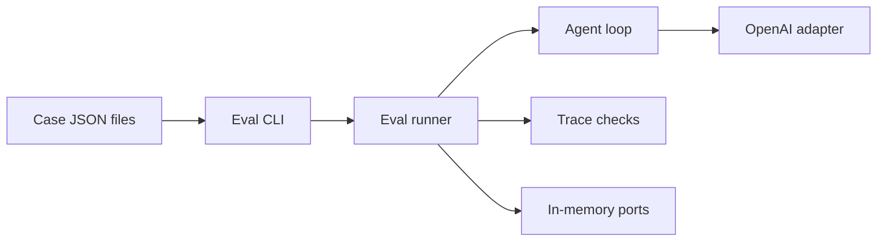
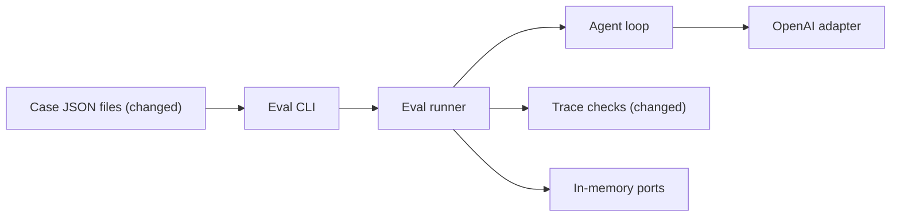

# Add live eval cases for each major agent capability

**Branch:** eval-cases · **Written:** 2026-10-22 · **Supersedes:** -

## Summary

`npm run eval` already runs two live OpenAI cases and scores the saved turn trace. That is not enough to notice when the agent stops following its own procedure: menu forms, custom components, mockups that must not call actions, or an off-topic refusal. This plan adds one committed case per major capability the system prompt teaches, plus a `toolNotCalled` check so a mockup or off-topic turn fails if the agent reached for a tool it should not have. Workers prove the new check and that every committed JSON file loads. It worked when `npm test` passes and, after merge, `npm run eval` with a key prints `pass` for all nine cases.

- **In scope:** `toolNotCalled`; seven new case files; keep the two existing cases; unit tests that load every committed case; architecture notes that list the cases.
- **Out of scope:** live eval in CI; golden trees or heading text; new check kinds beyond `toolNotCalled`; changing the agent loop, system prompt, tools, or actions; an eval HTTP or UI.
- **Open decisions:** none (see [Open decisions](#open-decisions))

### Behavior before

```mermaid
sequenceDiagram
  actor Dev
  participant CLI as Eval CLI
  participant Runner as Eval runner
  participant Loop as Agent loop
  participant OpenAI
  Dev->>CLI: npm run eval
  CLI->>Runner: simple-heading, then echo-form
  Runner->>Loop: runAgent with the case prompt
  Loop->>OpenAI: live completions
  Loop-->>Runner: saved AgentTrace
  alt every check on the trace passes
    CLI-->>Dev: pass id
  else a check fails
    CLI-->>Dev: fail id, check names and endedBy only
  end
```

### Behavior after

```mermaid
sequenceDiagram
  actor Dev
  participant CLI as Eval CLI
  participant Runner as Eval runner
  participant Loop as Agent loop
  participant OpenAI
  Dev->>CLI: npm run eval
  CLI->>Runner: nine cases, including mockup and off-topic
  Runner->>Loop: runAgent with the case prompt
  Loop->>OpenAI: live completions
  Loop-->>Runner: saved AgentTrace
  alt every check passes, including toolNotCalled
    CLI-->>Dev: pass id
  else the agent called a tool the case forbids
    CLI-->>Dev: fail id, toolNotCalled and endedBy only
  else another check fails
    CLI-->>Dev: fail id, check names and endedBy only
  end
```

### Architecture before



### Architecture after



### What changes

- Trace checks gain `toolNotCalled`, scored like `toolCalled` (a skipped call still counts as called).
- `server/eval/cases/` gains seven JSON files; `simple-heading` and `echo-form` stay as they are.
- Architecture docs list all nine live cases instead of two.

---

## Current state

The eval harness lives in [server/eval/](../../server/eval/cli.ts). [server/eval/cli.ts](../../server/eval/cli.ts) is `npm run eval` in [package.json](../../package.json): it builds the same OpenAI adapter and system prompt as chat, loads every `*.json` in [server/eval/cases/](../../server/eval/cases/simple-heading.json), and runs [runEvalCase](../../server/eval/runner.ts). The runner calls `runAgent` with in-memory catalog, custom-component, trace, and menu ports. It does not write `genui_traces`. CI ([.github/workflows/ci.yml](../../.github/workflows/ci.yml)) does not run eval.

A case is `{ id, prompt, checks }` ([server/eval/types.ts](../../server/eval/types.ts)). [loadCases](../../server/eval/loadCases.ts) requires kebab-case `id`, a non-empty prompt at most `MAX_MESSAGE_CHARS` (4000), a non-empty `checks` array, exactly one known key per check, and unique ids. Unknown keys are refused. Today's check keys: `endedBy`, `noError`, `toolCalled`, `toolSucceeded`, `uiComponent`, `uiButtonAction`, `uiNamedInput`.

[checkTrace](../../server/eval/checks.ts) walks the saved `AgentTrace`. `toolCalled` matches any tool call of that name, including skipped ones. `toolSucceeded` requires `result.ok` and no `skipped`. UI checks use the last successful `render_ui` tree (`result.ok`, `ui` present, not skipped). Fail reasons name the check only: they must not include `userText`, completion text, tool args, or tree JSON ([server/eval/checks.test.ts](../../server/eval/checks.test.ts)).

Committed cases today:

| File | Prompt intent | Checks |
|---|---|---|
| [simple-heading.json](../../server/eval/cases/simple-heading.json) | heading that says Hello | `endedBy: reply`, `noError`, `toolSucceeded: render_ui`, `uiComponent: Heading` |
| [echo-form.json](../../server/eval/cases/echo-form.json) | text field + demo echo button | those plus `toolCalled: list_actions`, `uiButtonAction: demo_echo`, `uiNamedInput: text` |

[server/eval/cli.test.ts](../../server/eval/cli.test.ts) loads the committed directory and asserts those two objects exactly.

The system prompt ([server/agent/systemPrompt.ts](../../server/agent/systemPrompt.ts)) teaches: `list_components` once; `list_actions` only when a button should do something on the server (skip for mockups and for designs without such buttons); prefer catalog, then existing custom, then `define_component`, Markup only inside a template; `get_component` before use; `render_ui` then a short reply; `delete_component` only when asked; off-topic requests get one sentence that this chat is for UI design.

Registered actions the cases can name: `demo_echo` (`text`) and the fourteen menu actions from [server/actions/menu/index.ts](../../server/actions/menu/index.ts). `menu_create_item` requires `name`, `size`, `price` (optional `description`, `category` with `menu_categories` choices). `menu_delete_category` requires `category` (choices), with confirm `Delete the category {category}? This can't be undone.`

`define_component` / `delete_component` are in [server/agent/tools/customComponents.ts](../../server/agent/tools/customComponents.ts). Names are PascalCase (`^[A-Z][A-Za-z0-9]*$`). Each `runEvalCase` builds a fresh in-memory custom-component store and menu, so cases do not share definitions or menu edits.

**Worker checks that exist:** `npm run typecheck`, `npm test`, `npm run build`, `npm run build:api`. **After-merge only:** `npm run eval` (needs `OPENAI_API_KEY`; not in CI).

## Requirements

### R1: toolNotCalled check

`EvalCheck` MUST accept `{ toolNotCalled: string }` and `checkTrace` MUST fail that check when any completion has a tool call whose `call.name` equals the string, including skipped calls, and MUST pass when none do.

**Acceptance:**

- A trace with a skipped `list_actions` call fails `{ toolNotCalled: "list_actions" }`.
- A trace with no `list_actions` call passes the same check.
- The fail reason names `toolNotCalled` and the tool string only: it MUST NOT contain `userText`, completion text, tool args, or tree JSON.

### R2: loadCases accepts toolNotCalled

[loadCases](../../server/eval/loadCases.ts) MUST parse `{ "toolNotCalled": "<non-empty string>" }` the same way it parses `toolCalled`, and MUST still refuse unknown keys, empty strings, and checks with more than one key.

**Acceptance:**

- A file whose only check is `{ "toolNotCalled": "list_actions" }` loads.
- `{ "toolNotCalled": "" }` is refused.
- `{ "toolCalled": "list_actions", "toolNotCalled": "render_ui" }` is refused.

### R3: Keep the two starter cases

[simple-heading.json](../../server/eval/cases/simple-heading.json) and [echo-form.json](../../server/eval/cases/echo-form.json) MUST keep their current `id`, `prompt`, and `checks`.

**Acceptance:**

- The objects asserted in [server/eval/cli.test.ts](../../server/eval/cli.test.ts) for those two ids stay the same.

### R4: catalog-layout case

`server/eval/cases/catalog-layout.json` MUST ask for a stacked card with a heading and a text line, and MUST score a clean `render_ui` that contains `Stack`, `Card`, `Heading`, and `Text`.

**Acceptance:**

- `id` is `catalog-layout`.
- Prompt (exact): `Show a Card titled Specials. Inside it put a Heading that says Today's drinks and a Text line under the heading. Group them with a Stack.`
- Checks: `{ "endedBy": "reply" }`, `{ "noError": true }`, `{ "toolSucceeded": "render_ui" }`, `{ "uiComponent": "Stack" }`, `{ "uiComponent": "Card" }`, `{ "uiComponent": "Heading" }`, `{ "uiComponent": "Text" }`.

### R5: menu-create-item case

`server/eval/cases/menu-create-item.json` MUST ask for a form that adds a café menu item, and MUST score `list_actions`, a successful `render_ui`, button action `menu_create_item`, and the three required inputs.

**Acceptance:**

- `id` is `menu-create-item`.
- Prompt (exact): `Show a form to add a new drink to the café menu.`
- Checks: `{ "endedBy": "reply" }`, `{ "noError": true }`, `{ "toolCalled": "list_actions" }`, `{ "toolSucceeded": "render_ui" }`, `{ "uiButtonAction": "menu_create_item" }`, `{ "uiNamedInput": "name" }`, `{ "uiNamedInput": "size" }`, `{ "uiNamedInput": "price" }`.

### R6: menu-delete-category case

`server/eval/cases/menu-delete-category.json` MUST ask for a form that deletes a menu category and says the person is asked to confirm, and MUST score `list_actions`, a successful `render_ui`, button action `menu_delete_category`, and input `category`.

**Acceptance:**

- `id` is `menu-delete-category`.
- Prompt (exact): `Show a form to delete a menu category. Say that the person will be asked to confirm before it runs.`
- Checks: `{ "endedBy": "reply" }`, `{ "noError": true }`, `{ "toolCalled": "list_actions" }`, `{ "toolSucceeded": "render_ui" }`, `{ "uiButtonAction": "menu_delete_category" }`, `{ "uiNamedInput": "category" }`.

### R7: define-and-use-custom case

`server/eval/cases/define-and-use-custom.json` MUST ask the agent to save a named custom component and then show it, and MUST score a successful `define_component` and a successful `render_ui` whose last tree contains that name.

**Acceptance:**

- `id` is `define-and-use-custom`.
- Prompt (exact): `Define a reusable custom component named PromoBanner: a Card whose children are a Heading and a Text. Then show PromoBanner.`
- Checks: `{ "endedBy": "reply" }`, `{ "noError": true }`, `{ "toolSucceeded": "define_component" }`, `{ "toolSucceeded": "render_ui" }`, `{ "uiComponent": "PromoBanner" }`.

### R8: delete-custom case

`server/eval/cases/delete-custom.json` MUST ask the agent to define a named custom component and then delete it, and MUST score both tools succeeding. It MUST NOT require `render_ui` (a render after delete would fail expand).

**Acceptance:**

- `id` is `delete-custom`.
- Prompt (exact): `Define a custom component named TempNotice that is a Card with a Heading. Then delete TempNotice. You do not need to show it.`
- Checks: `{ "endedBy": "reply" }`, `{ "noError": true }`, `{ "toolSucceeded": "define_component" }`, `{ "toolSucceeded": "delete_component" }`.

### R9: mockup-no-action case

`server/eval/cases/mockup-no-action.json` MUST ask for a signup mockup whose button must not run a server action, and MUST fail if `list_actions` was called.

**Acceptance:**

- `id` is `mockup-no-action`.
- Prompt (exact): `Show a mockup signup form with an email field, a password field, and a Create account button. The button must not run a server action.`
- Checks: `{ "endedBy": "reply" }`, `{ "noError": true }`, `{ "toolNotCalled": "list_actions" }`, `{ "toolSucceeded": "render_ui" }`, `{ "uiComponent": "TextInput" }`, `{ "uiComponent": "Button" }`.

### R10: off-topic-refusal case

`server/eval/cases/off-topic-refusal.json` MUST ask a non-UI question, and MUST score a clean reply that did not call `list_components`, `list_actions`, or `render_ui`.

**Acceptance:**

- `id` is `off-topic-refusal`.
- Prompt (exact): `What's the weather in Paris tomorrow?`
- Checks: `{ "endedBy": "reply" }`, `{ "noError": true }`, `{ "toolNotCalled": "list_components" }`, `{ "toolNotCalled": "list_actions" }`, `{ "toolNotCalled": "render_ui" }`.

### R11: Committed cases load in unit tests

[server/eval/cli.test.ts](../../server/eval/cli.test.ts) MUST load `server/eval/cases` and assert the exact `id`, `prompt`, and `checks` for every committed case in this plan (the two starters plus R4–R10).

**Acceptance:**

- `loadCases` on the committed directory returns nine cases, one per id: `catalog-layout`, `define-and-use-custom`, `delete-custom`, `echo-form`, `menu-create-item`, `menu-delete-category`, `mockup-no-action`, `off-topic-refusal`, `simple-heading` (sorted by id, as `loadCases` already sorts).
- Each object's prompt and checks match the requirement that owns that id.
- The test does not call OpenAI.

### R12: Docs list the live cases

[docs/ARCHITECTURE.md](../../docs/ARCHITECTURE.md) §9 or §10 MUST say `npm run eval` runs these nine committed cases (the two starters and the seven new ids), still with in-memory ports, still not in CI. [README.md](../../README.md) already points at eval and SHOULD stay a one-liner unless it still says there are only two cases.

**Acceptance:**

- A reader of §10 can name all nine case ids and what each is for.
- The doc still says CI does not run `npm run eval`.

## Design

### Components

No new packages. The CLI, runner, and OpenAI wiring stay as they are. Changes are the check union, the loader's allowed keys, seven JSON files, unit tests, and docs.

### Interfaces

Additive member on the existing union in [server/eval/types.ts](../../server/eval/types.ts):

```ts
export type EvalCheck =
  | { endedBy: EndedBy }
  | { noError: true }
  | { toolCalled: string }
  | { toolSucceeded: string }
  | { toolNotCalled: string }
  | { uiComponent: string }
  | { uiButtonAction: string }
  | { uiNamedInput: string };
```

In [server/eval/loadCases.ts](../../server/eval/loadCases.ts), add `"toolNotCalled"` to `CHECK_KEYS`. Parse it in the same `switch` arm as `toolCalled` / `toolSucceeded` / the UI string checks: non-empty string, one key per check.

In [server/eval/checks.ts](../../server/eval/checks.ts):

- `checkLabel`: `toolNotCalled "${check.toolNotCalled}"`.
- `evaluateCheck`, after the `toolSucceeded` branch and before UI checks: if `"toolNotCalled" in check`, search completions the same way `toolCalled` does (any `toolCall.call.name` match, skipped or not). Pass when none match. Fail with reason `${label}: tool was called`.

No new endpoints, env vars, or config keys. `npm run eval` is unchanged. Cases remain `{ id, prompt, checks }` only.

Committed file names equal `{id}.json`, same as the two starters.

### Data and migrations

None. Case JSON is source, not a database. Eval still uses `InMemoryTraceRepository` per case ([server/eval/runner.ts](../../server/eval/runner.ts)) and does not write `genui_traces`.

### Errors and edge cases

- `toolNotCalled` on a name the agent never heard of still passes (nothing was called).
- A skipped tool call fails `toolNotCalled` (the model asked for it).
- UI checks on R9 still need a successful `render_ui`; if the mockup never renders, those fail in addition to any `toolNotCalled` result.
- R8 must not include UI checks: `delete_component` after a show would make a later `render_ui` of `TempNotice` fail expand.
- Duplicate ids across the nine files are already refused by `loadCases`.
- Live flake: if after-merge `npm run eval` fails a case because the model ignored the prompt, tighten that file's prompt only; do not add golden text or new check kinds. Do not weaken a `toolNotCalled` or required action name to paper over a real procedure break.

### Compatibility and rollout

Additive. Existing cases do not use `toolNotCalled` and keep passing `loadCases`. Old traces remain scorable. No migration. Eval stays out of CI. Land the check before the cases that use it (R9, R10).

## Security

| Concern | Mitigation | Enforced by |
|---|---|---|
| Fail lines leak prompt text, trees, or tool args | `toolNotCalled` reasons stay check-label plus "tool was called"; existing leak tests keep covering `checkTrace` | R1 |
| Live eval needs an API key | Key stays in `.env.local` / the shell; cases and docs name `OPENAI_API_KEY` only; eval stays out of CI | R12 |
| Case prompts are committed user text | Prompts are short, fictional, and contain no credentials or personal data | R4–R10 |
| Eval must not write production traces | Runner already uses in-memory traces; this plan does not change that | R3 |

## Validation

**Workers can run** (no credentials or live services):

- `npm test`: loader, `checkTrace` (including `toolNotCalled` and leak-free reasons), and the committed-case snapshot in `cli.test.ts`.
- `npm run typecheck`: `EvalCheck` union and call sites.
- `npm run build` / `npm run build:api`: browser and API bundles; eval is a separate entry and is not required to be in the API bundle.

**New tests:**

- R1: [server/eval/checks.test.ts](../../server/eval/checks.test.ts) — pass when absent; fail when present; fail when skipped; reasons omit `userText`, completion text, args, and tree JSON.
- R2: [server/eval/loadCases.test.ts](../../server/eval/loadCases.test.ts) — valid `toolNotCalled`; empty string refused; combined with another key refused.
- R3–R11: [server/eval/cli.test.ts](../../server/eval/cli.test.ts) — `loadCases` on `server/eval/cases` equals the nine objects this plan specifies.
- R12: no automated test; review the doc in the docs slice.

**After merge** (needs credentials, live services, or a person):

- `npm run eval` with `OPENAI_API_KEY` set: nine `pass <id>` lines, exit 0. If a case fails, read the check name only and decide whether the prompt needs tightening or the agent actually broke the procedure.

## Work breakdown

| Slice | Covers | Touches | After | Size |
|---|---|---|---|---|
| eval-check-tool-not-called | R1, R2 | server/eval/types.ts, server/eval/checks.ts, server/eval/checks.test.ts, server/eval/loadCases.ts, server/eval/loadCases.test.ts | - | small |
| eval-live-cases | R3, R4, R5, R6, R7, R8, R9, R10, R11 | server/eval/cases/simple-heading.json, server/eval/cases/echo-form.json, server/eval/cases/catalog-layout.json, server/eval/cases/menu-create-item.json, server/eval/cases/menu-delete-category.json, server/eval/cases/define-and-use-custom.json, server/eval/cases/delete-custom.json, server/eval/cases/mockup-no-action.json, server/eval/cases/off-topic-refusal.json, server/eval/cli.test.ts | eval-check-tool-not-called | medium |
| eval-cases-docs | R12 | docs/ARCHITECTURE.md, README.md | eval-live-cases | small |

`eval-check-tool-not-called` lands first so R9 and R10 can use the new key. All new JSON files and the committed-case snapshot share `cli.test.ts`, so they stay in one slice. Docs wait until the ids exist.

## Non-goals

- Running `npm run eval` in CI.
- Golden trees, heading copy, Select option lists, or `list_actions` area/operation checks.
- Check kinds other than `toolNotCalled`.
- Changing the system prompt, tool registry, action registry, or agent loop to make cases easier.
- An eval HTTP route, UI, or writing eval traces to `genui_traces`.
- One case per catalog component or per menu action.

## Assumptions

- File name equals `{id}.json`, matching the two starters.
- Prompts in R4–R10 are the committed wording. After-merge flake is fixed by tightening that prompt, not by adding content checks.
- `get_component` is not required on any case; the model often skips it after `list_components` and that would flake.
- R8 does not require a shown tree.
- The uncommitted architecture-diagram edit on this checkout is not part of this plan; R12 only updates the case list in §9/§10 (and README if it still says two cases).
- No `plans/README.md` exists; `/d-set-framework` can add the planning-tree README later.

## Risks

- Live model variance: a case fails because the model named a different action or skipped `define_component`. Mitigation: prompts name the action or component; checks stay structural; after-merge, tighten the prompt only.
- R10 is strict (`toolNotCalled` on three tools). Mitigation: the system prompt already forbids off-topic tool use; if the live model still lists components, tighten the prompt to "Do not use tools." rather than drop the checks.
- R9 fails if the model calls `list_actions` despite "mockup" and "must not run a server action". That is a real procedure break, not a flake to ignore.
- Nine live turns cost time and tokens (~2 minutes for two cases today). Mitigation: still not in CI; run by a person after merge.

## Open decisions

None.

## References

- Request: "generate thorough test cases for the eval harness"
- Choices: live JSON cases (not harness unit tests); one case per major system-prompt capability; add `toolNotCalled` only
- Shipped starter: two cases from the eval-harness work (`simple-heading`, `echo-form`); that plan is not on this branch
- [server/eval/types.ts](../../server/eval/types.ts), [server/eval/checks.ts](../../server/eval/checks.ts), [server/eval/loadCases.ts](../../server/eval/loadCases.ts), [server/eval/runner.ts](../../server/eval/runner.ts), [server/eval/cli.ts](../../server/eval/cli.ts)
- [server/agent/systemPrompt.ts](../../server/agent/systemPrompt.ts)
- [server/actions/menu/index.ts](../../server/actions/menu/index.ts) (`menu_create_item`, `menu_delete_category`)
- [server/agent/tools/customComponents.ts](../../server/agent/tools/customComponents.ts)
- [docs/ARCHITECTURE.md](../../docs/ARCHITECTURE.md) §9–§10
- [README.md](../../README.md)
