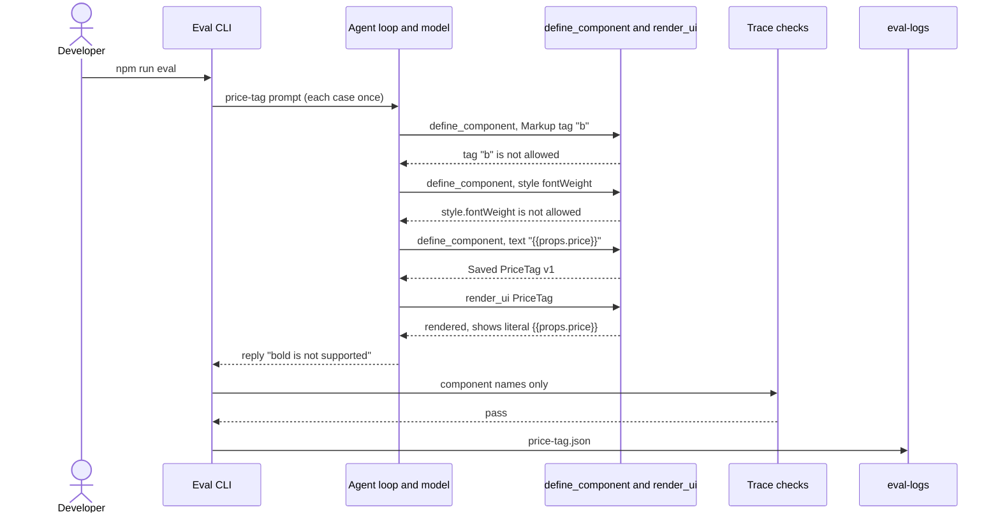
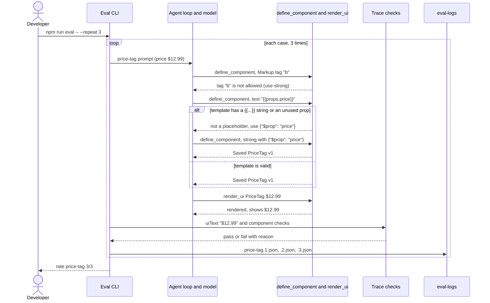
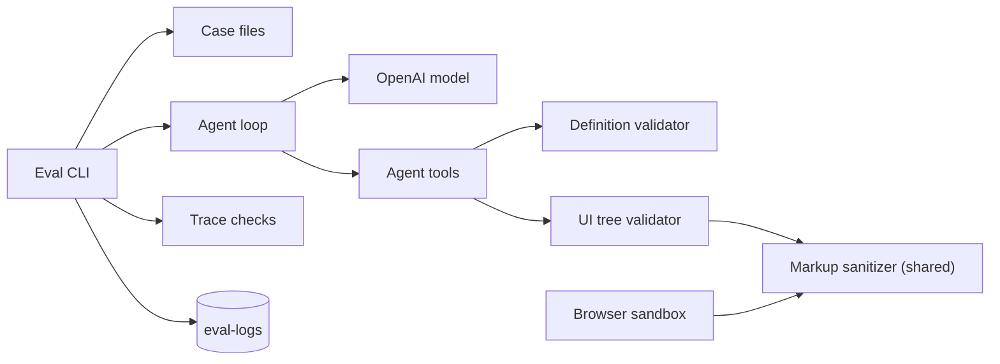
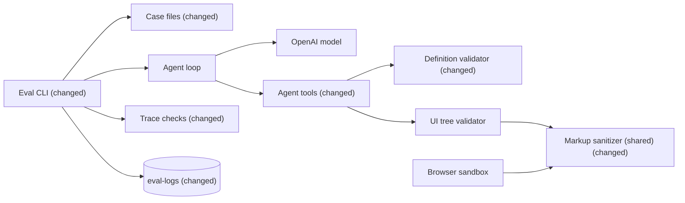

# Catch broken custom component props, explain Markup refusals, and measure eval flakiness

**Branch:** fix/eval-findings · **Written:** 2026-10-22 · **Supersedes:** -

## Summary

The latest eval run scored 13 of 14, but one pass was false. In `price-tag`, the model wrote `"text": "{{props.price}}"` instead of `{"$prop": "price"}`. `define_component` saved it, so the design showed the literal `{{props.price}}`. Earlier errors refused tag `b` and style `fontWeight` without naming `strong` or `font-weight`, so the model wrongly told the person bold isn't supported. This plan makes `define_component` refuse such templates, makes Markup errors name the allowed alternative, and adds eval checks on the text a design shows. It also rewords the ambiguous `export-pdf` case, adds `--repeat` to expose flaky cases, and adds six cases. It worked when `npm run eval -- --repeat 3` shows `price-tag` drawing the price.

- **In scope:** template placeholder and unused-prop checks in `define_component`; alternative names in Markup tag and style errors; `uiText` and `uiMarkupTag` eval checks; `--repeat N` on the eval CLI; rewording `export-pdf` and tightening `price-tag`; six new eval cases; eval docs.
- **Out of scope:** listing the Markup allowlist in `get_component Markup`; system prompt changes; a case filter for the CLI; checking `{{...}}` text in `render_ui` trees outside templates.
- **Open decisions:** none (see [Open decisions](#open-decisions))

### Behavior before

### Behavior after

### Architecture before

### Architecture after

### What changes

- The definition validator refuses a template string that looks like `{{...}}` and a declared prop the template never uses, and says which `{"$prop"}` to write.
- The Markup sanitizer's error messages name an allowed tag or style property; what it keeps and drops does not change, so the browser sandbox draws the same thing.
- The `define_component` tool description says every declared prop must be used through `{"$prop"}`.
- Trace checks gain `uiText` and `uiMarkupTag`, so a case can check what a design shows, not only which components it uses.
- The eval CLI takes `--repeat N`, writes one log per attempt, and prints a pass rate per case.
- Case files: `export-pdf` is reworded, `price-tag` fixes the price and checks it is drawn, and six cases are added.

---

## Current state

- **Eval CLI:** `server/eval/cli.ts` exports `main(options: CliMainOptions)`. It loads cases (`server/eval/loadCases.ts`), creates `eval-logs/<timestamp>/` (`createEvalLogDir` in `server/eval/writeLog.ts`), runs each case once with `runEvalCase` (`server/eval/runner.ts`) under a 180-second `AbortSignal.timeout`, writes `<id>.json` with `writeEvalCaseLog` (flag `wx`, id must be kebab-case, path must stay inside the directory), prints `pass <id>` or `fail <id> <reasons>`, then `logs <dir>`, and returns 1 if any case or log write failed. It reads no command-line arguments; the entry point calls `main()` with no options. `CliMainOptions.inject` lets tests replace every dependency.
- **Eval checks:** `server/eval/types.ts` defines `EvalCheck` as a union of single-key objects. `server/eval/checks.ts` scores the saved `AgentTrace`: `uiComponent`, `uiButtonAction`, `uiNamedInput` and `noButtonAction` read the last successful `render_ui` call's `ui.tree`, which is the expanded tree of catalog components (Markup included). `agentComponent` reads the call's `args.tree`. No check reads text. `server/eval/loadCases.ts` lists allowed keys in `CHECK_KEYS` and parses each in `parseCheck`.
- **Committed cases:** 14 files in `server/eval/cases/`. `server/eval/cli.test.ts` holds a `committedCases` array that must deep-equal `loadCases` on that directory, so every case change also edits that test.
- **Case `export-pdf`** (`server/eval/cases/export-pdf.json`): "Show a button labeled Export PDF. It should run a server action, but only if one of the registered actions actually exports a PDF." In both runs that included it, the model called `list_actions`, found no PDF action, and replied without rendering. `server/agent/systemPrompt.ts` (step 5) says: "If no action fits, render the button without an action and say that clicking it won't do anything yet." The "only if" wording reads as a condition on the whole button.
- **Case `price-tag`** (`server/eval/cases/price-tag.json`): its checks are `toolSucceeded` for both tools, `agentComponent PriceTag` and `uiComponent Markup`. None look at what is drawn.
- **Definition validator:** `server/customComponents/definition.ts` `validateDefinition` runs `checkTemplate`, which walks the template. `placeholder()` checks each `{"$prop"}` names a declared prop, `misplaced()` reports placeholders and slots in the wrong place, and `markup()` walks a Markup `root`. Plain strings are never inspected, and nothing checks that declared props are used. Only `define_component` (`server/agent/tools/customComponents.ts`) calls it; stored components are not revalidated when they expand (`server/customComponents/expand.ts`). Tests are in `server/customComponents/definition.test.ts`, with fixtures in `server/customComponents/testDefinitions.ts`.
- **Markup sanitizer:** `shared/markup.ts` `sanitizeMarkup` is used by the server (`server/ui/markup.ts` `validateMarkup`, called from `server/ui/validateTree.ts`) and by the browser (`src/sandbox/markup.ts`, which passes no `report` callback). An unknown tag reports `` `${at}.tag "${tag}" is not allowed${where}` ``, where `where` is ` inside an svg` or ` outside an svg` for a tag from the other list. An unknown style property reports `` `${at}.style.${property} is not allowed` ``. Allowed tags: `MARKUP_HTML_TAGS` (includes `strong`, `em`, `h1` to `h4`) and `MARKUP_SVG_TAGS`. Allowed styles: `MARKUP_STYLE_PROPERTIES`, all kebab-case (includes `font-weight`). Tests: `server/ui/markup.test.ts`, `server/ui/validateTree.test.ts`.
- **Markup docs for the model:** `server/catalog/components.ts` describes `root` as having "allowlisted tags, attributes and inline style properties" but does not list them.
- **Error cap:** `limitErrors` in `server/ui/validateTree.ts` keeps at most `MAX_ERRORS` messages.
- **Docs:** `README.md` (Scripts, `npm run eval` line) and `docs/ARCHITECTURE.md` (the eval paragraph near the top, the scripts table row for `npm run eval`, and the §9 bullet, which still says "nine committed live cases").
- **Checks:** CI (`.github/workflows/ci.yml`) runs `npm run db:migrate:traces`, `npm run typecheck`, `npm test`, `npm run build` and `npm run build:api`. `npm run eval` is not run in CI and needs `OPENAI_API_KEY`.

## Requirements

### R1: Refuse {{...}} placeholders in templates

`define_component` MUST refuse a template in which any string value (a prop value at any depth, or a Markup `text`, attribute or style value) contains `{{`, then text, then `}}`, and the problem MUST name the `{"$prop"}` to use instead. Such text is drawn as written, so the person sees `{{props.price}}` instead of the value.

**Acceptance:**

- A template with Markup `"text": "{{props.price}}"` and declared prop `price` is refused with a problem whose path is `template.props.root.text` and which contains `{"$prop": "price"}`.
- A catalog prop such as Heading `"text": "Hello {{name}}"` with declared prop `name` is refused at `template.props.text` with `{"$prop": "name"}`.
- When the name inside the braces (its last dot-separated part, spaces trimmed) is not a declared prop, the problem shows `{"$prop": "<name>"}`.
- The problem quotes at most the first 60 characters of the string.
- Strings with a single `{` or `}`, or `{{` with no closing `}}`, are accepted.
- A valid definition saves exactly as before.

### R2: Refuse declared props the template never uses

`define_component` MUST refuse a definition in which a property in `propsSchema.properties` is not used by any valid `{"$prop": "<name>"}` in the template, with a problem that names the property. A prop the template never reads is the sign of a broken substitution (R1's case), and it misleads anyone using the component. The `define_component` tool description SHOULD say that every declared prop must be used through `{"$prop"}` and that `{{...}}` text is not filled in.

**Acceptance:**

- A definition that declares `price` and `label` and uses only `{"$prop": "price"}` is refused with `propsSchema.properties.label is not used by the template; use it with {"$prop": "label"} or remove it`.
- A prop used only in a nested custom component's props, or only in Markup attributes or style, counts as used.
- A definition with no `properties`, or `properties: {}`, is not affected.
- The problem is reported together with the template's other problems, within `limitErrors`.
- Stored custom components that declare an unused prop still expand and render. Only saving through `define_component` checks this.
- The `define_component` description in `server/agent/tools/customComponents.ts` mentions both rules.

### R3: Name an allowed tag when a Markup tag is refused

When `sanitizeMarkup` reports an unknown tag, the message MUST name an allowed alternative: a fixed replacement for common HTML tags (`b` to `strong`, `i` to `em`, `h5` and `h6` to `h4`), otherwise the list of tags allowed in that context (HTML or SVG). The model must see that bold text is possible.

**Acceptance:**

- `{"tag": "b"}` outside an svg reports `` `<path>.tag "b" is not allowed (use strong)` ``; `i` names `em`; `h5` and `h6` name `h4`.
- An unknown HTML tag with no fixed replacement, such as `marquee`, reports `is not allowed (allowed: ...)` followed by the `MARKUP_HTML_TAGS` names in their declared order, joined with `, `.
- An unknown tag inside an svg lists the `MARKUP_SVG_TAGS` names.
- The existing ` inside an svg` and ` outside an svg` messages are unchanged.
- A tag named like an `Object.prototype` key, such as `constructor`, gets the allowed list and not a prototype value: the lookup uses `Object.hasOwn`.
- What `sanitizeMarkup` returns is unchanged for every input: the same elements, attributes and styles are dropped, and `src/sandbox/markup.ts` draws the same thing.

### R4: Name the kebab-case style property when a camelCase one is refused

When `sanitizeMarkup` refuses a style property whose kebab-case form (each uppercase letter becomes `-` plus its lowercase) is in `MARKUP_STYLE_PROPERTIES`, the message MUST name that form. Bold through `font-weight` must be discoverable from the error.

**Acceptance:**

- `style: {"fontWeight": "bold"}` reports `` `<path>.style.fontWeight is not allowed (use font-weight)` ``; `backgroundColor` names `background-color`.
- A refused property with no allowed kebab-case form, such as `position` or `zIndex`, keeps the plain `is not allowed` message.
- The style is still dropped: `sanitizeMarkup`'s output is unchanged.

### R5: uiText eval check

The eval harness MUST support a check `{"uiText": "<text>"}` that passes when any string in the props of the last successful `render_ui` call's `ui.tree` contains the text. This includes Markup `root` text and attribute values at any depth, and children's props. It lets a case prove a prop value was actually drawn.

**Acceptance:**

- It passes when Heading `props.text` is `"Hello Ada"` and the check is `"Ada"`. It also passes when a Markup root child's `text` is `"$12.99"` and the check is `"$12.99"`.
- It fails with the reason `uiText "<text>": text not found in last render_ui tree` when no string contains the text. Matching is case-sensitive.
- It fails with the existing "no successful render_ui tree" reason when there is no successful `render_ui`.
- `loadCases` accepts `uiText` only as a non-empty string and refuses other values with the existing error wording.

### R6: uiMarkupTag eval check

The eval harness MUST support a check `{"uiMarkupTag": "<tag>"}` that passes when a Markup element with that `tag` appears anywhere in the last successful `render_ui` call's `ui.tree`, at any depth of any Markup `root`. It lets a case check how a custom component draws, such as bold through `strong`.

**Acceptance:**

- It passes for a tree with a Markup node whose root is a `span` with a `strong` child and the check is `strong`. It also passes when the Markup node is nested under a Card.
- It fails with the reason `uiMarkupTag "<tag>": Markup tag not found in last render_ui tree` when no Markup element has that tag, including when the tree has no Markup.
- `loadCases` accepts it only as a non-empty string.

### R7: --repeat N on the eval CLI

`npm run eval -- --repeat N` MUST run every case N times and print each case's pass rate, so flaky cases can be told apart from broken ones.

**Acceptance:**

- With no arguments, behavior and output are unchanged: one attempt per case, `<id>.json`, the same lines and exit codes.
- With `--repeat 3`, each case runs 3 times in a row, each attempt with its own timeout signal. Each attempt prints `pass <id> [k/3]` or `fail <id> [k/3] <reasons>` and is logged as `<id>.<k>.json` (k from 1). After all cases, one `rate <id> <passes>/3` line per case is printed in case order, then the `logs <dir>` line.
- `--repeat` accepts whole numbers from 1 to 10. Any other value, a missing value, or an unknown option prints one error line (`--repeat must be a whole number from 1 to 10`, or `unknown option <name>`) and returns 1 before cases load or a log directory is created.
- The exit code is 1 if any attempt failed or any log write failed, otherwise 0.
- `--repeat 1` behaves exactly like no arguments.
- The OpenAI API key never appears in logs, stdout or stderr, as the existing `cli.test.ts` test checks today. The test is extended to `--repeat 2`.

### R8: Reword export-pdf

`server/eval/cases/export-pdf.json` MUST use the prompt `Show a button labeled Export PDF that exports this page as a PDF.` and keep its checks. It then tests the system prompt rule (render the button without an action when none fits) without inviting the "don't show it at all" reading.

**Acceptance:**

- The file has the new prompt and the same six checks: `endedBy reply`, `noError`, `toolCalled list_actions`, `toolSucceeded render_ui`, `uiComponent Button`, `noButtonAction`.
- `committedCases` in `server/eval/cli.test.ts` matches.

### R9: Make price-tag check the drawn price

`server/eval/cases/price-tag.json` MUST give a fixed price and check that it is drawn, so broken prop substitution fails the case.

**Acceptance:**

- The prompt is `Define a custom component named PriceTag that uses Markup to draw a label no catalog component can: a span whose text is the price prop in bold. Then show PriceTag with the price $12.99. Use Markup in the template.`
- The checks are the existing six plus `{"uiText": "$12.99"}`.
- `committedCases` in `server/eval/cli.test.ts` matches.

### R10: Six new eval cases

The repository MUST add these cases to `server/eval/cases/`. Each also has `{"endedBy": "reply"}` and `{"noError": true}` as its first two checks. Together they cover the R1 to R6 fixes and more ways of asking for a button no action fits.

| File | Prompt | Checks after endedBy and noError |
|---|---|---|
| `markup-bold-tag.json` | Define a custom component named SaleLabel that uses Markup to draw the word SALE in a b tag inside a span. Then show SaleLabel. | `toolSucceeded define_component`, `toolSucceeded render_ui`, `agentComponent SaleLabel`, `uiMarkupTag strong`, `uiText SALE` |
| `markup-prop-text.json` | Define a custom component named StatusDot that uses Markup: an svg with a small green circle, then a span whose text is a label prop. Then show StatusDot with the label Online. | `toolSucceeded define_component`, `toolSucceeded render_ui`, `agentComponent StatusDot`, `uiMarkupTag circle`, `uiText Online` |
| `custom-props-shown.json` | Define a reusable custom component named ContactCard: a Card with a Heading showing a name prop and a Text showing an email prop. Then show ContactCard for Ada Lovelace, ada@example.com. | `toolSucceeded define_component`, `toolSucceeded render_ui`, `agentComponent ContactCard`, `uiComponent Card`, `uiText Ada Lovelace`, `uiText ada@example.com` |
| `sms-no-action.json` | Add a button labeled Send SMS that texts the customer their order status. | `toolCalled list_actions`, `toolSucceeded render_ui`, `uiComponent Button`, `noButtonAction` |
| `newsletter-no-action.json` | Show a newsletter signup: an email field and a Subscribe button that adds the person to our mailing list. | `toolCalled list_actions`, `toolSucceeded render_ui`, `uiComponent TextInput`, `uiComponent Button`, `noButtonAction` |
| `invented-action-name.json` | Show a Download CSV button that runs the export_csv action. | `toolCalled list_actions`, `toolSucceeded render_ui`, `uiComponent Button`, `noButtonAction` |

**Acceptance:**

- `loadCases` loads all 20 committed cases without errors, sorted by id, and `committedCases` in `server/eval/cli.test.ts` lists them.
- Every prompt is within `MAX_MESSAGE_CHARS`, and every id is kebab-case and unique.
- No case names a person's real contact details; `ada@example.com` uses the reserved `example.com` domain.

### R11: Eval docs

`README.md` and `docs/ARCHITECTURE.md` MUST describe `--repeat`, the `uiText` and `uiMarkupTag` checks, and the current list of 20 cases.

**Acceptance:**

- The README's `npm run eval` line mentions `npm run eval -- --repeat N` and the per-attempt log names.
- The `docs/ARCHITECTURE.md` eval paragraph and scripts table row describe repeats, per-attempt logs and `rate` lines.
- The §9 bullet lists all 20 cases by id with one phrase each, replacing "nine committed live cases".

## Design

### Components

- `server/customComponents/definition.ts`: in `checkTemplate`, record each prop name a valid placeholder uses. Have `misplaced` check plain strings against the `{{...}}` pattern, since it already walks every non-placeholder value, including Markup text, attribute and style values reached through `fillable`. After the walk, report declared props that were never used. Put the new problems in `shape.problems`, so a refused template is not expanded with the example props.
- `server/agent/tools/customComponents.ts`: extend the `template` property's description, and the tool description, with the R2 sentence.
- `shared/markup.ts`: add `MARKUP_TAG_ALTERNATIVES` and a `kebabCase` helper. Change only the message strings in the unknown-tag branch of `visit` and in `styleProblem`. The keep and drop logic is untouched.
- `server/eval/types.ts`, `server/eval/checks.ts`, `server/eval/loadCases.ts`: two new check kinds.
- `server/eval/cli.ts` and `server/eval/writeLog.ts`: argument parsing, the attempt loop, per-attempt file names and rate lines.
- `server/eval/cases/*.json` and `server/eval/cli.test.ts`: case changes.

### Interfaces

- `shared/markup.ts` (additive):
  - `export const MARKUP_TAG_ALTERNATIVES: Readonly<Record<string, string>> = { b: "strong", i: "em", h5: "h4", h6: "h4" };` used only for HTML context.
  - Unknown tag messages: `` `${at}.tag "${tag}" is not allowed (use ${alt})` ``, otherwise `` `${at}.tag "${tag}" is not allowed (allowed: ${names.join(", ")})` ``. The existing `${where}` forms keep their current text.
  - `styleProblem` returns `` `is not allowed (use ${kebab})` `` when `kebab !== property` and `MARKUP_STYLE_PROPERTIES.includes(kebab)`.
- `server/customComponents/definition.ts`, new problem strings:
  - `` `${path} "${excerpt}" looks like a {{...}} placeholder, which is shown as written; use {"$prop": "${name}"}` ``, where `excerpt` is the first 60 characters and `name` is the declared prop from the braces, or `<name>`. The pattern is `/\{\{\s*([^{}]+?)\s*\}\}/`.
  - `` `propsSchema.properties.${prop} is not used by the template; use it with {"$prop": "${prop}"} or remove it` ``.
- `server/eval/types.ts` (additive): `EvalCheck` adds `| { uiText: string } | { uiMarkupTag: string }`.
- `server/eval/loadCases.ts`: `CHECK_KEYS` adds `"uiText"` and `"uiMarkupTag"`, parsed like `uiComponent` (non-empty string).
- `server/eval/checks.ts`: `checkLabel` adds `uiText "<text>"` and `uiMarkupTag "<tag>"`. Both checks use `lastSuccessfulRenderUi(trace)?.ui.tree`. `uiText` collects every string under each node's `props`, recursively through objects and arrays, and over `children`. `uiMarkupTag` walks each `Markup` node's `props.root` and its `children` for a matching `tag`.
- `server/eval/writeLog.ts`: `writeEvalCaseLog(dir: string, log: EvalCaseLog, attempt?: number): void`. Without `attempt`, it writes `<id>.json` as today. With `attempt`, it writes `<id>.<attempt>.json`, where attempt must be a whole number from 1 to 10 (it throws otherwise). The kebab-case and path-escape checks stay.
- `server/eval/cli.ts`:
  - `export function parseCliArgs(argv: string[]): { ok: true; repeat: number } | { ok: false; error: string }` uses `parseArgs` from `node:util` with `strict: true` and `options: { repeat: { type: "string" } }`. The value must match `/^\d+$/` and fall between 1 and 10.
  - `CliMainOptions` adds `argv?: string[]` (default `[]`). The entry point passes `process.argv.slice(2)`.
  - With `repeat === 1`, output and file names are unchanged. With `repeat > 1`, `formatResult` adds ` [k/N]` after the id, `writeEvalCaseLog` gets `attempt = k`, and the `rate` lines print before `logs`.

### Errors and edge cases

- R1 strings inside a placeholder object are not checked, since the placeholder check owns them. Strings in `exampleProps` are not checked.
- R1 and R2 problems block expansion with the example props, like other template-shape problems, so the model sees them first and without follow-on errors.
- R2 counts a prop as used only through a placeholder that passed `placeholder()`. A placeholder naming an undeclared prop already reports its own problem.
- R3 lists every allowed HTML tag (33 names), so the message is long. `limitErrors` caps how many messages there are, not their length, and one tree rarely has more than one unknown tag.
- R5 does not search the reply text or the `render_ui` arguments, only the drawn tree. That is the point: a placeholder that was never filled must fail.
- R7: the attempt with `attempt > 1` and the attempt with no `attempt` never share a file name, because `.` is not allowed in ids.
- R7: a timeout on one attempt does not stop later attempts.

### Compatibility and rollout

- All shared type changes are additive. `EvalCheck` gains variants, and `writeEvalCaseLog` gains an optional parameter.
- The browser sandbox (`src/sandbox/markup.ts`) ignores reports, so R3 and R4 change nothing it draws.
- Stored custom components are not revalidated. A component saved before R2 with an unused prop keeps working; the next `define_component` save of that name must fix it.
- The catalog is unchanged, so no `npm run db:seed` is needed.
- No migrations.

## Security

| Concern | Mitigation | Enforced by |
|---|---|---|
| Error messages echo model-written text back into the model's context | Quote at most 60 characters of the offending string; tag and property names are echoed as today | R1 |
| A message change hides a change to what Markup allows, weakening the HTML and SVG allowlist shared with the browser | Only message strings change; tests assert `sanitizeMarkup` output is identical for the refused inputs; the alternatives lookup uses `Object.hasOwn`, so prototype keys such as `constructor` are never treated as allowed | R3, R4 |
| Unbounded `--repeat` runs up OpenAI cost | Whole numbers from 1 to 10 only; strict parsing refuses unknown options and malformed values before any case runs | R7 |
| More log files could leak the API key | Per-attempt logs hold the same fields as today; the existing no-leak test covers `--repeat 2` | R7 |
| Eval cases carrying personal data into committed files and logs | Case prompts use a historical name and the reserved `example.com` domain | R10 |
| New dependencies | None; `parseArgs` is built into `node:util` | R7 |

## Validation

**Workers can run** (no credentials or live services):

- `npm run typecheck`: the additive types compile across server, shared and src.
- `npm test`: unit tests for the definition validator, Markup messages, eval checks, case loading, the log writer and CLI. Database and Redis tests skip without `DATABASE_URL` and `REDIS_URL`.
- `npm run build` and `npm run build:api`: both bundles still build.

**New tests:**

- R1: `server/customComponents/definition.test.ts`: Markup text `{{props.price}}`; Heading text `Hello {{name}}`; an undeclared name inside braces; the 60-character excerpt; single braces and unclosed `{{` accepted.
- R2: `server/customComponents/definition.test.ts`: unused prop refused; a prop used only in a nested custom node's props, Markup attrs or style counts as used; empty `properties` unaffected. Update `server/customComponents/testDefinitions.ts` fixtures if any declare unused props.
- R3: `server/ui/markup.test.ts`: `b`, `i`, `h5`, `h6` messages; `marquee` lists HTML tags; an unknown tag inside an svg lists SVG tags; `inside an svg` and `outside an svg` unchanged; sanitized output unchanged. Update the existing unknown-tag expectations for the `(allowed: ...)` suffix: `script` in `server/ui/validateTree.test.ts`, and the `script`, `style`, `iframe`, `a`, `object`, `form`, `textarea`, `constructor`, `foreignObject`, `use`, `animate` and `image` cases in `server/ui/markup.test.ts`.
- R4: `server/ui/markup.test.ts`: `fontWeight` and `backgroundColor` messages; `position` and `zIndex` keep the plain message; the style is dropped.
- R5, R6: `server/eval/checks.test.ts`: pass, fail and no-render cases for each, including Markup nested under a Card. `server/eval/loadCases.test.ts`: valid strings, plus refusal of empty strings and non-strings.
- R7: `server/eval/cli.test.ts`: `parseCliArgs` for no args, `--repeat 3`, `--repeat=3`, `0`, `11`, `2.5`, `abc`, a missing value and `--other`; `main` with `argv: ["--repeat", "2"]` writes `<id>.1.json` and `<id>.2.json`, prints `[k/2]` lines then `rate` then `logs`, and returns 1 when one attempt fails; bad args create no log directory; the no-leak test with `--repeat 2`. `server/eval/writeLog.test.ts`: `attempt` file names; `attempt` 0, 11 and 1.5 throw.
- R8, R9, R10: `server/eval/cli.test.ts` `committedCases` updated to the 20 cases.

**After merge** (needs credentials, live services, or a person):

- `npm run eval -- --repeat 3` with `OPENAI_API_KEY` set: `price-tag` shows `$12.99` drawn (`uiText` passes). Compare per-case rates with the 2026-10-23 01:08 run, and note any case under 3/3 as flaky.
- If `export-pdf`, `sms-no-action`, `newsletter-no-action` or `invented-action-name` still reply without rendering, open a follow-up on the system prompt's no-fitting-action rule.

## Work breakdown

| Slice | Covers | Touches | After | Size |
|---|---|---|---|---|
| template-placeholder-checks | R1, R2 | server/customComponents/definition.ts, server/customComponents/definition.test.ts, server/customComponents/testDefinitions.ts, server/agent/tools/customComponents.ts | - | medium |
| markup-error-hints | R3, R4 | shared/markup.ts, server/ui/markup.test.ts, server/ui/validateTree.test.ts | - | small |
| eval-text-checks | R5, R6 | server/eval/types.ts, server/eval/checks.ts, server/eval/checks.test.ts, server/eval/loadCases.ts, server/eval/loadCases.test.ts | - | small |
| eval-repeat | R7 | server/eval/cli.ts, server/eval/cli.test.ts, server/eval/writeLog.ts, server/eval/writeLog.test.ts | - | medium |
| eval-cases-update | R8, R9, R10 | server/eval/cases/export-pdf.json, server/eval/cases/price-tag.json, server/eval/cases/markup-bold-tag.json, server/eval/cases/markup-prop-text.json, server/eval/cases/custom-props-shown.json, server/eval/cases/sms-no-action.json, server/eval/cases/newsletter-no-action.json, server/eval/cases/invented-action-name.json, server/eval/cli.test.ts | eval-text-checks, eval-repeat | small |
| eval-docs | R11 | README.md, docs/ARCHITECTURE.md | eval-repeat, eval-cases-update | small |

Order:

- `template-placeholder-checks`, `markup-error-hints`, `eval-text-checks` and `eval-repeat` share no files, so up to three of them can run in parallel from the start.
- `eval-cases-update` waits for `eval-text-checks`, because `loadCases` must accept `uiText` and `uiMarkupTag` before the committed cases test passes. It also waits for `eval-repeat`, because both edit `server/eval/cli.test.ts`.
- `eval-docs` goes last.
- The shared interface between slices is the additive `EvalCheck` union in `server/eval/types.ts`.

## Non-goals

- Listing the Markup tag and style allowlist in `get_component Markup` (`server/catalog/components.ts`). That would need a catalog reseed.
- Changing the system prompt's no-fitting-action rule. This plan first removes the ambiguity from the case.
- A `--case <id>` filter for the eval CLI.
- Refusing `{{...}}` text in `render_ui` trees outside custom component templates.
- Revalidating custom components already stored.

## Assumptions

- A template string that really should show `{{name}}` literally is rare enough to refuse. A template-engine tutorial UI is the only plausible use, and it can use Markup with single braces or other wording.
- Any declared prop the template never uses is refused, required or optional, because only the template can read props.
- `--repeat` is capped at 10 to bound cost. Attempts of one case run back to back, which keeps output grouped.
- With `--repeat 1` or no flag, log file names stay `<id>.json`, so existing habits and log readers keep working.
- `newsletter-no-action` expects no fitting action, because the registered actions are `demo_echo` and the café menu actions (`server/eval/runner.ts` wires `createActions` and `createMenuActions`). If a mailing-list action is added later, that case must change.

## Risks

- The new cases are live and nondeterministic, so some may pass only some of the time: run them with `--repeat 3` after merge, and treat a rate under 3/3 as a finding, not a regression.
- R2 may break fixtures or existing tests that define unused props: the `template-placeholder-checks` slice fixes them in `server/customComponents/testDefinitions.ts` and the tests.
- `markup-bold-tag` expects `strong`, but the model could use `font-weight` and still draw bold text: if that happens in practice, replace `uiMarkupTag strong` with `uiText SALE` alone and note it.
- The long `(allowed: ...)` list adds tokens to each refused-tag error: it only appears on errors, and it replaces a retry loop that cost more (`price-tag` used 18k prompt tokens over four attempts).
- Follow-up: the `{{...}}` mistake also suggests the model lacks Markup syntax up front. Consider documenting `$prop` in the Markup `root` description in a later plan.

## Open decisions

None.

## References

- Request: "Fixes from the eval-log review (runs 2026-10-22T13-32 through 2026-10-23T01-08), plus new eval cases covering them: define_component should reject unused props and {{...}} placeholders; Markup errors should name the allowed alternative; a uiText eval check; reword export-pdf; --repeat N on the eval CLI; more eval cases."
- Eval logs reviewed: `eval-logs/2026-10-22T13-32-13.512Z`, `eval-logs/2026-10-22T13-38-04.101Z`, `eval-logs/2026-10-22T22-04-52.968Z`, `eval-logs/2026-10-23T01-08-15.336Z` (gitignored, local only)
- [server/eval/cli.ts](../../server/eval/cli.ts), [server/eval/checks.ts](../../server/eval/checks.ts), [server/eval/loadCases.ts](../../server/eval/loadCases.ts), [server/eval/writeLog.ts](../../server/eval/writeLog.ts), [server/eval/types.ts](../../server/eval/types.ts)
- [server/customComponents/definition.ts](../../server/customComponents/definition.ts), [server/agent/tools/customComponents.ts](../../server/agent/tools/customComponents.ts)
- [shared/markup.ts](../../shared/markup.ts), [server/ui/markup.ts](../../server/ui/markup.ts), [src/sandbox/markup.ts](../../src/sandbox/markup.ts)
- [server/agent/systemPrompt.ts](../../server/agent/systemPrompt.ts), [server/catalog/components.ts](../../server/catalog/components.ts)
- [docs/ARCHITECTURE.md](../../docs/ARCHITECTURE.md), [README.md](../../README.md)
- Commit `213c12d` (Point props-schema problems at get_component), which added the hint that let `price-tag` recover in the latest run
