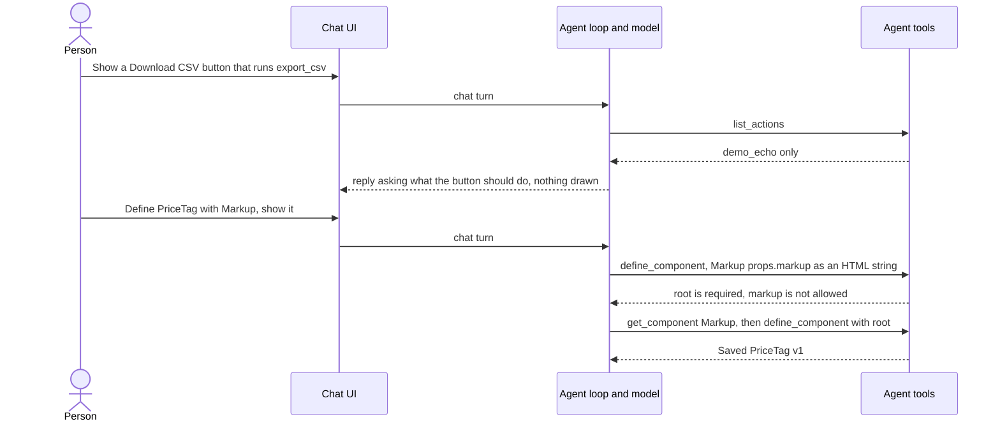
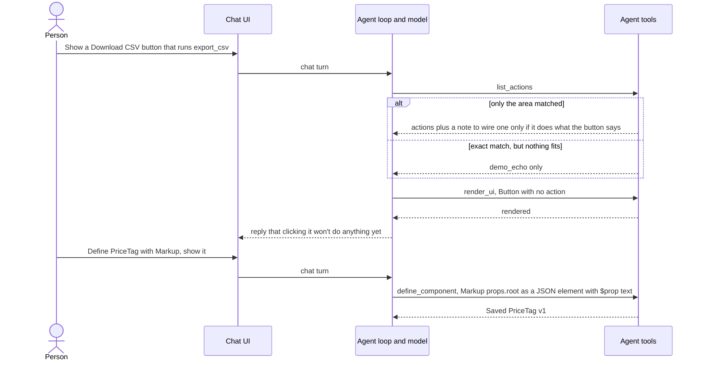
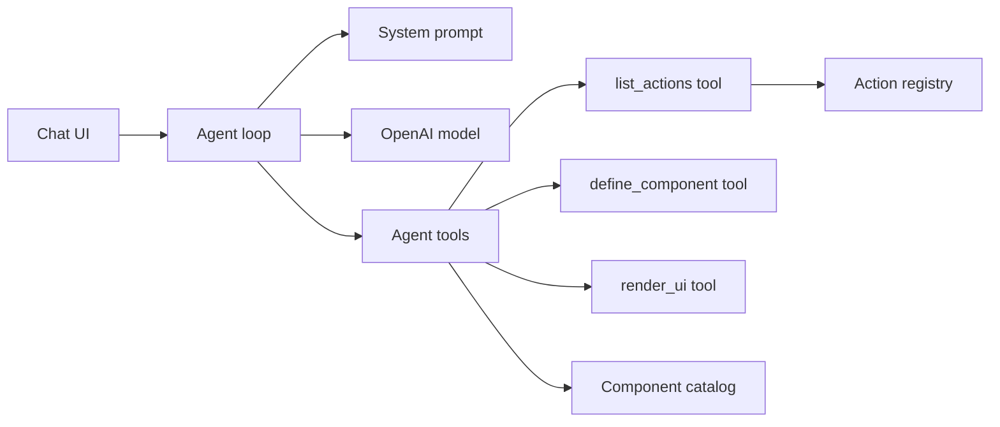
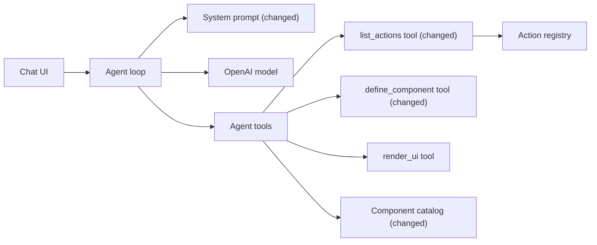

# Render buttons that have no fitting action, and show Markup's format up front

**Branch:** fix/eval-followups · **Written:** 2026-10-23 · **Supersedes:** -

## Summary

After the eval-findings fixes, `npm run eval -- --repeat 3` passed 54 of 60 attempts. All 6 failures were buttons that no registered action fits. The model asked a question instead of rendering (`invented-action-name` 0/3), wired the button to the unrelated demo echo action (`newsletter-no-action` 1/3), or offered the button without drawing it (`export-pdf` 2/3). Separately, the first `define_component` call in all six `price-tag` and `markup-prop-text` attempts wrote Markup as an HTML string, which cost a retry each time. This plan tightens the system prompt's no-fitting-action rule, flags area-only matches in `list_actions`, and describes Markup's `root` format where the model writes templates. It worked when a new `--repeat 3` run shows those three cases at 3/3, every other case still at 3/3, and no first `define_component` call refused for a missing `root`.

- **In scope:** the system prompt's step 5 action rule; a note on `list_actions` results that fall back to the area; Markup's `root` format in the `define_component` tool description and in the catalog's Markup `root` description; `docs/ARCHITECTURE.md` text for the changed rule and note.
- **Out of scope:** new eval cases or checks; changing `demo_echo`; a targeted error for Markup HTML strings; listing the Markup tag and style allowlist; server-side enforcement that a reply renders.
- **Open decisions:** none (see [Open decisions](#open-decisions))

### Behavior before



### Behavior after



### Architecture before



### Architecture after



### What changes

- The system prompt says what makes an action fit, that the button is still rendered when the person names a missing action or only an unrelated one comes back, that a stand-in action is never wired, and that a missing action is no reason to ask or to skip `render_ui`.
- `list_actions` adds a fixed `note` to results that fell back to the area's actions.
- The `define_component` tool description shows Markup's `root` format, with an example, `$prop` values and kebab-case style keys.
- The catalog's Markup `root` description says the same, so `get_component Markup` agrees.

---

## Current state

- **Eval run:** `eval-logs/2026-10-23T10-47-35.373Z` (gitignored, local only), `npm run eval -- --repeat 3` on main `84ee2fa`. Rates: `invented-action-name` 0/3, `newsletter-no-action` 1/3, `export-pdf` 2/3, the other 17 cases 3/3.
  - `invented-action-name` (all 3): `list_actions` returned only `demo_echo`; the model replied asking for the right action name or offering a placeholder, and never called `render_ui`.
  - `newsletter-no-action` attempts 1 and 2: `list_actions {"area": "other", "operation": "create"}` returned `match: "area"` with `demo_echo`; the model set `"action": "demo_echo"` on Subscribe and said it only echoes the email.
  - `export-pdf` attempt 2: after `list_actions`, the model replied "I can show an Export PDF button, but clicking it will not do anything yet" without calling `render_ui`.
  - All 3 attempts of `price-tag`, `markup-prop-text` and `markup-bold-tag` began with `define_component` whose Markup props were an HTML string (`markup` or `html`). Every one was refused with `template.props.root is required (call get_component Markup for its props)` and `template.props.<key> is not allowed`. None called `get_component Markup` before that first attempt. After reading it, the model sent `root`, then hit camelCase style keys (`alignItems`, fixed by the `(use align-items)` hint), a `style` string inside `attrs`, and the `b` tag (fixed by `(use strong)`).
- **System prompt:** `server/agent/systemPrompt.ts` exports `SYSTEM_PROMPT`. Step 5's second bullet reads: "Set the Button's action prop to the name of a returned action that fits. If no action fits, render the button without an action and say that clicking it won't do anything yet." The Rules section adds "If the request is unclear in a way that changes the design, ask one short question." and "Never invent action names; use only names list_actions returned." The file's comment says catalog contents stay out of the prompt so it never goes stale.
- **System prompt tests:** `server/agent/systemPrompt.test.ts` asserts exact sentences with `includes`, including "If no action fits, render the button without an action" and `/won't do anything yet/`. It also fails on any snake_case word that is not a registered tool name, so the prompt cannot say `demo_echo`.
- **list_actions:** `listActionsTool` in `server/agent/tools/actions.ts`. When no action fits both `area` and `operation`, it returns the area's actions with `match: "area"` and the summary `Listed <n> actions (no exact match)`. The result `data` holds `match`, `actions`, `others` and optionally `choices`. Tests in `server/agent/tools/actions.test.ts` ("falls back to the area's actions when none fit both") check the summary, `match` and names.
- **Registered actions in eval:** `server/eval/runner.ts` wires `createActions()` (`demo_echo`, `server/actions/demo.ts`, description "Demo action with no side effects: replies with the text it was sent.") and `createMenuActions`. `demo_echo` has area and operation `other`, so `list_actions` with area `other` returns it as an exact match for operation `other` and as an area match for any other operation.
- **define_component:** `defineComponentTool` in `server/agent/tools/customComponents.ts`. The `template` property description says Markup "may draw what nothing else can", explains `{"$prop": "<name>"}` and `{"$children": true}`, and says every declared prop must be used and `{{name}}` is not filled in. It does not describe Markup's props. Tests are in `server/agent/tools/customComponents.test.ts`; none assert the description text.
- **Markup catalog entry:** `server/catalog/components.ts`, entry `Markup`, `propsSchema.properties.root.description`: "The root element: { "tag", "attrs"?, "style"?, "text"?, "action"?, "children"? }, with allowlisted tags, attributes and inline style properties; no scripts, classes or event handlers. Only used inside custom component templates." It does not mention `$prop` or the style key format. `validateCatalog` (`server/catalog/validate.ts`, tests in `server/catalog/validate.test.ts`) requires a description on every property.
- **Where the catalog is read:** eval uses the in-memory `catalog` directly (`server/eval/runner.ts`). In production, `server/index.ts` runs `seedComponents` on start; in development, `npm run db:seed` updates the `components` table.
- **Markup rules:** `shared/markup.ts` (`MARKUP_HTML_TAGS`, `MARKUP_STYLE_PROPERTIES` in kebab-case). In templates, `checkTemplate` in `server/customComponents/definition.ts` accepts `{"$prop"}` for an element's `text` and for each `attrs` and `style` value (`fillable`).
- **Docs:** `docs/ARCHITECTURE.md` describes `list_actions` (the `**list_actions**` paragraph in §3, which mentions `match: "area"`) and the system prompt procedure (§4, the paragraph starting "The system prompt lives in").
- **Checks:** CI (`.github/workflows/ci.yml`) runs `npm ci`, `npm run db:migrate:traces`, `npm run typecheck`, `npm test`, `npm run build` and `npm run build:api`. `npm test` runs `server/**/*.test.ts` and `src/**/*.test.ts`. `npm run eval` needs `OPENAI_API_KEY` and is not run in CI.

## Requirements

### R1: Render the button when no action fits

The system prompt MUST tell the model that an action fits only when its description does what the button should do, and that when none fits it still calls `render_ui` with the button and no `action` prop, then says clicking it won't do anything yet. This holds when the person names an action `list_actions` did not return, and when only a demo or other unrelated action came back. A missing action MUST NOT be a reason to ask a question or to skip `render_ui`. All three failure patterns in the eval run come from the model treating the current rule as optional.

**Acceptance:**

- `SYSTEM_PROMPT` step 5's second bullet is exactly the sentence given under [Interfaces](#interfaces).
- It still contains "If no action fits, render the button without an action" and "won't do anything yet".
- It contains no snake_case word other than registered tool names (the existing test passes), so it never names `demo_echo`.
- Every other sentence the existing `systemPrompt.test.ts` asserts is unchanged, including the Rules sentences "Never invent action names; use only names list_actions returned." and "If the request is unclear in a way that changes the design, ask one short question."

### R2: Flag area-only matches in list_actions

When `list_actions` finds no action that fits both `area` and `operation` and returns the area's actions instead (`match: "area"`), its result `data` MUST include a `note` holding the fixed `AREA_FALLBACK_NOTE` string. That string says these actions do something else, that one may be wired only if its description does what the button should do, and that otherwise the button is rendered without an action. In `newsletter-no-action` the model read `match: "area"` and still wired `demo_echo`.

**Acceptance:**

- A call that falls back to the area (the existing `{ area: "items", operation: "delete" }` test) returns `data.note === AREA_FALLBACK_NOTE`, with `match`, `actions`, `others` and the summary `Listed 4 actions (no exact match)` unchanged.
- An exact match has no `note` key, and neither does a registry with no actions (`match: "exact"`, empty lists).
- The note is a constant: it contains no argument value, action name or description.
- `AREA_FALLBACK_NOTE` is exported from `server/agent/tools/actions.ts`.

### R3: Describe Markup's root format in define_component

The `define_component` tool's `template` property description MUST say that Markup takes one prop, `root`, a JSON element and never an HTML string, that its text, attribute and style values may be `{"$prop": "<name>"}`, that style keys are kebab-case CSS properties and go in `style`, not `attrs`, and give one example. This is the description the model reads when it writes a template, and in every attempt it wrote an HTML string before ever calling `get_component Markup`.

**Acceptance:**

- The `template` description ends with the exact text given under [Interfaces](#interfaces). The rest of the description, and the tool's top-level `description`, are unchanged.
- The example in it is valid JSON and is a template that `validateDefinition` accepts with a declared string prop `label` (a test saves a definition whose template is the example).
- A test in `server/agent/tools/customComponents.test.ts` asserts the description contains `never an HTML string`, `{"$prop": "<name>"}` and `kebab-case`.

### R4: Describe $prop and style keys in Markup's root description

The catalog's Markup `root` description MUST say the root is a JSON tree, never an HTML string, that style keys are kebab-case CSS properties set in `style` rather than `attrs`, and that in a template, text, attribute and style values may be `{"$prop": "<name>"}`. Then `get_component Markup` agrees with the `define_component` description.

**Acceptance:**

- `propsSchema.properties.root.description` of the `Markup` entry is exactly the text given under [Interfaces](#interfaces).
- `validateCatalog(catalog)` still returns no problems, and the Markup `exampleProps` are unchanged.
- A new test file `server/catalog/components.test.ts` asserts the description contains `never an HTML string`, `kebab-case` and `{"$prop": "<name>"}`.

### R5: Document the changed rule and note

`docs/ARCHITECTURE.md` MUST describe R1's rule in the system prompt paragraph (§4) and R2's `note` in the `list_actions` paragraph (§3).

**Acceptance:**

- The §4 system prompt paragraph says a Button with no fitting action is still rendered without an action, including when the person names an action that was not returned, that a stand-in action is never wired, and that a missing action is no reason to ask.
- The §3 `list_actions` paragraph says an area fallback carries a fixed `note`.

## Design

### Components

- `server/agent/systemPrompt.ts`: replace step 5's second bullet. No other line changes.
- `server/agent/tools/actions.ts`: add the exported constant and set `data.note` when `match === "area"`, placed right after `match` so the model reads it before the list.
- `server/agent/tools/customComponents.ts`: append R3's text to the `template` property description.
- `server/catalog/components.ts`: replace the Markup `root` description.
- `docs/ARCHITECTURE.md`: two paragraph edits.

### Interfaces

- `server/agent/systemPrompt.ts`, step 5 second bullet (three-space indent, like its siblings):

  ```text
     - Set the Button's action prop to the name of a returned action that fits: one whose description does what the button should do. If no action fits, render the button without an action and say that clicking it won't do anything yet. Do this also when the person names an action list_actions didn't return, or when only a demo or other unrelated action came back: never wire one as a stand-in. A missing action is not a reason to ask a question or to skip render_ui.
  ```

- `server/agent/tools/actions.ts` (additive):

  ```ts
  /** Added to an area fallback, whose actions do something other than the operation asked for. */
  export const AREA_FALLBACK_NOTE =
    "No action fits both this area and operation, so these are the area's other actions. Use one only if its description does what the button should do; otherwise render the button without an action.";
  ```

  `data` becomes `{ match, ...(match === "area" ? { note: AREA_FALLBACK_NOTE } : {}), actions, others, choices? }`.

- `server/agent/tools/customComponents.ts`, text appended to the `template` property description after "never filled in.":

  ```text
   Markup takes one prop, root: a JSON element {"tag", "attrs"?, "style"?, "text"?, "children"?}, never an HTML string. Its text, attribute and style values may be {"$prop": "<name>"}. Style keys are kebab-case CSS properties, such as font-weight, and go in style, not attrs. Example: {"component": "Markup", "props": {"root": {"tag": "span", "children": [{"tag": "strong", "text": {"$prop": "label"}}]}}}.
  ```

- `server/catalog/components.ts`, Markup `propsSchema.properties.root.description`:

  ```text
  The root element: { "tag", "attrs"?, "style"?, "text"?, "action"?, "children"? }, a JSON tree, never an HTML string, with allowlisted tags, attributes and inline style properties; no scripts, classes or event handlers. Style keys are kebab-case CSS properties, such as font-weight, and go in style, not attrs. In a template, text, attribute and style values may be {"$prop": "<name>"}. Only used inside custom component templates.
  ```

### Errors and edge cases

- R1: `echo-form` asks for "the demo echo action" by name, so `demo_echo` fits it and the rule does not stop it being wired.
- R1: `render_ui` already refuses a Button `action` that is not registered (`server/ui/validateTree.ts`), so a model that copies a missing action name into the tree gets a problem and fixes it. The prompt does not rely on that.
- R1: `mockup-no-action` and designs without server buttons skip `list_actions` (step 2) and are unaffected.
- R2: when `area` is `any` and no action has the operation, the fallback lists every action (up to `MAX_LISTED_ACTIONS`) and still carries the note, which is still correct.
- R2: when the model guessed the wrong operation (for example `edit` for an archive), the right action is in the area list and its description does what the button should do, so the note still allows it.
- R3, R4: the texts name only allowlisted things (`strong`, `span`, `font-weight`) and change no rule. `sanitizeMarkup` and `validateDefinition` are untouched.

### Compatibility and rollout

- The prompt and descriptions are sent on every model call, adding about 150 tokens per call in total.
- R4 changes a catalog row. Production reseeds on start (`server/index.ts`); in development, run `npm run db:seed`. Eval reads the catalog file and needs no seed.
- `AREA_FALLBACK_NOTE` and `data.note` are additive. Nothing in the browser reads `list_actions` results.
- No migrations, no new configuration.

## Security

| Concern | Mitigation | Enforced by |
|---|---|---|
| A button wired to an unrelated action sends what the person typed to server code they did not ask for | The prompt forbids stand-in actions; the area fallback tells the model the listed actions do something else; `render_ui` still refuses unregistered names | R1, R2 |
| Tool-result text steering the model | The note is a fixed server string with no argument, action name or description in it | R2 |
| Documentation hinting at Markup features the allowlist refuses, weakening the HTML and SVG rules shared with the browser | The texts name only allowlisted tags and properties; no sanitizer or validator code changes | R3, R4 |
| Personal data in prompts, logs or plans | None added; no user text is echoed | R1, R2, R3, R4 |
| New dependencies | None | R1, R2, R3, R4 |

## Validation

**Workers can run** (no credentials or live services):

- `npm run typecheck`: the new constant and the `data` change compile.
- `npm test`: system prompt sentences, `list_actions` results, `define_component` description and example, and the catalog description. Database and Redis tests skip without `DATABASE_URL` and `REDIS_URL`.
- `npm run build` and `npm run build:api`: both bundles still build.

**New tests:**

- R1: `server/agent/systemPrompt.test.ts`: the new bullet is present exactly; "If no action fits, render the button without an action" and "won't do anything yet" still present; the snake_case test still passes.
- R2: `server/agent/tools/actions.test.ts`: the area fallback carries `note: AREA_FALLBACK_NOTE` and keeps its summary; an exact match and an empty registry have no `note`.
- R3: `server/agent/tools/customComponents.test.ts`: the `template` description contains the three phrases; a definition whose template is the description's example (prop `label`, `exampleProps` `{ "label": "New" }`) saves as v1.
- R4: `server/catalog/components.test.ts` (new): the Markup `root` description contains the three phrases; `validateCatalog(catalog)` returns no problems.
- R5: none (docs).

**After merge** (needs credentials, live services, or a person):

- `npm run db:seed` in development, so the Markup description reaches the `components` table.
- `npm run eval -- --repeat 3` with `OPENAI_API_KEY` set: `invented-action-name`, `newsletter-no-action` and `export-pdf` at 3/3, and every other case still 3/3 (especially `echo-form`, `archive-item`, `menu-create-item`, `menu-delete-category`).
- In that run's directory, `grep -l 'template.props.root is required' price-tag.*.json markup-prop-text.*.json markup-bold-tag.*.json` lists no files. Compare `promptTokens` for those cases with `eval-logs/2026-10-23T10-47-35.373Z`.

## Work breakdown

| Slice | Covers | Touches | After | Size |
|---|---|---|---|---|
| no-action-rule | R1, R2, R5 | server/agent/systemPrompt.ts, server/agent/systemPrompt.test.ts, server/agent/tools/actions.ts, server/agent/tools/actions.test.ts, docs/ARCHITECTURE.md | - | small |
| markup-format-docs | R3, R4 | server/agent/tools/customComponents.ts, server/agent/tools/customComponents.test.ts, server/catalog/components.ts, server/catalog/components.test.ts | - | small |

The two slices share no files and no interfaces, so they can run in parallel from the start.

## Non-goals

- New eval cases or checks, such as a check that the first `define_component` call succeeds. The after-merge grep measures that once.
- Changing `demo_echo`'s description or registration.
- A targeted `define_component` error for Markup HTML strings. The existing `root is required (call get_component Markup for its props)` hint already recovers in one retry.
- Listing the full Markup tag and style allowlist in the catalog.
- Server-side enforcement that a turn which called `list_actions` ends with `render_ui`.
- Changing the Rules section's "ask one short question" sentence.

## Assumptions

- The rule goes in step 5 rather than in Rules, because step 5 is where the model decides what to wire; the "ask one short question" rule stays as it is, and the new bullet says a missing action is not a reason to ask.
- The prompt says "a demo or other unrelated action" instead of naming `demo_echo`, because the prompt test refuses snake_case words that are not tools, and the rule should hold for any registry.
- The Markup format goes in tool and catalog descriptions, not the system prompt, because the prompt keeps catalog contents out on purpose (comment in `server/agent/systemPrompt.ts`), and the `define_component` description is in front of the model when it writes a template.
- The example uses a generic `label` prop and a `strong` tag, not the eval prompts' `price` or `SALE`, so it teaches the format without fitting the eval cases.
- A `note` field is added rather than changing the summary string, so existing summary assertions and log readers keep working.

## Risks

- The new cases are live and nondeterministic: run `--repeat 3` and treat a rate under 3/3 as a finding, not a regression.
- The stricter "fits" wording could make the model skip an action that does fit when its description is terse (for example a menu action): the after-merge run covers all menu cases; if one drops, reword the action's description rather than the rule.
- The model may still skip `render_ui` after `list_actions` despite R1: if `invented-action-name` or `export-pdf` stay under 3/3, consider a loop-level nudge in a later plan.
- Longer descriptions add about 150 tokens per call: small next to the steps they replace (the refused first attempt plus `get_component Markup` added two model steps of about 2,600 to 2,900 prompt tokens each in `price-tag` and `markup-prop-text`).
- Follow-up: the model never read `get_component Markup` before its first template, despite step 3. If R3 does not fix first attempts, a targeted error for a string-valued Markup prop is the next step.

## Open decisions

None.

## References

- Request: "Follow-up to the eval-findings-fixes plan, from the eval run eval-logs/2026-10-23T10-47-35.373Z (npm run eval -- --repeat 3 on main 84ee2fa: 54/60 attempts). Fix (1) the no-fitting-action rule: invented-action-name 0/3 (model asks instead of rendering when the named action isn't returned), newsletter-no-action 1/3 (wires Subscribe to unrelated demo_echo), export-pdf 2/3 (says it can show the button but doesn't render) — system prompt step 5 at server/agent/systemPrompt.ts:28; (2) the model writes Markup as an HTML string (props.markup "[span]…{$prop:price}…[/span]", HTML tags shown in brackets here) on its first define_component attempt in 6/6 price-tag and markup-prop-text attempts, costing retries — document the Markup root format and $prop up front."
- Eval logs: `eval-logs/2026-10-23T10-47-35.373Z` (gitignored, local only)
- Earlier plan: `daniel-super-secret-workflow/plans/eval-findings-fixes.md` on branch `fix/eval-findings` (local only), whose After merge section asked for this follow-up
- [server/agent/systemPrompt.ts](../../server/agent/systemPrompt.ts), [server/agent/systemPrompt.test.ts](../../server/agent/systemPrompt.test.ts)
- [server/agent/tools/actions.ts](../../server/agent/tools/actions.ts), [server/agent/tools/actions.test.ts](../../server/agent/tools/actions.test.ts), [server/actions/demo.ts](../../server/actions/demo.ts)
- [server/agent/tools/customComponents.ts](../../server/agent/tools/customComponents.ts), [server/customComponents/definition.ts](../../server/customComponents/definition.ts)
- [server/catalog/components.ts](../../server/catalog/components.ts), [server/catalog/validate.ts](../../server/catalog/validate.ts), [shared/markup.ts](../../shared/markup.ts)
- [server/eval/runner.ts](../../server/eval/runner.ts), [server/index.ts](../../server/index.ts), [docs/ARCHITECTURE.md](../../docs/ARCHITECTURE.md)
