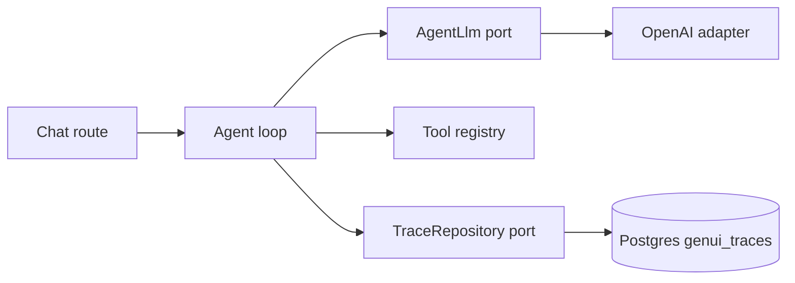
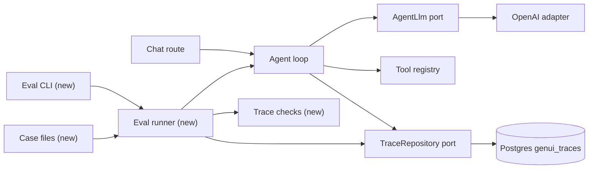

# Run live agent turns against committed checks

**Branch:** eval-harness · **Written:** 2026-10-22 · **Supersedes:** -

## Summary

We can already record what a chat turn did, but we still only know whether the live agent actually builds a usable UI by typing in the browser and looking. This plan adds a small command that sends two committed prompts through the real agent (live OpenAI, same tools and system prompt as chat) and scores the saved turn trace with deterministic checks: did it finish cleanly, did `render_ui` succeed, does the tree have the component or action we asked for. Workers prove the loader, checkers, and runner with a scripted model. It worked when `npm run eval` with a key exits 0 on those two cases, and when the same runner fails a check without printing trees or user text.

- **In scope:** a case file format and checkers on `AgentTrace`; a runner that calls `runAgent` with injectable `AgentLlm` and in-memory ports; `npm run eval` for live OpenAI; two starter cases; architecture and README notes.
- **Out of scope:** an eval HTTP or UI; LLM-as-judge; exact golden trees; recording OpenAI traffic; writing eval traces to `genui_traces`; live evals in CI; changing the loop, SSE, prompt, or guardrails.
- **Open decisions:** none (see [Open decisions](#open-decisions))

### Behavior before

```mermaid
sequenceDiagram
  actor Dev
  participant Browser
  participant Loop as Agent loop
  participant OpenAI
  participant Traces as Trace repository
  Dev->>Browser: types a prompt in chat
  Browser->>Loop: POST /api/agent/chat
  Loop->>OpenAI: live completions
  Loop-->>Browser: SSE text, tool, and ui events
  Loop->>Traces: save this turn's trace
  Dev->>Dev: judges the sandbox by eye
```

### Behavior after

```mermaid
sequenceDiagram
  actor Dev
  participant Browser
  participant Loop as Agent loop
  participant OpenAI
  participant Traces as Trace repository
  Dev->>Browser: still chats as today
  Dev->>Loop: npm run eval runs runAgent with the case prompt
  Loop->>OpenAI: live completions for each case prompt
  Loop->>Traces: save this turn's trace
  alt every check on the trace passes
    Loop-->>Dev: pass, exit 0
  else a check fails or the turn errors
    Loop-->>Dev: fail, check names and endedBy only, exit 1
  end
```

### Architecture before



### Architecture after



### What changes

- A developer can score live agent turns from the command line, without opening the chat.
- Each case is a committed prompt plus checks on the saved `AgentTrace`, not an exact UI tree.
- The eval process uses in-memory catalog, menu, custom components, and traces; it does not write `genui_traces` or go through HTTP.
- Chat, SSE, and the traces database stay as they are.

---

## Current state

Turn traces already exist as `AgentTrace` in [server/agent/trace.ts](../../server/agent/trace.ts). [server/agent/loop.ts](../../server/agent/loop.ts) `runAgent` / `runTurn` fills one per turn and, in `finally`, calls `run.traces.save`. [server/ports/TraceRepository.ts](../../server/ports/TraceRepository.ts) is `{ save, listByConversation }` with `MAX_TRACES_PER_CONVERSATION = 5`. Tests use [server/ports/fakes/InMemoryTraceRepository.ts](../../server/ports/fakes/InMemoryTraceRepository.ts). Production writes [server/adapters/traces/DrizzleTraceRepository.ts](../../server/adapters/traces/DrizzleTraceRepository.ts) into `genui_traces`. There is no HTTP route for traces ([docs/ARCHITECTURE.md](../../docs/ARCHITECTURE.md) §5).

The live model is [server/adapters/openai/OpenAILlm.ts](../../server/adapters/openai/OpenAILlm.ts) `createOpenAILlm`, wired in [server/index.ts](../../server/index.ts) with `SYSTEM_PROMPT` from [server/agent/systemPrompt.ts](../../server/agent/systemPrompt.ts) and `config.openai` from [server/config.ts](../../server/config.ts) (`OPENAI_API_KEY`, `AGENT_MODEL` default `gpt-4.1`). `agentAvailable` is true only when the key is non-empty. Without a key, [server/routes/agent.ts](../../server/routes/agent.ts) emits an `error` event instead of calling `runAgent`.

Tools the agent may call are [server/agent/tools/index.ts](../../server/agent/tools/index.ts) `createAgentTools`: `list_components`, `get_component`, `list_actions`, `render_ui`, and, when a `CustomComponentRepository` is passed, `define_component` / `delete_component`. Production passes catalog Postgres, custom-component Postgres, and [server/actions/index.ts](../../server/actions/index.ts) `createActions` plus [server/actions/menu/index.ts](../../server/actions/menu/index.ts) `createMenuActions` over [server/adapters/pos/InMemoryPosMenu.ts](../../server/adapters/pos/InMemoryPosMenu.ts). Tests already run the real tools against [server/ports/fakes/InMemoryComponentRepository.ts](../../server/ports/fakes/InMemoryComponentRepository.ts) and [server/ports/fakes/InMemoryCustomComponentRepository.ts](../../server/ports/fakes/InMemoryCustomComponentRepository.ts) in [server/agent/loop.test.ts](../../server/agent/loop.test.ts) (`scriptedLlm` is local to that file).

`demo_echo` in [server/actions/demo.ts](../../server/actions/demo.ts) has one optional string property `text` and no `area` / `operation` (those count as `other`). The catalog includes `Heading` ([server/catalog/components.ts](../../server/catalog/components.ts)). [server/ui/bindings.ts](../../server/ui/bindings.ts) `collectBindings` walks a tree for named inputs and action Buttons (including Markup).

There is no `server/eval/` directory, no `npm run eval`, and no live-model test. [package.json](../../package.json) `npm test` already globs `server/**/*.test.ts`. [tsconfig.server.json](../../tsconfig.server.json) includes `server`. CI ([.github/workflows/ci.yml](../../.github/workflows/ci.yml)) runs `npm run typecheck`, `npm test`, `npm run build`, `npm run build:api` and does not set `OPENAI_API_KEY`.

**Checks:** `npm run typecheck`, `npm test`, `npm run build`, `npm run build:api`. **New:** `npm run eval`.

## Requirements

### R1: Case file format

The harness MUST load eval cases from committed JSON files. Each case MUST have a unique kebab-case `id`, a non-empty `prompt` no longer than `MAX_MESSAGE_CHARS` (4000, [shared/api.ts](../../shared/api.ts)), and a non-empty `checks` array of the check objects in R2. A file that fails that shape MUST be refused before any turn runs.

**Acceptance:**

- `server/eval/cases/*.json` files with those three fields load; `id` values across files are unique.
- A missing `id`, empty `prompt`, `prompt` longer than 4000, empty `checks`, unknown check key, or duplicate `id` throws a clear error and runs no case.
- Load does not call the model.

### R2: Deterministic trace checks

A check MUST pass or fail from an `AgentTrace` alone, with no second model and no exact tree equality. The allowed checks are `endedBy`, `noError`, `toolCalled`, `toolSucceeded`, `uiComponent`, `uiButtonAction`, and `uiNamedInput`. UI checks MUST use the last successful `render_ui` tree on the trace (`result.ok`, `ui` present, not skipped).

**Acceptance:**

- `endedBy` passes when `trace.endedBy` equals the given value.
- `noError` passes when `trace.error` is omitted.
- `toolCalled` passes when any recorded call has that `call.name`.
- `toolSucceeded` passes when any recorded call has that `call.name`, `result.ok === true`, and `skipped` omitted.
- `uiComponent` passes when some node of that last tree has `component` equal to the given catalog name.
- `uiButtonAction` passes when `collectBindings` on that tree has a button whose `action` equals the given name.
- `uiNamedInput` passes when `collectBindings` on that tree has an input whose `name` equals the given name.
- If there is no last successful `render_ui` tree, every UI check fails with a reason that says so.
- A failing check's reason names the check and does not include `userText`, completion text, tool arguments, or a UI tree.

### R3: Isolated runner with injectable model

The runner MUST call `runAgent` once per case with a fresh conversation id, the production tool set built over in-memory ports (catalog file, empty custom components, `demo_echo` plus the fourteen menu actions on a fresh in-memory menu), and the injected `AgentLlm`. It MUST read the turn from `InMemoryTraceRepository.listByConversation`, apply R2, then `resetConversation`. It MUST NOT open Postgres, Redis, or an HTTP server.

**Acceptance:**

- With a scripted `AgentLlm` that lists components and `render_ui`s a `Heading`, a case that checks `toolSucceeded: "render_ui"` and `uiComponent: "Heading"` passes.
- With a scripted `AgentLlm` that only replies with text, that same case fails `toolSucceeded` and `uiComponent` and still returns a result (does not throw).
- After a case, `hasConversation` is false for that id.
- The runner does not import `createDb`, `createTracesDb`, or `createRedis`, and does not call `createOpenAILlm` (the CLI does).

### R4: Live CLI requires a key

`npm run eval` MUST run every loaded case against `createOpenAILlm` using `config.openai` and `SYSTEM_PROMPT`. Without `OPENAI_API_KEY` it MUST exit non-zero with a message that names that variable, and MUST NOT call the network. A failed case MUST NOT stop the remaining cases. The process exits 0 only when every case passed. Logs and stdout MUST omit `userText`, completions, tool arguments, and UI trees.

**Acceptance:**

- `package.json` has `"eval"` that runs the CLI with `--env-file-if-exists=.env.local` (same pattern as `dev:api`).
- With the key unset or empty, the CLI prints that `OPENAI_API_KEY` is required and exits 1 (or 2); no case starts.
- With a key, cases run one after another; each line of the report is `pass` or `fail`, the case `id`, and on fail the check reasons plus `endedBy` and `error` when present.
- One failed case still runs the next; exit 1 if any failed.
- A 180-second abort per case; on abort the case fails (reason mentions timeout) and the next case still runs.

### R5: Starter case — heading

The suite MUST include a live case that asks for a heading and checks that the turn rendered one.

**Acceptance:**

- File `server/eval/cases/simple-heading.json`: `id` `simple-heading`, `prompt` `Show a heading that says Hello`, `checks` `endedBy: "reply"`, `noError`, `toolSucceeded: "render_ui"`, `uiComponent: "Heading"`.
- Workers do not run this case against OpenAI.

### R6: Starter case — echo form

The suite MUST include a live case that asks for a form whose button runs `demo_echo` with a named `text` input.

**Acceptance:**

- File `server/eval/cases/echo-form.json`: `id` `echo-form`, `prompt` `Show a form with a text field and a button that runs the demo echo action with what I type`, `checks` `endedBy: "reply"`, `noError`, `toolCalled: "list_actions"`, `toolSucceeded: "render_ui"`, `uiButtonAction: "demo_echo"`, `uiNamedInput: "text"`.
- Workers do not run this case against OpenAI.

### R7: Docs mention the command

[docs/ARCHITECTURE.md](../../docs/ARCHITECTURE.md) and [README.md](../../README.md) MUST describe the eval command as a live-model check that is not part of CI.

**Acceptance:**

- §8 lists `server/eval/` next to `server/agent/`.
- §9 includes `npm run eval` and says it needs `OPENAI_API_KEY`, uses the same model as chat, and is not run in CI.
- §10 says two committed live cases score the turn trace (heading; `demo_echo` form).
- README "Other scripts" includes `npm run eval` with the same key requirement.

## Design

### Components

- **`server/eval/types.ts` (new).** `EvalCheck`, `EvalCase`, `CheckFailure`, `EvalCaseResult`. No I/O.
- **`server/eval/loadCases.ts` (new).** Reads `server/eval/cases/*.json` (directory passed in, default that folder). Validates R1. Sort by `id`.
- **`server/eval/checks.ts` (new).** `checkTrace(trace, checks)`. Last successful `render_ui` tree: last `AgentTraceToolCall` with `call.name === "render_ui"`, `result.ok`, `ui` set, no `skipped`. Tree walk for `uiComponent`. `collectBindings` for the two binding checks.
- **`server/eval/runner.ts` (new).** `createEvalTools()` builds `createToolRegistry(createAgentTools({ components: new InMemoryComponentRepository(catalog), customComponents: new InMemoryCustomComponentRepository(), actions: registry.specs, listChoices: registry.listChoices }))` where `registry` is `createActionRegistry([...createActions(), ...createMenuActions(createInMemoryPosMenu())])`. `runEvalCase(case, { llm, now? })` creates `InMemoryTraceRepository`, `conversationId` `eval:<id>:<uuid>`, `AbortSignal` 180s, `runAgent(case.prompt, id, run, llm)`, then `listByConversation`, `checkTrace`, `resetConversation` in `finally`.
- **`server/eval/cli.ts` (new).** If `!agentAvailable`, print and exit. Else `createOpenAILlm({ apiKey, model, maxOutputTokens, systemPrompt: SYSTEM_PROMPT })`, `loadCases`, `runEvalCase` each, print the report, `process.exit`.
- **Cases (new).** The two JSON files in R5 and R6.
- **Docs.** [docs/ARCHITECTURE.md](../../docs/ARCHITECTURE.md) §8–§10, [README.md](../../README.md), [package.json](../../package.json) script.

Do not change [server/agent/loop.ts](../../server/agent/loop.ts), routes, or the traces adapter. Do not export `scriptedLlm` from the loop tests; eval tests keep their own helper.

### Interfaces

```ts
import type { EndedBy, AgentTrace } from "../agent/trace";
import type { AgentLlm } from "../ports/AgentLlm";

export type EvalCheck =
  | { endedBy: EndedBy }
  | { noError: true }
  | { toolCalled: string }
  | { toolSucceeded: string }
  | { uiComponent: string }
  | { uiButtonAction: string }
  | { uiNamedInput: string };

export interface EvalCase {
  id: string; // kebab-case, unique
  prompt: string; // 1..=MAX_MESSAGE_CHARS
  checks: EvalCheck[]; // length >= 1
}

export interface CheckFailure {
  check: EvalCheck;
  reason: string;
}

export interface EvalCaseResult {
  id: string;
  ok: boolean;
  failures: CheckFailure[];
  endedBy?: EndedBy;
  error?: string;
}

export function loadCases(dir: string): EvalCase[];
export function checkTrace(trace: AgentTrace, checks: EvalCheck[]): CheckFailure[];
export function runEvalCase(
  evalCase: EvalCase,
  opts: { llm: AgentLlm; signal?: AbortSignal },
): Promise<EvalCaseResult>;
```

A check object MUST have exactly one of those keys. `noError` MUST be `true`. Unknown keys fail load (R1).

**Command (new):** `npm run eval` → `tsx --tsconfig ./tsconfig.server.json --env-file-if-exists=.env.local server/eval/cli.ts`

**Env (existing names only):** `OPENAI_API_KEY` (required for the CLI), `AGENT_MODEL`, `AGENT_MAX_OUTPUT_TOKENS`. No new variables.

### Errors and edge cases

- No key: CLI exits before load or after load, but before `createOpenAILlm` / `runAgent` (R4).
- `save` would fail: the in-memory fake does not throw; if it did, today's loop still finishes and the runner would see an empty list and fail every check.
- OpenAI throws or aborts: `runAgent` may emit `error` or store `endedBy: "stopped"`; the case fails checks, the CLI continues.
- No `render_ui` on the trace: UI checks fail with a fixed reason, not a throw.
- Two cases share no conversation id and no menu instance (a new `createInMemoryPosMenu` per case, or one per process; either is fine because these cases do not mutate the menu).
- Case JSON with extra fields: refuse at load.

### Compatibility and rollout

Additive. No SSE, health, or schema change. CI stays unchanged (no key, no `npm run eval`). Chat still works without running evals. Rollback is delete `server/eval/` and the script.

## Security

| Concern | Mitigation | Enforced by |
|---|---|---|
| CLI reads `OPENAI_API_KEY` | Same config as the API; name the variable, never a value; do not log the key | R4 |
| Traces hold prompts, tool args, and UI trees | Eval uses in-memory traces only; report and fail reasons omit `userText`, completions, args, and trees | R2, R3, R4 |
| New way to spend OpenAI quota | CLI only, two committed cases, not an HTTP route, not CI | R4, R5, R6 |
| Accidental eval writes into `genui_traces` | Runner constructs `InMemoryTraceRepository`; no traces client import | R3 |
| Case prompts committed | They are fixture text, not customer data | R5, R6 |

## Validation

**Workers can run** (no credentials or live services):

- `npm test`: load errors, each check pass/fail against fixture traces, runner pass/fail with a scripted `AgentLlm`, CLI refuses an empty key
- `npm run typecheck`
- `npm run build` / `npm run build:api`

**New tests:**

- R1: `server/eval/loadCases.test.ts` — valid pair of files; each refusal in R1
- R2: `server/eval/checks.test.ts` — one fixture trace per check that passes and one that fails; UI checks with no `render_ui`; fail reasons omit `userText`
- R3: `server/eval/runner.test.ts` — scripted heading pass; text-only fail; conversation gone after
- R4: `server/eval/cli.test.ts` — empty key exits non-zero and the message includes `OPENAI_API_KEY` (invoke the exported `main`, do not spawn a network client)
- R5, R6: load the two committed files and assert `id` / `prompt` / `checks` match this plan (no live call)
- R7: no automated test; review the doc lines

**After merge** (needs credentials, live services, or a person):

- With `OPENAI_API_KEY` in `.env.local`, `npm run eval` exits 0 on `simple-heading` and `echo-form`
- If a case fails, the printed reasons have no tree JSON and no prompt text
- `curl -s localhost:5173/api/health` is unchanged; `genui_traces` gains no row from the eval run

## Work breakdown

| Slice | Covers | Touches | After | Size |
|---|---|---|---|---|
| eval-checks | R1, R2 | server/eval/types.ts, server/eval/loadCases.ts, server/eval/loadCases.test.ts, server/eval/checks.ts, server/eval/checks.test.ts | - | small |
| eval-runner | R3 | server/eval/runner.ts, server/eval/runner.test.ts | eval-checks | medium |
| eval-cli | R4, R5, R6 | server/eval/cli.ts, server/eval/cli.test.ts, server/eval/cases/simple-heading.json, server/eval/cases/echo-form.json, package.json | eval-runner | medium |
| eval-docs | R7 | docs/ARCHITECTURE.md, README.md | eval-cli | small |

`eval-checks` lands the contract (`EvalCase`, `EvalCheck`, `checkTrace`, `loadCases`). `eval-runner` and then `eval-cli` can be one worker in that order; `eval-docs` last so the command name matches the script. Shared contract: the types in `server/eval/types.ts`.

## Non-goals

- An HTTP or chat UI for evals or traces
- LLM-as-judge or exact golden UI trees
- Recording or replaying raw OpenAI traffic
- Writing eval traces to `genui_traces` or raising the five-trace cap
- Running live cases in CI
- Menu, custom-component, or multi-turn cases
- Changing the agent loop, SSE events, system prompt, or guardrail limits

## Assumptions

- This branch starts from current `trace-db` HEAD because `TraceRepository` and durable traces are not on `main` yet; the harness reads the same `AgentTrace` type.
- Direct `runAgent` (not `POST /api/agent/chat`) is enough: traces are recorded in the loop, and HTTP would add rate limits without testing the checks.
- In-memory ports are the right eval world: the catalog file is the source of truth, and these two cases do not need Postgres.
- No retry on a live flake: a failed check fails the case. The prompts name "heading" and "demo echo" so they match the catalog and `demo_echo`.
- `noError: true` is the only `noError` value; a JSON `false` is an unknown shape and fails load.
- A new `createInMemoryPosMenu` per process is enough (cases do not click actions).

## Risks

- Live model skips `Heading` or names the echo input something other than `text`: the case fails until the prompt or check is loosened; checks stay behavioral, not golden trees (R2, R5, R6).
- Live model is slow or rate-limited: 180s abort per case, remaining cases still run (R4).
- Cost of two live turns per `npm run eval`: CLI only, not CI (R4).
- `loop.test.ts` `scriptedLlm` stays private so eval tests do not couple to it; a short local helper is duplicated (R3).

## Open decisions

None.

## References

- Request: "create an eval harness"
- Decisions: feature branch `eval-harness`; live OpenAI for product cases; deterministic checks on `AgentTrace`; two starter cases (heading; `demo_echo` form). Runner and checkers stay testable with a scripted model.
- Earlier traces work (this tree): [trace-db.md](../plans/trace-db.md). Earlier in-memory traces (not in this tree): `daniel-super-secret-workflow/plans/agent-trace.md` on the old `eval-harness` line.
- [server/agent/trace.ts](../../server/agent/trace.ts), [server/agent/loop.ts](../../server/agent/loop.ts), [server/agent/systemPrompt.ts](../../server/agent/systemPrompt.ts)
- [server/ports/TraceRepository.ts](../../server/ports/TraceRepository.ts), [server/ports/AgentLlm.ts](../../server/ports/AgentLlm.ts)
- [server/adapters/openai/OpenAILlm.ts](../../server/adapters/openai/OpenAILlm.ts), [server/index.ts](../../server/index.ts)
- [server/ui/bindings.ts](../../server/ui/bindings.ts), [server/actions/demo.ts](../../server/actions/demo.ts)
- [docs/ARCHITECTURE.md](../../docs/ARCHITECTURE.md) §4, §5, §8–§10
