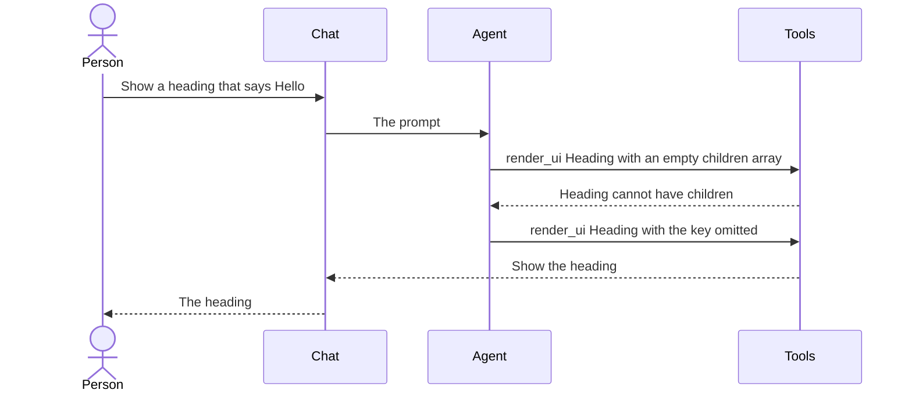
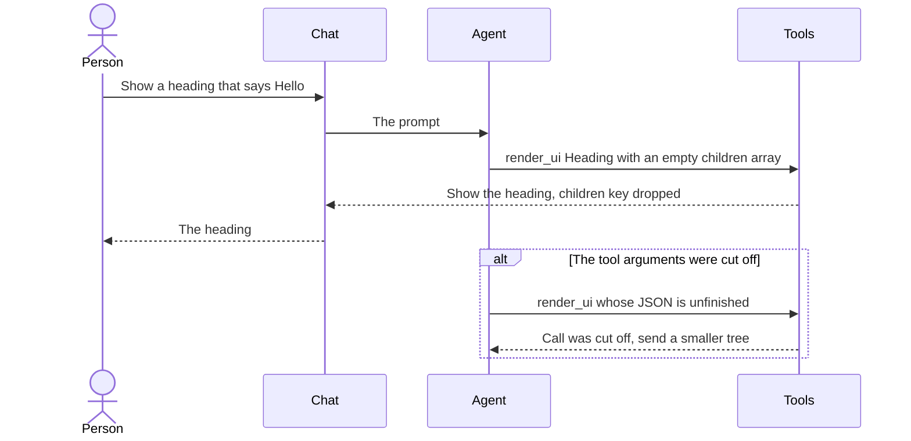
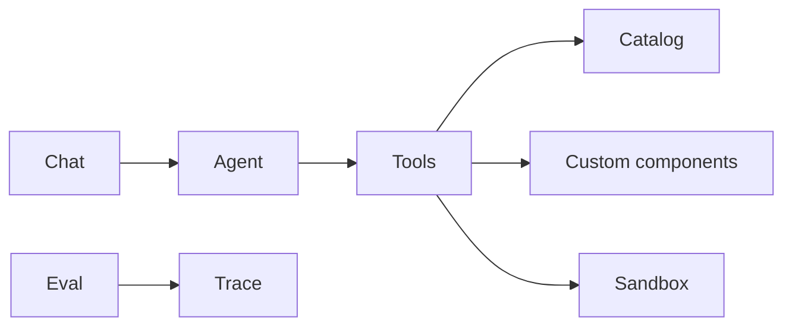
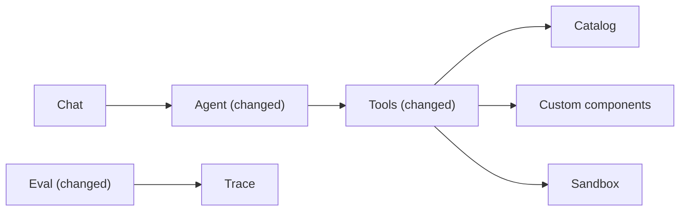

# Make empty children and cut-off tool calls succeed cleanly

**Branch:** eval-improvements · **Written:** 2026-10-22 · **Supersedes:** -

## Summary

Two eval runs on 22 October 2026 passed 8 of 9 cases. The failure is define-and-use-custom: the agent rendered PromoBanner, but the check looks at the expanded sandbox tree, which only contains Card, Heading, and Text. The same runs show the model sending an empty children array on components that cannot have children, then spending another step to remove it, and one run burning a whole turn after a cut-off render_ui was reported as a missing tree. This plan makes an empty children array mean the property was left out, tells the model when a tool call was cut off, asks it to read every component it will use in one turn, and adds eval cases for the behaviors the current nine never ask for. We will know it worked when the unit tests pass and a live eval run passes define-and-use-custom together with the new cases.

- **In scope:** Dropping an empty children array on a component whose children is none, before the check and before a tree is shown or saved. A cut-off tool call whose arguments are not finished JSON. Prompt lines for same-turn get_component, omitting children, and Checkbox for a boolean. An eval check for the component the agent named, a check that no button runs an action, a fix to define-and-use-custom, and five new eval cases.
- **Out of scope:** Multi-turn evals, reply wording, raising the output-token cap, rejecting a deep but valid tree, and running the live eval in CI.
- **Open decisions:** none (see [Open decisions](#open-decisions))

### Behavior before



### Behavior after



### Architecture before



### Architecture after



### What changes

- Tools drop an empty children array on a component that takes none, then show or save that tree.
- A tool call whose arguments were cut off is not run. The model is told to send a smaller tree.
- The prompt tells the model to read every component it will use in one turn, to omit children on a leaf, and to use Checkbox for a boolean.
- Eval can name the component in the agent's render_ui arguments, and new cases cover a slot, Markup, archiving an item, a button with no action, and an alert.

---

## Current state

The agent loop in `server/agent/loop.ts` runs each tool call through `handleToolCall`. `parseToolArguments` in `server/agent/openaiTools.ts` turns arguments that are not a JSON object into `{}`. A completion stopped for length sets `turn.truncated`, and the loop emits `TRUNCATED_NOTICE` ("The reply was cut off because it was too long."). The OpenAI adapter caps one completion at `DEFAULT_MAX_OUTPUT_TOKENS` (2048) in `server/agent/guardrails.ts`. The first `menu-delete-category` run hit that cap: the arguments did not parse, and the tool result was `Invalid arguments for render_ui` with `/tree is required`. The next call sent a tree plus extra root keys, and the call that succeeded still showed a nested empty Note card. The user-facing notice does not replace that schema error.

`validateUiTree` in `server/ui/validateTree.ts` reports `cannot have children` whenever `children` is present on a component whose catalog `children` is `none`, including an empty array. `expandTree` in `server/customComponents/expand.ts` does the same for a custom component instance (`tree PromoBanner cannot have children`) and leaves that node out. `validateDefinition` in `server/customComponents/definition.ts` expands the template with `exampleProps` and runs the same tree check, rewriting the path to `template.children.0 Heading cannot have children`. The definition that is saved is the object's own `template`. Only `Stack` and `Card` in `server/catalog/components.ts` have `children: "any"`. `shared/ui.ts` types `children` as optional and only for components that allow them. `render_ui` in `server/agent/tools/ui.ts` shows `design.tree`, the expanded tree, via `showUi`. The model's arguments stay on the trace as `call.args`.

The system prompt in `server/agent/systemPrompt.ts` shows every node as component, props, and children, and says only a component whose children is `any` may have children. It says to call `get_component` for each component the model will use. It does not say to call those reads in one turn, and it does not say that a boolean property uses Checkbox. `server/agent/systemPrompt.test.ts` asserts several of those sentences verbatim.

Eval checks in `server/eval/checks.ts` walk `toolCall.ui.tree`, which the loop copies from the `ui` event, so it is the expanded sandbox tree. `uiComponent: "PromoBanner"` cannot pass after a correct render. `server/eval/loadCases.ts` allows one key per check, from a fixed list. `server/eval/cli.test.ts` deep-equals `loadCases` of `server/eval/cases/` to an in-file list, so a new or edited case has to update both. Cases are one prompt each (`runEvalCase` in `server/eval/runner.ts`). `npm run eval` needs `OPENAI_API_KEY` and is not a CI step. CI in `.github/workflows/ci.yml` runs `npm run typecheck`, `npm test`, `npm run build`, and `npm run build:api`.

The nine cases are `catalog-layout`, `define-and-use-custom`, `delete-custom`, `echo-form`, `menu-create-item`, `menu-delete-category`, `mockup-no-action`, `off-topic-refusal`, and `simple-heading`. None asks for a custom component that accepts children, Markup, Checkbox, Alert, or a button whose action does not exist. `menu_set_item_archived` in `server/actions/menu/index.ts` takes `item` (choices) and `archived` (boolean). Markup in the catalog is a catalog component used only inside a template, so it remains in the expanded tree.

## Requirements

### R1: Empty children on a leaf

An empty `children` array on a component whose `children` is `none` MUST be treated as the property being absent, in catalog nodes, custom-component instances, and templates. The tree shown by `render_ui` and the template saved by `define_component` MUST NOT contain that key. A non-empty `children` array on a `none` component MUST still fail with the existing `cannot have children` message. An empty array on a component whose `children` is `any` MUST be kept. A non-array `children` value MUST still fail. The walk MUST NOT enter `props`, so a Markup `root` keeps its own children. The model's tool arguments MUST NOT be mutated, so the trace still shows what the model sent. This removes the extra step both eval runs spent on `delete-custom`, and the same step on `simple-heading` and `PromoBanner`.

**Acceptance:**

- `render_ui` of a Heading with `text` and `children: []` succeeds, and the tree passed to `showUi` has no `children` key.
- A custom component saved with `children: "none"`, rendered with `children: []`, expands and is shown. A non-empty `children` array on that instance still fails with `cannot have children` and the node is left out.
- `define_component` whose template has a Heading with `children: []` saves, and the stored template has no `children` key on that Heading. A Heading with a real child still fails and nothing is saved.
- `validateUiTree` of a Heading with `children: []` reports no children error. A Button whose child is a Button still reports `cannot have children`. A Stack with `children: []` still has that array.
- A `{ "$children": true }` slot when the definition says `children` is `none` still fails.
- The `expandTree` test that passes `MenuItemCard` with `children: []` no longer reports `cannot have children`, and the result tree includes that card's expansion ahead of the text node. The other errors in that test stay. The rewritten text error stays `tree.children.3.props.text must be string`, because the origin map still names the agent's node.

### R2: Cut-off tool arguments

When a completion is truncated and a tool call's arguments are not a complete JSON object, the loop MUST NOT run the tool. The tool result summary MUST be `Call was cut off`. The history message MUST be `This call was cut off before its arguments finished. Call it again with a smaller tree.` The result MUST NOT be `Invalid arguments for render_ui` or `/tree is required`. A truncated completion whose arguments are a complete JSON object MUST still run the tool. A completion that is not truncated MUST keep today's parsing, including turning broken JSON into `{}` and then a schema error. `TRUNCATED_NOTICE` MUST still be emitted when a completion is truncated.

**Acceptance:**

- A scripted turn with `truncated: true` and arguments `{` does not call the tool. The trace summary is `Call was cut off`. The tool history message is the sentence above. The following completion still runs.
- A scripted turn with `truncated: true` and arguments `{"tree":{"component":"Divider"}}` runs the tool.
- A scripted turn that is not truncated, with unfinished arguments, still runs the tool with `{}`. `parseToolArguments` still returns `{}` for broken JSON, which the registry rejects when the schema requires `tree`.
- The existing test that a truncated text reply emits `TRUNCATED_NOTICE` still passes.

### R3: Prompt lines

`SYSTEM_PROMPT` MUST tell the model to call `get_component` for every component it will use in the same turn. It MUST say that a component whose children is `none` omits `children`, and that an empty array is dropped. It MUST say to use a Checkbox for a boolean property. The existing verbatim sentences that tests already require MUST remain, except where this requirement changes the get_component sentence.

**Acceptance:**

- The prompt contains `all in the same turn`.
- The prompt contains `Omit the children property when a component's children is none. An empty array is dropped.`
- The prompt contains `Use a Checkbox for a boolean property.`
- `server/agent/systemPrompt.test.ts` asserts those three sentences and still passes its current tool-name and ordering checks.

### R4: Agent tree checks

Eval MUST support `{ "agentComponent": "<Name>" }`, which passes when the last successful `render_ui` (result ok, `ui` present, not skipped) has that component name somewhere in `call.args.tree`. It MUST support `{ "noButtonAction": true }`, which passes when that same render's sandbox tree contains a Button and `collectBindings` finds no button action. Failure reasons MUST name the check and MUST NOT include the user text, the completion text, the tool arguments, or the tree JSON. `loadCases` MUST accept each new key alone and reject a check with two keys. `define-and-use-custom` MUST use `agentComponent` `PromoBanner` and `uiComponent` for Card, Heading, and Text, and MUST NOT use `uiComponent` PromoBanner.

**Acceptance:**

- A trace whose `render_ui` arguments are a PromoBanner and whose sandbox tree is a Card passes `agentComponent` PromoBanner and fails `uiComponent` PromoBanner.
- `agentComponent` fails when the arguments tree has no such component, and when there is no successful `render_ui`.
- `noButtonAction` passes for a Button with no `action`, and fails when a Button has an `action` or when the tree has no Button.
- A check reason for a planted secret in the user text, completion, arguments, and tree does not contain that secret.
- `loadCases` loads `{ "agentComponent": "PromoBanner" }` and `{ "noButtonAction": true }`, and rejects `{ "noButtonAction": false }` and a check that sets two keys.
- The committed `define-and-use-custom` case and the matching object in `server/eval/cli.test.ts` use the checks in this requirement.

### R5: New eval cases

The suite MUST add five cases and one extra check on `catalog-layout`. Each file name is the case id. `server/eval/cli.test.ts` MUST list the same cases `loadCases` returns, sorted by id. Prompts and checks:

- `framed-note`: "Define a reusable custom component named FramedNote that can contain children: a Card, and the children go inside that card. Then show FramedNote containing a Heading that says Pinned and a Text line under it." Checks: reply, no error, `define_component` succeeded, `render_ui` succeeded, `agentComponent` FramedNote, `uiComponent` Card, Heading, and Text.
- `price-tag`: "Define a custom component named PriceTag that uses Markup to draw a label no catalog component can: a span whose text is the price in bold. Then show PriceTag. Use Markup in the template." Checks: reply, no error, `define_component` succeeded, `render_ui` succeeded, `agentComponent` PriceTag, `uiComponent` Markup.
- `archive-item`: "Show a form to archive a menu item or bring it back." Checks: reply, no error, `list_actions` called, `render_ui` succeeded, `uiButtonAction` `menu_set_item_archived`, `uiNamedInput` `item` and `archived`, `uiComponent` Checkbox and Select.
- `export-pdf`: "Show a button labeled Export PDF. It should run a server action, but only if one of the registered actions actually exports a PDF." Checks: reply, no error, `list_actions` called, `render_ui` succeeded, `uiComponent` Button, `noButtonAction` true.
- `closed-alert`: "Show an alert that says the kitchen is closed. Do not add a button." Checks: reply, no error, `list_actions` not called, `render_ui` succeeded, `uiComponent` Alert.
- `catalog-layout` gains `toolNotCalled` `list_actions`. Its other checks stay.

**Acceptance:**

- `loadCases` on `server/eval/cases` returns these five cases plus the existing nine, and `catalog-layout` includes `toolNotCalled` `list_actions`.
- The deep-equal in `server/eval/cli.test.ts` passes.
- Each new id is kebab-case and matches its file name.

## Design

### Components

`omitEmptyChildren` is a pure walk used at the two boundaries that store a tree: the expanded tree `render_ui` is about to validate and show, and the template `validateDefinition` is about to expand and save. `expandTree` applies the same rule to a custom instance before its `cannot have children` check, without mutating the agent's node. `validateUiTree` ignores an empty array on a `none` component so a direct caller agrees, and it does not delete the key on its input.

The loop, before the duplicate and budget branches in `runTurn`, skips a truncated call whose raw `arguments` string is not a JSON object. `skipCall` already records a result without running the tool. No new skip reason: `skipReason` stays limited to stopped, duplicate, and budget.

The prompt edits are three sentences in `SYSTEM_PROMPT`. Step 3's get_component sentence gains `all in the same turn`. The tree rules gain the omit sentence. The action-wiring rules gain the Checkbox sentence. The UI trees bullet in `docs/ARCHITECTURE.md` gains one sentence: an empty children array on a component whose children is none is removed before the check, and the tree that is shown or saved has no children key.

Eval checks stay on the last successful `render_ui`. `agentComponent` reads `call.args.tree`. `uiComponent`, `uiButtonAction`, `uiNamedInput`, and `noButtonAction` keep reading `ui.tree`.

### Interfaces

```ts
export function omitEmptyChildren(
  node: unknown,
  childrenOf: (name: string) => "none" | "any" | undefined,
): unknown
```

Returns a new value and does not mutate `node`. For an object with a string `component`, when `children` is an array of length 0 and `childrenOf(component)` is `"none"`, the copy has no `children` key. A non-empty `children` array is copied element by element. Any other value is returned unchanged. `props` is copied by reference and not walked.

`childrenOf` for `render_ui` reads the catalog and returns `undefined` for any other name. `render_ui` validates and shows the returned copy, never `args.tree` itself. It does this after `expandDesign` when custom components are wired, and on a copy of `args.tree` when they are not.

`childrenOf` for `validateDefinition` is a map built after reference resolution: every catalog name, every resolved custom component that is not deleted, and the definition's own name mapped to its own `children`. The stripped template is what `expandTree` receives inside the example check and what the successful return value stores. The tool arguments object is left as the model sent it.

In `expandCustom`, an array of length 0 when `custom.children === "none"` is treated as absent: no children error, and the slot source is empty. A non-empty array when `children` is `none` still pushes `cannot have children` and returns `undefined`.

```ts
export function jsonObjectArguments(raw: string): Record<string, unknown> | undefined
```

Returns the parsed value when `JSON.parse` yields a non-null, non-array object. Otherwise `undefined`. `parseToolArguments` keeps returning `{}` when this is `undefined`.

`EvalCheck` gains `{ agentComponent: string }` and `{ noButtonAction: true }`. `CHECK_KEYS` in `loadCases` gains `agentComponent` and `noButtonAction`. `noButtonAction` must be `true`, same rule as `noError`.

Reason strings, and nothing else about the tree:

- `agentComponent "PromoBanner": component not found in the render_ui arguments`
- `agentComponent "PromoBanner": no successful render_ui tree on trace (result.ok, ui present, not skipped)` when there is no successful render, reusing the existing constant
- `agentComponent "PromoBanner": arguments tree is missing` when `call.args.tree` is absent
- `noButtonAction: a button has an action`
- `noButtonAction: no Button in the last render_ui tree`
- the same no-render sentence when there is no successful render

### Errors and edge cases

- `children: []` on an unknown name is left in place. The unknown-component error still reports it. It is not treated as `none`.
- `children: [null]` and a one-element array are non-empty. A `none` component still fails.
- `children` that is not an array still fails with `children must be an array`.
- A Stack or Card, or a custom component with `children: "any"`, keeps `children: []`.
- A template slot is an object inside the array. The array is not empty, so the slot rule is unchanged.
- A definition that fails for another reason saves nothing, stripped or not.
- Templates already stored with `children: []` on a leaf are not rewritten in the database. The next `render_ui` drops the key on the expanded tree before showing it. `get_component` returns the stored template until something saves that name again.
- Truncation with a finished JSON object, including a huge tree, still runs. The nested Note card from the first `menu-delete-category` run is out of scope.
- Several tool calls in one truncated completion are judged one by one. A finished call runs. An unfinished one is skipped.
- `agentComponent` does not look at a failed or skipped `render_ui`. The last successful one wins, matching the other UI checks.

### Compatibility and rollout

No config key, environment variable, or feature flag. The prompt is applied on the next process start because the adapter sends it on each call and does not store it. Saved custom components stay valid. Clients that already omit `children` see the same trees. Clients that send `children: []` on a leaf start succeeding, and the sandbox tree matches a tree that never had the key.

## Security

| Concern | Mitigation | Enforced by |
|---|---|---|
| A leaf could hide real children behind an empty array | Only an array of length 0 is dropped. A non-empty array still fails with `cannot have children`. `props` is not walked, so Markup content is unchanged | R1 |
| Unfinished tool JSON could be run as a different payload | A truncated call that is not a JSON object is not run. The model is told the call was cut off | R2 |
| New eval reasons could leak prompts or trees | Reasons use fixed sentences. The existing leak test is extended to the new checks | R4 |

## Validation

**Workers can run** (no credentials or live services):

- `npm test`: the new and updated unit tests for R1 through R5, including `loadCases` and the committed-case deep-equal
- `npm run typecheck`: the new check variants and `omitEmptyChildren` typecheck

**New tests:**

- R1: `server/ui/omitEmptyChildren.test.ts` (copy, leaf, stack, unknown name, Markup `props.root` left intact). `server/ui/validateTree.test.ts` (empty Heading passes, Button with a child still fails). `server/customComponents/expand.test.ts` (empty `MenuItemCard` children expands, non-empty still refused). `server/customComponents/definition.test.ts` (template Heading with `children: []` saves without the key). `server/agent/tools/ui.test.ts` (shown tree has no key). `server/agent/tools/customComponents.test.ts` (repository returns the stripped template).
- R2: `server/agent/openaiTools.test.ts` for `jsonObjectArguments`. `server/agent/loop.test.ts` for the three scripted turns in the acceptance list.
- R3: `server/agent/systemPrompt.test.ts` asserts the three sentences.
- R4: `server/eval/checks.test.ts` and `server/eval/loadCases.test.ts` for the acceptance list, including the leak test.
- R5: the deep-equal in `server/eval/cli.test.ts`.

**After merge** (needs credentials, live services, or a person):

- `npm run eval` with `OPENAI_API_KEY` set. `define-and-use-custom`, `delete-custom`, `simple-heading`, `catalog-layout`, and the five new cases pass. A cut-off call is not forced by this command.

## Work breakdown

| Slice | Covers | Touches | After | Size |
|---|---|---|---|---|
| omit-empty-children | R1 | server/ui/omitEmptyChildren.ts, server/ui/omitEmptyChildren.test.ts, server/ui/validateTree.ts, server/ui/validateTree.test.ts, server/customComponents/expand.ts, server/customComponents/expand.test.ts, server/customComponents/definition.ts, server/customComponents/definition.test.ts, server/agent/tools/ui.ts, server/agent/tools/ui.test.ts, server/agent/tools/customComponents.test.ts, docs/ARCHITECTURE.md | - | medium |
| truncated-tool-call | R2 | server/agent/openaiTools.ts, server/agent/openaiTools.test.ts, server/agent/loop.ts, server/agent/loop.test.ts | - | small |
| prompt-lines | R3 | server/agent/systemPrompt.ts, server/agent/systemPrompt.test.ts | - | small |
| agent-tree-checks | R4 | server/eval/types.ts, server/eval/checks.ts, server/eval/checks.test.ts, server/eval/loadCases.ts, server/eval/loadCases.test.ts, server/eval/cases/define-and-use-custom.json, server/eval/cli.test.ts | - | medium |
| eval-cases | R5 | server/eval/cases/framed-note.json, server/eval/cases/price-tag.json, server/eval/cases/archive-item.json, server/eval/cases/export-pdf.json, server/eval/cases/closed-alert.json, server/eval/cases/catalog-layout.json, server/eval/cli.test.ts | agent-tree-checks, prompt-lines | small |

`omit-empty-children`, `truncated-tool-call`, `prompt-lines`, and `agent-tree-checks` share no files and can run together. `eval-cases` edits `server/eval/cli.test.ts` after `agent-tree-checks` has updated the PromoBanner checks in that list, and it follows `prompt-lines` so the archive case matches a prompt that names Checkbox. `render_ui` is the only tool file `omit-empty-children` changes. The eval slices do not import it.

## Non-goals

- A second prompt in one eval case. `runEvalCase` sends one prompt and then resets the conversation.
- Asserting the words of the reply, including the confirm sentence.
- Raising `DEFAULT_MAX_OUTPUT_TOKENS`, or rejecting a valid tree that nests empty cards.
- Rewriting custom-component rows already stored with an empty `children` array.
- Adding `npm run eval` to CI.

## Assumptions

- An empty array means length 0. The key is dropped only for `children: "none"`. This is the behavior chosen for this plan.
- The trace keeps the model's arguments. The sandbox and the saved template store the stripped copy.
- `agentComponent` and `noButtonAction` are new check keys. `uiComponent` keeps meaning the sandbox tree.
- The five new cases and the `catalog-layout` check are the whole of "more test cases."
- A truncated call that parsed as a JSON object still runs, because the misleading failure was the unfinished payload.

## Risks

- `price-tag`, `export-pdf`, and `catalog-layout` can fail when the model picks a different shape. Each prompt states the constraint the check measures. They are live-model cases and stay out of CI.
- `archive-item` depends on the model choosing Checkbox for a boolean. R3 states that in the prompt so the case is not testing an unstated rule.
- The `MenuItemCard` expansion test currently expects the empty-children instance to be dropped, and it expects the text node's path to move up. R1 says to update both expectations together.
- Applying `omitEmptyChildren` inside `props.root` would strip Markup element children. The function does not walk `props`.

## Open decisions

None.

## References

- Request: "given the eval results, generate a new plan to improve the agent also generate more test cases"
- Local eval logs (not committed): `eval-logs/2026-10-22T13-32-13.512Z`, `eval-logs/2026-10-22T13-38-04.101Z`
- `docs/ARCHITECTURE.md` sections on UI trees, custom component definitions, and the system prompt
- `server/catalog/components.ts`, `server/ui/validateTree.ts`, `server/customComponents/expand.ts`, `server/customComponents/definition.ts`
- `server/agent/loop.ts`, `server/agent/openaiTools.ts`, `server/agent/systemPrompt.ts`, `server/agent/tools/ui.ts`
- `server/eval/checks.ts`, `server/eval/loadCases.ts`, `server/eval/cases/define-and-use-custom.json`
- `server/actions/menu/index.ts` (`menu_set_item_archived`)
