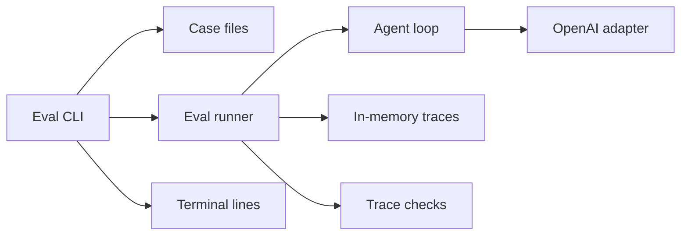
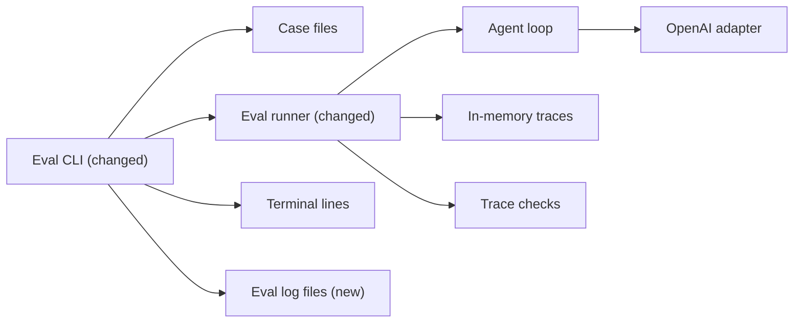

# Write a full trace log for each eval case

**Branch:** eval-upgrade · **Written:** 2026-10-22 · **Supersedes:** -

## Summary

A developer running `npm run eval` sees one pass or fail line per case, and the turn trace is then discarded, so a miss only names the check. This plan keeps that terminal report and writes one JSON file per case under a gitignored `eval-logs` directory, with the prompt, the checks, the result, and the full trace. The command prints that directory's path after the case lines. Tests fake the model and use a temporary directory, with no API key. It worked when those tests pass and a keyed local run leaves one JSON file per case beside a terminal report of one line per case and the directory path.

- **In scope:** the runner returns the trace it already scored; one JSON log per case under `eval-logs`; the terminal path line; gitignore; architecture and README notes.
- **Out of scope:** committing or replaying logs; writing eval traces to `genui_traces`; printing trace bodies on the terminal; live eval in CI; changing checks, case files, the agent loop, or the system prompt.
- **Open decisions:** none (see [Open decisions](#open-decisions))

### Behavior before

```mermaid
sequenceDiagram
  actor Dev
  participant CLI as Eval CLI
  participant Runner as Eval runner
  participant Loop as Agent loop
  participant OpenAI
  Dev->>CLI: npm run eval
  CLI->>Runner: run each case
  Runner->>Loop: runAgent with the case prompt
  Loop->>OpenAI: live completions
  Loop-->>Runner: saved AgentTrace
  Runner-->>CLI: pass or fail and reasons
  CLI-->>Dev: one line per case
```

### Behavior after

```mermaid
sequenceDiagram
  actor Dev
  participant CLI as Eval CLI
  participant Runner as Eval runner
  participant Loop as Agent loop
  participant OpenAI
  participant Logs as Log files
  Dev->>CLI: npm run eval
  CLI->>Runner: run each case
  Runner->>Loop: runAgent with the case prompt
  Loop->>OpenAI: live completions
  Loop-->>Runner: saved AgentTrace
  Runner-->>CLI: pass or fail, reasons, and trace
  alt write succeeds
    CLI->>Logs: one JSON file for the case
  else write fails
    CLI-->>Dev: log failed, case id and error code
  end
  CLI-->>Dev: one line per case, then the logs directory path
```

### Architecture before



### Architecture after



### What changes

- The runner returns the `AgentTrace` it already loaded, including on a failed case.
- Each case, pass or fail, becomes one JSON file in a new `eval-logs` directory for that run.
- The terminal gains a single line with that directory's path. The pass and fail lines stay as they are.
- `eval-logs` is gitignored. Chat, Postgres traces, and CI stay as they are.

---

## Current state

`npm run eval` is [server/eval/cli.ts](../../server/eval/cli.ts), wired in [package.json](../../package.json) as `tsx --tsconfig ./tsconfig.server.json --env-file-if-exists=.env.local server/eval/cli.ts`. `main` returns 1 before loading cases when `agentAvailable` is false, with the message `OPENAI_API_KEY is required to run eval cases.` It otherwise builds `createOpenAILlm` from [server/config.ts](../../server/config.ts) and [server/adapters/openai/OpenAILlm.ts](../../server/adapters/openai/OpenAILlm.ts) (the client is constructed on the first `complete` call, not at build time), loads every `*.json` file in `server/eval/cases` via [server/eval/loadCases.ts](../../server/eval/loadCases.ts), and runs each case with a 180 second `AbortSignal.timeout`. A case whose signal is aborted is replaced by `timeoutResult`: `ok: false`, one failure reason `case timed out after 180 seconds`, and `endedBy` and `error` copied from the partial result when present. The original failures are dropped. `formatResult` prints `pass <id>` or `fail <id>` plus failure reasons, then `endedBy:` and `error:` when those fields are set. The process exits 0 only when every case passed. Tests call `main` with injected `loadCases`, `runEvalCase`, and `createOpenAILlm` ([server/eval/cli.test.ts](../../server/eval/cli.test.ts)); they do not spawn a process.

[server/eval/runner.ts](../../server/eval/runner.ts) `runEvalCase` stores the turn in a fresh `InMemoryTraceRepository`, calls `runAgent`, then `resetConversation`. It scores `traces.listByConversation(...).at(-1)`, or an `emptyTrace` (`endedBy: "stopped"`, empty `completions`, empty `userText`) when the list is empty. The returned [EvalCaseResult](../../server/eval/types.ts) has `id`, `ok`, `failures`, `endedBy`, and sometimes `error`. It does not include the trace. The run's `ToolLogger` is `noopLogger`, so the loop's counts line is not printed. [server/eval/runner.test.ts](../../server/eval/runner.test.ts) covers a scripted heading pass, a text-only fail, and conversation cleanup. It does not read the trace back.

[server/agent/trace.ts](../../server/agent/trace.ts) `AgentTrace` holds `conversationId`, `userText`, `endedBy`, token and call counts, `completions` (model `content`, tool calls with `arguments` and `result`, optional `ui` tree), and optional `error`. [server/agent/loop.ts](../../server/agent/loop.ts) fills that object and saves it in a `finally` block. The system prompt is added by the OpenAI adapter on each call and is not a field on the trace. The loop's own info line is counts only (`agent turn finished`). Eval does not use that logger.

Case ids are kebab-case (`/^[a-z0-9]+(?:-[a-z0-9]+)*$/` in `loadCases`). Nine committed cases are snapshotted in `cli.test.ts`: `catalog-layout`, `define-and-use-custom`, `delete-custom`, `echo-form`, `menu-create-item`, `menu-delete-category`, `mockup-no-action`, `off-topic-refusal`, `simple-heading`. Check reasons from [server/eval/checks.ts](../../server/eval/checks.ts) name the check and do not include `userText`, completion text, tool arguments, or a UI tree.

[.gitignore](../../.gitignore) does not mention eval logs. [docs/ARCHITECTURE.md](../../docs/ARCHITECTURE.md) says eval uses in-memory traces and does not write `genui_traces`, and that CI does not run eval. [.github/workflows/ci.yml](../../.github/workflows/ci.yml) runs `npm run db:migrate:traces`, `npm run typecheck`, `npm test`, `npm run build`, and `npm run build:api`. It does not run `npm run eval` and does not set `OPENAI_API_KEY`.

**Checks:** `npm test`, `npm run typecheck`, `npm run build`, `npm run build:api`.

## Requirements

### R1: Result carries the trace

`runEvalCase` MUST set `trace` on `EvalCaseResult` to the `AgentTrace` it already scores: the last saved trace for that conversation, or the existing empty trace when none was saved. `timeoutResult` MUST copy that `trace` onto the timeout result. The other result fields stay as they are.

**Acceptance:**

- A scripted heading pass returns `trace.endedBy` `reply`, `trace.userText` equal to the case prompt, and a completion whose tool call name is `render_ui`.
- A text-only reply still returns a trace, with `endedBy` `reply` and no tool call named `render_ui`.
- `trace.conversationId` starts with `eval:` plus the case id.
- The conversation is still cleared after the case.
- `timeoutResult` includes the partial result's `trace` and still replaces `failures` with the 180 second timeout failure.

### R2: One JSON file per case

`writeEvalCaseLog` MUST write one UTF-8 file, pretty-printed with two-space indent and a trailing newline, named with the case id plus `.json`, inside the directory it is given. The JSON object MUST use this key order: `id`, `prompt`, `checks`, `ok`, `failures`, then `endedBy` only when set, then `error` only when set, then `trace`. `trace` MUST be the full `AgentTrace` (`JSON.stringify` drops `undefined`). The id MUST match the kebab-case rule in `loadCases`, and the resolved path MUST stay inside the directory; otherwise the function throws `eval log id must be kebab-case` or `eval log path escapes the directory` and writes no file. An existing file MUST NOT be overwritten (`flag: "wx"`). `evalLogDirName` MUST return `now.toISOString()` with every `:` replaced by `-`, as one path segment. `createEvalLogDir` MUST create that directory inside `root` and MUST throw if it already exists.

**Acceptance:**

- A log with `endedBy` and no `error` round-trips through `JSON.parse`, and `Object.keys` are `id`, `prompt`, `checks`, `ok`, `failures`, `endedBy`, `trace`.
- A defined completion `content`, tool `arguments` string, and `ui` tree round-trip unchanged. A log with `error` and no `endedBy` omits `endedBy` and includes `error`.
- An id that is not kebab-case, including one with a slash or `..`, throws `eval log id must be kebab-case`, and no file appears outside the directory.
- A second write of the same id in the same directory throws and leaves the first file unchanged.
- The top-level keys are only those listed above. There is no `apiKey` and no system-prompt field.
- `evalLogDirName` of a fixed `Date` contains no `/` and no `:`.
- Calling `createEvalLogDir` twice with the same root and `Date` throws the second time, and the first directory is still there.

### R3: A gitignored directory per run

Before the first case, `main` MUST create `eval-logs/<directory name>/` under the process cwd (tests pass `logRoot`). The directory name MUST be `Date.toISOString()` with `:` replaced by `-`, one path segment, from `now` (default `() => new Date()`). If that directory already exists, or the directory cannot be created, `main` MUST exit 1 before `runEvalCase` and before `createOpenAILlm`. After the case lines, stdout MUST include one line `logs` plus the absolute directory path. `.gitignore` MUST contain the line `eval-logs/`. When the agent is unavailable, `main` MUST NOT create the directory.

**Acceptance:**

- Two cases in one `main` call write both files in the same directory. That directory's basename equals `evalLogDirName(now)`. Stdout's last line is `logs` plus that absolute path.
- A second `main` call with the same `now` and `logRoot` exits 1, does not call `runEvalCase`, and does not call `createOpenAILlm`. Stderr is `failed to create eval log directory` plus an error code, and does not include a planted trace sentinel.
- With `agentAvailable: false` and a `logRoot`, that root is not created, and the existing missing-key message is unchanged.
- The repo `.gitignore` has a line whose text is `eval-logs/`.

### R4: Terminal stays one line per case

For every case, after the existing timeout replacement, `main` MUST write that case's log and then print the same `formatResult` line as today, including when that write threw. A write error MUST NOT skip later cases. Stderr for a write error MUST be `log failed`, the case id, and an error code (`Error` when the thrown value has no safe code), and MUST NOT include `Error.message` or the trace. The process exits 0 only when every case passed and every log write succeeded. An empty case list still creates the directory, prints the path, and exits 0. A missing `trace` at runtime MUST be treated as a write failure with code `missing-trace` and MUST NOT write a file.

**Acceptance:**

- Sentinels placed in the case prompt, completion `content`, tool `arguments`, and a UI tree appear in the JSON file and do not appear in stdout or stderr. The pass line is `pass` plus the id. The fail line still follows `formatResult`.
- When the injected timeout signal is already aborted, the file has `ok: false`, the failure reason `case timed out after 180 seconds`, and the trace returned by `runEvalCase`. The fail line contains that timeout reason.
- A writer that throws an `Error` whose message is a sentinel and whose `code` is `EIO` prints `log failed <id> EIO` on stderr, still prints that case's `formatResult` line, still runs the next case, and the process exits 1 even if every case passed.
- A result with no `trace` prints `log failed <id> missing-trace`, writes no file for that id, and continues.
- When the string passed to the injected `createOpenAILlm` as `apiKey` is non-empty, that string appears in neither the JSON file nor stdout nor stderr.

### R5: Docs name the log directory

[docs/ARCHITECTURE.md](../../docs/ARCHITECTURE.md) and [README.md](../../README.md) MUST say that `npm run eval` writes one JSON file per case under a gitignored `eval-logs` directory, that the file holds the full turn trace, and that the terminal prints one result line per case plus the directory path. They MUST still say eval needs `OPENAI_API_KEY`, is not run in CI, and does not write `genui_traces`.

**Acceptance:**

- The overview sentence that begins "Eval runs beside the HTTP API" and the §9 table row for `npm run eval` say the above.
- The §10 bullet that begins with `npm run eval` says the logs are local files and the run still does not write `genui_traces`.
- The Eval subgraph in the overview diagram has one node for those log files, linked from the Eval CLI node.
- The §8 tree line for `server/eval/` mentions the log writer.
- The README "Other scripts" line for `npm run eval` mentions the gitignored log directory.
- No new test. Review the sentences.

## Design

### Components

- [server/eval/types.ts](../../server/eval/types.ts). Add required `trace: AgentTrace` to `EvalCaseResult`.
- [server/eval/runner.ts](../../server/eval/runner.ts). Set `result.trace` to the trace variable it already passes to `checkTrace`. Leave `noopLogger`, `emptyTrace`, and the in-memory ports as they are.
- [server/eval/cli.ts](../../server/eval/cli.ts). `timeoutResult` copies `partial.trace`. After a successful `loadCases`, create the log directory, then `createOpenAILlm`, then the case loop. Write the log after timeout replacement and before `formatResult`. Catch write failures. Print the path after the loop.
- `server/eval/writeLog.ts` (new). `evalLogDirName`, `createEvalLogDir`, `writeEvalCaseLog`, and `EvalCaseLog`. No model, filesystem root, or network.
- [.gitignore](../../.gitignore). One new line: `eval-logs/`.
- Docs in R5. Do not change [package.json](../../package.json) or [.github/workflows/ci.yml](../../.github/workflows/ci.yml).

`eval-case-trace` only adds `trace: partial.trace` inside `timeoutResult`. File writing lands in `eval-cli-logs`.

### Interfaces

`EvalCaseResult` in [server/eval/types.ts](../../server/eval/types.ts) gains a required field. The mock result in [server/eval/cli.test.ts](../../server/eval/cli.test.ts) must include a trace in the same change, or `npm run typecheck` fails.

```ts
export interface EvalCaseResult {
  id: string;
  ok: boolean;
  failures: CheckFailure[];
  endedBy?: EndedBy;
  error?: string;
  trace: AgentTrace;
}
```

`server/eval/writeLog.ts`:

```ts
export interface EvalCaseLog {
  id: string;
  prompt: string;
  checks: EvalCheck[];
  ok: boolean;
  failures: CheckFailure[];
  endedBy?: EndedBy;
  error?: string;
  trace: AgentTrace;
}

export function evalLogDirName(now: Date): string;

export function createEvalLogDir(root: string, now: Date): string;

export function writeEvalCaseLog(dir: string, log: EvalCaseLog): void;
```

`evalLogDirName` returns `now.toISOString().replaceAll(":", "-")`. Example: `2026-10-22T12-31-05.123Z`.

`createEvalLogDir` creates `root` with `recursive: true`, then creates `join(root, evalLogDirName(now))` without `recursive`, so an existing directory throws. It returns that path.

`writeEvalCaseLog` checks the id with the same kebab-case regex as `loadCases`. It writes `join(dir, id + ".json")` only when `path.relative` of the resolved file against the resolved directory does not start with `..` and is not absolute. Body is `JSON.stringify(object, null, 2) + "\n"` with `flag: "wx"` and encoding `utf8`. Key order is the R2 order. Omit `endedBy` and `error` when they are `undefined`.

`main` builds the log from the case plus the result, after timeout replacement:

```ts
const record: EvalCaseLog = {
  id: evalCase.id,
  prompt: evalCase.prompt,
  checks: evalCase.checks,
  ok: result.ok,
  failures: result.failures,
  trace: result.trace,
};
if (result.endedBy !== undefined) record.endedBy = result.endedBy;
if (result.error !== undefined) record.error = result.error;
```

Use `evalCase.id` for the file name. If `result.trace` is `undefined` at runtime, do not call `writeEvalCaseLog`; count a write failure with code `missing-trace`.

`CliMainOptions` gains optional fields, all defaulted so the real CLI is unchanged:

```ts
export type CliMainOptions = {
  agentAvailable?: boolean;
  casesDir?: string;
  logRoot?: string;
  now?: () => Date;
  log?: (line: string) => void;
  error?: (line: string) => void;
  inject?: {
    loadCases?: typeof loadCases;
    runEvalCase?: typeof runEvalCase;
    createOpenAILlm?: typeof createOpenAILlm;
    createEvalLogDir?: typeof createEvalLogDir;
    writeEvalCaseLog?: typeof writeEvalCaseLog;
    timeoutSignal?: () => AbortSignal;
  };
};
```

Defaults: `logRoot` is `join(process.cwd(), "eval-logs")`. `now` is `() => new Date()`. `timeoutSignal` is `() => AbortSignal.timeout(180_000)`. The constant `CASE_TIMEOUT_MS` stays `180_000`. Every test that gets past the missing-key return MUST pass a `logRoot` under `os.tmpdir()`, so `npm test` does not create `eval-logs` in the repo.

Error codes printed by the CLI are the thrown value's `code` when it is a string matching `/^[A-Za-z0-9_-]+$/`, otherwise `Error`. The two error lines do not use `Error.message`. The three messages, each a single line with single spaces, are:

```text
failed to create eval log directory ${code}
log failed ${id} ${code}
logs ${path.resolve(dir)}
```

The path line uses the same `log` function as the case lines, after the loop, including when a write failed or the case list was empty. It is not printed when the directory was not created.

No new environment variable. No new `package.json` script. No argv flags.

### Data and migrations

No database migration and no change to `agent_traces`. Eval keeps using `InMemoryTraceRepository`. Rollback is reverting the eval and doc files and deleting the `eval-logs/` gitignore line. Leftover log directories on disk are untracked and can be deleted by hand.

### Errors and edge cases

- No API key: return 1 with the current message, before `loadCases`, `createEvalLogDir`, and `createOpenAILlm`.
- `loadCases` throws: the directory is not created, because creation runs only after a successful load.
- Directory create throws: exit 1, do not call `runEvalCase` or `createOpenAILlm`.
- Timeout: the logged failures are the timeout failure, not the checks that ran. The logged trace is the runner's trace.
- Empty `loadCases` result: create the directory, print the path, exit 0, call `runEvalCase` zero times.
- Write throws, including `EEXIST` from `wx`: stderr as in R4, keep going, exit 1.
- Saved trace missing: the runner's existing `emptyTrace` is what gets logged. Do not change that fallback.
- `formatResult` is unchanged, including appending `error:` when `result.error` is set. That field can still show the trace's terminal error string. Do not redact it in this change, and do not start printing prompts, completions, arguments, or trees on the case line.

### Compatibility and rollout

`EvalCaseResult.trace` is required. In this repo the only builders are `runEvalCase`, `timeoutResult`, and the test mock. No HTTP, SSE, or schema change. CI does not gain an eval step. `noopLogger` stays, so eval still does not emit `agent turn finished`. Chat is unchanged.

## Security

| Concern | Mitigation | Enforced by |
|---|---|---|
| Log files hold prompts, model text, tool arguments, and UI trees | Only under `eval-logs/`, which is gitignored; not an HTTP response; not written to `genui_traces`. New stdout and stderr lines omit those bodies | R2, R3, R4 |
| `OPENAI_API_KEY` copied into a log or the terminal | The log object has no key field. The writer is not passed `config.openai`. A non-empty key seen by the injected factory must be absent from the file and from both streams | R2, R4 |
| Case id used as a path | Kebab-case check, resolved path must stay in the directory, write flag `wx` | R2 |
| Write or mkdir errors echoing the trace or `Error.message` | CLI prints a fixed phrase plus a safe error code | R3, R4 |
| Live eval spending quota from CI | Workflow file unchanged; workers do not run `npm run eval` | R5 |

Case prompts are the committed fixtures. The in-memory menu inside a trace is the demo café menu, not a live point-of-sale system. No new dependency.

## Validation

**Workers can run** (no credentials or live services):

- `npm test`: runner trace field, log writer, CLI directory and redaction, gitignore line
- `npm run typecheck`
- `npm run build`
- `npm run build:api`

**New tests:**

- R1: [server/eval/runner.test.ts](../../server/eval/runner.test.ts) for the pass and text-only traces; [server/eval/cli.test.ts](../../server/eval/cli.test.ts) that a pre-aborted timeout signal keeps `trace` on the timeout result (asserted through the log file in R4)
- R2: `server/eval/writeLog.test.ts` for key order, round-trip of content, arguments, and `ui`, omitted `error`, refused ids, no file outside the directory, `wx` leaving the first file in place, `evalLogDirName`, and a second `createEvalLogDir` throw
- R3: [server/eval/cli.test.ts](../../server/eval/cli.test.ts) for one directory named by `evalLogDirName`, two files, the `logs` line, a colliding `now` that skips `runEvalCase` and `createOpenAILlm`, the missing-key path creating nothing, and a read of `.gitignore`
- R4: [server/eval/cli.test.ts](../../server/eval/cli.test.ts) for sentinels, timeout log, `EIO` continuing to the next case, `missing-trace`, and the captured `apiKey` when it is non-empty
- R5: no test; review the doc lines

**After merge** (needs credentials, live services, or a person):

- From the repo root, with `OPENAI_API_KEY` set, `npm run eval` prints one pass or fail line per committed case and a final `logs` line. That directory contains one `.json` file per case id.
- `git status` does not list that directory.
- The terminal output does not include the `simple-heading` prompt `Show a heading that says Hello`.
- An eval run does not add a row to `genui_traces`. A normal chat turn still can.

## Work breakdown

| Slice | Covers | Touches | After | Size |
|---|---|---|---|---|
| eval-case-trace | R1 | server/eval/types.ts, server/eval/runner.ts, server/eval/runner.test.ts, server/eval/cli.ts, server/eval/cli.test.ts | - | small |
| eval-log-writer | R2 | server/eval/writeLog.ts, server/eval/writeLog.test.ts | - | medium |
| eval-cli-logs | R3, R4 | server/eval/cli.ts, server/eval/cli.test.ts, .gitignore | eval-case-trace, eval-log-writer | medium |
| eval-logs-docs | R5 | docs/ARCHITECTURE.md, README.md | eval-cli-logs | small |

`eval-case-trace` and `eval-log-writer` share no files and can merge in either order. `eval-case-trace` edits `timeoutResult` and the test mock only so the new required field typechecks; it does not write files. `eval-cli-logs` merges after both. It calls `createEvalLogDir` and `writeEvalCaseLog`, reads `EvalCaseResult.trace`, and adds the `.gitignore` line. `eval-logs-docs` merges last so the docs describe the directory name and the `logs` line the CLI prints.

Shared contracts: `trace` on `EvalCaseResult` in [server/eval/types.ts](../../server/eval/types.ts), and `EvalCaseLog`, `evalLogDirName`, `createEvalLogDir`, and `writeEvalCaseLog` in `server/eval/writeLog.ts`.

## Non-goals

- Committing log files, or asserting a later live run against them
- Writing eval traces to `genui_traces` or raising the five-trace cap
- Printing the trace, the prompt, tool arguments, or a UI tree on the terminal
- Replacing `noopLogger` with the API logger
- A flag or environment variable that chooses the log directory
- Running `npm run eval` in CI
- Changing check kinds, the nine case files, the agent loop, SSE, or the system prompt
- Truncating or redacting fields inside the JSON file

## Assumptions

- Logs are for a person inspecting this run. They are not golden fixtures.
- The directory is always `eval-logs` under the process cwd. `npm run eval` from the repo root is the way people run it. Tests pass `logRoot`.
- Passing and failing cases both get a file. A pass is part of what you inspect.
- The JSON file stores the full trace with no redaction. The system prompt is omitted because it is not on `AgentTrace`.
- The path line is printed once, after the case lines, including when a write failed.
- Two runs that resolve to the same directory name do not share it: the second exits before any case.
- `EvalCaseResult.trace` is required, not optional, so a log cannot silently drop the body. The one test mock is updated in the same slice.

## Risks

- A `list_components` result makes a log large. There is no truncation; the files stay local and gitignored (R3, R4).
- Someone may paste a log into a ticket. The docs say the file contains the prompt and the full model trace (R5).
- Two runs in the same millisecond: the second exits 1 before calling the model (R3).
- `formatResult` can still print `result.error`. This change does not widen that line (R4).
- `.gitignore` does not stop `git add -f`. The line is there so a normal add skips the directory (R3).

## Open decisions

None.

## References

- Request: "update the eval harness to generate logs for thorough testing"
- Decision in this planning session: a gitignored JSON file per case with the full trace; the terminal stays one line per case plus the directory path. Stdout of those lines omits prompts, completions, tool arguments, and trees. Logs are not written to `genui_traces`, and eval stays out of CI.
- [server/eval/cli.ts](../../server/eval/cli.ts), [server/eval/runner.ts](../../server/eval/runner.ts), [server/eval/types.ts](../../server/eval/types.ts), [server/eval/checks.ts](../../server/eval/checks.ts), [server/eval/loadCases.ts](../../server/eval/loadCases.ts)
- [server/eval/cli.test.ts](../../server/eval/cli.test.ts), [server/eval/runner.test.ts](../../server/eval/runner.test.ts)
- [server/agent/trace.ts](../../server/agent/trace.ts), [server/agent/loop.ts](../../server/agent/loop.ts), [server/agent/tools.ts](../../server/agent/tools.ts)
- [server/ports/fakes/InMemoryTraceRepository.ts](../../server/ports/fakes/InMemoryTraceRepository.ts)
- [server/adapters/openai/OpenAILlm.ts](../../server/adapters/openai/OpenAILlm.ts), [server/config.ts](../../server/config.ts)
- [docs/ARCHITECTURE.md](../../docs/ARCHITECTURE.md), [README.md](../../README.md), [package.json](../../package.json), [.gitignore](../../.gitignore), [.github/workflows/ci.yml](../../.github/workflows/ci.yml)
