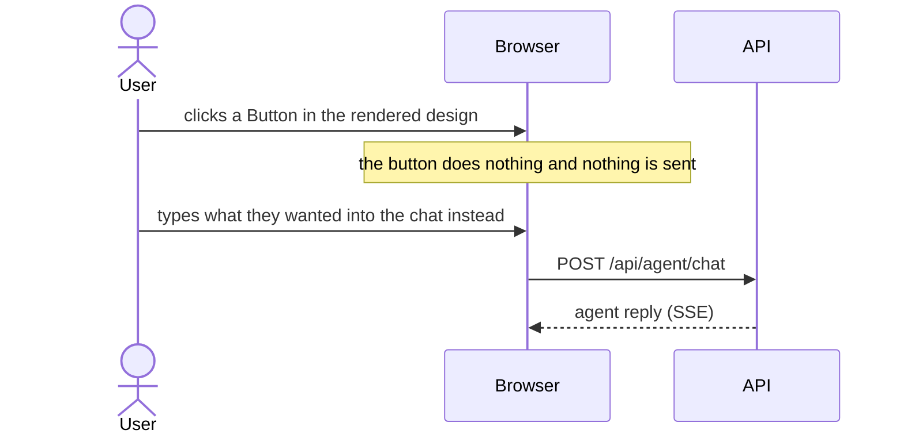
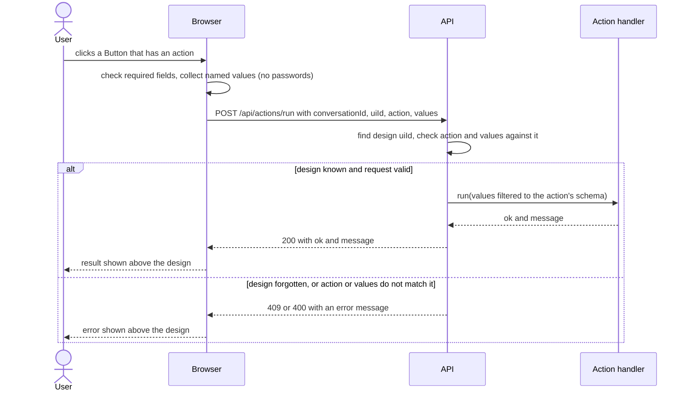
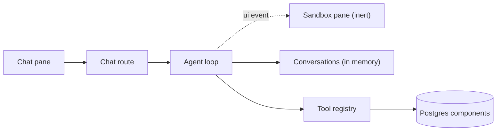
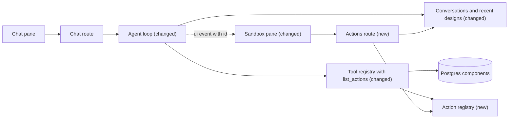

# Let buttons in generated designs run backend actions

**Branch:** ui-actions · **Written:** 2026-10-18 · **Supersedes:** -

## Summary

The agent can draw a design in the sandbox, but the design is inert: typing and clicking in it reach nobody, so a generated form can never do anything. This plan lets the agent attach a named backend action to a Button and name the inputs whose values that action needs, based on what the person asked for. When the person clicks such a button, the browser sends the named values to a new API route, the server checks them against the design it rendered and runs the action's handler directly (no model call), and the result appears in the sandbox. This iteration delivers the mechanism (an action registry, the catalog and validation changes, the route, the browser wiring) with one harmless demo action; real actions come later. We'll know it works when a design the agent builds around the demo action shows the handler's reply after a click, and a forged or stale request is refused.

- **In scope:** an in-memory action registry with one demo action; `action` and `name` props in the catalog; tree checks for those bindings; a `list_actions` agent tool and prompt changes; remembering recently rendered designs per conversation; `POST /api/actions/run`; the sandbox click flow and result display; docs.
- **Out of scope:** real, side-effecting actions; storing submitted values; letting the agent see clicks; authentication.
- **Open decisions:** none (see [Open decisions](#open-decisions))

### Behavior before



### Behavior after



### Architecture before



### Architecture after



### What changes

- The sandbox sends a request when a Button with an action is clicked, and shows the result.
- A new actions route checks the request against a design the server rendered and runs the handler.
- A new action registry holds named handlers with input schemas; the agent reads it through a new `list_actions` tool, and `render_ui` checks bindings against it.
- Conversations also remember the last few designs sent to the browser, each with an id carried on the `ui` event.

---

## Current state

- **Catalog** ([server/catalog/components.ts](../../server/catalog/components.ts)): twelve components. `Button` props are `label`, `variant`, `size`, `disabled`; `TextInput` has `label`, `placeholder`, `type` (`text`, `email`, `password`, `number`), `required`; `Checkbox` has `label`, `checked`; `Select` has `label`, `options`, `placeholder`. None has an action or a field name. `validateCatalog` ([server/catalog/validate.ts](../../server/catalog/validate.ts)) requires a `description` on every property and a closed object schema. Changes reach Postgres through the seed (`npm run db:seed`, or on production start), which updates changed rows and bumps `updated_at`; no migration is needed because `props_schema` is JSON.
- **Tree validation** ([server/ui/validateTree.ts](../../server/ui/validateTree.ts)): `validateUiTree(tree, catalog)` checks shape, names, props against each `propsSchema` (validators cached per `updatedAt`), children rules, `MAX_DEPTH` 8 and `MAX_NODES` 100, and returns at most `MAX_ERRORS` 20 messages. It knows nothing about input names or actions.
- **Agent tools** ([server/agent/tools/](../../server/agent/tools/)): `createAgentTools({ components })` returns `list_components`, `get_component`, `render_ui`. `render_ui` ([server/agent/tools/ui.ts](../../server/agent/tools/ui.ts)) validates and calls `ctx.showUi(tree)`. `createToolRegistry` ([server/agent/registry.ts](../../server/agent/registry.ts)) is the pattern to copy: snake_case names, closed `input_schema` checked with the shared strict Ajv ([server/validation/jsonSchema.ts](../../server/validation/jsonSchema.ts)), arguments validated before `run`, a throwing handler becomes `ok: false` and is logged.
- **Emitting a design** ([server/agent/run.ts](../../server/agent/run.ts)): `handleToolCall` passes `showUi: (tree) => run.emit({ type: "ui", tree })`. `AgentRun` has no conversation id; `runAgent(userText, conversationId, run, llm)` in [server/agent/loop.ts](../../server/agent/loop.ts) does.
- **Conversations** ([server/agent/conversations.ts](../../server/agent/conversations.ts)): an LRU `Map<string, HistoryMessage[]>` of at most `MAX_CONVERSATIONS` 500; `getHistory`, `hasConversation`, `resetConversation`, `oneTurnAtATime`. Nothing about designs is kept.
- **Wire types** ([shared/api.ts](../../shared/api.ts)): `AgentChatRequest`, `AgentEvent` (the `ui` member is `{ type: "ui"; tree: UiNode }`), `ToolResult`, `MAX_MESSAGE_CHARS`. [shared/ui.ts](../../shared/ui.ts) has `UiNode`.
- **Chat route** ([server/routes/agent.ts](../../server/routes/agent.ts)): `POST /api/agent/chat`, `bodyLimit` 32 KB, `config: { rateLimit: {} }`, errors as `{ error: { message } }`. [server/rateLimit.ts](../../server/rateLimit.ts) registers `@fastify/rate-limit` with `global: false`; each route with `config.rateLimit` gets its own child store (`store.child(...)` in `node_modules/@fastify/rate-limit/index.js`), so a second route counts separately. The 429 message is "Too many messages. Try again in N seconds."
- **App wiring**: [server/app.ts](../../server/app.ts) `buildApp(deps: AppDeps)` registers routes; [server/index.ts](../../server/index.ts) builds adapters and the tool registry.
- **System prompt** ([server/agent/systemPrompt.ts](../../server/agent/systemPrompt.ts)) says "nothing the person types into a rendered design reaches you". [server/agent/systemPrompt.test.ts](../../server/agent/systemPrompt.test.ts) fails if the prompt omits a registered tool or names any other snake_case word.
- **Browser**: [src/sandbox/components.ts](../../src/sandbox/components.ts) draws each component (Button is `type="button"` with no handler); [src/sandbox/render.ts](../../src/sandbox/render.ts) `renderUi(tree, container)` replaces the sandbox contents. [src/main.ts](../../src/main.ts) renders `ui` events and drops every event that arrives after Stop (`if (!controller.signal.aborted) renderEvent(...)`), so after Stop the server may have sent a newer design than the browser shows. [src/agentClient.ts](../../src/agentClient.ts) is the fetch pattern for errors (`{ error: { message } }` → message). Browser tests are DOM-free (for example [src/sandbox/componentNames.test.ts](../../src/sandbox/componentNames.test.ts)); there is no DOM test environment.
- **Checks** ([.github/workflows/ci.yml](../../.github/workflows/ci.yml)): `npm ci`, `npm run typecheck`, `npm test`, `npm run build`, `npm run build:api`. Database and Redis tests are skipped without `DATABASE_URL` / `REDIS_URL`.

## Requirements

### R1: Action registry

The server MUST hold actions in a registry built from definitions `{ name, description, input_schema, run }`, mirroring the tool registry. One place to declare what a click may do, with its inputs checked before any handler runs.

**Acceptance:**

- `createActionRegistry` throws on a name not matching `^[a-z][a-z0-9_]*$`, a duplicate name, an `input_schema` that is not `type: "object"` with `additionalProperties: false`, an invalid schema, or a property whose `type` is not `"string"` or `"boolean"` or that lacks a `description`.
- `run(name, values, ctx)` returns `{ ok: false, message: "Unknown action: <name>" }` for an unregistered name without calling any handler.
- Values that break the schema return `ok: false` with the problems listed, and the handler is not called.
- A handler that throws returns `{ ok: false, message: "That action failed." }` and logs the error; a handler still running after `ACTION_TIMEOUT_MS` (10,000) returns `{ ok: false, message: "That action took too long." }` and its signal is aborted.
- A result `message` longer than `MAX_ACTION_MESSAGE_CHARS` (500) is cut to that length.
- `specs` lists `{ name, description, input_schema }` for every action.

### R2: Demo action

The server MUST register one action, `demo_echo`, with no side effects. It proves the pipeline end to end until real actions exist.

**Acceptance:**

- Its schema has one optional string property `text` (`maxLength` 1000).
- With `text` it returns `{ ok: true, message: "Demo action received: <text>" }`; without it `{ ok: true, message: "Demo action ran." }`.
- It writes nothing anywhere and makes no network calls.

### R3: Catalog bindings

`Button` MUST accept an optional `action` prop, and `TextInput`, `Checkbox` and `Select` MUST accept an optional `name` prop. Without these the agent has no way to wire a design to an action.

**Acceptance:**

- `action`: string, pattern `^[a-z][a-z0-9_]*$`, `maxLength` 64, with a description that points to `list_actions`.
- `name`: string, pattern `^[A-Za-z][A-Za-z0-9_]*$`, `maxLength` 64, described as the key the value is sent under, unique in the design.
- `validateCatalog(catalog)` returns no problems; `npm run db:seed` reports Button, TextInput, Checkbox and Select as updated on an already seeded database and unchanged on a second run.
- Every existing `exampleProps` still validates.

### R4: Binding checks in render_ui

`render_ui` MUST refuse a design whose bindings can't work, and say why. Mistakes are caught while the agent can still fix them, not when the person clicks.

**Acceptance:**

- Two inputs with the same `name` anywhere in the tree are an error naming both paths.
- A Button whose `action` is not registered is an error that suggests calling `list_actions`.
- For each action used by a Button that is not disabled, every `required` property of its schema must be the `name` of an input in the tree, else an error names the action and the missing input.
- An input bound to an action property must match its type: `boolean` → Checkbox; `string` → TextInput (not `type: "password"`) or Select. A mismatch, or a password TextInput bound to an action property, is an error.
- These errors count toward `MAX_ERRORS` like any other; a tree with no `action` and no `name` props validates exactly as before.

### R5: Agent can discover and attach actions

The agent MUST be able to list registered actions and MUST be told how to attach them. Attaching actions is driven by the prompt's context.

**Acceptance:**

- A `list_actions` tool returns every action's `name`, `description` and `input_schema`, and reports `Listed N actions`.
- The system prompt says: call `list_actions` when the request implies a button should do something; set the Button's `action` to a listed name; give each input a `name` equal to the action property it fills; never invent action names; when no action fits, render the button without one and say that clicking it won't do anything yet; clicks do not reach the agent.
- The prompt no longer says nothing typed into a design reaches anyone, and `server/agent/systemPrompt.test.ts` passes (the prompt names no snake_case word except tool names).

### R6: Designs remembered by id

Each `ui` event MUST carry a server-generated `id`, and the server MUST remember the last `MAX_DESIGNS_PER_CONVERSATION` (5) designs sent to each conversation. Actions are checked against the exact design the browser shows, which can differ from the newest one after Stop.

**Acceptance:**

- The `ui` event is `{ type: "ui"; id: string; tree: UiNode }`, where `id` is a random UUID.
- `getDesign(conversationId, uiId)` returns the tree for any of the last five designs and `undefined` for older ones, unknown ids, and unknown conversations.
- A conversation's designs are dropped together with its history (LRU eviction and `resetConversation`).
- Only trees that passed `render_ui` are remembered (they are the only ones emitted).

### R7: Action route

`POST /api/actions/run` MUST run an action only when it matches a remembered design. The browser is untrusted, so the server re-derives what the click may send.

**Acceptance:**

- Body `{ conversationId: string, uiId: string, action: string, values: object }`; a missing or wrong-typed field, a value that is not a string or boolean, or more than `MAX_NODES` (100) values gives 400.
- An unknown `conversationId` or `uiId` gives 409 "This design is no longer available. Ask the agent to show it again."
- `action` not on a Button without `disabled: true` in that design gives 400.
- A key that is not the `name` of an input in that design, a value on a password TextInput, a TextInput value that is not a string or is longer than `MAX_FIELD_CHARS` (1000), a Checkbox value that is not a boolean, or a Select value that is neither `""` nor one of its options gives 400.
- Valid requests run the handler with only the values whose keys the action's schema declares; the response is 200 `{ ok, message }`, including `ok: false` results from R1.
- Errors use the existing `{ error: { message } }` shape.

### R8: Abuse limits on the action route

The action route MUST have the same body cap and per-IP rate limit as chat. Clicks cost no model call but can still be scripted.

**Acceptance:**

- `bodyLimit` 32 KB; a larger body gets 413.
- `config: { rateLimit: {} }`: past `AGENT_RATE_LIMIT_PER_MINUTE` requests per IP per minute the route gives 429 with `Retry-After`; chat and action counters are separate.
- The limiter runs before the body is parsed, as for chat.

### R9: Sandbox sends actions

Clicking a Button that has an action MUST send the named values of the design shown. This is the user-visible half of the feature.

**Acceptance:**

- The Button renderer sets `data-action` only when `action` is a valid string and `disabled` is not true; TextInput, Checkbox and Select set the `name` attribute from `name`; TextInput sets `maxLength` to `MAX_FIELD_CHARS`.
- On click the browser runs native validity on every input in the design; if one is invalid it calls `reportValidity()` on it and sends nothing.
- Values: TextInput → its value (password inputs are left out entirely), Checkbox → `checked`, Select → its value (`""` when the placeholder is still selected).
- The request carries the `id` of the `ui` event that drew the design.
- A pure helper turns a list of field descriptors into `values` and is unit tested without a DOM.

### R10: Sandbox shows results

The browser MUST show the outcome and prevent overlapping requests. The person needs to see that something happened.

**Acceptance:**

- While an action request is in flight, or a chat turn is streaming, every `button[data-action]` in the sandbox is disabled; they are re-enabled after, including for a design drawn during the turn.
- The result appears in a status area above the design (outside the drawn tree, `role="status"`), green-toned for `ok: true` and red-toned for `ok: false` or an HTTP error, with the message set through `textContent`. A new design or a new action result replaces it.
- The chat thread gets one small line per action: `⚡ <action>: <message>`.
- A network failure shows "Couldn't reach the server."; other failures show the response's error message or `Request failed (<status>)`.

### R11: No values in logs

The server MUST NOT log submitted values. They may be personal data.

**Acceptance:**

- Each action request logs one info line with `conversationId`, `action`, `ok`, `durationMs` and nothing from `values`; tests assert the logged object has no `values` key and contains no submitted string.

### R12: Documentation

`docs/ARCHITECTURE.md` MUST describe actions. The architecture doc is the project's map.

**Acceptance:**

- §1 diagram and §3 table include the action registry and route; §2 describes the click flow and that the UI is no longer inert; §4 notes the `ui` event `id` and the binding checks; §5 notes remembered designs; §10 "Today" and "Planned" are updated; the SSE event list stays correct.

## Design

### Components

- `server/actions/types.ts` (new): `ActionDefinition`, `ActionSpec`, `ActionContext`, `ActionRegistry`.
- `server/actions/registry.ts` (new): `createActionRegistry`, `ACTION_TIMEOUT_MS`, `MAX_ACTION_MESSAGE_CHARS`. Reuses `compileSchema`, `schemaProblem`, `formatSchemaErrors`.
- `server/actions/demo.ts` (new): `demoEchoAction`. `server/actions/index.ts` (new): `createActions(): ActionDefinition[]`.
- `server/ui/bindings.ts` (new): reading a tree's bindings, shared by R4 and R7: `collectBindings(tree)` returns the named inputs (path, component, `type`, options) and the action Buttons (path, action, disabled).
- `server/ui/validateTree.ts` (changed): optional third parameter `actions?: ActionSpec[]`; duplicate-name check always, action checks when given.
- `server/ui/checkAction.ts` (new): `checkActionRequest(tree, action, values)` for R7.
- `server/agent/tools/actions.ts` (new): `listActionsTool(actions)`. `server/agent/tools/ui.ts` and `server/agent/tools/index.ts` (changed): `createAgentTools({ components, actions })`.
- `server/agent/conversations.ts` (changed): per-conversation entry `{ history, designs }`; `rememberDesign`, `getDesign`.
- `server/agent/run.ts` (changed): `AgentRun` gains `conversationId`; `handleToolCall`'s `showUi` generates the design id, remembers the tree, then emits the `ui` event (see Interfaces). `server/routes/agent.ts` (changed) sets `conversationId` on the run.
- `server/routes/actions.ts` (new): `actionsRouter`. `server/app.ts` (changed): `AppDeps.actions`, registers it at `/api/actions`. `server/index.ts` (changed): builds the registry once, passes it to tools and app.
- `src/actionsClient.ts` (new): `runAction(req, signal)`. `src/sandbox/actionValues.ts` (new): pure value builder. `src/sandbox/components.ts`, `src/main.ts` (changed).

### Interfaces

```ts
// shared/api.ts (additive, except the ui event's new required id)
export const MAX_FIELD_CHARS = 1000;
export interface ActionRunRequest {
  conversationId: string;
  /** The `id` of the `ui` event that drew the design. */
  uiId: string;
  action: string;
  /** Named input values; password fields never included. */
  values: Record<string, string | boolean>;
}
export interface ActionResult { ok: boolean; message: string }
// AgentEvent member becomes: { type: "ui"; id: string; tree: UiNode }

// server/actions/types.ts
export interface ActionContext { conversationId: string; log: ToolLogger; signal: AbortSignal }
export interface ActionSpec { name: string; description: string; input_schema: Record<string, unknown> }
export interface ActionDefinition extends ActionSpec {
  run(values: Record<string, string | boolean>, ctx: ActionContext): Promise<ActionResult>;
}
export interface ActionRegistry {
  specs: ActionSpec[];
  run(name: string, values: Record<string, unknown>, ctx: ActionContext): Promise<ActionResult>;
}

// server/agent/conversations.ts
export const MAX_DESIGNS_PER_CONVERSATION = 5;
export function rememberDesign(conversationId: string, id: string, tree: UiNode): void;
export function getDesign(conversationId: string, id: string): UiNode | undefined;

// server/agent/run.ts: AgentRun gains `conversationId: string`; handleToolCall's
// showUi becomes (tree) => { const id = randomUUID(); rememberDesign(run.conversationId, id, tree); run.emit({ type: "ui", id, tree }); }

// server/ui/validateTree.ts
export function validateUiTree(tree: unknown, catalog: Component[], actions?: ActionSpec[]): UiTreeCheck;

// server/ui/checkAction.ts
export function checkActionRequest(
  tree: UiNode, action: string, values: Record<string, string | boolean>,
): { ok: true } | { ok: false; message: string };

// src/actionsClient.ts
export function runAction(req: ActionRunRequest, signal?: AbortSignal): Promise<ActionResult>;
// network and HTTP errors resolve to { ok: false, message } (R10 wording)

// src/sandbox/actionValues.ts
export interface FieldReading { name: string; kind: "text" | "password" | "checkbox" | "select"; value: string; checked: boolean }
export function actionValues(fields: FieldReading[]): Record<string, string | boolean>;
```

`POST /api/actions/run`

| Status | When | Body |
|---|---|---|
| 200 | handler ran, or registry refused the values (R1) | `ActionResult` |
| 400 | malformed body; action or values don't match the design (R7) | `{ error: { message } }` |
| 409 | conversation or design not remembered | `{ error: { message } }` |
| 413 | body over 32 KB | `{ error: { message } }` |
| 429 | rate limit | `{ statusCode, message }` from the limiter, `Retry-After` header |

### Data and migrations

No database change. `props_schema` rows for Button, TextInput, Checkbox and Select change through the existing seed. Designs live in API memory beside conversation history: at most 5 trees of at most 100 nodes per conversation, 500 conversations, lost on restart.

### Errors and edge cases

- **After Stop:** the browser keeps the older design; its `uiId` is still among the last five, so its actions work.
- **API restart or eviction:** 409 with the "no longer available" message; the browser shows it in the status area.
- **Two forms in one design:** every named value is sent; the server passes the handler only the keys its schema declares, so an unrelated field neither breaks nor reaches it.
- **Required fields of another form block a click:** native validity runs on the whole design; accepted for now (Assumptions).
- **Click during a chat turn:** buttons are disabled; if one gets through, the request is still valid against its own `uiId`.
- **Disabled Button with an action:** no `data-action` in the browser, and the server refuses it.
- **Number TextInput:** sent as a string; an action wanting a number parses it itself (schemas only allow string and boolean).

### Compatibility and rollout

- Additive except the `ui` event's new `id`, which only the server emits and the browser ignores until R9; ship shared types first.
- Catalog changes need `npm run db:seed` in development; production seeds on start. Trees without the new props behave as before.
- No new environment variables; `AGENT_RATE_LIMIT_PER_MINUTE` also sets the action limit.

## Security

| Concern | Mitigation | Enforced by |
|---|---|---|
| Forged requests running arbitrary actions or sending arbitrary fields | Only actions on a non-disabled Button of a server-rendered, remembered design run; only that design's named inputs with matching types are accepted; values are then checked against the action's schema | R1, R6, R7 |
| Agent binding a design to a non-existent action, or mis-typed inputs | `render_ui` refuses unregistered actions, missing required inputs and type mismatches | R4 |
| No authentication: anyone with a `conversationId` and `uiId` can trigger that design's actions | Both are random UUIDs never exposed outside the session's own requests; actions this iteration have no side effects (demo only). Authentication is required before any side-effecting action ships (Risks) | R2, R6 |
| Passwords leaving the browser | Browser omits password fields; server rejects a value for one; password inputs can't be bound to action properties | R4, R7, R9 |
| HTML injection through result messages or values | Results are shown with `textContent`; values are never put into HTML | R10 |
| Personal data in logs | Action logs carry name, outcome and timing only | R11 |
| Abuse and resource use | 32 KB body cap, per-IP rate limit, 100 values max, 1000 characters per text value, 10 s handler timeout, 500-character result cap, 5 designs per conversation | R1, R6, R7, R8 |
| Injection into future handlers (SQL, shell) | Handlers get schema-checked string and boolean values only; the registry doc comment says handlers must use parameterised queries and never a shell | R1 |
| New dependencies | None; reuses Ajv, Fastify and `@fastify/rate-limit` | - |

## Validation

**Workers can run** (no credentials or live services):

- `npm run typecheck`: shared types, renderer map and wiring line up.
- `npm test`: all unit and route tests below, with fakes; database tests skip without `DATABASE_URL`.
- `npm run build` and `npm run build:api`: both bundles build.

**New tests:**

- R1: `server/actions/registry.test.ts`: bad names, duplicates, open or invalid schemas, non string/boolean properties; unknown action; schema errors skip the handler; throwing handler; timeout aborts the signal (short timeout injected); message cap; `specs`.
- R2: `server/actions/demo.test.ts`: both messages.
- R3: `server/catalog/validate.test.ts`: catalog still valid; `server/ui/validateTree.test.ts` "accepts every catalog component's example props" still passes; new props accepted and bad patterns refused.
- R4: `server/ui/validateTree.test.ts`: duplicate names; unregistered action; missing required input; Checkbox bound to a string property; password bound; disabled Button skipped; no actions passed behaves as before. `server/agent/tools/ui.test.ts`: `render_ui` refuses an unregistered action.
- R5: `server/agent/tools/actions.test.ts`: `list_actions` output; `server/agent/systemPrompt.test.ts` passes with the new tool.
- R6: `server/agent/conversations.test.ts`: five kept, sixth evicts the oldest, dropped with the conversation; `server/agent/loop.test.ts`: a `render_ui` call emits a `ui` event with an id that `getDesign` returns.
- R7, R8, R11: `server/routes/actions.test.ts`: 400 cases, 409 unknown design and conversation, disabled Button, password value, Select option, filtering to schema keys, 200 with `ok: false`, 413, 429 with separate chat counter, log line without values.
- R9: `src/sandbox/actionValues.test.ts`: passwords omitted, checkbox booleans, select empty value.
- R10, R12: reviewed in the PR; no DOM test environment exists.

**After merge** (needs credentials, live services, or a person):

- With `OPENAI_API_KEY` set, ask the agent for "a form that sends a short note with the demo action"; confirm it calls `list_actions`, the design renders, clicking shows "Demo action received: ..." above the design and a `⚡ demo_echo: ...` line in the chat.
- Press Stop during a re-render, then click the old design's button: it still works.
- Restart the API and click again: the 409 message appears.
- Run `npm run db:seed` against the development database and see four components updated.

## Work breakdown

| Slice | Covers | Touches | After | Size |
|---|---|---|---|---|
| action-registry | R1, R2 | shared/api.ts, server/actions/types.ts, server/actions/registry.ts, server/actions/registry.test.ts, server/actions/demo.ts, server/actions/demo.test.ts, server/actions/index.ts | - | medium |
| tree-bindings | R3, R4, R5 | server/catalog/components.ts, server/catalog/validate.test.ts, server/ui/bindings.ts, server/ui/validateTree.ts, server/ui/validateTree.test.ts, server/agent/tools/actions.ts, server/agent/tools/actions.test.ts, server/agent/tools/ui.ts, server/agent/tools/ui.test.ts, server/agent/tools/index.ts, server/agent/systemPrompt.ts, server/agent/systemPrompt.test.ts, server/index.ts | action-registry | medium |
| design-memory | R6 | server/agent/conversations.ts, server/agent/conversations.test.ts, server/agent/run.ts, server/agent/run.test.ts, server/agent/loop.test.ts, server/routes/agent.ts | action-registry | small |
| action-route | R7, R8, R11 | server/ui/checkAction.ts, server/ui/checkAction.test.ts, server/routes/actions.ts, server/routes/actions.test.ts, server/app.ts, server/index.ts | tree-bindings, design-memory | medium |
| sandbox-actions | R9, R10 | src/sandbox/components.ts, src/sandbox/actionValues.ts, src/sandbox/actionValues.test.ts, src/actionsClient.ts, src/main.ts | action-registry | medium |
| actions-docs | R12 | docs/ARCHITECTURE.md, README.md | action-route, sandbox-actions | small |

`action-registry` goes first: it lands every `shared/api.ts` change (including the `ui` event `id`) so later slices never edit that file. Then up to three run in parallel: `tree-bindings`, `design-memory` and `sandbox-actions`. `action-route` needs the bindings reader (`server/ui/bindings.ts`) from `tree-bindings` and `getDesign` from `design-memory`; it and `tree-bindings` both edit `server/index.ts`, so they are ordered. `actions-docs` closes it out.

## Non-goals

- Real actions with side effects (sending email, writing records) and their permissions.
- Storing submitted values or action results anywhere.
- Telling the agent about clicks or their results.
- Authentication or per-user limits.
- Actions on anything but Button (for example on Checkbox change or Select change).
- Scoping a button to part of a design (forms within a design).

## Assumptions

- `demo_echo` is registered in every environment; it has no side effects, so gating it buys nothing.
- One status area above the design shows results, rather than the agent placing an Alert in the tree; the drawn tree stays exactly what the agent rendered.
- Native validity runs on the whole design, since there is no form scoping; a "Cancel" button with an action could be blocked by another field's `required`. Acceptable until a design needs it.
- The 429 message keeps its chat wording ("Too many messages"); rewording would change the chat route's tests.
- Action schemas allow only string and boolean properties, because those are the only values inputs produce.
- Five remembered designs per conversation is enough to cover a Stop during a re-render.

## Risks

- No authentication on a route that will one day have side effects: before any side-effecting action ships, add authentication or at least bind requests to a per-page secret; record that requirement in the next actions plan.
- The model may bind actions badly or invent names: `render_ui` refuses unregistered actions and missing inputs, so the agent gets errors to fix while the turn is running.
- Catalog prop changes leave development databases stale until `npm run db:seed`: `render_ui` would then reject `action` and `name` props; the README already lists the seed command, and the docs slice calls it out.
- Designs held in memory grow API memory: bounded at 500 conversations × 5 designs × 100 nodes.

## Open decisions

None.

## References

- Request: "now that this agent can generate components, users must be able to interact with components and trigger actions on the backend; lets brainstorm and generate a plan first"
- Brainstorm decisions (this session): clicks run backend handlers with no model call; exact actions deferred, the mechanism and prompt-driven attachment come first; no persistence.
- [docs/ARCHITECTURE.md](../../docs/ARCHITECTURE.md) §2, §4, §10
- [server/agent/registry.ts](../../server/agent/registry.ts), [server/ui/validateTree.ts](../../server/ui/validateTree.ts), [server/agent/conversations.ts](../../server/agent/conversations.ts), [server/routes/agent.ts](../../server/routes/agent.ts), [server/rateLimit.ts](../../server/rateLimit.ts), [src/main.ts](../../src/main.ts), [src/sandbox/components.ts](../../src/sandbox/components.ts)
