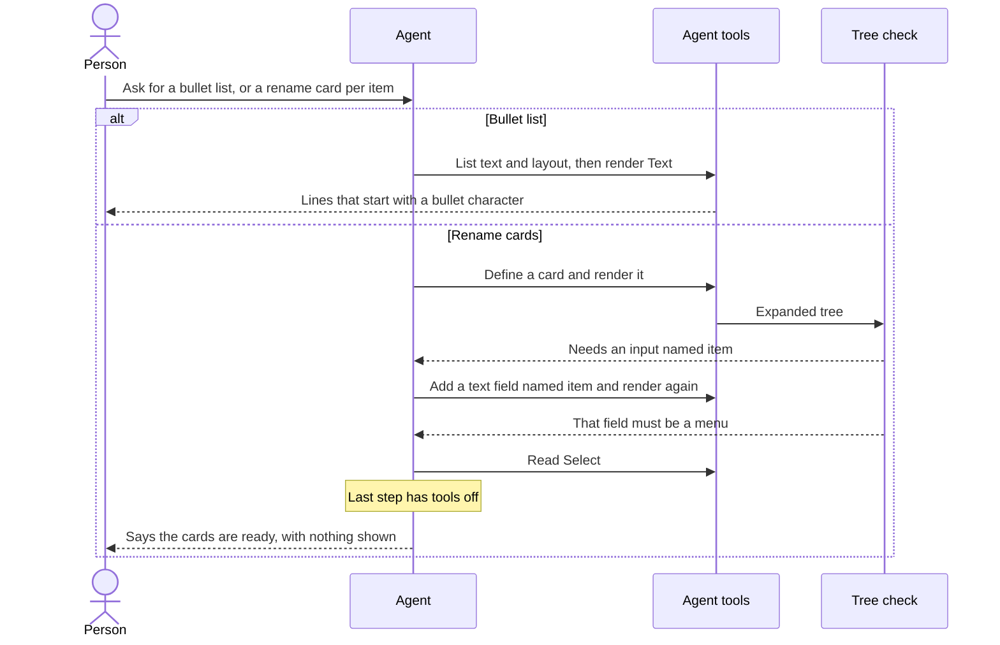
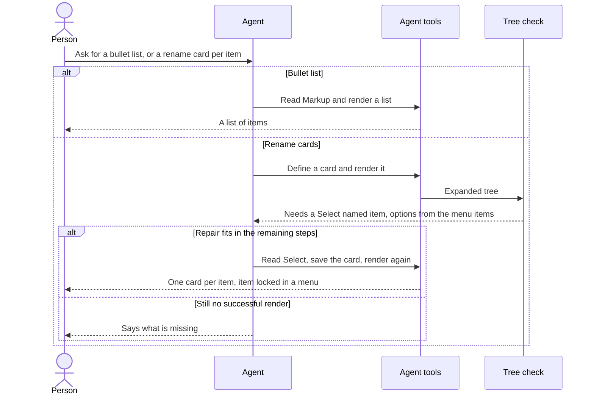
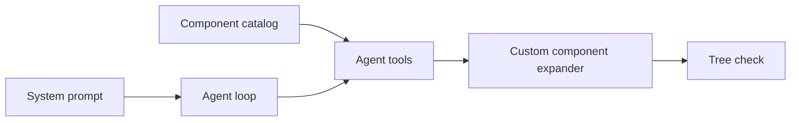
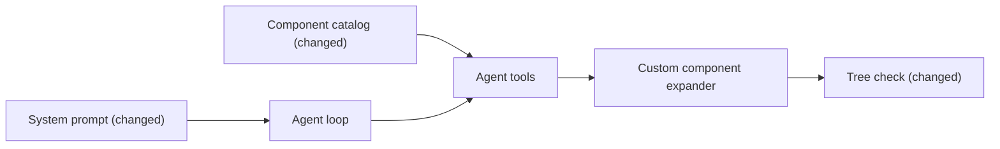

# Say when a list is Markup, and ask for a menu when a choice is missing

**Branch:** plan-markup-lists-and-choice-selects · **Written:** 2026-10-23 · **Supersedes:** -

## Summary

The model draws a requested bullet list as lines of text with a bullet character, so the check for a real list fails. When each menu item needs its own rename card, the first error only says an input of that name is missing, so the model adds a text field, then hears it must be a menu, and runs out of steps with nothing shown. This plan tells the model, in its instructions and in Markup's short catalog description, that a bullet or numbered list is drawn with list markup. It also changes that first error so a missing choice asks for a menu of the right choices immediately. Tests lock both wordings. A later model run, which needs an API key, is how we see whether those two cases improve.

- **In scope:** the list sentence in the system prompt, the same idea in Markup's catalog description, the missing-input error when that property has a choice source, and the tests that pin those strings.
- **Out of scope:** a new list component, a higher step limit, edits to eval cases, repeating the locked-item rule in the error, reporting missing inputs while saving a component, deduping repeated errors, and the message for an input that exists but is the wrong kind.
- **Open decisions:** none (see [Open decisions](#open-decisions))

### Behavior before



### Behavior after



### Architecture before



### Architecture after



### What changes

- The system prompt names a bullet or numbered list as Markup, with `ul` or `ol` of `li`, and says not to fake one with Text.
- Markup's one-line catalog description names a bullet or numbered list, so a full component list shows it before the model opens Markup.
- A missing required input that has a choice source asks for a Select and names that source on the first error.
- The expander still prefixes template paths. Only the sentence after the path changes.

---

## Current state

The model instructions live in `SYSTEM_PROMPT` in `server/agent/systemPrompt.ts`. The loop does not send them; the LLM adapter prepends them. Step 3 says to use Markup only for a look the catalog cannot produce, and the examples are a chart, a rating, or a specific style. It then says a rough approximation with catalog components is not enough in that case. A line of Text starting with a bullet character fits that rule. The same step already says a form that edits one existing item has a Select, named after the identifying input, with value set to that item and disabled, and that many repeated forms should be a reusable item card or one form with an item dropdown. `server/agent/systemPrompt.test.ts` pins the current Markup sentence in "prefers existing components and says when to define one", and pins the locked-Select sentence in "teaches forms in Cards, locked item Selects, large lists and $each".

Markup is a catalog component in `server/catalog/components.ts`. Its description says it draws allowlisted HTML and SVG for what no other component can show, such as a bar chart or a star rating, and tells the model to call `get_component` for the full rules. `get_component` returns `markupRules()` from `shared/markup.ts`, which already allowlists `ul`, `ol`, and `li`. The root example is an SVG bar. `server/catalog/components.test.ts` asserts that the description mentions `get_component` and no longer says Markup is only for templates.

`bindingProblems` in `server/ui/validateTree.ts` checks action inputs. For each enabled button, and only when `designChecks` is true, a missing required property produces `needs an input named "<key>"`, plus ` in its Card` when the button is inside a card. A later loop, and only when `choiceValues` has loaded that source, tells a present non-Select input to use a Select. `ActionSpec.choices` in `server/actions/types.ts` maps an input name to a source name and does not depend on those loaded values. `validateUiTree` is the public function; `bindingProblems` is private. `server/customComponents/definition.ts` calls `validateUiTree` with `designChecks: false`, so saving a component does not report a missing action input. `render_ui` validates the expanded tree with the default `designChecks: true`. `expandTree` in `server/customComponents/expand.ts` rewrites those errors so a template node reads as the agent's path plus the component name, version, and `template`.

`server/ui/validateTree.test.ts` pins the old missing-input sentence for `sign_up` (no `choices`) and for `menu_update_item` (`choices.item` is `menu_items`), both inside a card and outside every card. It also pins the present-but-wrong-component sentence.

One turn allows `MAX_STEPS` of 10 completions in `server/agent/guardrails.ts`. The last completion is sent with tools off. In the local run `eval-logs/2026-10-24T01-12-26.466Z` (local only), `bullet-list-items` rendered three Text nodes and `per-item-edit-cards` used the last tool-capable step to read Select after two rejected renders. The earlier local run `eval-logs/2026-10-24T01-04-05.959Z` passed the card case with a disabled Select. Eval cases `server/eval/cases/bullet-list-items.json` and `server/eval/cases/per-item-edit-cards.json` are unchanged by this plan.

Checks that exist: `npm test`, `npm run typecheck`, `npm run build`, `npm run build:api`, and `npm run eval`. CI in `.github/workflows/ci.yml` runs the first four after installing dependencies, with Postgres and Redis. `npm run eval` needs `OPENAI_API_KEY`. Database-backed tests skip when `DATABASE_URL` is unset; the tests this plan changes do not need it.

## Requirements

### R1: List is Markup in the prompt

The system prompt MUST say that a bullet or numbered list is Markup with a `ul` or `ol` of `li` elements, and that Text lines starting with a bullet character are not that list. The chart, rating, and specific-style examples MUST stay, and Markup MUST stay limited to looks the catalog cannot produce.

**Acceptance:**

- `SYSTEM_PROMPT` contains the replacement sentence in Design, in step 3, before the custom-component section.
- The following sentence, about a one-off Markup going directly in the design, is unchanged.
- The locked-Select sentence and the "for an input that has choices, use a Select" sentence stay.
- The prompt names no tool that is not registered. `ul`, `ol`, and `li` are tags, not tool names.

### R2: Markup's catalog line names lists

Markup's catalog description MUST mention a bullet or numbered list and MUST still tell the model to call `get_component` for the full rules. The root prop description, the SVG example, and `markupRules()` MUST stay as they are.

**Acceptance:**

- The description is the replacement string in Design.
- `list_components` and `get_component` return that description, because both read the catalog entry.
- `get_component` for Markup still returns `markupRules()`, including `ul`, `ol`, and `li`.
- The description does not say Markup is only for templates.

### R3: A missing choice asks for a Select

When `designChecks` is true, an enabled button's action is missing a required input, and `ActionSpec.choices` maps that input to a non-empty source name, the error MUST ask for a Select with that source's values as its options. A required input with no choice source MUST keep today's "needs an input named" sentence. A present input of the wrong kind MUST keep today's "use a Select" sentence, which still depends on loaded `choiceValues`.

**Acceptance:**

- Inside a card, a missing `item` for `menu_update_item` produces: `tree.children.1.children.1 action "menu_update_item" needs a Select named "item" in its Card, with the menu_items values as its options, and none has that name`.
- Outside every card, the same miss produces: `tree.children.1 action "menu_update_item" needs a Select named "item", with the menu_items values as its options, and none has that name`.
- Those two sentences are produced even when `choiceValues` is omitted, because the source name is on the spec.
- `sign_up` missing `email` still produces `needs an input named "email"`, with and without ` in its Card` as it does today. That spec has no `choices`.
- A disabled button still does not require the action's inputs.
- `designChecks: false` still skips the missing-input check, so `define_component` does not start reporting it.
- A TextInput named `item`, with `menu_items` loaded, still produces the existing "use a Select with those values as options" sentence, not the new missing-input sentence.
- A missing optional property does not by itself produce the new sentence.

## Design

### Components

No new module. R1 edits `SYSTEM_PROMPT` in `server/agent/systemPrompt.ts`. R2 edits the Markup entry in the `catalog` array in `server/catalog/components.ts`. R3 edits the required-key branch inside `bindingProblems` in `server/ui/validateTree.ts`. `validateUiTree`'s signature stays. `expandTree` keeps prefixing whatever sentence `bindingProblems` returns, so an expanded card still reads as the agent's path, the component name and version, and `template`, then the new sentence.

### Interfaces

Replace this sentence in step 3 of `SYSTEM_PROMPT`:

```text
Use Markup, which draws a visual from a JSON tree, only when the person asks for a look the components can't produce, such as a chart, a rating or a specific style; a rough approximation with catalog components isn't enough then.
```

with:

```text
Use Markup, which draws a visual from a JSON tree, only when the person asks for a look the components can't produce, such as a chart, a rating, a bullet or numbered list, or a specific style; a rough approximation with catalog components isn't enough then. A bullet or numbered list is Markup with a ul or ol of li elements, not Text lines that start with a bullet character.
```

Replace Markup's `description` with:

```text
Draws allowlisted HTML and SVG elements from a JSON tree, for what no other component can show, such as a bar chart, a star rating, or a bullet or numbered list. Call get_component for Markup's full rules.
```

In the missing-required loop, when `spec.choices?.[key]` is a non-empty string `source`, push:

```text
${button.path} action "${spec.name}" needs a Select named "${key}"${where}, with the ${source} values as its options, and none has that name
```

`where` stays ` in its Card` when the button has a card, and empty otherwise. When `source` is missing or empty, keep:

```text
${button.path} action "${spec.name}" needs an input named "${key}"${where}, and none has that name
```

Do not read `choiceValues` for this branch. Leave the later loop, the one that starts `fills "<name>" of action`, unchanged.

### Data and migrations

None. No schema, config, or environment variable changes.

### Errors and edge cases

The new sentence is a tool error on `render_ui`, same channel as the old one. Seven copies can still appear, one per expanded card, and `limitErrors` still caps them at `MAX_ERRORS`. This plan does not dedupe them.

A Markup `select` that already has the right name is not a missing input, so the new sentence does not fire. If `choiceValues` is loaded, the existing wrong-kind sentence can still fire, because that element is not a Select. That stays as it is.

Saving a component still uses `designChecks: false`, so a missing action input is still silent at `define_component`. The model hears the new sentence when it renders.

### Compatibility and rollout

The only callers that match the old `menu_update_item` missing-input strings are the two tests named under R3. They update in the same change as the sentence. `sign_up` strings stay. Nothing is stored, and no client parses these sentences. Ship both slices in either order; they share no files and no type.

## Security

| Concern | Mitigation | Enforced by |
|---|---|---|
| The prompt tells the model to emit `ul`, `ol`, and `li` | Those tags are already on the Markup allowlist in `shared/markup.ts`. `sanitizeMarkup` still drops anything else. No new tags. | R1 |
| The new error names an action, an input, and a choice source | Those names already come from `ActionSpec`, which `list_actions` returns to the model. The sentence is a tool error, not HTML in the sandbox. | R3 |

## Validation

**Workers can run** (no credentials or live services):

- `npm test`: prompt, catalog, and tree-check cases. Database suites skip when `DATABASE_URL` is unset.
- `npm run typecheck`: the edits typecheck.

**New tests:**

- R1: `server/agent/systemPrompt.test.ts` replaces the pinned Markup sentence with the replacement in Design, and asserts the `ul` or `ol` of `li` sentence and the refusal of Text lines that start with a bullet character. The registered-tool test still passes.
- R2: `server/catalog/components.test.ts` asserts the new description, that it still mentions `get_component`, and that the root description is unchanged.
- R3: `server/ui/validateTree.test.ts` updates "requires each button's own Card to hold the action's inputs" and "keeps the whole-design message for a button outside every Card". Adds the same missing `item` with `choiceValues` omitted. Keeps the `sign_up` missing-email cases, the disabled-button case, the `designChecks: false` case, and the TextInput-named-`item` "use a Select" case.

**After merge** (needs credentials, live services, or a person):

- `npm run eval`, which needs `OPENAI_API_KEY`. Compare `bullet-list-items` and `per-item-edit-cards` with the local logs from 2026-10-24. One run can still miss; the unit tests are the contract.

## Work breakdown

| Slice | Covers | Touches | After | Size |
|---|---|---|---|---|
| list-markup-wording | R1, R2 | server/agent/systemPrompt.ts, server/agent/systemPrompt.test.ts, server/catalog/components.ts, server/catalog/components.test.ts | - | small |
| choice-select-error | R3 | server/ui/validateTree.ts, server/ui/validateTree.test.ts | - | small |

The slices share no files and no type. They can land in either order, including at the same time. `list-markup-wording` keeps the prompt and the catalog on the same phrase, "bullet or numbered list". `choice-select-error` only changes the first repair sentence; the prompt already tells the model to use a Select for a choice.

## Non-goals

- A catalog List component. Markup already allowlists `ul`, `ol`, and `li`, and the eval case checks for an `li`.
- Raising `MAX_STEPS`. The first error should name the Select so the repair fits in the turns that remain.
- Editing `server/eval/cases/bullet-list-items.json` or `server/eval/cases/per-item-edit-cards.json`.
- Putting the disabled-Select or `$prop` rule into the error. Step 3 of the prompt already says that.
- Making `define_component` report a missing action input.
- Deduping one error per expanded card, or changing the sentence for a present input of the wrong kind.
- Changing `markupRules()`, Markup's root description, or its SVG example.

## Assumptions

- Both fixes from the eval readout belong in this one plan.
- The branch name is `plan-markup-lists-and-choice-selects`.
- The new sentence keys off `ActionSpec.choices`, not off whether `choiceValues` loaded.
- The exact replacement strings in Design are the wording to ship.

## Risks

- The model can still ignore the list sentence, or spend the remaining steps after a clearer error. The prompt is on every turn, and the first error names the Select. `npm run eval` is the live check, not a promise that one run passes.
- The prompt test pins the old Markup sentence. The wording change and that assertion update in `list-markup-wording` together, or the suite fails.

## Open decisions

None.

## References

- Request: "on a new branch /d-generate-plans , plan fixes", meaning the two fixes proposed for the 2026-10-24 eval readout.
- `server/agent/systemPrompt.ts`, `server/agent/systemPrompt.test.ts`
- `server/catalog/components.ts`, `server/catalog/components.test.ts`
- `server/ui/validateTree.ts`, `server/ui/validateTree.test.ts`
- `server/actions/types.ts`, `server/customComponents/definition.ts`, `server/customComponents/expand.ts`
- `shared/markup.ts`, `server/agent/guardrails.ts`
- `server/eval/cases/bullet-list-items.json`, `server/eval/cases/per-item-edit-cards.json`
- `docs/ARCHITECTURE.md`, `.github/workflows/ci.yml`, `package.json`
- Local only: `eval-logs/2026-10-24T01-12-26.466Z`, `eval-logs/2026-10-24T01-04-05.959Z`
