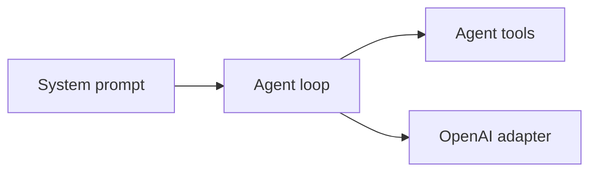
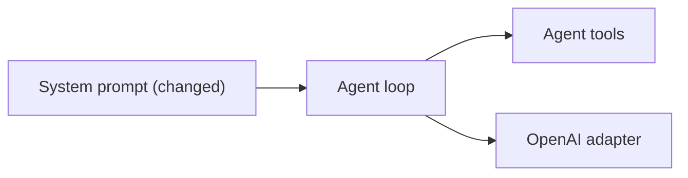

# Show the button when no action fits, instead of asking

**Branch:** plan-missing-action-render · **Written:** 2026-10-23 · **Supersedes:** -

## Summary

Someone asks for a button that runs an action this app does not have. The assistant is supposed to draw that button and say the click will not do anything yet. On the latest run it listed the actions, then asked what to try instead, and showed nothing. The instructions already say to draw the button, but a later line says to ask one short question when a request is unclear, and that later line won. This plan adds the exception onto that question line, so a missing action is not treated as unclear. A live model run, which needs an API key, is how we see whether the Download CSV case improves.

- **In scope:** the question line in the system prompt, and the test that pins it.
- **Out of scope:** the agent loop, the action-list tool result, eval cases, the catalog, and the separate unmerged list-and-menu plan.
- **Open decisions:** none (see [Open decisions](#open-decisions))

### Behavior before

```mermaid
sequenceDiagram
  actor Person
  participant Agent
  participant Tools as Agent tools
  Person->>Agent: Ask for a Download CSV button that runs export_csv
  Agent->>Tools: list_actions
  Tools-->>Agent: demo_echo matches; no export action
  Agent-->>Person: Asks what to try instead
```

### Behavior after

```mermaid
sequenceDiagram
  actor Person
  participant Agent
  participant Tools as Agent tools
  Person->>Agent: Ask for a Download CSV button that runs export_csv
  Agent->>Tools: list_actions
  Tools-->>Agent: demo_echo matches; no export action
  Agent->>Tools: render_ui with a button and no action
  Tools-->>Person: A Download CSV button
  Agent-->>Person: Says the click will not do anything yet
  alt The request is unclear for a different reason
    Agent-->>Person: Asks one short question
  else The request is not about a design
    Agent-->>Person: Says it can only help with UI design
  end
```

### Architecture before



### Architecture after



### What changes

- The Rules line that tells the model when to ask now says a button with no fitting action is not unclear, and to draw that button with no action instead of asking.

---

## Current state

The model instructions live in `SYSTEM_PROMPT` in `server/agent/systemPrompt.ts`. The loop does not send them. `createOpenAILlm` in `server/adapters/openai/OpenAILlm.ts` prepends them as the first message, and they are not stored in history. Chat (`server/index.ts`) and `npm run eval` (`server/eval/cli.ts`) both pass the same `SYSTEM_PROMPT`.

Step 5 already says: if no action fits, render the button without an action and say that clicking it will not do anything yet; do this also when the person names an action `list_actions` did not return, or when only a demo or other unrelated action came back; never wire one as a stand-in; a missing action is not a reason to ask a question or to skip `render_ui`. The Rules section, later in the same prompt, says: if the request is unclear in a way that changes the design, ask one short question in everyday words; otherwise make a reasonable choice and mention it. A separate sentence says that for anything unrelated to UI design, reply in one sentence that you can only help with UI design here. Step 2 says not to call `list_actions` for a mockup, a design without buttons, or buttons that only move around the design.

`server/agent/systemPrompt.test.ts` pins the step 5 bullet as a whole line in "renders a button without an action rather than wiring a stand-in or asking", and pins the ask sentence as a substring in that same test. That test also asserts the prompt does not contain `demo_echo`. "names only registered tools in snake_case" treats every snake_case word as a tool name, so a new sentence may name `list_actions` and `render_ui` and no other snake_case word.

`list_actions` is `listActionsTool` in `server/agent/tools/actions.ts`. A spec with no area or operation counts as `other`. `demo_echo` in `server/actions/demo.ts` sets neither, so a call with area `any` and operation `other` returns it as an exact match. Menu actions have their own areas and operations, so they are listed under `others`. The note `AREA_FALLBACK_NOTE` ("render the button without an action") is added only when `match` is `area`, so this exact match does not include it. Button's `action` prop in `server/catalog/components.ts` is optional (`required` is `label` only) and its description says to leave it out if none fits. `collectBindings` in `server/ui/bindings.ts` records a Button only when `props.action` is a string, so a button with no action is not checked as an unregistered action. `bindingProblems` in `server/ui/validateTree.ts` rejects a button whose action string is not a registered name.

The loop's `REPAIR_REMINDER` in `server/agent/loop.ts` says that if you need to ask the person something first, reply with only that question. It is pushed only after a failed `render_ui` or `define_component`, and only once. It was not sent on the failing run.

`server/eval/cases/invented-action-name.json` asks: "Show a Download CSV button that runs the export_csv action." Its checks require `endedBy` reply, `noError`, a call to `list_actions`, a successful `render_ui`, a `Button`, and `noButtonAction`. `noButtonAction` in `server/eval/checks.ts` passes when the last successful tree has a Button and `collectBindings` found no button action. The same shape of checks is on `export-pdf`, `sms-no-action`, and `newsletter-no-action`. `mockup-no-action` requires that `list_actions` is not called. `off-topic-refusal` requires a short reply and no design tools.

In the local run `eval-logs/2026-10-24T05-53-03.999Z` (local only), `invented-action-name` called `list_actions` with area `any` and operation `other`, then replied that there is no export action and asked what to try, including a demo. It made no `render_ui` call. `endedBy` was `reply`, `repairReminders` was 0, and tools were still allowed. The same run passed `export-pdf` by rendering a Button with no action. The earlier local run `eval-logs/2026-10-24T01-12-26.466Z` passed `invented-action-name` the same way `export-pdf` passed this time. Eval cases are unchanged by this plan.

Checks that exist: `npm test`, `npm run typecheck`, `npm run build`, `npm run build:api`, and `npm run eval`. CI in `.github/workflows/ci.yml` runs the first four after installing dependencies, with Postgres and Redis. `npm run eval` needs `OPENAI_API_KEY`. Database-backed tests skip when `DATABASE_URL` is unset; the prompt test does not need it.

## Requirements

### R1: A missing action is not a question

When the person asks for a button that should do something and `list_actions` returned no action whose description does that, the system prompt MUST say that this is not unclear, and MUST say to render the button without an action and say that clicking it will not do anything yet, instead of asking. The step 5 bullet that already says this MUST stay, so the exception sits on the later question line the model followed.

**Acceptance:**

- The Rules bullet is the replacement string in Design.
- The step 5 bullet stays the string quoted in Design, including "A missing action is not a reason to ask a question or to skip render_ui."
- The opening "ask one short question in everyday words" stays, for a request that is unclear in a way that changes the design and is not this missing-action case.
- The one-sentence refusal for anything unrelated to UI design stays.
- The step 2 sentence that skips `list_actions` for a mockup, a design without buttons, and buttons that only move around the design stays.
- The prompt does not contain `demo_echo`.
- The new sentence names no snake_case word other than a registered tool. `list_actions` is registered.
- In `server/agent/systemPrompt.test.ts`, "renders a button without an action rather than wiring a stand-in or asking" fails when the exception clause is absent. Matching the old ask sentence alone is not enough.

## Design

### Components

No new module. R1 edits `SYSTEM_PROMPT` in `server/agent/systemPrompt.ts`. Chat and eval both import that constant, so both pick up the sentence. The loop, `listActionsTool`, `REPAIR_REMINDER`, the catalog, `collectBindings`, `bindingProblems`, and the eval cases stay as they are.

### Interfaces

Leave this step 5 bullet unchanged:

```text
   - Set the Button's action prop to the name of a returned action that fits: one whose description does what the button should do. If no action fits, render the button without an action and say that clicking it won't do anything yet. Do this also when the person names an action list_actions didn't return, or when only a demo or other unrelated action came back: never wire one as a stand-in. A missing action is not a reason to ask a question or to skip render_ui.
```

Replace this Rules bullet:

```text
- If the request is unclear in a way that changes the design, ask one short question in everyday words. Otherwise make a reasonable choice and mention it.
```

with:

```text
- If the request is unclear in a way that changes the design, ask one short question in everyday words. Otherwise make a reasonable choice and mention it. A button that should do something, when list_actions returned no action whose description does that, is not unclear: render the button without an action and say that clicking it won't do anything yet, instead of asking.
```

### Data and migrations

None. No schema, config, or environment variable changes.

### Errors and edge cases

No new tool error. A Button with no `action` string is still omitted by `collectBindings`, so `render_ui` still accepts it. A Button whose `action` is an invented name is still rejected by `bindingProblems`.

The new clause applies only after `list_actions` has returned and no returned description does what the button should do. `demo_echo` coming back as the exact match for operation `other` does not count as a fitting action: its description does not export a CSV. An unclear request that has not reached that point, such as a form whose purpose is missing, still gets one short question. A mockup still follows step 2 and does not need `list_actions`. An off-topic request still gets the one-sentence refusal.

`REPAIR_REMINDER` can still invite a question after a failed `render_ui`. This failure never called `render_ui`, so that sentence is not part of this change.

### Compatibility and rollout

The only assertion that requires the old ask sentence is the test named under R1. The new bullet still begins with that sentence, so a test that only searches for the old sentence would stay green. The same change updates that test to require the exception clause. Nothing is stored, and no client parses the prompt.

## Security

| Concern | Mitigation | Enforced by |
|---|---|---|
| The model wires `demo_echo` or invents `export_csv` so the button appears to export | The prompt still forbids a stand-in and still forbids invented action names. `bindingProblems` rejects an action string that is not registered. Omitting `action` stays valid. | R1 |
| A Download CSV button that does nothing misleads the person | The same sentence tells the model to say that clicking it will not do anything yet. The button has no action, so a click does not run an export. | R1 |

## Validation

**Workers can run** (no credentials or live services):

- `npm test`: the prompt cases in `server/agent/systemPrompt.test.ts`. Database suites skip when `DATABASE_URL` is unset.
- `npm run typecheck`: the prompt edit typechecks.

**New tests:**

- R1: `server/agent/systemPrompt.test.ts` "renders a button without an action rather than wiring a stand-in or asking" asserts the replacement Rules bullet, including "is not unclear" and "instead of asking", and still asserts the unchanged step 5 bullet and the absence of `demo_echo`. "names only registered tools in snake_case" still passes.

**After merge** (needs credentials, live services, or a person):

- `npm run eval`, which needs `OPENAI_API_KEY`. Compare `invented-action-name` with the local log from 2026-10-24T05-53-03.999Z. On the same run, `export-pdf`, `sms-no-action`, and `newsletter-no-action` should still render a button with no action, `mockup-no-action` should still skip `list_actions`, and `off-topic-refusal` should still answer with no design tools. One run can still miss; the unit test is the contract.

## Work breakdown

| Slice | Covers | Touches | After | Size |
|---|---|---|---|---|
| missing-action-ask-exception | R1 | server/agent/systemPrompt.ts, server/agent/systemPrompt.test.ts | - | small |

One slice. The prompt and the test that pins it change together.

## Non-goals

- A loop change that forces `render_ui` when the model replies early.
- Editing `REPAIR_REMINDER`.
- Adding the fallback note to an exact `list_actions` match, or any other change to `server/agent/tools/actions.ts`.
- Editing `server/eval/cases/invented-action-name.json` or the sibling no-action cases.
- The bullet-list and missing-choice work on branch `plan-markup-lists-and-choice-selects`.
- Changing Button's props, `collectBindings`, or `bindingProblems`.

## Assumptions

- The exception belongs on the Rules question bullet. The step 5 bullet stays character for character, because it already states the rule and the model still followed the later line.
- The exact replacement string in Design is the wording to ship.
- `demo_echo` remaining an exact match for operation `other` stays. The new sentence keys off whether a returned description does what the button should do, not off an empty `actions` array.

## Risks

- The model can still ask. The exception sits on the line it followed. `npm run eval` is the live check, not a promise that one run passes.
- A test that only searches for the old ask sentence stays green without the exception. The assertion update is in the same slice as the wording, and R1 says the old sentence alone is not enough.
- The model might treat a fitting action's description as a non-match and omit the action. Step 5 already tells it to wire an action whose description does what the button should do. This sentence repeats the same test.

## Open decisions

None.

## References

- Request: "troubleshoot the eval failures and generate a fix", scoped to `invented-action-name` as a prompt clarification.
- `server/agent/systemPrompt.ts`, `server/agent/systemPrompt.test.ts`
- `server/adapters/openai/OpenAILlm.ts`, `server/index.ts`, `server/eval/cli.ts`
- `server/agent/loop.ts`, `server/agent/tools/actions.ts`, `server/actions/demo.ts`
- `server/catalog/components.ts`, `server/ui/bindings.ts`, `server/ui/validateTree.ts`
- `server/eval/cases/invented-action-name.json`, `server/eval/cases/export-pdf.json`, `server/eval/cases/sms-no-action.json`, `server/eval/cases/newsletter-no-action.json`, `server/eval/cases/mockup-no-action.json`, `server/eval/cases/off-topic-refusal.json`
- `server/eval/checks.ts`
- `docs/ARCHITECTURE.md`, `.github/workflows/ci.yml`, `package.json`
- Separate unmerged plan on branch `plan-markup-lists-and-choice-selects` (not this plan)
- Local only: `eval-logs/2026-10-24T05-53-03.999Z`, `eval-logs/2026-10-24T01-12-26.466Z`
