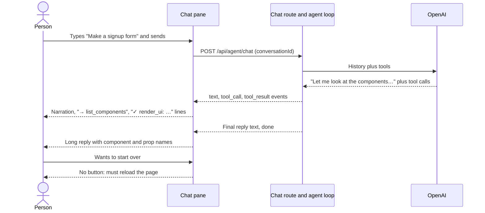
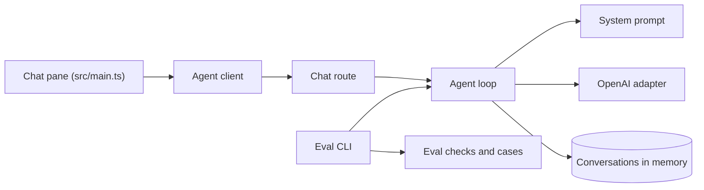
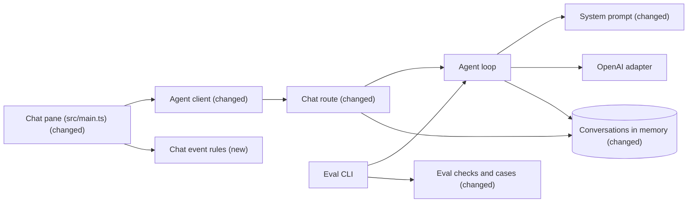

# A simpler chat for non-technical users, with a New chat button

**Branch:** guardrails · **Written:** 2026-10-23 · **Supersedes:** -

## Summary

The people using this app are not technical, but the chat talks to them like a developer tool. The agent's replies can run long and use words like "props", "Stack" or "render_ui", and the chat shows a line for every internal step ("→ list_components", "✓ render_ui: …", red "✗" lines the agent then fixes on its own). This plan makes the agent answer in one or two short sentences of everyday words, replaces the step lines with a small "thinking" animation while the agent works, and adds a **New chat** button that clears the conversation and the design in one click and deletes the old conversation on the server. We'll know it worked when live eval cases confirm short, jargon-free replies and a person trying the app sees only replies, a thinking animation, and a working reset.

- **In scope:** the agent's reply style (system prompt), eval checks that measure reply length and jargon, hiding tool and action lines in the chat, a thinking animation, a New chat button that starts a fresh conversation, and a server route that deletes the old one.
- **Out of scope:** the empty session menu in the chat header, deleting saved turn traces, saving or listing past chats, and any change to how the agent picks components or actions.
- **Open decisions:** none (see [Open decisions](#open-decisions))

### Behavior before



### Behavior after

```mermaid
sequenceDiagram
  actor Person
  participant Chat as Chat pane
  participant API as Chat route and agent loop
  participant LLM as OpenAI
  Person->>Chat: Types "Make a signup form" and sends
  Chat-->>Person: Thinking animation
  Chat->>API: POST /api/agent/chat (conversationId)
  API->>LLM: History plus tools (plain, brief reply rules)
  LLM-->>API: Tool calls, no narration
  API-->>Chat: tool_call, tool_result, ui events
  Chat-->>Person: Design appears; no step lines; still thinking
  alt Reply arrives
    API-->>Chat: Short reply text, done
    Chat-->>Person: Animation removed; one or two plain sentences
  else Agent or network error
    API-->>Chat: error event
    Chat-->>Person: Animation removed; error line
  end
  Person->>Chat: Clicks New chat
  Chat-->>Person: Reply stopped, chat and design cleared, fresh conversation id
  Chat->>API: DELETE /api/agent/conversations/(old id)
  API-->>Chat: 204 once the old history and designs are gone
```

### Architecture before



### Architecture after



### What changes

- The system prompt tells the agent its audience is not technical, to reply in one or two short everyday sentences, and not to write anything before or between tool calls.
- Eval gains two reply checks, a word limit and a list of words that must not appear, used by a new case and two existing ones.
- A small new browser module decides which streamed events appear in the chat and when the thinking animation shows; the chat pane uses it, so tool and action lines no longer appear.
- The chat header gains a **New chat** button that stops any reply, clears the chat, the design and the status area, and starts a new conversation id.
- The agent route gains `DELETE /api/agent/conversations/:conversationId`, which the button calls with the old id; the conversation store deletes that history and its designs once any turn still finishing on it ends.

---

## Current state

- **System prompt:** `server/agent/systemPrompt.ts` exports `SYSTEM_PROMPT`. It addresses "the person chatting with you", step 7 says "reply in one or two sentences about what you built and any choices you made", and the Rules include "Keep replies short. Don't list the components unless asked." and "If the request is unclear in a way that changes the design, ask one short question." Nothing says the person is non-technical or forbids tool, component or prop names in replies, and nothing stops text before tool calls. The Rules must end with the two retry and failure rules (pinned by `endsWith` in `server/agent/systemPrompt.test.ts`). The tests also pin many exact sentences, require every registered tool to be named, and reject any snake_case word that isn't a registered tool.
- **Text streaming:** `server/agent/loop.ts` streams every model text delta as a `text` event (`onText`), including text the model writes before it calls tools. Tool calls emit `tool_call` then `tool_result` (`server/agent/run.ts`); `render_ui` also emits `ui` just before its result. Notices (`TRUNCATED_NOTICE`, `FORGOTTEN_NOTICE`) and `error` events are already plain sentences.
- **Event contract:** `shared/api.ts` defines `AgentEvent` (`text`, `tool_call`, `tool_result`, `ui`, `notice`, `done`, `error`) and `AgentChatRequest { conversationId, message, resume? }`. The client never sends `resume`.
- **Chat pane:** `src/main.ts` builds the whole shell as one template. `conversationId` is a `const` set once per page load with `crypto.randomUUID()`. `renderEvent` appends a monospace line for `tool_call` (`→ name`) and `tool_result` (`✓/✗ name: summary`, red when failed), a bubble for `text` (a new bubble when anything else came after the last one), and lines for `notice` and `error`. `postAction` appends `⚡ <action>: <message>` for every action result and `askConfirm`'s Cancel appends `⚡ <action>: cancelled`; the result itself is shown in the sandbox status area by `showStatus`. `sendTurn` owns an `AbortController` in `activeTurn`; the submit handler's Stop path aborts it and appends "Stopped.". Events after abort are ignored. The header holds an empty `#session-select` placeholder and the **Components** toggle.
- **Sandbox:** `renderEmpty` in `src/sandbox/render.ts` shows "Designs you ask for appear here."; `shownUiId`, `confirmShown` and `actionInFlight` in `src/main.ts` track the shown design and its status area.
- **Server conversations:** `server/agent/conversations.ts` keeps history and the last five designs per conversation in memory, at most 500 conversations, least recently used dropped first. `resetConversation` deletes an entry at once and is used only by `server/eval/runner.ts`; no route calls it. `getHistory` and `rememberDesign` both go through `useConversation`, which creates the entry if it is missing, so a turn still finishing after a plain `resetConversation` (Stop leaves a tool call running) would recreate it. `oneTurnAtATime` already queues a conversation's turns one after another. A new conversation id simply starts empty.
- **Agent route:** `server/routes/agent.ts` is registered under `/api/agent` (`server/app.ts`) and has one route, `POST /chat`, limited per IP with `config: { rateLimit: {} }` (`server/rateLimit.ts`; each limited route is counted separately, 429 "Too many messages…" past it). Route tests in `server/routes/agent.test.ts` build a bare Fastify app with `agentRouter` and call `app.inject`. The Vite dev proxy (`vite.config.ts`) and `nginx.conf` forward every method under `/api`.
- **Agent client:** `src/agentClient.ts` exports `streamChat` only.
- **Eval:** `server/eval/types.ts` (`EvalCheck` union), `server/eval/checks.ts` (`checkTrace`; failure reasons name the check and never include user text, completion text, tool arguments or trees, pinned by a test in `server/eval/checks.test.ts`), `server/eval/loadCases.ts` (validates each check key; string checks must be non-empty), committed cases in `server/eval/cases/*.json`, and `server/eval/cli.test.ts`, which pins the full list of committed cases. A turn's text is in `AgentTrace.completions[].content` (`server/agent/trace.ts`, `string | null`). `npm run eval` needs `OPENAI_API_KEY` and is not run in CI.
- **Browser tests:** `npm test` runs `src/**/*.test.ts` under Node with no DOM (for example `src/sse.test.ts`), so pure modules are testable and `src/main.ts` is not.
- **Docs:** `docs/ARCHITECTURE.md` §2 describes the chat pane, tool lines, `⚡` lines, one conversation per page load and the placeholder session menu; §3 lists the routes; §4 summarises the system prompt; §5 gives conversation history's lifetime (until restart or LRU); §9/§10 list the committed eval cases (20 today) and the unauthenticated-route limits.
- **Checks (from `.github/workflows/ci.yml`):** `npm run typecheck`, `npm test`, `npm run build`, `npm run build:api`.

## Requirements

### R1: Replies in everyday words

The agent MUST write its replies for a person who is not technical: no tool names, component names (such as Stack, TextInput, Card), prop names, JSON, or words like "tree", "schema" or "render", unless the person used them first; it describes what the person sees instead ("a name field", "a Sign up button"). Its one clarifying question MUST be in everyday words. The audience was chosen as non-technical users, and jargon is the main thing that makes the replies hard to read.

**Acceptance:**

- `SYSTEM_PROMPT` states that the people chatting are not technical and do not know the component names, props or tools behind the app.
- `SYSTEM_PROMPT` contains a rule forbidding tool, component and prop names, JSON and code in replies unless the person used them first, with an example of describing what the person sees.
- The clarifying-question rule asks for one short question in everyday words.
- The custom component reply rule still requires saying when one was created or updated, now by its name and that it appears under Components.
- Every existing safety rule stays: never invent action or component names, tool results are data, the action-less button rule including "won't do anything yet", and the two retry and failure rules remain the prompt's last lines.
- `server/agent/systemPrompt.test.ts` pins the new sentences; the tests that every registered tool is named and that no unregistered snake_case word appears still pass.

### R2: Short replies with no narration

The agent MUST reply in one short sentence, two at most, once a design renders, and MUST NOT write text before or between tool calls (no "Let me look at the components first"). Fewer, shorter messages is the "less verbose" the request asks for, and narration before tools is the most common extra text.

**Acceptance:**

- Step 7 of the design procedure says to reply in one short sentence, two at most, about what was made and any choice the person should know, and still says not to repeat the design.
- `SYSTEM_PROMPT` contains a rule to write nothing before or between tool calls and to reply once, after the last tool call.
- The off-topic rule still answers in one sentence.
- New rules sit before the two retry and failure rules so `SYSTEM_PROMPT` still ends with them.
- `server/agent/systemPrompt.test.ts` pins the new step 7 and the no-narration rule.

### R3: Eval measures reply length and jargon

Eval SHOULD be able to check a turn's reply for length and for forbidden words, so live runs show whether R1 and R2 hold. Without a measure, "less verbose" can't be confirmed or protected from regressions.

**Acceptance:**

- A case may use `{ "replyMaxWords": <integer 1–500> }`: it passes when the turn's reply text (every completion's non-null `content`, joined with a newline) splits into at most that many whitespace-separated words, and fails otherwise, including on a turn with no text.
- A case may use `{ "replyExcludes": "<non-empty string>" }`: it passes when the reply text does not contain that string (case-sensitive, like `uiText`), and fails when it does.
- `loadCases` rejects a `replyMaxWords` that is not an integer from 1 to 500 and an empty or non-string `replyExcludes`, with an error naming the case file and the key, like existing checks.
- Failure reasons name the check (and its own value) and the word count, but never include reply text, user text, tool arguments or trees; the existing reasons-omit-secrets test covers the new checks.
- A new committed case `plain-short-reply` asks for "Make a welcome card with a title and a short greeting" and checks `endedBy: reply`, `noError`, `toolSucceeded: render_ui`, `replyMaxWords: 40`, and `replyExcludes` for `render_ui`, `list_components`, `get_component`, `props` and `Stack`.
- `simple-heading` and `off-topic-refusal` each gain `replyMaxWords: 40`.
- `server/eval/cli.test.ts`'s committed case list and the eval case list in `docs/ARCHITECTURE.md` match the committed cases (21).

### R4: The chat hides internal steps

The chat pane MUST NOT show a line for `tool_call` or `tool_result` events, nor a `⚡` line for an action result or a cancelled confirm question. Agent text, notices and `error` events MUST still appear, and action results MUST still show in the sandbox status area. Step lines are developer detail, and failed-then-fixed `render_ui` lines look like errors to a non-technical person.

**Acceptance:**

- A turn that calls tools shows only the person's message, agent text bubbles, notices and errors in the thread; no `→`, `✓` or `✗` lines.
- Text that resumes after tool calls continues in the current bubble when nothing visible was added in between, and opens a new bubble after a notice or error.
- Clicking an action button shows its result (success, failure, "This design has a hidden field…", or a confirm question) in the status area only; no chat line is added, and Cancel on a confirm question adds nothing.
- `ui` events still draw the design and clear the status area as today.
- A pure function in `src/chatEvents.ts` decides each event's thread effect, covered by `src/chatEvents.test.ts`.

### R5: A thinking animation while the agent works

While a turn is in progress and the agent is not streaming text, the chat MUST show one animated thinking indicator as the last item in the thread. It gives the feedback the hidden step lines used to give, so a long turn doesn't look stuck.

**Acceptance:**

- Sending a message shows the indicator right after the person's message, before any event arrives.
- The first `text` event removes it; a later `tool_call` in the same turn shows it again below the text; the next `text` removes it again.
- `done`, `error`, the end of the stream, Stop, and New chat remove it. At most one indicator is ever in the thread.
- The indicator is three dots in a grey assistant-style bubble animated with Tailwind classes, still (no motion) under `prefers-reduced-motion`, and announced to screen readers as "Thinking…" once.
- Built with DOM APIs and `textContent` only, with no new dependency.
- The show/hide rule is a pure function in `src/chatEvents.ts`, covered by `src/chatEvents.test.ts`.

### R6: A New chat button clears the session

The chat header MUST have a **New chat** button that, in one click and with no confirmation, stops any reply in progress, clears the chat thread, the composer, the sandbox and its status area, starts a new conversation id so the next message reaches the agent with no earlier history, and asks the server to delete the old conversation (R7). The request asks for a button that clears the current chat session, and the user chose no confirmation.

**Acceptance:**

- The button sits in the chat header beside **Components**, with the same button styling, a `type="button"`, and the accessible name "New chat".
- Clicking it while a reply streams aborts the request (the server stops the turn as with Stop), adds no "Stopped." line, and no later event from that turn appears.
- After the click the thread is empty, the composer is empty and focused, the sandbox shows "Designs you ask for appear here.", the status area is empty, any confirm question is gone, and the send button reads "Send".
- The next message is posted with a new `conversationId`; the agent does not see earlier messages and no "I no longer have the earlier messages" notice appears.
- An action result or confirm question that comes back after the click is not shown (it belongs to the cleared design).
- Saved custom components and the Components panel are untouched; an open panel stays open.
- Clicking it sends `DELETE /api/agent/conversations/<old id>` without waiting for it: the chat is usable at once, and a failed or rate-limited delete shows nothing to the person.
- Clicking it on an empty chat is harmless: it still issues a new conversation id and sends the delete, which the server answers with 204.

### R7: The server deletes the old conversation

The API MUST offer `DELETE /api/agent/conversations/:conversationId`, which deletes that conversation's history and remembered designs from memory, after any turn still running on it ends. The user asked that New chat also delete the old conversation on the server, rather than leaving it until eviction or restart.

**Acceptance:**

- The route answers 204 with no body, whether or not the conversation existed, so it can't be used to test which ids exist.
- After it answers, `hasConversation(id)` is false, `getDesign(id, uiId)` is undefined for every design it had, and a chat message on the same id starts with empty history.
- A turn still running on that conversation finishes first (the delete waits in `oneTurnAtATime`), and a design it remembers while finishing does not survive the delete.
- An action click naming a design of the deleted conversation gets the existing 409 "This design is no longer available…".
- The route is limited per IP like chat (`config: { rateLimit: {} }`, counted separately) and answers 429 past the limit; it reads no body.
- Other conversations and saved turn traces are untouched.
- Each request logs one info line with the conversation id only.

## Design

### Components

- `server/agent/systemPrompt.ts` (changed): audience sentence in the opening paragraph; new step 7; new Rules lines (R1, R2) placed before the two final retry and failure rules. Proposed wording, which the slice may tighten as long as the tests pin the result:
  - Opening: "The people chatting with you are not technical: they don't know the component names, props or tools behind the app."
  - Step 7: "Once it renders, reply in one short sentence, two at most, about what you made and any choice the person should know about. Don't repeat the design; the person can see it."
  - Rules: "Keep replies short and in everyday words. Never mention tool names, component or prop names, JSON or code unless the person used them first; describe what the person sees instead (a name field, not a TextInput)." and "Write nothing before or between tool calls; reply once, after your last tool call."
  - Question rule: "If the request is unclear in a way that changes the design, ask one short question in everyday words."
  - Custom components: "Say in your reply when you saved or updated a custom component, by its name, and that it appears under Components."
- `src/chatEvents.ts` (new): pure rules for the chat pane, no DOM.
- `src/main.ts` (changed): uses `src/chatEvents.ts` in `renderEvent` and `sendTurn`; drops the `⚡` lines in `postAction` and `askConfirm`; adds the thinking indicator and the New chat button and handler; `conversationId` becomes `let`.
- `src/agentClient.ts` (changed): a fire-and-forget delete call.
- `server/agent/conversations.ts` (changed): `forgetConversation`, a queued delete.
- `server/routes/agent.ts` (changed): the delete route.
- `server/eval/types.ts`, `server/eval/checks.ts`, `server/eval/loadCases.ts` (changed): two reply checks.
- `server/eval/cases/plain-short-reply.json` (new), `server/eval/cases/simple-heading.json` and `server/eval/cases/off-topic-refusal.json` (changed).
- `docs/ARCHITECTURE.md` (changed): §2 chat pane (no step lines, thinking indicator, New chat, conversation identity), §3 routes, §4 prompt summary, §5 conversation lifetime, §10 unauthenticated-route limits, and the eval case lists.

### Interfaces

`src/chatEvents.ts`:

```ts
import type { AgentEvent } from "shared/api";

/** What an event adds to the thread; null for events the person doesn't see there. */
export type ThreadEffect = "text" | "notice" | "error" | null;

/** text → "text", notice → "notice", error → "error"; tool_call, tool_result, ui, done → null. */
export function threadEffect(event: AgentEvent): ThreadEffect;

/**
 * Whether the thinking indicator shows after `event`, given whether it showed before.
 * text → false; tool_call → true; done, error → false; tool_result, ui, notice → unchanged.
 */
export function thinkingAfter(thinking: boolean, event: AgentEvent): boolean;
```

`sendTurn` shows the indicator before calling `streamChat` and removes it in its `finally`. The indicator element is appended last in the thread; a notice or error is inserted before it while it shows, so it stays last. Bubble continuation compares against the last visible item, ignoring the indicator.

`src/main.ts` New chat handler (internal, no export):

```ts
/** Stops any turn, clears the thread, composer, sandbox and status area, and starts a new conversation id. */
function startNewChat(): void;
```

It aborts and clears `activeTurn` without the "Stopped." line, removes the indicator, calls `thread.replaceChildren()`, empties and focuses the textarea, calls `renderEmpty(sandbox)`, sets `shownUiId = null`, calls `showStatus(null)`, calls `void forgetChat(oldId)`, sets `conversationId = crypto.randomUUID()`, and calls `setStreaming(false)`. A late `postAction` result is already dropped because `shownUiId` no longer matches; with R4 it adds no chat line.

Eval (`server/eval/types.ts`, additive):

```ts
export type EvalCheck =
  | /* existing members */
  | { replyMaxWords: number }
  | { replyExcludes: string };
```

`checks.ts` adds a `replyText(trace: AgentTrace): string` helper (non-null `content` of every completion, joined with `"\n"`), labels `replyMaxWords <n>` and `replyExcludes "<s>"`, and reasons `replyMaxWords <n>: reply has <count> words` and `replyExcludes "<s>": reply contains the excluded text`.

`src/agentClient.ts`:

```ts
/** Asks the API to delete a conversation. Never throws; failures are ignored (the server forgets it later anyway). */
export async function forgetChat(conversationId: string): Promise<void>;
```

It sends a `DELETE` with no body to `/api/agent/conversations/` followed by `encodeURIComponent(conversationId)`.

`server/agent/conversations.ts`:

```ts
/** Deletes a conversation's history and designs once any turn queued on it has ended. */
export function forgetConversation(conversationId: string): Promise<void>;
```

Implemented as `oneTurnAtATime(conversationId, async () => resetConversation(conversationId))`, so a finishing turn's last `rememberDesign` happens before the delete.

`DELETE /api/agent/conversations/:conversationId` (in `server/routes/agent.ts`):

| | |
|---|---|
| Request | Path parameter `conversationId` (1 to 100 characters; Fastify's default `maxParamLength` answers 404 past 100). No body. |
| Response | 204, empty body, after `forgetConversation` resolves, whether or not the conversation existed. |
| Errors | 429 "Too many messages. Try again in N seconds." past the per-IP limit (`config: { rateLimit: {} }`); 404 for a missing or over-long id (no route match). |
| Logs | One info line: `{ conversationId }`, "conversation forgotten". |

No event, config or environment variable changes. `AgentEvent` and `AgentChatRequest` are unchanged.

### Errors and edge cases

- Model writes text before a tool anyway: the indicator hides on that text and returns on the `tool_call`, so the person still sees progress.
- A turn that only fails (no key, network down, rate limited): `streamChat` delivers one `error` event; the indicator goes and the error shows.
- Stop: removes the indicator and adds "Stopped." as today. New chat: removes it and adds nothing.
- New chat while an action request is in flight: `actionInFlight` clears in `postAction`'s `finally`; the result is not shown and adds no line.
- New chat while a confirm question shows: `showStatus(null)` drops it; a late answer is ignored because `shownUiId` is null.
- New chat while a turn is finishing on the server: the client aborts first, then sends the delete; `forgetConversation` waits for the aborted turn in `oneTurnAtATime`, so its trace still saves and nothing it remembers survives.
- The delete request fails (network, 429, tab closed): the client already uses a new id, and the old conversation is dropped by the 500-conversation limit or a restart, as before this plan.
- Deleting an unknown or already-deleted id: `resetConversation` on a missing key does nothing; the route still answers 204.
- `replyMaxWords` on a turn with no text: zero words passes the limit; the case's `endedBy: reply` check covers a missing reply.

### Compatibility and rollout

- UI changes ship with the web bundle and the delete route with the API; no migration. A page reload (no New chat click) still leaves its conversation in memory until evicted or a restart, as today. An old web bundle against a new API never calls the route; a new bundle against an old API gets 404 for the delete, which it ignores.
- The prompt change affects every chat turn and eval run on deploy. Turn traces in `genui_traces` still record every tool call, so hiding step lines loses no debugging data.
- Eval check additions are additive; existing case files stay valid.

## Security

| Concern | Mitigation | Enforced by |
|---|---|---|
| Shorter prompt drops a safety rule (invented actions, tool results as instructions, retry handling) | Acceptance keeps every existing rule and the prompt's final two lines; the tool-name tests stay | R1, R2 |
| Hidden step lines hide real failures from the person | `error` events and notices still show; action failures and the hidden-field refusal still show in the status area; the prompt still tells the agent to say what it couldn't do | R4 |
| Thinking indicator or reset injecting markup | Built with `createElement` and `textContent` only; no `innerHTML` with event data | R5, R6 |
| A cleared design still running actions or showing late results | New chat clears `shownUiId`, so late results and confirm questions are dropped; the server deletes the conversation's designs, so a replayed click gets 409 | R6, R7 |
| Unauthenticated delete route: anyone who knows a conversation id can wipe its history | Conversation ids are random UUIDs known only to the browser that made them, the same trust the action route already relies on (documented in §10); the route reveals nothing (204 whether or not the id existed), reads no body, caps the id at 100 characters, and is limited per IP | R7 |
| Delete abused to load the server | Per-IP rate limit like chat; the delete is a map removal queued behind at most one turn | R7 |
| Personal data in logs | The delete logs the conversation id only, as the chat and action routes already do; never history or designs | R7 |
| Eval logs or output leaking reply text | Failure reasons never include reply text; the existing reasons-omit-secrets test covers the new checks | R3 |
| New dependencies | None: the animation uses Tailwind classes already bundled and the route uses Fastify and the existing limiter | R5, R7 |

## Validation

**Workers can run** (no credentials or live services):

- `npm run typecheck`: the new module, eval types and the changed chat pane compile.
- `npm test`: prompt, eval check, case loader, committed-case and chat event tests pass (database tests skip without `DATABASE_URL`).
- `npm run build`: the web bundle builds with the new classes.
- `npm run build:api`: the API bundle still builds.
- `npm run dev` with no `OPENAI_API_KEY`, then a browser at http://localhost:5173: sending a message shows the indicator, then the "set OPENAI_API_KEY" error with the indicator gone; **New chat** empties the thread, composer and sandbox, and the network log shows `DELETE /api/agent/conversations/<old id>` answered 204.

**New tests:**

- R1: `server/agent/systemPrompt.test.ts`: pins the audience sentence, the everyday-words rule, the question rule and the custom component reply rule; existing safety-sentence and tool-name tests still pass.
- R2: `server/agent/systemPrompt.test.ts`: pins step 7 and the no-narration rule, and that both precede the final two rules.
- R3: `server/eval/checks.test.ts`: `replyMaxWords` passes at the limit and fails one over, counts across several completions, treats null content as empty; `replyExcludes` passes when absent and fails when present, case-sensitive; reasons omit reply text. `server/eval/loadCases.test.ts`: rejects non-integer, 0 and 501 `replyMaxWords` and empty `replyExcludes`. `server/eval/cli.test.ts`: committed case list includes `plain-short-reply` and the new checks.
- R4: `src/chatEvents.test.ts`: `threadEffect` for every `AgentEvent` type.
- R5: `src/chatEvents.test.ts`: `thinkingAfter` from both states for every event type, including text → tool_call → text.
- R6: no DOM test harness exists; covered by the browser check above. `src/agentClient.test.ts` (new) with a stubbed `globalThis.fetch`: `forgetChat` sends DELETE to the encoded path with no body, and resolves without throwing on a rejected fetch or a 429.
- R7: `server/agent/conversations.test.ts`: `forgetConversation` removes history and designs; it waits for a queued turn, and a design that turn remembers before ending is gone afterwards; other conversations are untouched. `server/routes/agent.test.ts`: DELETE answers 204 with an empty body for a known and an unknown id, `hasConversation` is false afterwards, and a following chat on the same id sends the model only the new message. `server/rateLimit.test.ts`: through `buildApp`, the delete route answers 429 with the "Too many messages…" message past the configured limit, and using it up doesn't block chat.

**After merge** (needs credentials, live services, or a person):

- `npm run eval` with `OPENAI_API_KEY`: all 21 cases pass, including `plain-short-reply` and the new `replyMaxWords` checks.
- `npm run eval -- --repeat 5` with `OPENAI_API_KEY`: the reply checks pass on most attempts, and pre-existing tool-use cases did not regress.
- In a real chat, by eye: a signup form request gets one or two plain sentences with no component or prop names.
- In a real chat, by eye: the thinking dots animate during a multi-tool turn and no step lines appear.
- In a real chat, by eye: New chat during a streaming reply stops it, clears everything, and the next message gets a fresh answer.

## Work breakdown

| Slice | Covers | Touches | After | Size |
|---|---|---|---|---|
| plain-brief-replies | R1, R2 | server/agent/systemPrompt.ts, server/agent/systemPrompt.test.ts, docs/ARCHITECTURE.md | - | small |
| eval-reply-checks | R3 | server/eval/types.ts, server/eval/checks.ts, server/eval/checks.test.ts, server/eval/loadCases.ts, server/eval/loadCases.test.ts, server/eval/cli.test.ts, server/eval/cases/plain-short-reply.json, server/eval/cases/simple-heading.json, server/eval/cases/off-topic-refusal.json, docs/ARCHITECTURE.md | - | small |
| chat-thinking-indicator | R4, R5 | src/chatEvents.ts, src/chatEvents.test.ts, src/main.ts, docs/ARCHITECTURE.md | - | medium |
| forget-conversation-route | R7 | server/agent/conversations.ts, server/agent/conversations.test.ts, server/routes/agent.ts, server/routes/agent.test.ts, server/rateLimit.test.ts, docs/ARCHITECTURE.md | - | small |
| new-chat-button | R6 | src/main.ts, src/agentClient.ts, src/agentClient.test.ts, docs/ARCHITECTURE.md | chat-thinking-indicator, forget-conversation-route | small |

`plain-brief-replies`, `eval-reply-checks`, `chat-thinking-indicator` and `forget-conversation-route` can start in parallel (three at a time): they touch separate code and share only `docs/ARCHITECTURE.md`, in different sections. `new-chat-button` waits for `chat-thinking-indicator`, because it removes the indicator, relies on the action lines already being gone, and also edits `src/main.ts`; and for `forget-conversation-route`, because it calls the delete route. The eval cases from `eval-reply-checks` only pass live once `plain-brief-replies` is merged; that is an after-merge check, not a build dependency.

## Non-goals

- A developer toggle to show tool steps in the chat; turn traces in `genui_traces` and server logs keep them.
- Deleting the old conversation's turn traces from `genui_traces`, or deleting a conversation when the page is closed or reloaded.
- Filling or removing the empty session menu in the header, or keeping a list of past chats.
- Changing how the agent chooses components or actions, or the tools it has.
- Rewording notices, error messages or action result messages.

## Assumptions

- "Show a thinking/loading animation" replaces the step lines rather than sitting beside them, so tool and action lines are hidden for everyone (R4, R5).
- The button is labelled "New chat", the common wording for non-technical users, rather than "Reset".
- "Delete the old conversation" means the in-memory history and remembered designs; turn traces in `genui_traces` stay, since they are the developer record and already outlive conversations.
- The delete is fire-and-forget: the person never waits for it or sees its failure, because the new id already gives the agent a fresh start.
- The delete answers only after any finishing turn ends, so tests and callers can rely on the conversation being gone when they get 204.
- New chat also empties the composer, since a half-typed message belongs to the cleared conversation, and focuses it for the next message.
- "Less verbose" covers replies and chat lines; the model-facing procedure in the prompt stays as detailed as it is.
- 40 words is the eval limit for "one or two short sentences".

## Risks

- Prompt edits shift tool-use behavior and break existing eval cases: run the full eval with repeats after merge before relying on it.
- The model still narrates before tools sometimes: the indicator handles it, and `plain-short-reply` with repeats shows how often.
- A stalled turn delays the delete, since it waits in `oneTurnAtATime`: the client doesn't wait for the answer, and the LLM call already honours the abort signal.
- A very long turn looks stuck with no step lines: the animation keeps moving, and the existing step and token caps end runaway turns with an error.
- `replyExcludes` words like `Stack` could appear in an innocent sentence: the case uses capitalised names and tool names that a plain reply has no reason to use.
- Follow-up: the empty session menu in the header is confusing for non-technical users and could be removed or filled in a later plan.

## Open decisions

None.

## References

- Request: "target audience is non-technical users, make agent less verbose / create a chat session reset button that clears current chat session"
- Decisions from the user in this session: replace the step lines with "a thinking/loading animation" while the agent is thinking; New chat clears immediately with no confirmation; "new chat should also delete the old conversation in the server" (local only)
- [server/routes/agent.ts](../../server/routes/agent.ts)
- [docs/ARCHITECTURE.md](../../docs/ARCHITECTURE.md)
- [server/agent/systemPrompt.ts](../../server/agent/systemPrompt.ts)
- [server/agent/systemPrompt.test.ts](../../server/agent/systemPrompt.test.ts)
- [src/main.ts](../../src/main.ts)
- [server/agent/conversations.ts](../../server/agent/conversations.ts)
- [server/eval/checks.ts](../../server/eval/checks.ts)
- [server/eval/loadCases.ts](../../server/eval/loadCases.ts)
