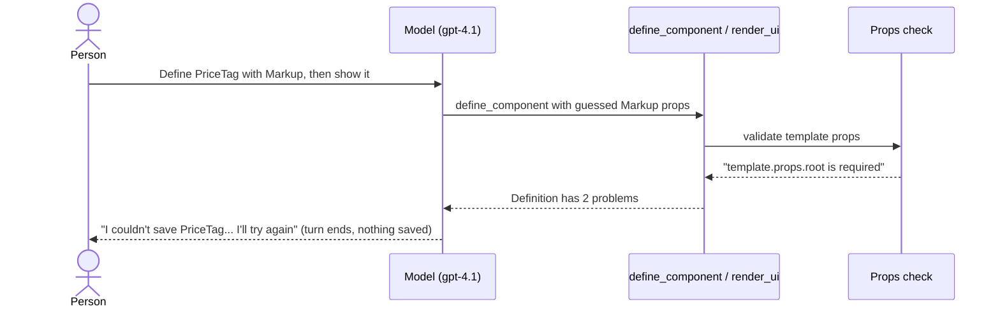
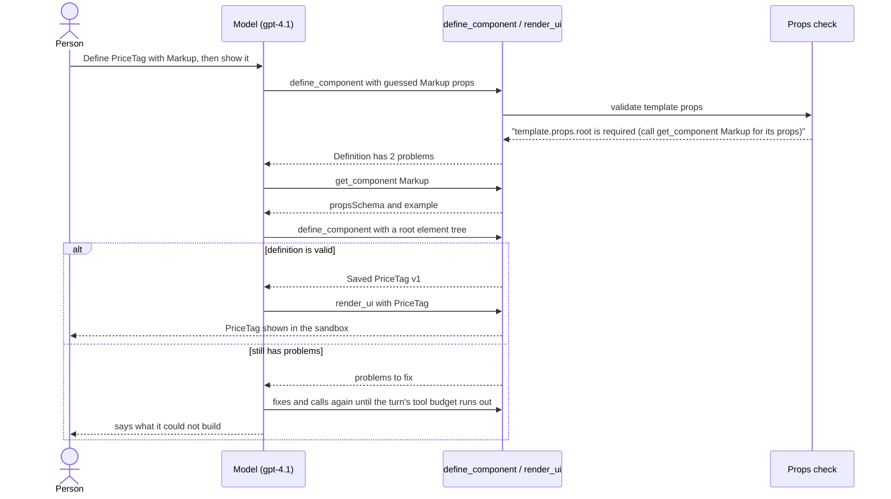
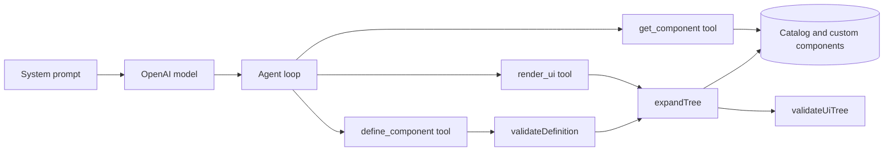
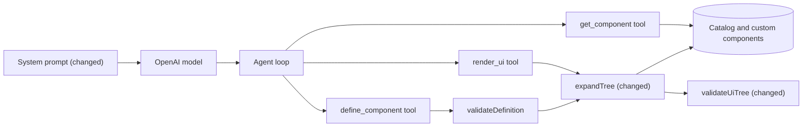

# Help the agent recover when a tool rejects its props

**Branch:** fix/component-props-recovery · **Written:** 2026-10-22 · **Supersedes:** -

## Summary

In the 2026-10-22 eval run, the `price-tag` case failed. The model gave Markup props it had guessed instead of read, and `define_component` refused them. Then the model replied that it would "make the needed adjustments before trying again" and ended the turn, with tools still on and nothing saved. Two things led there. The props errors never say where to read a component's props, and one system prompt rule ("If a tool fails, say what you couldn't do") reads as permission to stop after a fixable rejection. This plan adds a pointer to `get_component` on props errors and tells the model that reported problems are to be fixed in the same turn. It has worked if `price-tag` passes in repeated eval runs and the other cases still pass.

- **In scope:** A `get_component` hint on props-schema problems from `render_ui` and `define_component`, for catalog components and for custom-component uses. Narrowing the system prompt's tool-failure rule and forbidding "I'll try again" replies. Updating the two `docs/ARCHITECTURE.md` bullets that describe these.
- **Out of scope:** Rewording the `export-pdf` eval case. A loop-level retry nudge. Hints on Markup element problems. A single-case filter for `npm run eval`.
- **Open decisions:** none (see [Open decisions](#open-decisions))

### Behavior before



### Behavior after



### Architecture before



### Architecture after



### What changes

- `validateUiTree` adds a `get_component` hint to the first props problem for each catalog component in a check.
- `expandTree` does the same for each custom component whose use has bad props.
- The system prompt says that problems reported by `render_ui` and `define_component` are not failures and must be fixed in the same turn. It forbids replies that promise to try again, and it keeps the "say what you couldn't do" rule for other failures.

---

## Current state

- **The failure.** `eval-logs/2026-10-22T22-04-52.968Z/price-tag.json` (gitignored, local only) shows two completions. In the first, the model calls only `define_component`, with template `{"component": "Markup", "props": {"markup": "<span><strong>{{price}}</strong></span>"}, "children": []}`. It gets `ok: false`, `Definition has 2 problems`, and errors `template.props.root is required` and `template.props.markup is not allowed`. In the second completion (`allowTools: true`), it replies with text only, so the loop ends the turn as `reply` (`server/agent/loop.ts:172`). It never called `list_components` or `get_component`. Every other case in that run that used components read them first.
- **Markup's props.** `server/catalog/components.ts:306` defines Markup with one required prop, `root`, an element tree `{ tag, attrs?, style?, text?, action?, children? }`. The element type and allowlist are in `shared/markup.ts`. A custom prop is bound with `{"$prop": "<name>"}`, never `{{name}}`.
- **Props errors.** `formatSchemaErrors` (`server/validation/jsonSchema.ts:45`) turns Ajv errors into `is required`, `is not allowed`, or Ajv's message. `propsErrors(validate, props, path)` (`server/ui/validateTree.ts:99`) formats each as `<path>.props<.prop> <message>`, and `propMessage` lists enum values. `validateUiTree` (`server/ui/validateTree.ts:229`) calls `propsErrors` for every node whose component is in the catalog (lines 274 and 280), then `validateMarkup` on a Markup `root`. `expandTree` (`server/customComponents/expand.ts:135`) calls `propsErrors` for each custom-component use (line 199). Other messages already carry hints in parentheses: `(did you mean X?)`, `(call list_actions to see them)`, `(use component, props, children)`.
- **Where those errors go.** `render_ui` (`server/agent/tools/ui.ts:150`) joins `expandDesign` problems and `validateUiTree` errors, rewrites template paths with `rewritePaths`, caps them with `limitErrors` (20), and returns `UI has N problems` with `data.errors`. `define_component` (`server/agent/tools/customComponents.ts:83`) returns `Definition has N problems` with the errors from `validateDefinition` (`server/customComponents/definition.ts:170`). That function expands `{component: name, props: exampleProps}` and validates the result only when the props schema and example props already passed (`expandable`, lines 211–214 and 265–278), then maps `tree (<Name> v0) template` back to `template`.
- **The prompt.** `server/agent/systemPrompt.ts` step 3 says to call `get_component` for each component before use. Step 6 (line 34) and the custom-component rules (line 44) say to fix reported problems and call again. The last rule (line 55) is: "If a tool fails, say what you couldn't do instead of guessing. If you can no longer call tools in this turn, answer with what you have and say what is missing." `server/agent/systemPrompt.test.ts` asserts many prompt sentences verbatim, and checks that every snake_case word is a registered tool.
- **Turn limits.** `server/agent/guardrails.ts` caps a turn at 10 model calls and 20 tool calls. The loop skips a repeated call with the same arguments (`server/agent/loop.ts:208`).
- **Docs.** `docs/ARCHITECTURE.md` describes the prompt procedure ("call `render_ui` and fix reported problems", line 205) and what `validateUiTree` reports (line 208).
- **Tests that assert props error strings.** These change with R1 and R2: `server/ui/validateTree.test.ts` ("reports props that break the schema", "checks the root only when it is an object"), `server/customComponents/expand.test.ts` ("refuses bad instance props and children…", "splices the instance's children into the slot…"), `server/customComponents/definition.test.ts` ("refuses catalog prop and Markup problems in the expanded example"), and `server/agent/tools/ui.test.ts` ("shows nothing and returns the errors for an invalid tree", "reports instance and template problems in the agent's terms"). Nothing outside tests reads error text: `server/eval/checks.ts` and `src/` don't.
- **Check commands** (`.github/workflows/ci.yml`): `npm run typecheck`, `npm test`, `npm run build`, `npm run build:api`. `npm test` skips repository tests without `DATABASE_URL` and the Redis tests without `REDIS_URL`. `npm run eval` needs `OPENAI_API_KEY`, runs every case, and is not in CI.

## Requirements

### R1: Point catalog props problems at get_component

Within one `validateUiTree` call, the first props problem reported for a catalog component name MUST end with ` (call get_component <Name> for its props)`, where `<Name>` is the catalog component's stored name. The model that skipped `get_component` then gets told where the schema is, in the same place it reads the error.

**Acceptance:**

- `{"component": "Markup"}` reports exactly `tree.props.root is required (call get_component Markup for its props)`.
- A Stack with four Buttons that each break the schema in a different way reports four problems. Only the first ends with ` (call get_component Button for its props)`; the other three are unchanged.
- When two different components have props problems, the first problem of each gets its own hint.
- Problems that don't come from `propsErrors` get no hint: unknown component, `props must be an object`, children on a leaf, Markup element problems, bindings, and size limits.
- The number of problems is unchanged, so `UI has N problems` and `Definition has N problems` count the same as before.
- Through `define_component`, the price-tag template from the trace reports `template.props.root is required (call get_component Markup for its props)` and `template.props.markup is not allowed`.
- Through `render_ui`, a Button without `label` reports `tree.children.0.props.label is required (call get_component Button for its props)`.

### R2: Point custom-component props problems at get_component

Within one `expandTree` call, the first props problem reported for a use of a custom component MUST end with ` (call get_component <Name> for its props)`, where `<Name>` is the stored custom component's name. `get_component` reads custom components too, so the same pointer works.

**Acceptance:**

- A use of a stored custom component that breaks its `propsSchema` in several ways gets the hint on its first problem only.
- Two uses of the same custom component with bad props in one tree name it once; uses of two different custom components each get one hint.
- In `define_component`, a definition whose `exampleProps` break its own `props_schema` reports the existing schema problems, with no hint naming the unsaved component. Expansion doesn't run in that case.
- Problem paths still rewrite as before: a template node's problem reads `tree.children.0 (MenuItemCard v3) template…` with the hint at the end.

### R3: Fix reported problems in the same turn

`SYSTEM_PROMPT` MUST say that problems reported by `render_ui` or `define_component` are not failures, and that the model fixes them and calls the tool again in the same turn. It MUST tell the model never to reply that it will try again, and to call the tool instead. The rule about failing tools MUST apply only to other failures. The trace's reply matched the current rule almost word for word, so the prompt has to separate the two cases.

**Acceptance:**

- Line 55's bullet is replaced by these two bullets, in this order:
  - `- Problems that render_ui or define_component reports are not failures: fix them and call the tool again in the same turn. Never reply that you will try again; call the tool instead.`
  - `- If a tool fails for any other reason, say what you couldn't do instead of guessing. If you can no longer call tools in this turn, answer with what you have and say what is missing.`
- The sentence `If a tool fails, say what you couldn't do instead of guessing.` no longer appears.
- All the other sentences `server/agent/systemPrompt.test.ts` asserts are still present, and the snake_case and tool-name tests pass.
- `docs/ARCHITECTURE.md`'s system prompt bullet says reported problems are fixed in the same turn, and that the prompt forbids replies that promise to try again.

## Design

### Components

- `server/ui/validateTree.ts` (changed): a new exported helper, `withPropsHint`. `validateUiTree` creates one `hinted` set per call and passes each `propsErrors` result through `withPropsHint` with the catalog component's name.
- `server/customComponents/expand.ts` (changed): `expandTree` creates one `hinted` set per call and passes the instance props problems (line 199) through `withPropsHint` with `custom.name`.
- `server/agent/systemPrompt.ts` (changed): line 55 is replaced as R3 states. No other prompt lines change.
- `render_ui`, `define_component`, `validateDefinition`, `rewritePaths` and `limitErrors` don't change. The hint is a suffix on a string they already pass through.

### Interfaces

```ts
// server/ui/validateTree.ts (new export)
/**
 * `problems` from `propsErrors` for a use of `name`, the first one saying
 * where to read its props unless `hinted` already has `name`. Adds `name` to
 * `hinted`, so one check names each component once.
 */
export function withPropsHint(problems: string[], name: string, hinted: Set<string>): string[];
```

- It returns `problems` unchanged when it is empty or `hinted` has `name`. Otherwise it returns a new array whose first entry is `` `${problems[0]} (call get_component ${name} for its props)` `` and adds `name` to `hinted`.
- `propsErrors`, `validateUiTree` and `expandTree` keep their signatures. The tools' result shapes (`ok`, `summary`, `data.errors`) don't change.

### Errors and edge cases

- A component name is only hinted after it resolved, so the name in the hint is always a catalog name or a stored custom name. A miscased name gets `is not in the catalog (did you mean Button?)` and no props check.
- `render_ui` runs `expandTree`, then `validateUiTree`, each with its own `hinted` set. Catalog names win over custom ones during expansion, and only catalog nodes reach `validateUiTree`'s props check, so a name is hinted at most once per call.
- Enum problems already list the allowed values. They still get the hint when they come first, which keeps the rule simple.
- `limitErrors` may cut problems past the 19th. The hinted entry is the first for its name, so it is the most likely to survive.
- In `validateDefinition`, the definition's own name can't get a hint, because the expansion that would check its example props runs only after they passed.

### Compatibility and rollout

The only visible change is longer error strings in failed `render_ui` and `define_component` results, and those are read only by the model. No stored data, API shape, event or config changes. The prompt change applies on the next chat turn and the next eval run. Rollback is reverting the two commits.

## Security

| Concern | Mitigation | Enforced by |
|---|---|---|
| The hint puts text into the model's context | It names only a resolved component: a catalog name, or a custom name that `validateDefinition` restricted to `^[A-Z][A-Za-z0-9]*$`. It never echoes the model's raw input | R1, R2 |
| The prompt change makes the model retry more | Each turn stays capped at 10 model calls and 20 tool calls (`server/agent/guardrails.ts`), and repeated identical calls are skipped. The prompt still says to answer with what it has when tools are off | R3 |
| Logs and stored data | No new logging, storage, dependency or route. No new exposure | R1, R2, R3 |

## Validation

**Workers can run** (no credentials or live services):

- `npm run typecheck`: the new export and its call sites type-check.
- `npm test`: the updated and new unit tests pass (repository tests skip without `DATABASE_URL`).
- `npm run build` and `npm run build:api`: the web and API bundles still build.

**New tests:**

- R1: `server/ui/validateTree.test.ts`: tests `withPropsHint` directly (empty input, first use of a name, a name already hinted). Also: one hint per name with four Button problems; separate hints for two names; no hint on unknown component, `props must be an object`, children, Markup element or binding problems. Update "reports props that break the schema" and "checks the root only when it is an object". `server/agent/tools/ui.test.ts`: update "shows nothing and returns the errors for an invalid tree" and check that the summary count is unchanged. `server/customComponents/definition.test.ts`: the price-tag template reports the hinted `template.props.root` problem. Update "refuses catalog prop and Markup problems in the expanded example".
- R2: `server/customComponents/expand.test.ts`: one hint per custom name across two uses, and separate hints for two names. Update "refuses bad instance props and children with the agent's paths and leaves the node out" and "splices the instance's children into the slot and maps them back to the agent's paths". `server/agent/tools/ui.test.ts`: update "reports instance and template problems in the agent's terms". `server/customComponents/definition.test.ts`: when example props break their own schema, no hint names the definition.
- R3: `server/agent/systemPrompt.test.ts`: a new test asserting both new bullets' sentences, and that `If a tool fails, say what you couldn't do instead of guessing.` is absent.

**After merge** (needs credentials, live services, or a person):

- `npm run eval` three times with `OPENAI_API_KEY` set: `price-tag` passes in each run, and the other cases pass as they did in `eval-logs/2026-10-22T22-04-52.968Z` (`export-pdf` is expected to keep failing, see Non-goals).
- In a `price-tag` log where `define_component` was refused, the next completion calls a tool instead of replying.

## Work breakdown

| Slice | Covers | Touches | After | Size |
|---|---|---|---|---|
| props-hint | R1, R2 | server/ui/validateTree.ts, server/ui/validateTree.test.ts, server/customComponents/expand.ts, server/customComponents/expand.test.ts, server/customComponents/definition.test.ts, server/agent/tools/ui.test.ts, docs/ARCHITECTURE.md | - | small |
| prompt-retry-rule | R3 | server/agent/systemPrompt.ts, server/agent/systemPrompt.test.ts, docs/ARCHITECTURE.md | - | small |

The two slices can run in parallel; they share no code. Both edit `docs/ARCHITECTURE.md`, but different bullets: `props-hint` the UI trees bullet (line 208), which gains one sentence about the hint, and `prompt-retry-rule` the system prompt bullet (line 205). R1 and R2 share `withPropsHint`, so they stay in one slice.

## Non-goals

- Rewording the `export-pdf` eval case, which failed in the same run for an unrelated reason (the model read "only if" as conditioning the whole button).
- Making the agent loop nudge the model to retry when it replies after a refused tool call (`server/agent/loop.ts:172`).
- Hints on Markup element problems from `validateMarkup`, such as disallowed tags or attributes.
- Changing `formatSchemaErrors` or the tool descriptions of `render_ui` and `define_component`, which already say to fix and call again.

## Assumptions

- One plan covers both fixes: they come from the same failed trace and are each one small slice.
- The hint goes on the first props problem per component name per check, not on every problem, so a tree with many bad nodes doesn't repeat it.
- `props must be an object` stays unhinted, since it comes from a separate check from `propsErrors`.
- The hint wording follows the existing `(call list_actions to see them)` style.

## Risks

- The model may still skip `get_component`, or still end a turn after a refusal: the after-merge eval runs show whether it does. If it does, the loop nudge in Non-goals is the next step.
- With "fix and call again" stated more firmly, a problem the model can't fix (such as an action that doesn't exist) may use more of the turn's budget before it answers: the guardrails cap that at 10 model calls, and the "answer with what you have" rule still applies once tools are off.
- `npm run eval` has no single-case filter, so checking `price-tag` three times runs the whole suite three times: a `--case` filter is a possible follow-up.

## Open decisions

None.

## References

- Request: "Two fixes for the price-tag eval failure (eval-logs/2026-10-22T22-04-52.968Z/price-tag.json, gpt-4.1). (1) Props-validation errors should point at get_component … (2) Narrow the system prompt rule at server/agent/systemPrompt.ts:55 …"
- `eval-logs/2026-10-22T22-04-52.968Z/price-tag.json` and `export-pdf.json` (gitignored, local only)
- The eval-improvements plan, which added the `price-tag` case (on branch `eval-improvements`, not on main)
- `server/ui/validateTree.ts`, `server/customComponents/expand.ts`, `server/customComponents/definition.ts`, `server/agent/tools/ui.ts`, `server/agent/tools/customComponents.ts`, `server/agent/systemPrompt.ts`, `server/agent/loop.ts`, `server/agent/guardrails.ts`, `server/catalog/components.ts`, `shared/markup.ts`, `docs/ARCHITECTURE.md`, `.github/workflows/ci.yml`
