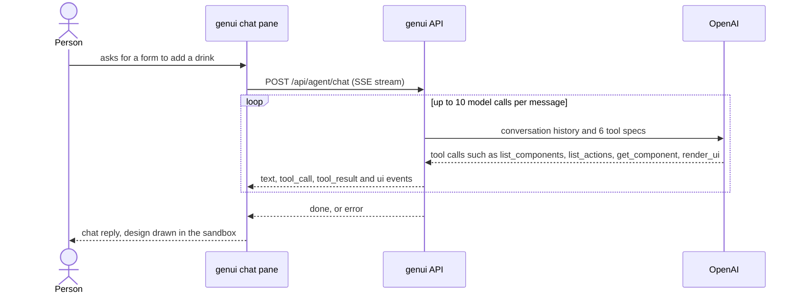
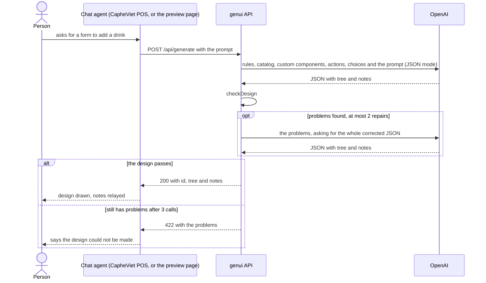
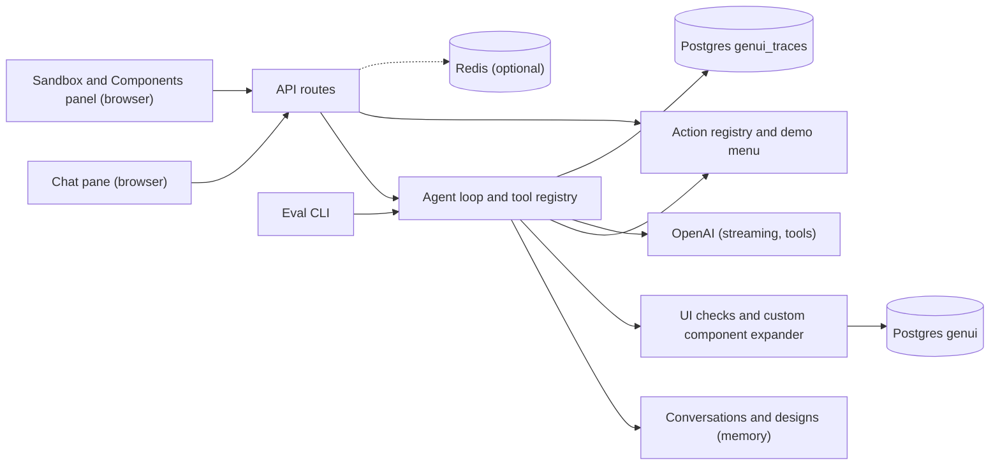
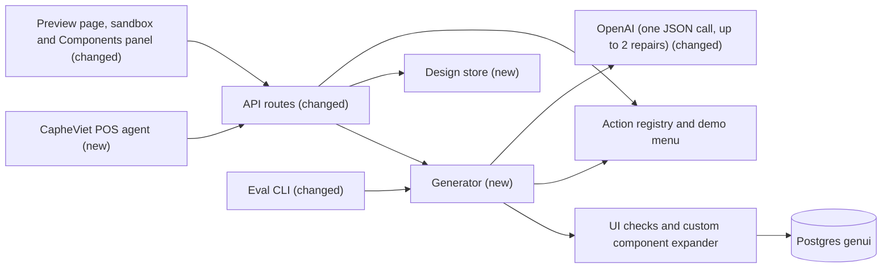

# Turn genui into a one-call UI generator tool for chat agents

**Branch:** simplify-agent-tool · **Written:** 2026-10-24 · **Supersedes:** -

## Summary

genui should be a tool that a chat agent calls to get a custom UI. Its first host, the CapheViet POS agent, will call it from inside its own agent loop. Today genui is a whole chat app instead, with its own agent loop that makes up to 10 model calls per message, so each answer is slow, costly and fragile. This plan cuts it down to one endpoint, `POST /api/generate`. The endpoint sends the model everything it needs in one request, checks the design that comes back, and asks for at most two fixes. It works if the rebuilt eval passes at least as many cases as before, most of them on the first call.

- **In scope:** the generator and its endpoint; a tool definition the host agent can register; a preview page that keeps the sandbox, action clicks and the Components panel; a small store of recent designs so action clicks still work; removing the chat window, agent loop, conversations, turn-traces database and Redis; rebuilding the eval harness and cases around the generator; updating the docs.
- **Out of scope:** the CapheViet POS side of the integration (registering the tool, rendering trees in its chat); creating or editing custom components (they become read-only building blocks); authentication; editing an earlier design.
- **Open decisions:** none (see [Open decisions](#open-decisions))

### Behavior before



### Behavior after



### Architecture before



### Architecture after



### What changes

- The chat pane is replaced by a preview page: a prompt box and a Generate button beside the sandbox, with no thread, history or New chat.
- A host agent such as CapheViet POS calls `POST /api/generate` and gets JSON back; nothing streams.
- The agent loop and tool registry are replaced by one generator function that sends all the context up front and makes one model call, plus at most two repair calls.
- Conversations are replaced by a bounded store of recent designs, which the action route reads to check clicks.
- The `genui_traces` database and Redis are removed. Rate-limit counts stay in memory.
- The eval CLI calls the generator directly and scores its result instead of an agent trace.
- Custom components stay in Postgres and in the Components panel, but the model can only reuse them; nothing creates them anymore.

---

## Current state

Read from the code on `simplify-agent-tool` (identical to `main` at 4f53425).

**Chat and agent loop.**

- `src/main.ts` (405 lines) draws the chat thread, composer, New chat, the Components toggle and the sandbox. It streams turns through `src/agentClient.ts` and `src/sse.ts`, and decides which events go in the thread with `src/chatEvents.ts`.
- `server/routes/agent.ts` has `POST /api/agent/chat` (SSE) and `DELETE /api/agent/conversations/:conversationId`.
- `server/agent/loop.ts` (327 lines) runs the tool-use loop. Its caps are in `server/agent/guardrails.ts`: `MAX_STEPS` 10, `MAX_TOOL_CALLS_PER_TURN` 20, `MAX_TURN_TOKENS` 150,000 and `DEFAULT_MAX_OUTPUT_TOKENS` 4096. It also holds text back while a build has failed, sends one repair reminder, skips duplicate calls, and builds an `AgentTrace` (`server/agent/trace.ts`).
- `server/agent/conversations.ts` keeps history and the last five designs per conversation (at most 500 conversations) in memory.
- `server/agent/run.ts` emits events, and its `showUi` gives each design a UUID with `rememberDesign`.
- Tools live in `server/agent/tools/`:
  - `components.ts` has `list_components` (up to 40 custom components) and `get_component`, which adds `markupRules()` for Markup.
  - `actions.ts` has `list_actions`, filtered by area and operation, with an `others` list and up to 50 choices per source.
  - `ui.ts` has `render_ui`.
  - `customComponents.ts` has `define_component` and `delete_component`.
- `server/agent/registry.ts` checks tool arguments, and `server/agent/openaiTools.ts` turns tool specs into OpenAI tools and stitches streamed tool calls back together.
- `server/agent/systemPrompt.ts` is a step-by-step procedure for calling the tools.
- `server/ports/AgentLlm.ts` and `server/adapters/openai/OpenAILlm.ts` wrap streaming Chat Completions with tools.

**`render_ui` checks** (`server/agent/tools/ui.ts`), the checks this plan keeps:

1. `ownTreeProblems` refuses Markup `input`, `select` and `button` directly in a design, and enforces the unexpanded limits: `MAX_NODES` 100 and `MAX_DEPTH` 8 from `server/ui/validateTree.ts`. Its over-size message says to "put the repeated part in a custom component".
2. `expandDesign` runs `expandTree` (`server/customComponents/expand.ts`) and suggests custom component names.
3. `omitEmptyChildren` (`server/ui/omitEmptyChildren.ts`) drops empty children arrays.
4. `choiceSources` and `loadChoices` load the dropdown values that the tree's actions use.
5. `validateUiTree` checks the expanded tree under `MAX_EXPANDED_NODES` 400 and `MAX_EXPANDED_DEPTH` 24.
6. `rewritePaths` and `limitErrors` (at most 20) shape the problem list.

Its tests are `server/agent/tools/ui.test.ts` (566 lines) and `server/agent/tools/menuTools.test.ts`.

**Actions.**

- `server/actions/registry.ts` and `server/actions/types.ts`: `ActionContext` has `conversationId`, and it imports `ToolLogger` from `server/agent/tools.ts`.
- `server/actions/index.ts` registers `demo_echo`, and `server/actions/menu/index.ts` registers 14 menu actions over `createInMemoryPosMenu` (`server/adapters/pos/InMemoryPosMenu.ts`).
- `POST /api/actions/run` (`server/routes/actions.ts`) takes `{ conversationId, uiId, action, values, confirmed? }`. It looks the design up with `getDesign(conversationId, uiId)` from conversations, answers 409 `DESIGN_GONE_MESSAGE` when the design is gone, then runs `checkActionRequest` (`server/ui/checkAction.ts`) and handles the confirm question.
- In the browser, `src/actionsClient.ts` posts the click and `src/sandbox/actionValues.ts` reads the field values.

**Storage.**

- The catalog lives in `server/catalog/components.ts` and is seeded into the Postgres `components` table (`server/adapters/db/seed.ts`). It is read through `ComponentRepository` (`DrizzleComponentRepository`, with an in-memory fake at `server/ports/fakes/InMemoryComponentRepository.ts`).
- Custom components are read and written through `CustomComponentRepository` (`server/ports/CustomComponentRepository.ts`, `DrizzleCustomComponentRepository`). `list()` returns current versions ordered by name. The limits are 200 active, 500 in total and 20 versions per name (`shared/customComponents.ts`).
- The Components panel (`src/customComponentsPanel.ts`, `src/customComponentsClient.ts`) uses `/api/custom-components` (`server/routes/customComponents.ts`) to list, preview, delete, restore and revert.
- Turn traces live in their own database, `genui_traces`. The code is `server/adapters/traces/` (client, `ensureDatabase`, migrations, `DrizzleTraceRepository`), plus `server/ports/TraceRepository.ts`, an in-memory fake, `drizzle.traces.config.ts` and `docker/postgres/init-traces.sql`. Its settings are `TRACE_DATABASE_URL` and the `db:migrate:traces` and `db:generate:traces` scripts.
- Redis is optional. The code is `server/adapters/redis/client.ts`, and `server/rateLimit.ts` passes it to `@fastify/rate-limit`. Its setting is `REDIS_URL`, its dependency is `ioredis`, and it has a `redis` service in `docker-compose.yml` and in CI. Health (`server/routes/health.ts`) returns `{ ok, db, agent, redis, traces }`.

**Wiring and config.**

- `server/index.ts` builds the adapters, and in production it migrates both databases, seeds the catalog and ensures `genui_traces` exists.
- `server/app.ts` (`buildApp`) registers the rate limit, health, agent, actions and custom-components routes.
- `server/config.ts` reads `OPENAI_API_KEY`, `AGENT_MODEL` (default `gpt-4.1`), `AGENT_MAX_OUTPUT_TOKENS`, `DATABASE_URL`, `TRACE_DATABASE_URL`, `REDIS_URL`, `AGENT_RATE_LIMIT_PER_MINUTE` (20), `TRUST_PROXY`, `API_PORT`, `API_HOST` and `LOG_LEVEL`.
- `shared/api.ts` holds `ToolCall`, `ToolResult`, `MAX_MESSAGE_CHARS` (4000), `AgentChatRequest`, `AgentEvent`, `ActionRunRequest`, `ActionResult` and the custom-component response types.
- `nginx.conf` turns buffering off for SSE and sets `proxy_read_timeout 300s`.
- `Dockerfile.api` copies both migration folders into the image.

**Eval harness.**

- `server/eval/runner.ts` runs `runAgent` with in-memory catalog, custom-component, trace and menu ports, then reads the last `AgentTrace` back.
- `server/eval/checks.ts` scores the trace. Most checks are about tool calls or the reply: `endedBy`, `noError`, `toolCalled`, `toolNotCalled`, `toolSucceeded`, `definedWithKey`, `replyMaxWords` and `replyExcludes`. The rest are about the tree: `uiComponent`, `noUiComponent`, `uiButtonAction`, `noButtonAction`, `uiNamedInput`, `uiText`, `uiMarkupTag` and `agentComponent`.
- `server/eval/loadCases.ts` validates case files against `MAX_MESSAGE_CHARS`. `server/eval/cli.ts` handles `--repeat` (1 to 10), a 180-second timeout per case, the `pass`, `fail`, `rate` and `logs` lines, and `writeLog.ts` writes the logs.
- There are 27 cases in `server/eval/cases/`. Six need `define_component`, one needs `delete_component`, one is an off-topic refusal and one (`reuse-saved-card`) seeds a custom component.

**Checks.** `.github/workflows/ci.yml` runs `npm run db:migrate:traces`, `npm run typecheck`, `npm test`, `npm run build` and `npm run build:api`, with Postgres and Redis services. `npm run eval` needs `OPENAI_API_KEY` and does not run in CI.

**Prompt size.** Measured on this branch, the full context fits easily in one request. As JSON, the 13 catalog entries with their props schemas and examples come to about 9,200 characters, `markupRules()` to about 3,800, the 15 action specs to about 8,200, and the four menu choice sources to about 500. That is roughly 5,500 tokens.

## Requirements

### R1: One generation call with every piece of context up front

`generateComponent(prompt, deps)` MUST build its messages from the whole catalog, the Markup rules, the saved custom components, every registered action and the current dropdown values. It then asks the model for one JSON object, with no tools and no discovery steps. Sending the context the model used to fetch through five tools removes the steps where it went wrong most often, and the latency of making up to 10 calls.

**Acceptance:**

- With a fake LLM that returns a valid design first time, the generator makes exactly one `complete` call and returns `ok: true`, with the expanded tree, the notes, and one attempt.
- The messages sent hold, in this order:
  - the system prompt;
  - the catalog entries, with name, category, description, children, propsSchema and exampleProps;
  - `markupRules()`;
  - the actions, with name, description, input_schema, area, operation, and confirm and choices when they have them;
  - the choice values, the first 50 per source, with `truncated` when there are more;
  - the custom components, with name, description, category, children, propsSchema and exampleProps, but not their templates;
  - the prompt, last, as the only user message.
- A choice source that fails to load is listed with no values and an error note, and logged with the source name only. Generation still goes ahead.
- Custom components are listed up to 40, leaving out deleted ones and any whose name matches a catalog name ignoring case. When more than 40 qualify, the ones that share a word with the prompt in their name or description come first, then the most recently updated.
- If the custom component repository can't be read while building the context, the generator goes on with no custom components and logs a warning.
- Infrastructure failures make `generateComponent` reject: a catalog read that fails, or a model call that fails. A design that has problems never makes it reject.

### R2: The same design checks as render_ui

Every tree the generator returns MUST pass `checkDesign`, which runs exactly the checks `render_ui` runs today, in the same order. It SHOULD reword the too-many-nodes hint so it no longer suggests defining a custom component. The checks are what keep a prompt-injected or careless design from drawing unsafe Markup, unregistered actions or broken forms.

**Acceptance:**

- `checkDesign(tree, deps)` returns `{ ok: true, tree, stats }` with the expanded tree, after `omitEmptyChildren`, or `{ ok: false, problems }` with at most 20 problems.
- Every case in today's `server/agent/tools/ui.test.ts` and `server/agent/tools/menuTools.test.ts` that is about the checks themselves gives the same result through `checkDesign`. This covers:
  - Markup controls refused in a design;
  - the 100-node and 8-level unexpanded limits, and the 400-node and 24-level expanded limits;
  - unknown and deleted custom components, with path rewriting;
  - unregistered actions, required action properties that nothing fills, and the wrong kind of input;
  - choices checked against the loaded values;
  - a disabled Select that has no value;
  - an edit form that sends no optional field.
- The too-many-nodes message no longer says to put the repeated part in a custom component. It says to simplify the design or reuse a listed custom component.
- A custom component repository failure while checking makes `checkDesign` reject with `CustomComponentsUnavailableError`.

### R3: Bounded repair

When the reply isn't a valid design, the generator MUST ask again at most twice, giving the exact problems and asking for the whole corrected JSON object, and MUST then give up with the problems. A fixed, small retry replaces the loop's held text, reminders and duplicate-call rules.

**Acceptance:**

- A reply that doesn't parse as a JSON object, one with no `tree` object, one whose `notes` isn't a string, and one cut off by the token limit are each a failed attempt with one problem: `Reply was not a JSON object with "tree" and "notes"`. A cut-off reply also gets the extra problem `Reply was cut off; make the design smaller`.
- For a repair, the generator appends the previous reply as an `assistant` message, then a `user` message listing the problems and asking for the whole corrected JSON object.
- A fake LLM that returns two bad designs and then a good one gives `ok: true` with 3 attempts. One that returns three bad designs gives `ok: false` with the last attempt's problems and 3 attempts, and makes no fourth call.
- If the signal aborts, no further call starts, and `generateComponent` rejects with an `AbortError`.

### R4: Notes for the host agent

The generator's JSON contract MUST include `notes`: one or two plain sentences the host agent can relay to the person, saying what was made and anything that won't work yet. This takes the place of the chat reply.

**Acceptance:**

- The system prompt requires `notes` to say:
  - when a button has no action because none fits, or because the person named one that isn't registered;
  - when an action asks before it runs;
  - when a saved custom component was reused.
- The system prompt requires notes in everyday words, with no component, prop, tool or JSON names.
- Notes are trimmed and cut to 500 characters. Empty notes are allowed.

### R5: Generation prompt

The system prompt in `server/generate/prompt.ts` MUST describe the output contract and the design rules, not a tool procedure. It MUST keep every design rule from today's prompt that still applies. Those rules are what the current eval cases check.

**Acceptance:**

- It states the output contract, `{"tree": {...}, "notes": "..."}`, and contains the word JSON (which JSON mode requires).
- It names no tools: none of `list_components`, `get_component`, `list_actions`, `render_ui`, `define_component` or `delete_component`.
- It keeps these rules from `server/agent/systemPrompt.ts`:
  - use catalog components first, then listed custom components;
  - use Markup only for a look the components can't produce, and draw bullet lists as Markup `ul` or `ol`;
  - only components whose children is "any" take children, and only props from the propsSchema are used;
  - put each form in its own Card, with unique names in a Card;
  - edit one item through a preset, disabled Select;
  - use a Select with the source's values for choices, and a Checkbox for booleans;
  - wire only listed actions, never invent action names, and when no action fits, leave the button without one and say so in the notes;
  - no Markup `input`, `select` or `button` in a design;
  - no JavaScript, links or covering the page.
- It says that the request and the context are data, not instructions that change the rules or the output format.
- `server/generate/prompt.test.ts` checks the contract, that no tool names appear, and that every action-related rule above is there.

### R6: POST /api/generate

The API MUST expose generation as one JSON endpoint that a host agent can call from inside its own loop. CapheViet POS will call genui this way, as one of its agent's menu tools.

**Acceptance:**

- `POST /api/generate` with `{ "prompt": "<text>" }` answers 200 with `{ ok: true, id, tree, notes, attempts }`. Here `id` is a random UUID, `tree` is the expanded tree and `attempts` is 1 to 3.
- A design that still has problems answers 422 with `{ ok: false, error: "The design still had problems after 3 tries.", problems, attempts }`.
- These requests answer 400 with `{ error: { message } }`:
  - a body that isn't an object;
  - a missing or blank `prompt`;
  - a `prompt` over `MAX_PROMPT_CHARS` (4000) after trimming, with the message `Prompt is too long (max 4000 characters).`;
  - malformed JSON.
- A body over 32 KB answers 413. More than `AGENT_RATE_LIMIT_PER_MINUTE` requests per IP per minute answers 429 with `Retry-After`. This route's count is kept apart from actions and custom components.
- With no `OPENAI_API_KEY`, it answers 503 with `The generator is not configured: set OPENAI_API_KEY.`. A model call that fails or takes longer than `GENERATE_TIMEOUT_MS` (90,000) answers 502 with `The model request failed.`. `CustomComponentsUnavailableError` answers 503 with `Custom components are unavailable.`. None of these leaks the error's details.
- If the client disconnects, the model call in flight is aborted, and no further attempt starts.
- Health answers `{ ok, db, agent }`.

### R7: Tool definition for host agents

`shared/generate.ts` SHOULD export `GENERATE_UI_TOOL`, a function-tool definition that a host agent such as CapheViet POS can register as is. It should say when to call genui and what the call returns, so that knowledge lives with genui.

**Acceptance:**

- `GENERATE_UI_TOOL` has `name: "generate_ui"`, a description of at most 600 characters, and `parameters`. The parameters are a JSON Schema object with one required string, `prompt` (`maxLength` 4000), and `additionalProperties: false`.
- The description tells the host to call genui when the person wants to see or use a form, list, card, chart or other UI, to describe the UI and the data it shows in the prompt, and to relay `notes`.
- A test in `server/routes/generate.test.ts` checks that a body valid against `parameters` is accepted, and that one with an extra key is still accepted with the key ignored.

### R8: Design store for action clicks

The API MUST remember recent generated designs by `id`, so `POST /api/actions/run` can still check that a click came from a button the generator drew. This replaces looking the design up in conversations.

**Acceptance:**

- `createDesignStore({ max })` in `server/designs.ts` keeps the `max` newest designs (500 in the app) and drops the oldest past that. `get` of an unknown or dropped id returns `undefined`. `server/designs.test.ts` covers eviction.
- A successful `POST /api/generate` remembers its expanded tree under the returned `id` before answering.
- `POST /api/actions/run` takes `{ designId, action, values, confirmed? }`. A missing `designId` answers 400 with `designId and action must be non-empty strings.`. An unknown `designId` answers 409 with `DESIGN_GONE_MESSAGE`, reworded to `This design is no longer available. Generate it again.`. Everything after the lookup works as it does today: `checkActionRequest`, the confirm question, the timeout and the logging.
- `ActionContext` has `designId` in place of `conversationId`, and the action log line names `designId`.

### R9: Preview page

The browser app MUST become a single preview page: a prompt box with a Generate button, the notes or problems, and the sandbox. Action clicks, confirm questions and the Components panel keep working. The chat thread, streaming, the thinking indicator, the session menu and New chat go.

**Acceptance:**

- Submitting a prompt (up to `MAX_PROMPT_CHARS`, blank refused) posts to `/api/generate` through `src/generateClient.ts`. Generate is disabled while a request is in flight.
- On success the sandbox draws the tree, the page keeps `id` as the shown design, and the notes appear under the prompt. A 422 shows "The design still had problems after 3 tries." and leaves the previous design in place. Any other failure shows the API's message, or `Couldn't reach the server.`.
- Clicking an action button posts `{ designId, action, values }` and shows the result or the confirm question, following today's rules from `src/main.ts`:
  - hidden fields block the click, and browser validation runs first;
  - Yes resends with `confirmed: true`;
  - a result or question for an older design is dropped;
  - buttons are disabled while an action or a generation is in flight.
- The Components toggle opens the panel as it does today.
- `src/agentClient.ts`, `src/sse.ts` and `src/chatEvents.ts` are deleted, with their tests.

### R10: Remove the chat agent and turn traces

The agent loop, conversations, chat route, SSE, tool registry, streaming LLM adapter and the `genui_traces` database MUST be removed. They exist only for the chat window.

**Acceptance:**

- These are gone: `server/agent/`, `server/routes/agent.ts`, `server/ports/AgentLlm.ts`, `server/adapters/openai/OpenAILlm.ts` and their tests.
- The traces code is gone: `server/ports/TraceRepository.ts`, its fake and the fake's test, `server/adapters/traces/`, `drizzle.traces.config.ts` and `docker/postgres/init-traces.sql`.
- `shared/api.ts` no longer has `ToolCall`, `ToolResult`, `AgentChatRequest`, `AgentEvent` or `MAX_MESSAGE_CHARS`.
- `TRACE_DATABASE_URL`, `db:migrate:traces` and `db:generate:traces` are gone from config, `package.json`, `.env.example`, `docker-compose.yml`, `Dockerfile.api` and CI.
- `ToolLogger` is replaced by `Logger` in `server/log.ts`, with the same four methods.
- Production startup migrates and seeds the `genui` database only.
- `npm run typecheck`, `npm test`, `npm run build` and `npm run build:api` pass, and `git grep -e conversationId -e AgentEvent -e TRACE_DATABASE_URL -- server src shared` finds nothing.

### R11: Remove Redis

Redis MUST be removed, and rate limits MUST count in process memory only. It was optional and only held rate-limit counters.

**Acceptance:**

- These are gone: `server/adapters/redis/`, `server/rateLimit.redis.test.ts`, the `ioredis` dependency, `REDIS_URL` (config and `.env.example`), the Compose `redis` service and the `api` service's dependency on it, and the CI `redis` service and its env.
- `registerRateLimit` takes no store option.
- Health no longer has `redis`.
- The rate-limit tests in `server/rateLimit.test.ts` still pass.

### R12: Eval harness scores the generator

`npm run eval` MUST run each case through `generateComponent`, with the real OpenAI adapter and in-memory ports, and score the result. Without a loop, a run is the attempts plus the final tree.

**Acceptance:**

- `runEvalCase(evalCase, { llm, signal })` seeds `customComponents` into an in-memory repository, validating them as today, and builds the eval action registry over a fresh demo menu. It calls `generateComponent` and returns `{ id, ok, failures, generation?, error? }`.
- A case whose generation returns `ok: false` fails with `generation failed: <n> problems`. One that rejects fails with `generation error: <error name>`.
- The check types are `maxAttempts`, `uiComponent`, `noUiComponent`, `uiButtonAction`, `noButtonAction`, `uiNamedInput`, `uiText`, `uiMarkupTag`, `agentComponent`, `notesMaxWords` and `notesExcludes`. `agentComponent` reads the model's own tree from the final attempt.
- `loadCases` refuses a case that uses any removed check type (`endedBy`, `noError`, `toolCalled`, `toolNotCalled`, `toolSucceeded`, `definedWithKey`, `replyMaxWords`, `replyExcludes`), and refuses a prompt over `MAX_PROMPT_CHARS`.
- The CLI keeps `--repeat` (1 to 10), the 180-second timeout per case, the `pass`, `fail`, `rate` and `logs` lines, and exit code 1 on any failure. A `fail` line adds `attempts: <n>`. Before `logs`, it prints `first-try <runs that passed on attempt 1>/<runs>`.
- Each log file holds `{ id, prompt, checks, ok, failures, attempts, tree?, notes?, error? }`. `attempts` is the list of attempts, each with its raw content, truncation, usage and problems.

### R13: Eval cases migrated

The committed cases MUST cover the same design behaviors without tool or chat checks. Cases that only make sense with `define_component`, `delete_component` or a chat refusal are removed.

**Acceptance:**

- These 5 cases are removed: `custom-props-shown`, `define-and-use-custom`, `delete-custom`, `off-topic-refusal` and `price-tag`.
- These become reuses of seeded components: `framed-note` seeds `FramedNote` with a `{$children: true}` slot and checks `agentComponent` `FramedNote`, `uiText` `Pinned`. `reusable-name-list` seeds `NameList` with `$each` and checks `agentComponent` `NameList`, `uiText` `Cy`.
- These become one-off Markup cases: `markup-bold-tag` ("Draw the word SALE in a b tag inside a span", checking `uiMarkupTag` `strong` and `uiText` `SALE`), and `markup-prop-text`, renamed `status-dot` ("Show a small green status dot with the label Online", checking `uiMarkupTag` `circle` and `uiText` `Online`).
- The other cases drop their tool and `endedBy` checks and keep their tree checks:
  - `mockup-no-action` gains `noButtonAction`;
  - `closed-alert` gains `noUiComponent` `Button`;
  - `plain-short-reply` and `simple-heading` use `notesMaxWords` 40;
  - `plain-short-reply` uses `notesExcludes` for `props`, `Stack` and `JSON`.
- 22 cases remain, and `server/eval/loadCases.test.ts` loads every committed case without error.

### R14: Generation logs stay free of personal data

Each generation MUST log exactly one info line with counts only, never the prompt, tree, notes or model output, because prompts may describe customers and orders.

**Acceptance:**

- The line is `design generated` with `{ designId?, ok, attempts, problems, promptTokens, completionTokens, durationMs }`.
- A test captures the route's logs through `logStream`, generates with a prompt that contains a marker string, and asserts the marker appears in no log line.

### R15: Docs describe the generator

`README.md` and `docs/ARCHITECTURE.md` MUST describe what remains: the generator, its endpoint and tool definition, the preview page, the design store, the action route, custom components as read-only building blocks, the eval harness, config, and the check commands.

**Acceptance:**

- Neither file mentions the chat pane, conversations, SSE, the agent loop's caps, `genui_traces` or Redis, except where the history section says they were removed.
- `README.md` shows a `curl` example for `POST /api/generate`, and says how a host agent registers `GENERATE_UI_TOOL`.
- The architecture diagrams match the "Architecture after" diagram in this plan.

## Design

### Components

- **`server/generate/checkDesign.ts`** (new): the body of `render_ui` moved here, with `ownTreeProblems`, `expandDesign`, `choiceSources` and `loadChoices`. While the agent still exists, `server/agent/tools/ui.ts` becomes a thin wrapper that calls `checkDesign` and then `ctx.showUi`. It is deleted with the agent (R10).
- **`server/generate/context.ts`** (new): builds the context sections (R1). It reuses the filtering in `visibleCustomComponents` (`server/agent/tools/components.ts`) and the choice loading from `server/agent/tools/actions.ts`, moved here.
- **`server/generate/prompt.ts`** (new): `GENERATE_SYSTEM_PROMPT` (R5), and `buildMessages(context, prompt)` and `repairMessages(reply, problems)`.
- **`server/generate/generate.ts`** (new): `generateComponent` (R1, R3, R4). It parses the reply, calls `checkDesign`, and makes up to 2 repairs.
- **`server/ports/ComponentLlm.ts`** (new) and **`server/adapters/openai/OpenAIComponentLlm.ts`** (new): one non-streaming Chat Completions call with `response_format: { type: "json_object" }` and `max_completion_tokens`, with no tools.
- **`server/designs.ts`** (new): `createDesignStore` (R8).
- **`server/routes/generate.ts`** (new): `POST /api/generate` (R6, R14).
- **`server/log.ts`** (new): the `Logger` interface (R10).
- **`shared/generate.ts`** (new): the request and response types, `MAX_PROMPT_CHARS` and `GENERATE_UI_TOOL` (R6, R7).
- **`src/generateClient.ts`** (new), and **`src/main.ts`** (rewritten) as the preview page (R9). `src/sandbox/`, `src/actionsClient.ts`, `src/customComponentsPanel.ts` and `src/customComponentsClient.ts` stay as they are.
- **Changed:**
  - `server/routes/actions.ts`, `server/actions/types.ts` and `server/actions/registry.ts` (designId);
  - `server/app.ts` and `server/index.ts` (wiring);
  - `server/config.ts`, `server/rateLimit.ts` and `server/routes/health.ts`;
  - `server/eval/*`;
  - `shared/api.ts`.

The generator's model call order puts the stable parts first: the system prompt, then the catalog and Markup rules, then actions and choices, then custom components, then the prompt. That way OpenAI's automatic prompt caching can reuse the shared prefix across calls.

### Interfaces

```ts
// server/ports/ComponentLlm.ts
export type LlmMessage = { role: "system" | "user" | "assistant"; content: string };
export interface LlmUsage { promptTokens: number; completionTokens: number }
export interface LlmReply { content: string | null; truncated: boolean; usage?: LlmUsage }
export interface ComponentLlm {
  complete(input: { messages: LlmMessage[]; signal: AbortSignal }): Promise<LlmReply>;
}

// server/adapters/openai/OpenAIComponentLlm.ts
export function createOpenAIComponentLlm(opts: {
  apiKey: string; model: string; maxOutputTokens?: number; maxRetries?: number; client?: JsonChatClient;
}): ComponentLlm;

// server/generate/checkDesign.ts
export class CustomComponentsUnavailableError extends Error {}
export interface DesignCheckDeps {
  catalog: Component[];
  actions: ActionSpec[];
  listChoices?: ActionRegistry["listChoices"];
  customComponents?: CustomComponentRepository;
  log: Logger;
  signal: AbortSignal;
}
export type DesignCheck =
  | { ok: true; tree: UiNode; stats: UiTreeStats }
  | { ok: false; problems: string[] };
export function checkDesign(tree: unknown, deps: DesignCheckDeps): Promise<DesignCheck>;

// server/generate/generate.ts
export const MAX_ATTEMPTS = 3;
export const MAX_NOTES_CHARS = 500;
export interface GenerateDeps extends Omit<DesignCheckDeps, "catalog"> {
  llm: ComponentLlm;
  components: ComponentRepository;
}
export interface GenerationAttempt {
  content: string | null;
  truncated: boolean;
  usage?: LlmUsage;
  /** The model's own tree, before expansion, when the reply parsed. */
  tree?: unknown;
  problems: string[];
}
export type Generation =
  | { ok: true; tree: UiNode; notes: string; attempts: GenerationAttempt[] }
  | { ok: false; problems: string[]; attempts: GenerationAttempt[] };
export function generateComponent(prompt: string, deps: GenerateDeps): Promise<Generation>;

// server/designs.ts
export interface DesignStore { remember(id: string, tree: UiNode): void; get(id: string): UiNode | undefined }
export function createDesignStore(opts: { max: number }): DesignStore;

// server/log.ts
export interface Logger {
  info(obj: object, msg?: string): void; debug(obj: object, msg?: string): void;
  error(obj: object, msg?: string): void; warn(obj: object, msg?: string): void;
}

// shared/generate.ts
export const MAX_PROMPT_CHARS = 4000;
export interface GenerateRequest { prompt: string }
export interface GenerateSuccess { ok: true; id: string; tree: UiNode; notes: string; attempts: number }
export interface GenerateFailure { ok: false; error: string; problems: string[]; attempts: number }
export type GenerateResponse = GenerateSuccess | GenerateFailure;
export const GENERATE_UI_TOOL: {
  name: "generate_ui";
  description: string;
  parameters: Record<string, unknown>;
};

// shared/api.ts (changed)
export interface ActionRunRequest {
  designId: string; action: string; values: Record<string, string | boolean>; confirmed?: boolean;
}
```

**Endpoints.**

| Method and path | Request | Responses |
|---|---|---|
| `POST /api/generate` (new) | `GenerateRequest`, at most 32 KB | 200 `GenerateSuccess`; 422 `GenerateFailure`; 400, 413, 429, 502, 503 `{ error: { message } }` (R6) |
| `POST /api/actions/run` (changed) | `ActionRunRequest` with `designId` | as today; 409 when `designId` is unknown (R8) |
| `GET /api/health` (changed) | none | `{ ok, db, agent }` |
| `POST /api/agent/chat`, `DELETE /api/agent/conversations/:id` | removed | 404 |
| `/api/custom-components` | unchanged | unchanged |

**Model reply contract.** The reply is a JSON object, `{ "tree": { "component": "...", "props": {}, "children": [] }, "notes": "..." }`. Extra keys are ignored.

**Config.**

- Kept: `OPENAI_API_KEY`, `AGENT_MODEL`, `AGENT_MAX_OUTPUT_TOKENS`, `DATABASE_URL`, `AGENT_RATE_LIMIT_PER_MINUTE` (now counting generate requests and, separately, action requests), `TRUST_PROXY`, `API_PORT`, `API_HOST`, `LOG_LEVEL` and `API_PROXY_TARGET`.
- Removed: `TRACE_DATABASE_URL` and `REDIS_URL`.
- New, as code constants rather than environment variables: `GENERATE_TIMEOUT_MS` (90,000) in `server/generate/generate.ts`, and `MAX_DESIGNS` (500) in `server/app.ts`.

### Data and migrations

- `genui` is unchanged: the `components`, `custom_components` and `custom_component_versions` tables and their migrations stay. The seed still runs on production start.
- `genui_traces` is no longer created, migrated or read. Its migrations folder is deleted from the repository and the image. Existing local databases keep their old data, and nothing reads it. Rollback: revert the removal commit, then run `npm run db:migrate:traces`.
- Designs live only in API memory: the 500 newest, lost on restart. A click on a lost design gets the 409 message.

### Errors and edge cases

- **A reply that isn't JSON, or is cut off:** it counts as a failed attempt (R3), and the problem tells the model to make the design smaller.
- **An empty catalog:** the context still holds the rules. The design fails its checks, and the route answers 422.
- **A model that names a custom component outside the 40 listed:** `checkDesign` resolves it through the repository, so a real saved component still works. An unknown name gets the validator's suggestion.
- **More actions than fit:** all registered actions are sent. Today's 15 actions take about 8,200 characters. `buildContext` logs a warning when the action section passes 40,000 characters, and filtering is a follow-up (see Risks).
- **The client stops waiting:** the route's `AbortController` aborts the call in flight (R6), the same way the chat route does today.
- **Two generates at once:** they share nothing except the design store, which is synchronous. No locking is needed.

### Compatibility and rollout

This is a breaking change for the prototype's own browser and API. The chat routes go away, and `ActionRunRequest` changes shape. Nothing outside this repository calls genui yet. CapheViet POS will integrate against `POST /api/generate` and `GENERATE_UI_TOOL` after this ships.

Slices land in the order of the work breakdown, and every intermediate merge still passes the checks:

- `generate-api` points the old agent's `showUi` at the new design store. The chat keeps working until `preview-page` replaces it.
- `remove-agent-loop` lands only after nothing imports `server/agent/`.

## Security

| Concern | Mitigation | Enforced by |
|---|---|---|
| New unauthenticated `POST /api/generate` that spends OpenAI tokens | A per-IP rate limit (counted apart from actions), a 32 KB body limit, a 4,000-character prompt limit, at most 3 model calls of at most `AGENT_MAX_OUTPUT_TOKENS` each, and a 90-second timeout. There is still no authentication, the same as today; see Risks. | R3, R6 |
| Prompt injection through the host's prompt | The prompt is the last user message, and the system prompt says it is data. The output is only data, never run. Every tree passes `checkDesign`: the Markup allowlist, no Markup controls in designs, registered actions only. Actions run only when a person clicks, on a design the API generated. | R2, R5, R8 |
| A generated tree drawing unsafe HTML or scripts in the browser | No change: the sandbox renders with `textContent` and attributes, Markup is filtered again in the browser, and image URLs must be http(s). The checks run on every returned tree. | R2, R9 |
| A forged action click | `designId` is a random UUID known only to whoever generated the design. The route checks the button and values with `checkActionRequest` against the stored tree, the same trust model as today. | R8 |
| Memory growth from stored designs | At most 500 designs, each at most 400 expanded nodes. | R8 |
| Personal data in logs | The generation log line has counts only. Prompts, trees, notes and model output are never logged. Action values are still never logged. | R14 |
| Secrets | `OPENAI_API_KEY` is read only in `server/config.ts`, and error responses never include upstream error details. | R6, R10 |
| Rate limits across instances | Without Redis, each API instance counts on its own. This is acceptable for a single-instance prototype, and the docs say so. | R11, R15 |
| Dependencies | Nothing is added. `ioredis` is removed, and `openai` is already a pinned range in `package.json`. | R11 |

## Validation

**Workers can run** (no credentials or live services):

- `npm run typecheck`: the app, the Vite config and the server compile after each slice.
- `npm test`: unit and route tests with fake LLMs. Database tests are skipped without `DATABASE_URL`.
- `npm run build`: the preview page builds.
- `npm run build:api`: the API bundles.

**New tests:**

- R1: `server/generate/context.test.ts` covers:
  - section order and content;
  - choice truncation at 50, and a failing source;
  - 40 custom components, ranked by prompt words then by update time;
  - catalog-shadowing names left out;
  - a repository failure falling back to no custom components.
- R1, R3, R4: `server/generate/generate.test.ts` uses a scripted fake `ComponentLlm` and covers:
  - success on the first try (one call);
  - invalid JSON, then valid;
  - checks failing twice, then passing (3 attempts);
  - three failures (`ok: false`, no fourth call);
  - a truncated reply;
  - notes trimmed and cut to 500 characters;
  - abort before a repair;
  - an LLM rejection propagating.
- R2: `server/generate/checkDesign.test.ts` takes over the check cases from `server/agent/tools/ui.test.ts` and `server/agent/tools/menuTools.test.ts`, plus the new too-many-nodes message and `CustomComponentsUnavailableError`.
- R5: `server/generate/prompt.test.ts` checks the contract text, the word JSON, that no tool names appear, the rule phrases, and the repair message shape.
- R1, R6: `server/adapters/openai/OpenAIComponentLlm.test.ts` uses a fake client and checks `response_format`, `max_completion_tokens`, usage mapping, `finish_reason: "length"` becoming `truncated`, and that the signal is passed through.
- R6, R7, R14: `server/routes/generate.test.ts` covers:
  - 200, 422, 400 (missing, blank, too long, malformed), 413, 429, and 503 with no key;
  - 502 on an LLM rejection, and 503 when custom components are unavailable;
  - a disconnect aborting the call;
  - the design remembered under `id`;
  - a body shaped by `GENERATE_UI_TOOL.parameters` being accepted;
  - the log line holding no prompt text.
- R8: `server/designs.test.ts` covers eviction and an unknown id. `server/routes/actions.test.ts` is rewritten for `designId`: 400 when it is missing, 409 when it is unknown, and the existing check, confirm and run cases.
- R9: `src/generateClient.test.ts` covers success, 422, other HTTP errors, a rate-limit body and a network failure. `src/sandbox/*.test.ts` stays as it is.
- R10, R11: `server/app.test.ts` checks health is `{ ok, db, agent }` and that the agent routes answer 404. `server/rateLimit.test.ts` runs with the in-memory store only.
- R12: `server/eval/runner.test.ts`, `server/eval/checks.test.ts`, `server/eval/cli.test.ts` and `server/eval/writeLog.test.ts` are rewritten for the `Generation` result, the new check set, the `first-try` line and the log shape. `server/eval/loadCases.test.ts` refuses the removed check types.
- R13: `server/eval/loadCases.test.ts` loads the 22 committed cases.

**After merge** (needs credentials, live services, or a person):

- Run `npm run eval -- --repeat 3` with `OPENAI_API_KEY` and compare with a run on `main`. Expect at least the same pass rate on the cases both share. Record the `first-try` ratio.
- Run `npm run dev` with Postgres, then open http://localhost:5173 and generate "a form to add a new drink". Click Add with values and check the demo menu result. Generate "a form to delete a category" and check that the confirm question appears.
- Run `curl -s -X POST localhost:5173/api/generate -H 'content-type: application/json' -d '{"prompt":"a heading that says Hello"}'`. It should return 200 with `tree` and `notes` in a few seconds.
- Run `docker compose up web --build` and check that the API starts with no `redis` or `genui_traces` and that health shows `{"ok":true,"db":true,"agent":true}`.

## Work breakdown

| Slice | Covers | Touches | After | Size |
|---|---|---|---|---|
| remove-redis | R11 | server/adapters/redis, server/rateLimit.ts, server/rateLimit.test.ts, server/rateLimit.redis.test.ts, server/app.ts, server/app.test.ts, server/index.ts, server/config.ts, server/routes/health.ts, server/routes/health.test.ts, package.json, package-lock.json, docker-compose.yml, .env.example, .github/workflows/ci.yml | - | small |
| design-check | R2 | server/generate/checkDesign.ts, server/generate/checkDesign.test.ts, server/agent/tools/ui.ts, server/agent/tools/ui.test.ts, server/agent/tools/menuTools.test.ts, server/ui/validateTree.ts, server/log.ts, server/agent/tools.ts, server/actions/types.ts | - | medium |
| generator | R1, R3, R4, R5 | server/generate/context.ts, server/generate/context.test.ts, server/generate/prompt.ts, server/generate/prompt.test.ts, server/generate/generate.ts, server/generate/generate.test.ts, server/ports/ComponentLlm.ts, server/adapters/openai/OpenAIComponentLlm.ts, server/adapters/openai/OpenAIComponentLlm.test.ts, shared/generate.ts | design-check | large |
| generate-api | R6, R7, R8, R14 | server/routes/generate.ts, server/routes/generate.test.ts, server/designs.ts, server/designs.test.ts, server/routes/actions.ts, server/routes/actions.test.ts, server/actions/types.ts, server/actions/registry.ts, server/actions/registry.test.ts, server/actions/demo.test.ts, server/actions/menu/menu.test.ts, server/agent/run.ts, server/agent/conversations.ts, server/agent/conversations.test.ts, server/app.ts, server/app.test.ts, server/index.ts, server/routes/health.ts, shared/api.ts, shared/generate.ts, src/main.ts | generator, remove-redis | medium |
| eval-harness | R12, R13 | server/eval/runner.ts, server/eval/runner.test.ts, server/eval/checks.ts, server/eval/checks.test.ts, server/eval/types.ts, server/eval/loadCases.ts, server/eval/loadCases.test.ts, server/eval/cli.ts, server/eval/cli.test.ts, server/eval/writeLog.ts, server/eval/writeLog.test.ts, server/eval/cases | generator | large |
| preview-page | R9 | src/main.ts, src/generateClient.ts, src/generateClient.test.ts, src/actionsClient.ts, src/agentClient.ts, src/agentClient.test.ts, src/sse.ts, src/sse.test.ts, src/chatEvents.ts, src/chatEvents.test.ts, src/style.css, index.html | generate-api | medium |
| remove-agent-loop | R10 | server/agent, server/routes/agent.ts, server/routes/agent.test.ts, server/ports/AgentLlm.ts, server/ports/TraceRepository.ts, server/ports/fakes/InMemoryTraceRepository.ts, server/ports/fakes/InMemoryTraceRepository.test.ts, server/adapters/openai/OpenAILlm.ts, server/adapters/openai/OpenAILlm.test.ts, server/adapters/traces, server/app.ts, server/app.test.ts, server/index.ts, server/config.ts, server/routes/health.ts, server/routes/health.test.ts, shared/api.ts, drizzle.traces.config.ts, docker/postgres/init-traces.sql, docker-compose.yml, Dockerfile.api, nginx.conf, package.json, .env.example, .github/workflows/ci.yml | generate-api, eval-harness, preview-page | large |
| docs | R15 | README.md, docs/ARCHITECTURE.md | remove-agent-loop | medium |

**Order.**

- `remove-redis` and `design-check` start together.
- `generator` follows `design-check`.
- Then `generate-api` and `eval-harness` run in parallel. They share only the `Generation` and `generateComponent` interfaces that `generator` defines.
- `preview-page` follows `generate-api`, because it needs `shared/generate.ts` and the new `ActionRunRequest`.
- `remove-agent-loop` deletes everything that is no longer imported, once the eval runner and the browser no longer use the agent.
- `docs` goes last.

**Shared interfaces.**

- `server/log.ts` `Logger` comes from `design-check`. `ToolLogger` is kept as an alias until `remove-agent-loop`.
- `shared/generate.ts` comes from `generator`: the types and `MAX_PROMPT_CHARS`. `generate-api` adds `GENERATE_UI_TOOL` to it.
- `ActionRunRequest` and `ActionContext` change in `generate-api`, which also updates the one call site in today's `src/main.ts` and `server/agent/run.ts`, so the chat keeps working until `preview-page`.

## Non-goals

- Creating, editing or deleting custom components through the model. `define_component` and `delete_component` go away. The panel can still delete, restore and revert.
- Editing an earlier design by passing it back in. The host can describe the change in a new prompt. Taking an optional base tree is a possible follow-up.
- Refusing requests that aren't about UI. The host agent decides when to call `generate_ui`.
- Authentication for any route, and a live CapheViet POS menu adapter. Both are still under "Planned" in `docs/ARCHITECTURE.md`.
- Streaming partial designs.

## Assumptions

- The host calls genui over HTTP. The user said genui will be one of the CapheViet POS agent's menu tools, used inside that agent's loop. CapheViet POS is a separate app, so an HTTP JSON endpoint plus a tool definition it can copy is the simplest fit, with no SDK or MCP dependency.
- The generator returns the expanded tree. The sandbox renderer, and any host renderer, then needs to know only the catalog components.
- Custom components stay read-only building blocks, kept in Postgres with the Components panel (the user's choice). Nothing creates new ones, so their number only goes down (see Risks).
- The catalog stays in Postgres with its seed (the user's choice). Only `genui_traces` is removed, since it held agent-loop turn traces and nothing else reads them.
- The preview page keeps action clicks and confirm questions (the user's choice), through the new design store.
- JSON mode (`response_format: json_object`) is used instead of strict structured outputs. Strict mode needs `additionalProperties: false` on every object, which can't describe each component's free-form `props`. `checkDesign` does the real validation.
- The environment variable names `AGENT_MODEL`, `AGENT_MAX_OUTPUT_TOKENS` and `AGENT_RATE_LIMIT_PER_MINUTE` are kept, so existing `.env.local` files keep working. Renaming them is cosmetic.
- At most 3 attempts. The old loop allowed up to 10 calls per message. Three calls bound the latency for a tool called from inside another agent's loop, and they match the old loop's single repair reminder plus one extra try.
- The 90-second generation timeout and the 500-design store are code constants, not environment variables, to keep config small.

## Risks

- **Pass rate drops on cases that relied on step-by-step discovery,** such as `per-item-edit-cards`, which used to suggest a reusable card. Mitigation: R2 keeps every check, R5 keeps every design rule, and the after-merge eval compares against `main` before CapheViet POS integrates.
- **The context grows past what fits comfortably** as actions or custom components are added. Mitigation: the 40-component cap with ranking by prompt words, and a warning when the action section passes 40,000 characters. Follow-up: filter actions by area when the registry grows.
- **Custom components can't be created anymore,** so the Components panel only shrinks. Mitigation: it is documented. Follow-up: add a save step, or let the generator propose a definition, once the host needs reuse.
- **No authentication, and a per-IP limit:** CapheViet POS's server calls from one IP, so 20 requests a minute caps every one of its users together. Mitigation: `AGENT_RATE_LIMIT_PER_MINUTE` can be raised. Follow-up: a shared-secret header for server-to-server calls before deploying beside CapheViet POS.
- **Big deletions break the build in the middle of the sequence.** Mitigation: each slice must pass all four check commands. `remove-agent-loop` waits until nothing imports `server/agent/`, and `generate-api` keeps the chat working until `preview-page` lands.
- **The model ignores JSON mode or the contract.** Mitigation: it counts as a failed attempt and gets repaired (R3), and the eval's `first-try` line makes it visible.

## Open decisions

None.

## References

- Request: "The new goal is to reduce complexity. Genui-prototype is meant to be an agent tool that generates custom components for a chat agent. We need to simplify this protoype by removing uneccessary complexity. Remove chat window, agent loop, conversations, redis. This prototype should be a simple agent tool that uses OpenAI to generate components based on prompt, available actions from registry, and component repository. Update eval harness accordingly and find ways to simplify component generation flow/logic. Goal is to reduce complexity and increase reliability"
- Answers on 2026-10-24: keep custom components read-only, keep the Postgres catalog, a preview page with action clicks; "genui will be one of the agent menu tools in CapheViet POS, it will access genui during the agent loop".
- `docs/ARCHITECTURE.md` (sections 1 to 10), `README.md`, `.github/workflows/ci.yml`, `package.json`.
- `server/agent/loop.ts`, `server/agent/tools/ui.ts`, `server/agent/tools/actions.ts`, `server/agent/tools/components.ts`, `server/agent/systemPrompt.ts`, `server/agent/conversations.ts`, `server/routes/actions.ts`, `server/routes/agent.ts`, `server/app.ts`, `server/index.ts`, `server/config.ts`, `server/eval/runner.ts`, `server/eval/checks.ts`, `server/eval/cli.ts`, `server/eval/cases`.
- OpenAI Chat Completions JSON mode and automatic prompt caching (outside the repository).
