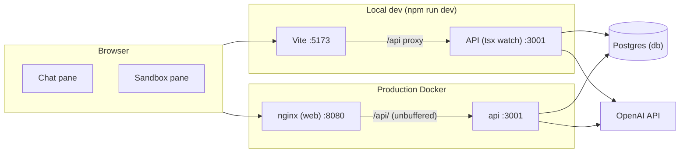

# Architecture

This repo is a **Vite + TypeScript** browser app plus a **Fastify** API: a
two-column shell where the left pane chats with an OpenAI-backed agent (replies
stream over SSE) and the right pane is a sandbox preview. The API also owns a
**Postgres** database (Drizzle ORM). The browser bundle is built to `dist/` and
served by Vite in dev or nginx in production; the API is bundled to
`server-dist/` and runs under Node.

Related: [Plans](./plans/) · [Goals](./goals/) · [Milestones](./milestones/) · [Abandoned](./abandoned/) · [README](../README.md)

## Index

1. [Purpose](#1-purpose)
2. [User interface](#2-user-interface)
3. [Runtime shapes](#3-runtime-shapes)
4. [Repository layout](#4-repository-layout)
5. [Build and typecheck](#5-build-and-typecheck)
6. [Docker](#6-docker)

## 1. Purpose

- **Product direction:** chat with an agent on the left; show generated output in a sandbox on the right.
- **Today:**
  - The chat sends each message to `POST /api/agent/chat` and streams the agent's reply into the thread as it is generated. The agent runs on OpenAI (`AGENT_MODEL`, default `gpt-4.1`) and has **no tools yet**.
  - Conversations live **in memory** on the API server (one per page load, at most 500, least recently used forgotten first). Restarting the API resets them.
  - Postgres holds a `components` table (`name`, `spec`, `props_schema`). It has a repository (`DrizzleComponentRepository`) but **no HTTP routes** yet.
  - `GET /api/health` reports `{ ok, db, agent }`: whether Postgres answers and whether `OPENAI_API_KEY` is set.
  - The session dropdown is empty. The sandbox is a placeholder panel.
- **Develop** with the Vite dev server (HMR) on port **5173** and the API (`tsx watch`) on **3001**. Vite proxies `/api` to the API.
- **Run production** as nginx serving `dist/` and proxying `/api/` to the API container (port **8080** via Compose).

Node **24+** is required (`package.json` `engines`).

## 2. User interface

```
┌──────────────────────────────┬──────────────────────────────┐
│ [ session ▾ ]  (empty)       │                              │
├──────────────────────────────┤                              │
│  agent chat thread           │  empty sandbox panel         │
│  (user + streamed agent      │                              │
│   bubbles, notices, errors)  │                              │
├──────────────────────────────┤                              │
│ [ Message the agent…     ]   │                              │
│               [Send / Stop]  │                              │
└──────────────────────────────┴──────────────────────────────┘
```

| Region | DOM / class | Behaviour today |
|---|---|---|
| Session menu | `#session-select` in the chat header | Empty `<select>`; no options or handler |
| Chat thread | `.thread` | User bubble per message, then an agent bubble that fills as `text` events arrive. Tool calls/results, notices, and errors render as small lines |
| Composer | `.composer` | Enter sends (Shift+Enter newline). While a reply streams the button reads **Stop** and aborts the request, which stops the turn on the server |
| Sandbox | dashed panel in sandbox section | Empty; no iframe or generated UI yet |

Markup and chat rendering are in [src/main.ts](../src/main.ts). [src/agentClient.ts](../src/agentClient.ts) posts a turn and reads the SSE response with the parser in [src/sse.ts](../src/sse.ts). The wire types (`AgentChatRequest`, `AgentEvent`) are shared with the server in [shared/api.ts](../shared/api.ts). Styling uses Tailwind utilities ([src/style.css](../src/style.css) imports Tailwind).

## 3. Runtime shapes



| Mode | Command | Web | API | Default URL |
|---|---|---|---|---|
| Dev (Node) | `npm run dev` | Vite, source files | `tsx watch`, loads `.env.local` | http://localhost:5173 |
| Dev (Compose) | `docker compose up dev` | `dev` container, repo bind-mounted | `api-dev` container, repo bind-mounted | http://localhost:5173 |
| Preview | `npm run preview` | Vite, prebuilt `dist/` | none (start one with `npm run dev:api`) | http://localhost:4173 |
| Production | `docker compose up web --build` | nginx → `dist/` in image | `api` container (`Dockerfile.api`) | http://localhost:8080 |

**API startup.** [server/index.ts](../server/index.ts) builds the real adapters (Postgres client and repository, OpenAI LLM when `OPENAI_API_KEY` is set) and registers `/api/health` and `/api/agent`. With `NODE_ENV=production` it first applies the Drizzle migrations in `server/adapters/db/migrations` (relative to the working directory) and exits with status 1 if they fail. In development migrations are manual (`npm run db:migrate`) and the API starts even without Postgres (`"db": false` in health). Without a key the API still starts: health reports `"agent": false`, and a chat turn returns a single SSE `error` event asking for `OPENAI_API_KEY`. SIGINT/SIGTERM close the server and the Postgres pool.

**Configuration.** [server/config.ts](../server/config.ts) is the only server file that reads the environment. Every variable is listed in [.env.example](../.env.example): `API_PORT` (3001), `API_HOST` (`127.0.0.1`; `0.0.0.0` in containers), `LOG_LEVEL`, `OPENAI_API_KEY`, `AGENT_MODEL`, `DATABASE_URL`. `vite.config.ts` reads `API_PROXY_TARGET` (default `http://localhost:3001`).

**Agent.** [server/agent/loop.ts](../server/agent/loop.ts) runs a turn: it appends the user message to the conversation history ([server/agent/conversations.ts](../server/agent/conversations.ts)), calls the `AgentLlm` port, streams text as `text` events, and runs any tool calls through the `ToolRegistry`; the registry wired today is empty. Turns of one conversation run one at a time. If the server has forgotten a conversation the chat resumes, the agent sends a `notice` saying so.

Entry HTML is [index.html](../index.html). Browser code starts at [src/main.ts](../src/main.ts); the API starts at [server/index.ts](../server/index.ts).

## 4. Repository layout

```
genui-prototype/
├── docs/                      # plans, goals, milestones, abandoned (+ this file)
├── src/                       # browser app
│   ├── main.ts                # shell UI, chat rendering, composer handlers
│   ├── agentClient.ts         # POST /api/agent/chat and read the SSE stream
│   ├── sse.ts                 # SSE parser (+ sse.test.ts)
│   ├── style.css              # Tailwind import
│   └── vite-env.d.ts
├── server/                    # Fastify API
│   ├── index.ts               # composition root: adapters, routes, migrations, listen
│   ├── config.ts              # environment → config (only place secrets are read)
│   ├── routes/                # health.ts, agent.ts (SSE chat)
│   ├── agent/                 # loop, in-memory conversations, tool registry, OpenAI tool mapping
│   ├── ports/                 # AgentLlm, ComponentRepository interfaces
│   └── adapters/
│       ├── openai/            # OpenAILlm (streaming Chat Completions)
│       └── db/                # Drizzle client, schema, repository, migrate, migrations/
├── shared/                    # types used by both sides: api.ts (wire), components.ts
├── index.html
├── vite.config.ts             # dev/preview host and ports, /api proxy, `shared` alias
├── drizzle.config.ts          # drizzle-kit: schema, migrations folder, DATABASE_URL
├── tsconfig.json              # references app + node + server configs
├── tsconfig.app.json          # strict TS for src/
├── tsconfig.node.json         # TS for vite.config.ts
├── tsconfig.server.json       # TS for server/, shared/, drizzle.config.ts, tests
├── .env.example               # every server variable; copy to .env.local
├── Dockerfile                 # web: build stage + nginx
├── Dockerfile.api             # api: esbuild bundle + production deps + migrations
├── docker-compose.yml         # dev, api-dev, web, api, db
├── nginx.conf                 # SPA fallback + /api/ proxy
└── package.json
```

There is a single package (no monorepo). Runtime dependencies are the API's: `fastify`, `openai`, `drizzle-orm`, and `pg`. Everything else (Vite, TypeScript, Tailwind, tsx, esbuild, drizzle-kit, concurrently) is a dev dependency.

## 5. Build and typecheck

| Script | What it does |
|---|---|
| `npm run dev` | `concurrently` runs `dev:api` and `dev:web` |
| `npm run dev:web` | Vite dev server (`server.host: true` in [vite.config.ts](../vite.config.ts)) |
| `npm run dev:api` | `tsx watch` on `server/index.ts`, loading `.env.local` if it exists |
| `npm run build` | `tsc -b` then `vite build` → `dist/` |
| `npm run build:api` | esbuild bundles `server/index.ts` → `server-dist/index.mjs` (dependencies left external) |
| `npm run preview` | Serves `dist/` for a local smoke test |
| `npm run typecheck` | `tsc -b --noEmit` — app, Vite config, and server projects |
| `npm test` | Node's test runner via tsx over `server/**/*.test.ts` and `src/**/*.test.ts` |
| `npm run db:generate` | drizzle-kit: generate a migration from `server/adapters/db/schema.ts` |
| `npm run db:migrate` | drizzle-kit: apply migrations to `DATABASE_URL` |
| `npm run db:studio` | drizzle-kit Studio |

Vite bundles ESM from `src/main.ts`. Both Vite and the server resolve `shared/*` to [shared/](../shared/). Tests use fakes for the LLM and need no API key; the repository tests run only when `DATABASE_URL` is set (they apply migrations first) and are skipped otherwise.

## 6. Docker

**Dockerfile** (web, two stages):

1. **build** — `node:24-alpine`, `npm ci`, `npm run build`.
2. **runtime** — `nginx:1.27-alpine`, copies `dist/` and [nginx.conf](../nginx.conf).

**Dockerfile.api** (API, two stages):

1. **build** — `node:24-alpine`, `npm ci`, `npm run build:api`.
2. **runtime** — `node:24-alpine`, `npm ci --omit=dev`, then `server-dist/` and `server/adapters/db/migrations/` at the same relative paths under `/app`. `NODE_ENV=production`, `API_HOST=0.0.0.0`, `API_PORT=3001`; runs `node server-dist/index.mjs` as the `node` user. No TypeScript sources or dev dependencies are in the image.

[nginx.conf](../nginx.conf) proxies `/api/` to `http://api:3001` with buffering and caching off and a 300 s read timeout, so SSE events reach the browser as they are written. Everything else uses `try_files` so client-side routes fall back to `index.html`.

**docker-compose.yml**:

- **dev** — Node 24, repo mounted, runs `npm run dev:web -- --host 0.0.0.0 --port 5173` with `API_PROXY_TARGET=http://api-dev:3001`. Port **5173**. Starts once `api-dev` is healthy.
- **api-dev** — Node 24, repo mounted, runs `npm ci && npm run dev:api` with `API_HOST=0.0.0.0` and `DATABASE_URL` pointing at `db`. `OPENAI_API_KEY` and `AGENT_MODEL` come from the shell environment. Port **3001**. Starts once `db` is healthy; it is healthy when `/api/health` answers.
- **web** — builds `Dockerfile`, publishes container port 80 as **8080**. Starts after `api`.
- **api** — builds `Dockerfile.api`, `DATABASE_URL` pointing at `db`, OpenAI variables from the shell environment. No published port (reached through nginx). Starts once `db` is healthy and migrates it on start.
- **db** — `postgres:17-alpine`, user/password/database `genui`, data in the `pgdata` volume, `pg_isready` healthcheck. Publishes host port **5432**.

`dev` and `api-dev` share a `dev_node_modules` volume mounted over `/app/node_modules`, so the containers' Linux dependencies never overwrite the host's `node_modules`. Only `api-dev` runs `npm ci`; `dev` waits for it to be healthy, so the two never race on the install.

If host port 5432 (or 8080, 5173, 3001) is already taken, change the host side of that service's `ports` mapping (for example `"5433:5432"`), ideally in an uncommitted `docker-compose.override.yml` (write `ports: !override` there; Compose otherwise appends to the list). Containers reach Postgres as `db:5432` regardless; only host tools need `DATABASE_URL` pointed at the new port: `.env.local` for `npm run dev:api`, the shell environment for `npm run db:migrate` (drizzle-kit does not read `.env.local`).

[.dockerignore](../.dockerignore) keeps `node_modules`, `dist`, `server-dist`, `.git`, Markdown, and `*.local` files (such as `.env.local`) out of the build context.
