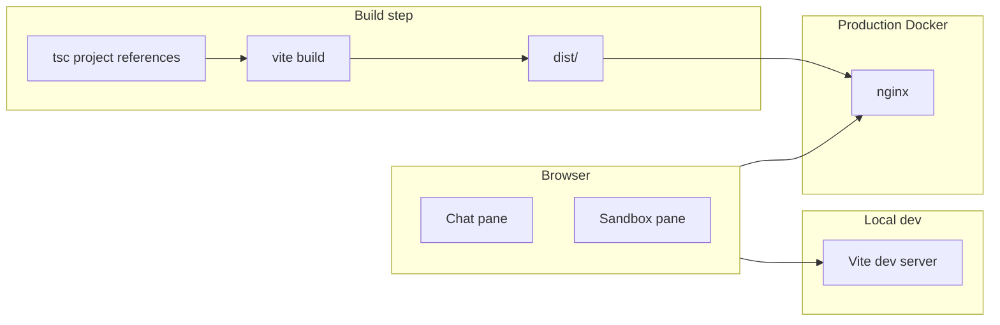

# Architecture

This repo is a **Vite + TypeScript** browser app: a two-column shell for an
agent chat and a sandbox preview. There is no backend, database, or API yet.
Static assets are built to `dist/` and served by Vite in dev or nginx in
production.

Related: [Plans](./plans/) · [Goals](./goals/) · [Milestones](./milestones/) · [Abandoned](./abandoned/) · [README](../README.md)

## Index

1. [Purpose](#1-purpose)
2. [User interface](#2-user-interface)
3. [Runtime shapes](#3-runtime-shapes)
4. [Repository layout](#4-repository-layout)
5. [Build and typecheck](#5-build-and-typecheck)
6. [Docker](#6-docker)

## 1. Purpose

- **Product direction:** chat with an agent on the left; show generated output in a sandbox on the right.
- **Today:** layout and local-only chat input (user messages append to the thread). The session dropdown is empty. The sandbox is a placeholder panel.
- **Develop** with Vite dev server (HMR) on port **5173**.
- **Ship** a static bundle under `dist/` (HTML, JS, CSS).
- **Run production** as nginx serving that bundle (port **8080** via Compose, or **80** in the container).

Node **24+** is required (`package.json` `engines`).

## 2. User interface

```
┌──────────────────────────────┬──────────────────────────────┐
│ [ session ▾ ]  (empty)       │                              │
├──────────────────────────────┤                              │
│  agent chat thread           │  empty sandbox panel         │
│  (user bubbles only)         │                              │
│                              │                              │
├──────────────────────────────┤                              │
│ [ Message the agent…     ]   │                              │
│                      [Send]  │                              │
└──────────────────────────────┴──────────────────────────────┘
```

| Region | DOM / class | Behaviour today |
|---|---|---|
| Session menu | `#session-select` in `.chat-toolbar` | Empty `<select>`; no options or handler |
| Chat thread | `.thread` | User submits via `.composer`; each message is a styled user bubble |
| Composer | `.composer` | Enter sends (Shift+Enter newline); no agent reply |
| Sandbox | dashed panel in sandbox section | Empty; no iframe or generated UI yet |

All markup is created in [src/main.ts](../src/main.ts). Layout and styling use Tailwind utilities ([src/style.css](../src/style.css) imports Tailwind). The page is a full-viewport two-column grid.

## 3. Runtime shapes



| Mode | Command | Serves from | Default URL |
|---|---|---|---|
| Dev (Node) | `npm run dev` | Vite, source files | http://localhost:5173 |
| Dev (Compose) | `docker compose up dev` | Same, repo bind-mounted | http://localhost:5173 |
| Preview | `npm run preview` | Vite, prebuilt `dist/` | http://localhost:4173 |
| Production | `docker compose up web --build` | nginx → `dist/` in image | http://localhost:8080 |

Entry HTML is [index.html](../index.html). Application code starts at [src/main.ts](../src/main.ts).

## 4. Repository layout

```
genui-prototype/
├── docs/                  # plans, goals, milestones, abandoned (+ this file)
├── src/
│   ├── main.ts            # shell UI + composer handlers
│   ├── style.css          # two-column layout
│   └── vite-env.d.ts
├── index.html
├── vite.config.ts         # dev/preview host and ports
├── tsconfig.json          # references app + node configs
├── tsconfig.app.json      # strict TS for src/
├── tsconfig.node.json     # TS for vite.config.ts
├── Dockerfile             # build stage + nginx
├── docker-compose.yml     # dev + web services
├── nginx.conf             # SPA fallback for static hosting
└── package.json
```

There is a single package (no monorepo). Dependencies are **dev-only**: Vite and TypeScript.

## 5. Build and typecheck

| Script | What it does |
|---|---|
| `npm run typecheck` | `tsc -b --noEmit` — app and Vite config project references |
| `npm run build` | `tsc -b` then `vite build` → `dist/` |
| `npm run dev` | Vite dev server (`server.host: true` in [vite.config.ts](../vite.config.ts)) |
| `npm run preview` | Serves `dist/` for a local smoke test |

Vite bundles ESM from `src/main.ts`. CSS is imported from TypeScript ([src/style.css](../src/style.css)).

## 6. Docker

**Dockerfile** (two stages):

1. **build** — `node:24-alpine`, `npm ci`, `npm run build`.
2. **runtime** — `nginx:1.27-alpine`, copies `dist/` and [nginx.conf](../nginx.conf).

[nginx.conf](../nginx.conf) uses `try_files` so client-side routes fall back to `index.html`.

**docker-compose.yml**:

- **dev** — Node 24, mount `.`, run `npm ci && npm run dev -- --host 0.0.0.0`. `CHOKIDAR_USEPOLLING=true` helps file watching on some hosts.
- **web** — Builds the Dockerfile and publishes container port 80 as **8080**.

[.dockerignore](../.dockerignore) keeps `node_modules`, `dist`, and `.git` out of the build context.
