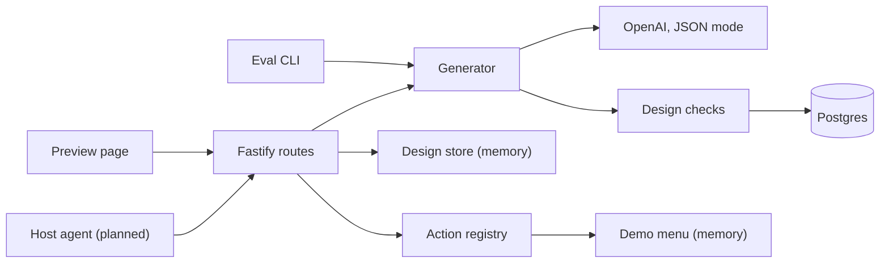
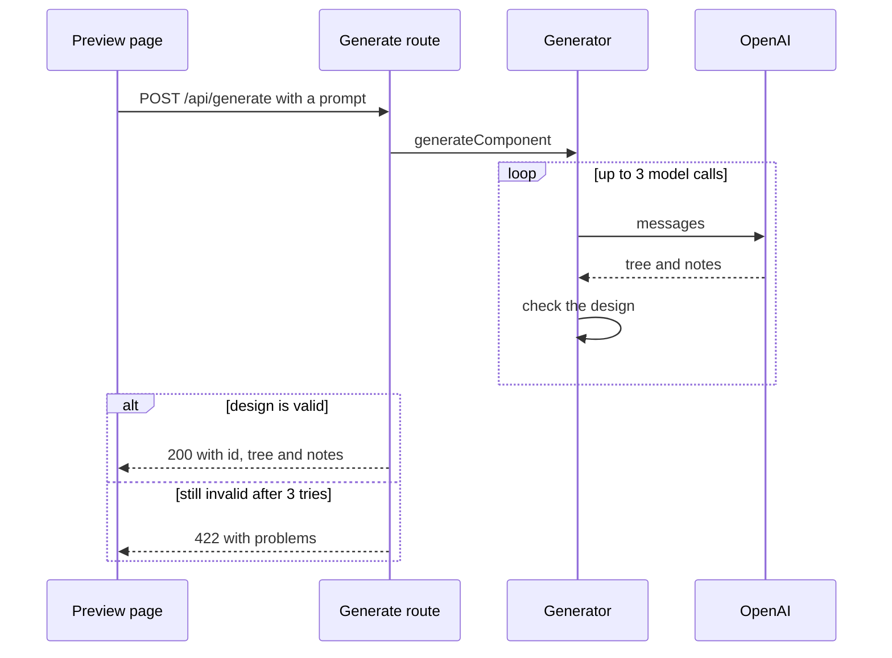

# genui-prototype

**Verified:** b8418f4ea0f3ebf09578100b6bad4cdb9051b1da · **Written:** 2026-10-25

## What this system is

A UI generator for a host agent. The planned CapheViet POS agent gives it a plain-language prompt and gets back a checked UI design as a JSON tree, plus short notes for the person. A Vite preview page draws the design in a sandbox and lets someone click its buttons, which run registered backend actions on a demo café menu. It is a prototype: no authentication, and nothing reaches a real POS.

## How it fits together

The generator makes one model call and up to two repairs, then returns a validated tree. Designs are remembered in memory so button clicks can be checked against them.

## The pieces

- **Entry and wiring:** `server/index.ts` builds the real adapters, applies migrations and the catalog seed in production, and listens.
- **Generate route:** `server/routes/generate.ts` validates the prompt, runs the generator under a 90-second cap, and remembers the design.
- **Action route:** `server/routes/actions.ts` runs the action a click names, with no model call.
- **Schema:** `server/adapters/db/schema.ts` defines the catalog and custom component tables.
- **Preview page:** the browser app in `src/`, which the docs describe as plain TypeScript with a sandbox renderer and a Components panel.
- **Eval harness:** `npm run eval` runs committed cases through the generator (`package.json`).

## A typical request

A missing key gives 503, a failed model call 502, and a client disconnect aborts without an answer.

## Data

Postgres holds the component catalog (copied from a file by the seed) and custom components with every saved version. Generated designs and the demo menu live only in API memory. Designs keep the newest 500, and the menu resets on every start.

## Outside systems

OpenAI Chat Completions, called once per attempt in JSON mode. Postgres is the only other service.

## How it runs

A Fastify API on Node 24 plus a Vite preview page. In development `npm run dev` starts both; production uses Docker, with an nginx web image proxying `/api` to the API image. The production API migrates and seeds on start and exits if either fails. CI is a single GitHub Actions workflow.

## Decisions and tradeoffs

The project began as a streaming chat agent with conversations, traces in a second database, and Redis. It became a one-call generator, and the chat pane, the agent loop, the SSE stream, trace storage and Redis were removed. Per-IP rate limits are kept in process memory, so each API instance counts on its own.

## Limits and risks

- There is no authentication: anyone who can reach the API can generate designs, and anyone with a design id can run its actions.
- Designs are lost on restart, after which clicks answer 409.
- Custom components can only be deleted, restored or reverted, not created.
- Prompts are capped at 4000 characters and bodies at 32 KB.

## Sources

- README.md
- docs/ARCHITECTURE.md
- package.json
- server/index.ts
- drizzle.config.ts
- Dockerfile
- server/routes/generate.ts
- server/routes/actions.ts
- server/adapters/db/schema.ts
