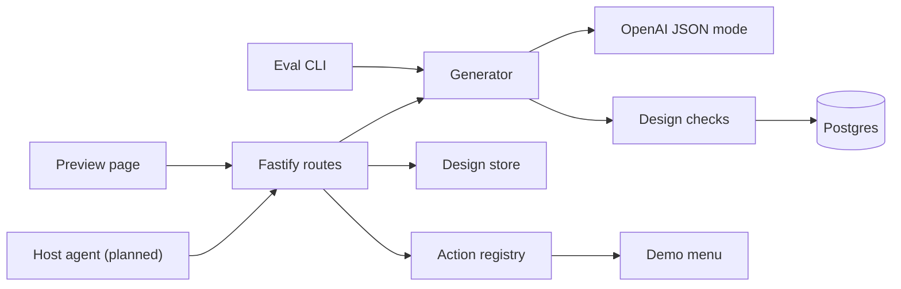
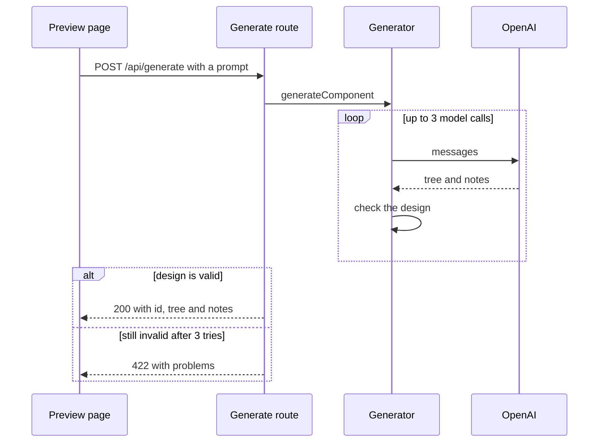

# genui-prototype

**Verified:** 0fd56510f85ce21a7356f8ea5a625f3000c39aac · **Written:** 2026-11-02

## What this system is

A UI generator for a host agent. The planned CapheViet POS agent will call `generate_ui` with a plain-language prompt and receive a validated UI design as a JSON component tree, plus short notes for the person. A Vite preview page draws each design in a sandbox, runs registered backend actions when buttons are clicked, and lists saved custom components. Menu actions mutate an in-memory demo café menu only. The prototype has no authentication and nothing reaches a real POS.

## How it fits together

One OpenAI call plus up to two repairs produces an expanded, checked tree. The generate route stores it by id so action clicks are validated against that snapshot. Custom component definitions live in Postgres and expand into catalog trees at generation time.

## The pieces

- **Wiring:** `server/index.ts` builds Drizzle repositories, the OpenAI adapter, the in-memory demo menu, the action registry, and `buildApp` from `server/app.ts`, then listens; production migrates and seeds the catalog on start.
- **HTTP surface:** `server/app.ts` registers health, `POST /api/generate`, `POST /api/actions/run`, and `/api/custom-components` for the Components panel.
- **Generate route:** `server/routes/generate.ts` validates the prompt, runs generation under a 90-second cap, and remembers successful designs in `server/designs.ts` (newest 500).
- **Action route:** `server/routes/actions.ts` checks clicks against the stored tree, may ask confirm questions, runs handlers without a model call, and can return stale dropdown scopes after success.
- **Persistence:** `server/adapters/db/schema.ts` defines the component catalog table and custom component version tables; the catalog file is seeded into Postgres.
- **Preview:** `src/main.ts` hosts the chat transcript, prompt composer, and Components entry point; the sandbox renderer lives under `src/sandbox/`.
- **Eval:** `npm run eval` in `package.json` runs committed live cases through the same generator as the API (OpenAI required; not in CI).

## A typical request

Without `OPENAI_API_KEY` the generate route answers 503. A failed model call is 502; a forgotten design id on action run is 409.

## Data

Postgres holds the read-only component catalog (synced from a file by seed) and versioned custom component definitions. Generated UI trees and the demo menu exist only in API process memory: designs cap at 500 and vanish on restart; the menu resets to fixtures on every start.

## Outside systems

OpenAI Chat Completions in JSON mode, one call per generation attempt. Postgres 17 for catalog and custom components. No other outbound services in the default wiring.

## Access

There is no authentication. Anyone who can reach the API may generate designs; anyone who knows a design id may run its actions, including menu mutations on the shared demo menu. Rate limits apply per client IP in process memory on generate, actions, and custom-component routes.

## How it runs

Node 24: a Fastify API (default port 3001) and a Vite preview page (5173). `npm run dev` runs both locally with Postgres via Compose. Production Compose builds a nginx `Dockerfile` web image on port 8080 that proxies `/api` to the bundled API image (`Dockerfile.api`); the API migrates and seeds on start. GitHub Actions CI runs typecheck, tests, and both builds against Postgres 17.

## Decisions and tradeoffs

The project replaced a streaming chat agent (SSE, conversations, trace Postgres, Redis, agent-defined custom components) with a one-call generator: the design store, deterministic action route, Components panel, and eval harness remain. Per-IP rate limits stayed in memory, so each API instance counts separately. Eval uses the live model and is kept out of CI.

## Limits and risks

Prompts cap at 4000 characters; generate and action bodies at 32 KB. Generations time out at 90 seconds after up to three model calls. Custom components can be deleted, restored, or reverted in the panel but not created over HTTP yet. Menu actions cannot show current item values and do not persist past restart. No auth means knowing a design id is enough to run its actions.

## Sources

- README.md
- docs/ARCHITECTURE.md
- package.json
- server/index.ts
- server/app.ts
- server/designs.ts
- server/routes/generate.ts
- server/routes/actions.ts
- server/adapters/db/schema.ts
- drizzle.config.ts
- Dockerfile
- docker-compose.yml
- .github/workflows/ci.yml
- src/main.ts
- docs/debrief.md
