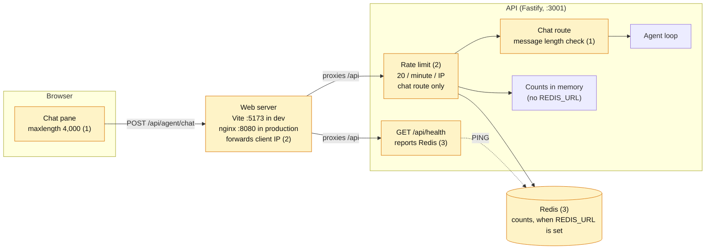
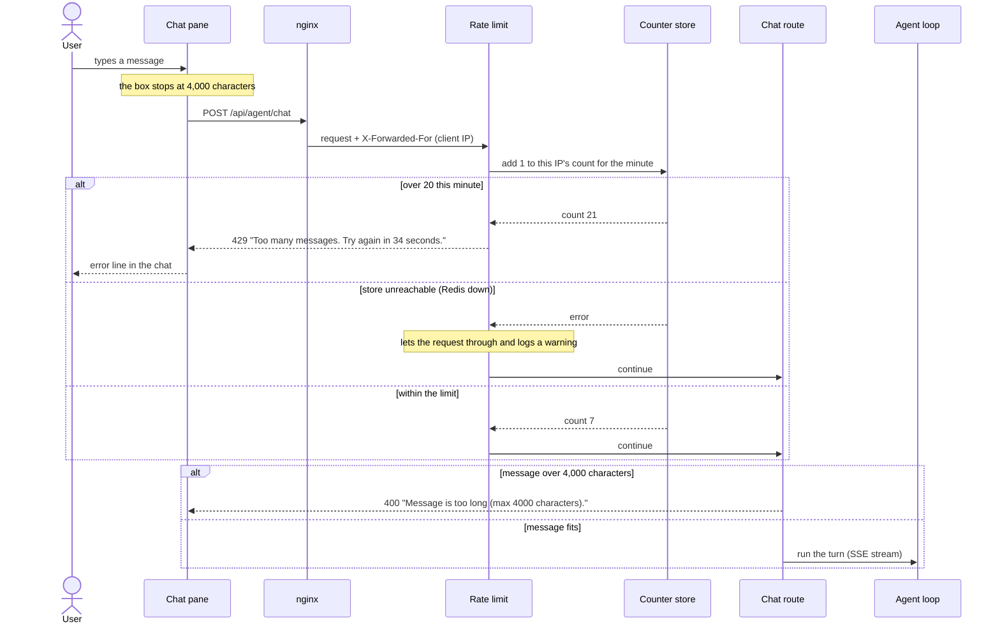

# Plan: Request limits

Cap how long a chat message can be and how often each client can send one, so nobody can run up the OpenAI bill or flood the API. Rate-limit counters can live in memory or, when configured, in Redis.

**Status:** not started · **Builds on:** the agent API and the per-turn limits in `server/agent/guardrails.ts` (once they land)

Related: [Architecture](./ARCHITECTURE.md)

## Why

- **Every message costs money.** Each chat turn calls OpenAI at least once, and there is no login, so anyone who can reach the API can send as many turns as they like.
- **Messages have no size limit.** A huge message is sent to OpenAI as-is and then stays in the conversation's history, so every later turn pays for it again.
- **The per-turn limits only cover a single turn.** They cap tool calls and tokens per turn, but not how many turns a client sends.

## At a glance

| Step | Purpose | Result | Needs |
|---|---|---|---|
| [1. Message length](#step-1--message-length) | Stop oversized messages before they cost anything | 4,000-character cap in the chat box and on the server | — |
| [2. Per-IP rate limit](#step-2--per-ip-rate-limit) | Stop one client from sending too many turns | 20 messages a minute per IP, counted in memory | — |
| [3. Redis store](#step-3--redis-store) | Keep counts across restarts and multiple API instances | Counters in Redis when `REDIS_URL` is set | Step 2 |

Steps 1 and 2 can be built in parallel.

**Not in this plan:** limits on replies in progress at once, limits on conversation history size, per-user quotas (there's no login), a daily spend cap across all users, and blocking or banning clients.

## Target architecture

The highlighted boxes are new or changed. The number is the step that builds each one.

### A chat request, end to end

## Step 1 — Message length

**Purpose:** a message can be any size today, and it costs tokens on every later turn of the conversation. Cap it where the user types and again on the server.

**What it does:** the chat box stops accepting text at 4,000 characters, and the server rejects longer messages before the agent runs.

| Where | Limit | When exceeded |
|---|---|---|
| Chat box (`src/main.ts`) | `maxlength="4000"` on the textarea | The user can't type or paste past it |
| Chat route (`server/routes/agent.ts`) | 4,000 characters, after trimming | 400, `{ error: { message: "Message is too long (max 4000 characters)." } }` |
| Request body | 32 KB (Fastify `bodyLimit` on the chat route) | 413, before the body is parsed |

**Details that matter:**

- **One shared constant.** Put `MAX_MESSAGE_CHARS = 4000` in `shared/api.ts`, so the browser and server can't drift apart.
- **Both sides count the same way.** The textarea's `maxlength` and JavaScript's `string.length` both count UTF-16 code units, so a message the box accepts always passes the server. An emoji counts as 2.
- **The server check is the real guard.** The textarea limit is a convenience, and anyone can call the API directly.
- **The 400 needs no browser work.** `src/agentClient.ts` already shows an error response's `error.message` in the chat.
- **The 32 KB body limit** stops a giant body from being read into memory at all. That's 4,000 characters of worst-case UTF-8 plus the JSON around it, with room to spare.

**Done when:** route tests show that a 4,000-character message is accepted, a 4,001-character one gets the 400 and message above, and a body over 32 KB gets a 413. In the running app, the chat box stops at 4,000 characters.

## Step 2 — Per-IP rate limit

**Purpose:** one client can send unlimited turns, and each one costs money. Limit how many chat messages each IP address can send per minute.

**What it does:** each chat request adds 1 to its IP's count for the current minute. Past 20, the request is refused with a 429 until the minute is up. Nothing else is limited: health checks and static files never count.

| Setting | Value |
|---|---|
| Limit | 20 chat messages per minute per IP (`AGENT_RATE_LIMIT_PER_MINUTE`, default 20) |
| Applies to | `POST /api/agent/chat` only |
| Over the limit | 429 with a `Retry-After` header, and `{ error: { message: "Too many messages. Try again in 34 seconds." } }` |
| Counter store | In memory in the API process (step 3 adds Redis) |

**Details that matter:**

- **Use the official `@fastify/rate-limit` plugin** (v10 or later supports Fastify 5). Register it with `global: false` and turn it on only for the chat route through the route's `config.rateLimit`, so health checks are never limited.
- **The error must reach the chat in the shape it displays.** The plugin throws whatever `errorResponseBuilder` returns, so it goes through the API's existing error handler in `server/index.ts`, which already sends `{ error: { message } }` for any status below 500. Have the builder return `{ statusCode: 429, message }`, with the wait in seconds from `context.ttl` (milliseconds); `context.after` is a phrase like "1 minute". A test checks the final body, since this path is easy to get wrong.
- **nginx must forward the client's IP.** Today it doesn't, so in production every request would appear to come from nginx and all users would share one limit of 20. Two changes fix it:
  - Add `proxy_set_header X-Forwarded-For $proxy_add_x_forwarded_for;` to the `/api/` block in `nginx.conf`.
  - Add a `TRUST_PROXY` setting (number of proxy hops, default off) passed to Fastify's `trustProxy`. The production `api` service in `docker-compose.yml` sets it to `1`.
- **Why trusting one hop is safe:** only nginx can reach the production API, since Compose doesn't publish its port. Turning on `TRUST_PROXY` for an API that clients can reach directly would let them fake their IP with their own `X-Forwarded-For` header.
- **In development, one IP for everyone.** Without `TRUST_PROXY`, every request through Vite counts as `127.0.0.1`. That's fine for one developer.
- **IPv6 addresses are grouped by /64,** the plugin's default, so one home network can't dodge the limit by cycling addresses.
- **It's a fixed window.** Counts reset at the end of each minute, so a client can send 20 at the end of one minute and 20 at the start of the next. That's acceptable for cost control.
- **The counts are per API process.** In memory, counts reset when the API restarts, and two API instances would each allow 20. Step 3 fixes that.

**Done when:**
- Route tests, using `app.inject` with different `remoteAddress` values, show:
  - the 21st message in a minute from one IP gets the 429, with `Retry-After` and the message above;
  - a second IP is still allowed;
  - `/api/health` is never limited.
- A test shows that with `TRUST_PROXY=1` the limit uses the `X-Forwarded-For` address.
- A manual run through `docker compose up web` logs the real client IP, not nginx's.

## Step 3 — Redis store

**Purpose:** in-memory counts reset on every restart or deploy, and aren't shared if the API ever runs as more than one instance. Store them in Redis when it's configured, so a client's count follows them across restarts and instances.

**What it does:** if `REDIS_URL` is set, the rate limiter keeps its counts in Redis. Otherwise it uses memory as in step 2. Nothing else changes: the limit, the responses and the routes stay the same.

### Should we use Redis?

| | In memory (step 2) | Redis (step 3) |
|---|---|---|
| Survives an API restart or deploy | No: everyone's count resets | Yes |
| Shared across API instances | No: each allows the full limit | Yes |
| Extra moving parts | None | A Redis service and the `ioredis` package |
| If the store fails | Can't fail | Requests are let through (see below) |
| Good for | One instance, local development | Production, and any time there's more than one instance |

**Recommendation:** build both, and choose with configuration. Development and tests need nothing new. Production runs Redis, so counts survive deploys, and adding a second API instance later needs no code change. Redis also gives future features (saved conversations, a daily spend cap) a shared place to keep counters.

**Details that matter:**

- **Client:** `@fastify/rate-limit` needs an `ioredis` client. Its defaults retry for a long time, which would hold up every chat request while Redis is down. Set short timeouts, as the plugin's docs recommend: `connectTimeout: 500`, `maxRetriesPerRequest: 1`, and `enableOfflineQueue: false`, so commands fail fast instead of queueing while disconnected.
- **If Redis is down, requests are let through** (`skipOnError: true`), and each failure logs a warning. The limiter protects cost, not security. Blocking every chat during a Redis outage would be worse than briefly losing the limit, and the per-turn limits still cap each turn.
- **The API starts without Redis,** just as it starts without Postgres, and reconnects when Redis comes up. Close the client on shutdown (the existing `onClose` hook).
- **Keys:** use the `nameSpace` `genui-rate-limit:`, so keys can't collide with anything else in that Redis. Each key expires on its own after its window, so nothing builds up.
- **Compose:** add a `redis` service (`redis:8-alpine`) with persistence off (`--save "" --appendonly no`), since counts only matter for a minute. Publish `6379` for local development, like Postgres's `5432`. The production `api` service gets `REDIS_URL=redis://redis:6379` and waits for Redis to be healthy.
- **Health:** `GET /api/health` adds `redis: true | false | null`: whether Redis answers a `PING`, or `null` when `REDIS_URL` isn't set. That shows whether limiting is working.
- **CI:** add a `redis` service and `REDIS_URL` to `.github/workflows/ci.yml`, next to Postgres. The Redis tests are skipped when `REDIS_URL` isn't set, the same way the database tests skip without `DATABASE_URL`.
- **Tests can't share counts.** Each Redis test run uses its own `nameSpace` (for example with a random suffix), so leftover counts from one run never affect the next.

**Done when:**
- With `REDIS_URL` set, the step 2 rate-limit tests pass against Redis, and the count survives building a new app instance on the same Redis.
- With Redis stopped, chat requests still succeed, a warning is logged, and health shows `redis: false`.
- Without `REDIS_URL`, everything behaves as in step 2, and health shows `redis: null`.
- CI runs the Redis tests.

## Docs and final checks

- `docs/ARCHITECTURE.md`: the rate limit and message length, Redis in the system overview and production diagrams, and the new settings in Configuration.
- `.env.example`: `AGENT_RATE_LIMIT_PER_MINUTE`, `TRUST_PROXY`, and `REDIS_URL`, commented, with defaults.
- `README.md`: how to start Redis locally (`docker compose up redis`), and that it's optional.
- `npm run typecheck`, `npm test`, `npm run build`, and `npm run build:api` pass.

## Decisions

**Decided**

- **Limit by IP.** There's no login, so the IP is the only identity a request has.
- **Only the chat route is limited.** It's the only route that costs money.
- **The official plugin over custom code.** It handles windows, headers and both stores, and it's maintained with Fastify.
- **Fail open when Redis is down.** Explained in step 3.
- **Memory by default, Redis by configuration.** Development needs nothing new, and production gets shared counts.

**Open**

- **The values are starting points.** 20 a minute and 4,000 characters may need tuning once people use it. The agent's per-turn usage log shows how much a typical turn costs.
- **Redis or Valkey.** Redis 8 is free to self-host under AGPLv3 (or two source-available licenses). Valkey is a drop-in, BSD-licensed fork that works with `ioredis` unchanged. Switching later is a one-line change to the image.
- **Shared IPs.** People behind one office or school network share a single limit. Revisit if that becomes a problem; login would fix it properly.
